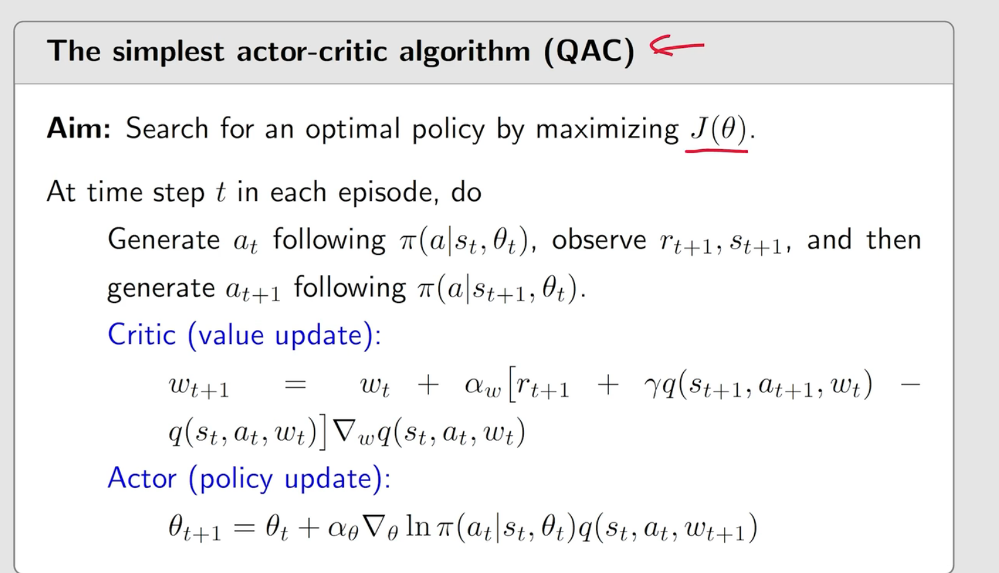
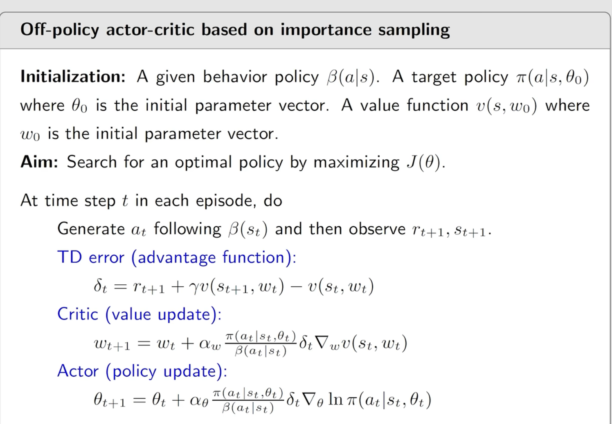
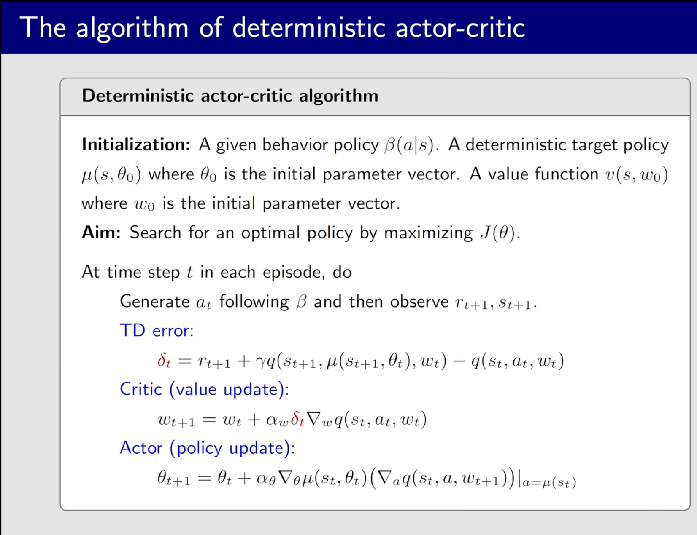

# 第 10 课 · Actor–Critic 方法

## 1. Introduction {#introduction}

Actor–Critic · Policy Gradient 与 Value Estimation

**Actor–Critic** 仍属于 **policy gradient methods**。它把策略梯度与基于价值的方法结合起来，用价值估计为策略梯度更新提供反馈。

What Are “Actor” and “Critic”?

- **Actor · Policy Update**。Actor 表示并更新策略 $\pi_\theta$。智能体在状态 $s$ 下按这个策略选择动作，所以称它为 actor。
- **Critic · Policy Evaluation / Value Estimation**。Critic 通过估计价值来评估当前策略。例如，动作价值 $q_{\pi_\theta}(s,a)$ 衡量在 $s$ 采取 $a$、随后按当前策略行动的期望回报。Critic 提供这样的评价，所以得名。

Actor 用当前策略与环境交互，Critic 从交互经验中评估该策略，Actor 再用评价结果更新策略参数。

上一课的 REINFORCE 用完整回合中的实际折扣回报估计动作价值。Actor–Critic 则可以用 Critic 学到的价值估计来构造策略更新。[第 9 课 · REINFORCE Algorithm](policy-gradient.md#reinforce-algorithm)

## 2. The Simplest Actor–Critic (QAC) {#qac}

### 2.1 From Policy Gradient to Actor and Critic {#qac-policy-gradient}

Review · 从目标函数到随机梯度更新

1. **Objective**。用标量 $J(\theta)$ 衡量策略表现，例如平均状态价值 $\bar v_\pi$ 或长期平均奖励 $\bar r_\pi$。
2. **Gradient ascent**。用 $\eta$ 表示归一化后的状态分布，令 $Z$ 为归一化前的权重总和，$\pi_t=\pi_{\theta_t}$ 为当前策略。在策略梯度等式成立时，动作价值的定义随目标而定。[第 9 课 · Gradients of the Metrics](policy-gradient.md#gradients-of-the-metrics)

$$
\begin{aligned}
\theta_{t+1}
&=\theta_t+\alpha\nabla_\theta J(\theta_t)\\
&=\theta_t+\alpha Z\,\mathbb E_{S\sim\eta,\,A\sim\pi_t(\cdot\mid S)}
\!\left[\nabla_\theta\ln\pi(A\mid S,\theta_t)\,q_{\pi_t}(S,A)\right].
\end{aligned}
$$

3. **Stochastic gradient ascent**。用抽到的 $(s_t,a_t)$ 代替期望中的随机变量，再用 $q_t(s_t,a_t)$ 估计未知的动作价值。以下沿用课件记法，把固定的正比例因子 $Z$ 并入步长。

$$
\theta_{t+1}
=\theta_t+\alpha\,\nabla_\theta\ln\pi(a_t\mid s_t,\theta_t)\,q_t(s_t,a_t).
$$

执行这条策略更新的是 **Actor**。估计 $q_t(s,a)$ 的算法是 **Critic**。

How to Estimate the Action Value?

- **Monte Carlo learning**。用完整回合的折扣回报 $G_t$ 估计 $q_{\pi_t}(s_t,a_t)$。上一课的 **REINFORCE** 就是这种 Monte Carlo policy gradient。
- **Temporal-difference learning**。用即时奖励和下一状态动作对的价值估计构造目标。QAC 的 Critic 用一步 TD，因此收到一条转移就可以更新。

### 2.2 QAC Algorithm {#qac-algorithm}

<figure>
  
</figure>

Critic (Value Update) · Sarsa with Function Approximation

第 $t$ 步在 $s_t$ 执行按策略选出的 $a_t$，观察 $r_{t+1}$ 和 $s_{t+1}$。若下一状态未终止，按课件在更新 $\theta_t$ 前从 $\pi(\cdot\mid s_{t+1},\theta_t)$ 抽取 $a_{t+1}$，形成 Sarsa 的一步 TD 目标。

$$
\begin{aligned}
\delta_t&=r_{t+1}+\gamma q(s_{t+1},a_{t+1},w_t)-q(s_t,a_t,w_t),\\
w_{t+1}&=w_t+\alpha_w\,\delta_t\,\nabla_w q(s_t,a_t,w_t).
\end{aligned}
$$

$w$ 是动作价值函数的参数，$\alpha_w$ 是 Critic 的学习率。半梯度更新只对当前预测 $q(s_t,a_t,w_t)$ 求导。终止转移的目标只取 $r_{t+1}$。[第 8 课 · Sarsa with Function Approximation](value-function-approximation.md#approximate-control)

Actor (Policy Update) · 用更新后的动作价值

课件先更新 Critic，再用 $q(s_t,a_t,w_{t+1})$ 对当前策略的 log-policy 梯度加权。$\alpha_\theta$ 是 Actor 的学习率。

$$
\theta_{t+1}
=\theta_t+\alpha_\theta\,\nabla_\theta\ln\pi(a_t\mid s_t,\theta_t)\,
q(s_t,a_t,w_{t+1}).
$$

QAC 中的 **Q** 指 Critic 学习动作价值 $q(s,a,w)$。Actor 的梯度由该动作价值加权，TD error $\delta_t$ 用于 Critic 的更新。

### 2.3 Why Is QAC On-policy? {#qac-on-policy}

Remarks · 同一策略负责采样和学习

- **On-policy**。这里的策略梯度期望本身按当前策略的状态访问分布和动作概率加权，所以用当前策略与环境交互。Critic 的 Sarsa 目标也用从该策略抽取的下一动作，评估的就是 Actor 正在改进的策略。
- **Exploration**。若 Actor 用 softmax 等随机策略，直接按动作概率采样就能探索，课件算法因此可以省去额外的 $\varepsilon$-greedy 动作选择。
- **Actor–Critic 的基本结构**。Critic 从新转移估计价值，Actor 用估计结果改进策略。沿用这套结构，可以更换价值估计方式或用不同的信号给策略梯度加权，得到其他 Actor–Critic 算法。

## 3. Advantage Actor–Critic (A2C) {#a2c}

从 QAC 扩展到 A2C 时，课件先引入 **baseline**，目的是降低梯度估计的方差。

### 3.1 Baseline Invariance {#baseline-invariance}

Baseline Invariance

固定当前策略 $\pi=\pi_{\theta_t}$。设 $S\sim\eta$，$A\sim\pi(\cdot\mid S)$，记 $g(S,A)=\nabla_\theta\ln\pi(A\mid S,\theta_t)$。对任意只依赖状态的标量 $b(S)$，策略梯度的期望项满足

$$
\mathbb E[g(S,A)q_\pi(S,A)]
=\mathbb E[g(S,A)(q_\pi(S,A)-b(S))].
$$

- 为什么减去 baseline 仍成立？
- 这样做对梯度估计有什么用？

Why Is It Valid?

证明从被减去的 baseline 项出发。用 $\pi\nabla_\theta\ln\pi=\nabla_\theta\pi$，并把 $b(s)$ 提出动作求和。

$$
\begin{aligned}
\mathbb E[g(S,A)b(S)]
&=\sum_s\eta(s)\sum_a\pi(a\mid s,\theta_t)g(s,a)b(s)\\
&=\sum_s\eta(s)\sum_a\nabla_\theta\pi(a\mid s,\theta_t)b(s)\\
&=\sum_s\eta(s)b(s)\sum_a\nabla_\theta\pi(a\mid s,\theta_t)\\
&=\sum_s\eta(s)b(s)\nabla_\theta\sum_a\pi(a\mid s,\theta_t)\\
&=\sum_s\eta(s)b(s)\nabla_\theta 1=0.
\end{aligned}
$$

这里求导只作用在动作概率上。若状态权重的归一化引入了比例因子，它同时乘在等式两边。

### 3.2 Choosing a Baseline {#choosing-a-baseline}

Why Is the Baseline Useful?

令 $X=g(S,A)(q_\pi(S,A)-b(S))$，$\bar x=\mathbb E[X]$。上一节的等式说明 $\bar x$ 对 $b$ 不变，但单个样本的梯度估计会随 $b$ 改变。用协方差矩阵的迹衡量各参数梯度分量的总方差，有

$$
\begin{aligned}
\operatorname{tr}(\operatorname{Cov}(X))
&=\mathbb E[X^\top X]-\bar x^\top\bar x,\\
\mathbb E[X^\top X]
&=\mathbb E\!\left[g(S,A)^\top g(S,A)(q_\pi(S,A)-b(S))^2\right]\\
&=\mathbb E\!\left[\|g(S,A)\|^2(q_\pi(S,A)-b(S))^2\right].
\end{aligned}
$$

例如，当动作价值的量级远小于 $10^6$，且策略梯度非零时，取 $b(s)=10^6$ 会把二阶矩放大。

Our Goal · Minimize the Variance

选择 $b$ 使总方差最小。这样，用单个样本估计 $\mathbb E[X]$ 时，梯度估计的整体波动更小。

前面介绍的基础 **REINFORCE** 和 **QAC** 都相当于取 $b(s)=0$。零 baseline 对应的方差取决于任务和策略，是否最优需要和其他选择比较。

Optimal Baseline · 用梯度范数平方加权

由于 $\bar x$ 固定，可以直接最小化二阶矩。固定状态 $s$，令 $c(s,a)=\|g(s,a)\|^2$，记 $\mathbb E_{A\mid s}$ 为按 $\pi(\cdot\mid s)$ 对动作取期望。对 $b$ 求一阶导数

$$
\frac{\partial}{\partial b}\,
\mathbb E_{A\mid s}\!\left[c(s,A)(q_\pi(s,A)-b)^2\right]
=2\,\mathbb E_{A\mid s}[c(s,A)(b-q_\pi(s,A))].
$$

在有正状态权重且 $\mathbb E_{A\mid s}[c(s,A)]>0$ 的状态，令上式等于零，得到最小化总方差的 baseline。若该分母为零，该状态的样本梯度为零，任选 baseline 都给出相同的方差。

$$
b^*(s)
=\frac{\mathbb E_{A\mid s}\!\left[c(s,A)q_\pi(s,A)\right]}
{\mathbb E_{A\mid s}[c(s,A)]}.
$$

最优式要计算每个动作的梯度范数。课件随后省去这个权重，直接按策略对动作价值取平均。[Greensmith 等 · Variance Reduction in Reinforcement Learning](https://www.jmlr.org/papers/volume5/greensmith04a/greensmith04a.pdf)

$$
b(s)=\mathbb E_{A\mid s}[q_\pi(s,A)]=v_\pi(s).
$$

这就得到状态价值 baseline。加权均值与普通均值相等时，它也能达到上述最小方差。

### 3.3 Advantage-weighted Policy Update {#advantage-policy-update}

Advantage Function · 动作相对当前策略的价值

取 $b(s)=v_\pi(s)$，定义 **advantage function**。课件记为 $\delta_\pi(s,a)$，其值表示选择 $a$ 后继续按 $\pi$ 行动，相比从一开始就按 $\pi$ 抽取动作，期望回报高出多少。优势为正表示高于该状态下的策略平均水平，为负表示低于平均水平。

$$
\delta_\pi(s,a)=q_\pi(s,a)-v_\pi(s).
$$

在期望形式和随机形式中分别代入真实优势及其估计。沿用课件记法，把状态权重带来的固定比例因子并入步长。

$$
\begin{aligned}
\theta_{t+1}
&=\theta_t+\alpha\,\mathbb E[g(S,A)(q_\pi(S,A)-v_\pi(S))]\\
&=\theta_t+\alpha\,\mathbb E[g(S,A)\delta_\pi(S,A)].
\end{aligned}
$$

$$
\begin{aligned}
\theta_{t+1}
&=\theta_t+\alpha\,g(s_t,a_t)[q_t(s_t,a_t)-v_t(s_t)]\\
&=\theta_t+\alpha\,g(s_t,a_t)\delta_t(s_t,a_t).
\end{aligned}
$$

Effective Step Size · 用相对价值调节更新

用 log-derivative 恒等式把后一条更新写成沿动作概率梯度移动。

$$
\begin{aligned}
\theta_{t+1}
&=\theta_t+\alpha
  \frac{\nabla_\theta\pi(a_t\mid s_t,\theta_t)}
       {\pi(a_t\mid s_t,\theta_t)}\,\delta_t(s_t,a_t)\\
&=\theta_t+
  \underbrace{\alpha\frac{\delta_t(s_t,a_t)}{\pi(a_t\mid s_t,\theta_t)}}_{\text{effective step size}}
  \nabla_\theta\pi(a_t\mid s_t,\theta_t).
\end{aligned}
$$

优势估计的符号决定更新方向，正优势在足够小的步长下提高所采动作的概率，负优势则降低它。随机策略提供探索，高于平均水平的动作获得强化。分母反映该动作被采到的概率，实际更新量还取决于概率梯度。

### 3.4 One-step TD Actor–Critic {#a2c-algorithm}

Estimating the Advantage with TD Error

由动作价值的一步 Bellman 方程，真实状态价值下的一步 TD error 在给定状态和动作时，条件期望恰好等于真实优势。

$$
\begin{aligned}
q_\pi(s,a)
&=\mathbb E_\pi[R_{t+1}+\gamma v_\pi(S_{t+1})\mid S_t=s,A_t=a],\\
\delta_\pi(s,a)
&=\mathbb E_\pi[R_{t+1}+\gamma v_\pi(S_{t+1})-v_\pi(s)
\mid S_t=s,A_t=a].
\end{aligned}
$$

用 Critic 当前的估计 $v(s,w_t)$ 代入，得到单步样本 $\delta_t=r_{t+1}+\gamma v(s_{t+1},w_t)-v(s_t,w_t)$。估计的状态价值有误差时，$\delta_t$ 的条件期望也可能偏离真实优势。这个办法让 Critic 只需学习一个状态价值函数，便可从转移样本计算优势信号。

<figure>
  
</figure>

TD Error · Critic Update · Actor Update

每个回合的第 $t$ 步按 $\pi(\cdot\mid s_t,\theta_t)$ 抽取 $a_t$，观察 $r_{t+1},s_{t+1}$。先用更新前的 $w_t$ 算出 $\delta_t$，再把同一个数值用于两次更新。

$$
\begin{aligned}
\delta_t&=r_{t+1}+\gamma v(s_{t+1},w_t)-v(s_t,w_t),\\
w_{t+1}&=w_t+\alpha_w\delta_t\,\nabla_w v(s_t,w_t),\\
\theta_{t+1}&=\theta_t+\alpha_\theta\delta_t\,\nabla_\theta\ln\pi(a_t\mid s_t,\theta_t).
\end{aligned}
$$

这里 $\alpha_w$ 和 $\alpha_\theta$ 分别是 Critic 和 Actor 的学习率。Critic 用 $\delta_t$ 修正状态价值，Actor 把它作为已采样动作的优势估计。终止转移取下一状态价值为零。这个版本用正在优化的策略采集数据，因此是 **on-policy**。直接按随机策略采样即可探索，可以省去额外的 $\varepsilon$-greedy 动作选择。

## 4. Off-policy Actor–Critic {#off-policy-actor-critic}

### 4.1 Introduction {#off-policy-introduction}

Introduction

- **前面的策略梯度更新是 on-policy。**
  - **为什么？** 沿用课件的简写，$\nabla_\theta J(\theta)=\mathbb E_{S\sim\eta,\,A\sim\pi(\cdot\mid S)}[\ast]$。直接用样本估计这个期望时，动作来自正在优化的策略 $\pi$。

- **能否改成 off-policy？**
  - 可以，用 **importance sampling（重要性采样）**。
  - 重要性采样也可用于其他期望估计问题，例如用一个分布的样本来估计另一个分布下的期望。

### 4.2 Importance Sampling {#importance-sampling}

Importance Sampling · 用另一个分布的样本估计期望

要估计的是目标分布 $p_0$ 下的期望 $\mathbb E_{X\sim p_0}[X]$，手中的样本却来自 $p_1$。假设 $p_1$ 覆盖 $p_0$，即 $p_0(x)>0$ 时有 $p_1(x)>0$。对离散情形，把原来的求和写成 $p_1$ 加权的形式。

$$
\begin{aligned}
\mathbb E_{X\sim p_0}[X]
&=\sum_x p_0(x)x\\
&=\sum_{x:\,p_1(x)>0}p_1(x)\underbrace{\frac{p_0(x)}{p_1(x)}x}_{f(x)}\\
&=\mathbb E_{X\sim p_1}[f(X)].
\end{aligned}
$$

**怎样估计 $\mathbb E_{X\sim p_1}[f(X)]$？** 从 $p_1$ 独立抽取 $X_1,\ldots,X_n$，对变换后的值取样本均值。

$$
\bar f=\frac1n\sum_{i=1}^n f(X_i),
\qquad X_i\overset{\mathrm{i.i.d.}}{\sim}p_1.
$$

样本均值的期望等于目标期望。若 $f(X)$ 在 $p_1$ 下的方差有限，独立采样使方差缩小为单个样本的 $1/n$。

$$
\begin{aligned}
\mathbb E[\bar f]&=\mathbb E_{X\sim p_1}[f(X)],\\
\operatorname{Var}(\bar f)&=\frac1n\operatorname{Var}_{X\sim p_1}(f(X)).
\end{aligned}
$$

Importance Weight · 样本权重怎么解释？

把实际抽到的样本 $x_1,\ldots,x_n$ 代入，得到课件中的估计式。

$$
\mathbb E_{X\sim p_0}[X]
\approx \bar f
=\frac1n\sum_{i=1}^n f(x_i)
=\frac1n\sum_{i=1}^n\frac{p_0(x_i)}{p_1(x_i)}x_i.
$$

$\frac{p_0(x_i)}{p_1(x_i)}$ 称为 **importance weight（重要性权重）**。

- 若 $p_0(x_i)=p_1(x_i)$，该样本的权重为 $1$。若所有样本的权重都为 $1$，$\bar f$ 就是普通样本均值 $\bar x$。
- 若 $p_0(x_i)>p_1(x_i)$，这个值在目标分布下更常出现。权重大于 $1$，补偿它在实际采样中较少出现的频率。
- 若 $p_0(x_i)<p_1(x_i)$，权重小于 $1$，该样本对估计的贡献相应减小。

You May Ask · 既然能算出概率，为什么还要采样？

**问题。** 估计式已经需要计算 $p_0(x_i)$。既然给定 $x$ 就能算出 $p_0(x)$，为什么还要估计期望？

**回答。** 逐点计算概率或密度，与对整个分布求和或积分，计算量可以相差很大。重要性采样只需要在抽到的样本处计算概率比。

- 对连续变量，直接求期望涉及积分。
- $p_0$ 的表达式可能很复杂。有时可以用神经网络计算给定输入的概率或密度，整个分布的期望仍难以直接计算。

### 4.3 The Theorem of Off-policy Policy Gradient {#off-policy-policy-gradient-theorem}

Behavior Policy · Target Policy · Objective

和 on-policy 情形一样，先确定策略优化的目标，再求它的梯度。

- **行为策略 $\beta$**（behavior policy）负责与环境交互，生成经验样本。
- **目标策略 $\pi_\theta$**（target policy）用这些样本来更新。在奖励设定下，目标是最大化

$$
J(\theta)
=\sum_{s\in\mathcal S}d_\beta(s)v_{\pi_\theta}(s)
=\mathbb E_{S\sim d_\beta}[v_{\pi_\theta}(S)].
$$

$d_\beta$ 是行为策略的平稳状态分布。可以把这个指标理解为从 $d_\beta$ 选择起点，再按目标策略行动时的期望折扣回报。求 $\theta$ 的梯度时，行为策略 $\beta$ 固定。

Theorem · Off-policy Policy Gradient Theorem

在折扣情形 $\gamma\in(0,1)$ 下，令 $\rho(s)$ 为从 $S_0\sim d_\beta$ 出发、随后按 $\pi_\theta$ 行动的折扣状态访问权重。把它归一化为 $\tilde\rho$ 后，梯度可写为

$$
\nabla_\theta J(\theta)
=\frac{1}{1-\gamma}
\mathbb E_{S\sim\tilde\rho,\,A\sim\beta(\cdot\mid S)}
\!\left[
\frac{\pi(A\mid S,\theta)}{\beta(A\mid S)}
\,\nabla_\theta\ln\pi(A\mid S,\theta)\,q_\pi(S,A)
\right].
$$

$$
\rho(s)=\sum_{k=0}^{\infty}\gamma^k
  \Pr_{S_0\sim d_\beta,\,\pi_\theta}(S_k=s),
\qquad
\tilde\rho(s)=(1-\gamma)\rho(s).
$$

动作 $A$ 从 $\beta(\cdot\mid S)$ 抽取，概率比 $\pi(A\mid S,\theta)/\beta(A\mid S)$ 把动作的期望还原到目标策略下。这要求 $\beta$ 覆盖 $\pi$ 的动作，即 $\pi(a\mid s,\theta)>0$ 时 $\beta(a\mid s)>0$。状态仍按上式的折扣访问权重计入。

课件的简写把 $\rho$ 放在期望下标。教材定义的 $\rho$ 是总和为 $1/(1-\gamma)$ 的权重，所以写成概率分布 $\tilde\rho$ 下的期望时，式外要乘回这一系数。证明见教材 §10.3.2 的 Box 10.2。[《强化学习的数学原理》教材](https://raw.githubusercontent.com/MathFoundationRL/Book-Mathematical-Foundation-of-Reinforcement-Learning/refs/heads/main/Book-all-in-one.pdf)

### 4.4 The Algorithm of Off-policy Actor–Critic {#off-policy-actor-critic-algorithm}

Baseline Invariance · 选取状态价值作为基准

Off-policy 策略梯度也可以减去只依赖状态的 baseline $b(s)$。以下期望沿用上一节的 $S\sim\tilde\rho$ 和 $A\sim\beta(\cdot\mid S)$。

$$
\nabla_\theta J(\theta)=
\frac{1}{1-\gamma}\mathbb E\!\left[
\frac{\pi(A\mid S,\theta)}{\beta(A\mid S)}
\nabla_\theta\ln\pi(A\mid S,\theta)
\big(q_\pi(S,A)-b(S)\big)
\right].
$$

给定 $S=s$，对动作取期望时，重要性权重把 $\beta$ 下的动作求和换回 $\pi$ 下的动作求和。于是 baseline 项化为 $b(s)\nabla_\theta\sum_a\pi(a\mid s,\theta)=0$。

为减小估计方差，课件取 $b(S)=v_\pi(S)$。括号里的差值就成为目标策略的 advantage。

$$
\nabla_\theta J(\theta)=
\frac{1}{1-\gamma}\mathbb E\!\left[
\frac{\pi(A\mid S,\theta)}{\beta(A\mid S)}
\nabla_\theta\ln\pi(A\mid S,\theta)
\big(q_\pi(S,A)-v_\pi(S)\big)
\right].
$$

Stochastic Gradient Ascent · 从 Advantage 到 TD Error

写成单样本更新时，将固定系数 $1/(1-\gamma)$ 并入 Actor 的步长 $\alpha_\theta$。令 $q_t$ 和 $v_t$ 分别表示对目标策略的动作价值和状态价值的估计。

$$
\theta_{t+1}=\theta_t+\alpha_\theta
\frac{\pi(a_t\mid s_t,\theta_t)}{\beta(a_t\mid s_t)}
\nabla_\theta\ln\pi(a_t\mid s_t,\theta_t)
\big(q_t(s_t,a_t)-v_t(s_t)\big).
$$

与 on-policy A2C 一样，用一步 TD error 估计 advantage。

$$
q_t(s_t,a_t)-v_t(s_t)
\approx
\underbrace{r_{t+1}+\gamma v_t(s_{t+1})-v_t(s_t)}_{\delta_t}.
$$

把 $\delta_t$ 代入，再用 $\pi\nabla_\theta\ln\pi=\nabla_\theta\pi$，得到课件的两种等价写法。

$$
\begin{aligned}
\theta_{t+1}
&=\theta_t+\alpha_\theta
\frac{\pi(a_t\mid s_t,\theta_t)}{\beta(a_t\mid s_t)}
\,\delta_t\,\nabla_\theta\ln\pi(a_t\mid s_t,\theta_t)\\
&=\theta_t+\alpha_\theta
\frac{\delta_t}{\beta(a_t\mid s_t)}
\,\nabla_\theta\pi(a_t\mid s_t,\theta_t).
\end{aligned}
$$

<figure>
  
</figure>

伪代码先按 $\beta$ 选动作，再用 $v(\cdot,w_t)$ 计算 TD error。**Critic 和 Actor 都乘同一个动作概率比** $\pi(a_t\mid s_t,\theta_t)/\beta(a_t\mid s_t)$。Critic 借此把给定状态下的 TD 更新校正到目标策略，Actor 用校正后的优势信号更新 $\theta$。终止转移取下一状态价值为零。[教材 §10.3.3 · Algorithm 10.3](https://raw.githubusercontent.com/MathFoundationRL/Book-Mathematical-Foundation-of-Reinforcement-Learning/refs/heads/main/Book-all-in-one.pdf)

**与定理的关系。** 定理中的状态分布是 $\tilde\rho$。若直接用行为策略轨迹逐步更新，长期状态分布是 $d_\beta$。图中概率比只校正动作分布。因此当 $d_\beta$ 与 $\tilde\rho$ 不同时，这个简单版本用的是近似梯度。

## 5. Deterministic Actor–Critic (DPG) {#deterministic-actor-critic}

### 5.1 Introduction {#dpg-introduction}

Introduction

到目前为止，前面讨论的策略梯度方法都用了 **stochastic policy（随机策略）**。以离散动作的 softmax 策略为例，每个可用动作都满足 $\pi(a\mid s,\theta)>0$，智能体按这些概率抽取动作。

**策略梯度方法能不能用 deterministic policy（确定性策略）？**

- 可以。确定性策略给定状态就直接输出一个动作，记为 $a=\mu(s,\theta)$。
- 这样可以直接输出连续动作，例如一个实数或一个实数向量。

### 5.2 The Theorem of Deterministic Policy Gradient {#deterministic-policy-gradient-theorem}

The Ways to Represent a Policy

- 对离散动作，$\pi(a\mid s,\theta)\in[0,1]$ 表示动作概率。它也能表示确定性策略，此时每个状态下有一个动作的概率为 $1$。
- 课件用 $\mu$ 专门表示确定性策略。它把状态 $s$ 映射到一个动作 $a$，即 $\mu:\mathcal S\to\mathcal A$。

$$
a=\mu(s,\theta)\doteq\mu(s).
$$

- 可以用神经网络表示 $\mu$。网络以 $s$ 为输入，以 $\theta$ 为参数，直接输出 $a$。固定参数时，简写为 $\mu(s)$。

Why Do We Need a New Policy Gradient Theorem?

前面的随机策略梯度用 $\nabla_\theta\ln\pi(a\mid s,\theta)$。对于连续动作下的确定性策略，给定状态后的全部概率集中在 $a=\mu(s,\theta)$，无法直接沿用这个对数密度梯度。接下来求的是参数变化如何通过动作输出 $\mu(s,\theta)$ 影响回报。

Objective · Average State Value

在折扣情形下，课件以初始状态分布 $d_0$ 对状态价值取平均。

$$
J(\theta)
=\mathbb E_{S_0\sim d_0}[v_\mu(S_0)]
=\sum_{s\in\mathcal S}d_0(s)v_\mu(s).
$$

$d_0$ 满足 $\sum_s d_0(s)=1$，选取时令它独立于 $\mu$，因此求导时只需对状态价值求导。课件列出两种常见选择。

1. **固定起点 $s_0$**。取 $d_0(s_0)=1$，其他状态取 $0$，此时 $J(\theta)=v_\mu(s_0)$。
2. **行为策略的平稳分布**。给定用于采集数据的行为策略 $\beta$，可令 $d_0=d_\beta$。从这个分布起步后，$v_\mu$ 仍按目标策略 $\mu$ 评价未来回报。

Theorem · Deterministic Policy Gradient in the Discounted Case

设 $\gamma\in(0,1)$，策略对参数可微，动作价值对动作可微，且满足定理的正则条件。令 $\rho_\mu(s)$ 为从 $S_0\sim d_0$ 出发、按 $\mu$ 行动的折扣访问权重，$\tilde\rho_\mu$ 为归一化后的状态分布。

$$
\rho_\mu(s)=\sum_{k=0}^{\infty}\gamma^k\Pr_{d_0,\mu}(S_k=s),
\qquad
\tilde\rho_\mu(s)=(1-\gamma)\rho_\mu(s).
$$

$$
\begin{aligned}
\nabla_\theta J(\theta)
&=\sum_s \rho_\mu(s)\,\nabla_\theta\mu(s,\theta)\,
  \left.\nabla_a q_\mu(s,a)\right|_{a=\mu(s,\theta)}\\
&=\frac{1}{1-\gamma}\,
  \mathbb E_{S\sim\tilde\rho_\mu}
  \!\left[\nabla_\theta\mu(S,\theta)\,
  \left.\nabla_a q_\mu(S,a)\right|_{a=\mu(S,\theta)}\right].
\end{aligned}
$$

$\nabla_\theta\mu$ 的每一列是一个动作分量对 $\theta$ 的梯度。它把 Critic 给出的动作方向转换成 Actor 的参数方向。期望式保留了折扣访问权重归一化的系数。[Silver 等 · Deterministic Policy Gradient Theorem](https://proceedings.mlr.press/v32/silver14.pdf)

Why Is There No Expectation over Actions?

给定 $S=s$ 后，$\mu$ 已经确定了唯一动作 $a=\mu(s,\theta)$。因此只需先求 $q_\mu(s,a)$ 对 $a$ 的梯度，再在这个动作处取值，并用链式法则传回 $\theta$。动作已经由状态给定，外层只对状态取期望。

这使得 **off-policy** 实现可以让行为策略 $\beta$ 负责探索：Critic 用交互数据评估 $q_\mu$，Actor 在同一个状态上直接计算 $\mu(s,\theta)$。定理仍对 $\tilde\rho_\mu$ 取期望，若直接用行为策略的状态分布代替它，通常得到近似梯度。DPG 也可以用目标策略的状态样本做 on-policy 更新。[Silver 等 · On-Policy and Off-Policy Deterministic Actor–Critic](https://proceedings.mlr.press/v32/silver14.pdf)

### 5.3 The Algorithm of Deterministic Actor–Critic {#deterministic-actor-critic-algorithm}

Gradient Ascent · 从期望到单个状态样本

用上一个小节的策略梯度最大化 $J(\theta)$。令 $\mu_t=\mu(\cdot,\theta_t)$，沿用课件的更新写法，把固定系数 $1/(1-\gamma)$ 并入步长 $\alpha_\theta$。

$$
\theta_{t+1}
=\theta_t+\alpha_\theta
\mathbb E_{S\sim\tilde\rho_{\mu_t}}
\!\left[\nabla_\theta\mu(S,\theta_t)\,
\left.\nabla_a q_{\mu_t}(S,a)\right|_{a=\mu(S,\theta_t)}\right].
$$

用单个状态样本 $s_t$ 替代期望，得到随机梯度上升的形式。

$$
\theta_{t+1}
=\theta_t+\alpha_\theta\nabla_\theta\mu(s_t,\theta_t)\,
\left.\nabla_a q_{\mu_t}(s_t,a)\right|_{a=\mu(s_t,\theta_t)}.
$$

<figure>
  
</figure>

图中 Initialization 的 $v(s,w_0)$ 是记号笔误，后续的 TD error 和 Actor 更新用的是动作价值函数 $q(s,a,w)$，因此应初始化 $q(s,a,w_0)$。

- **TD error**。执行 $\beta$ 选出的 $a_t$，用 $q(s_t,a_t,w_t)$ 作为当前预测。下一状态的动作取目标策略输出 $\mu(s_{t+1},\theta_t)$。终止转移的目标只取 $r_{t+1}$。
- **Critic**。用 TD error 更新动作价值参数，得到 $w_{t+1}$。
- **Actor**。用更新后的 Critic，在当前状态的目标动作 $a=\mu(s_t,\theta_t)$ 处求 $\nabla_a q(s_t,a,w_{t+1})$，再传回策略参数。这里的目标动作可能与交互样本中的 $a_t$ 不同。

Remarks

- **行为策略与目标策略**。这是一个 off-policy 实现，负责采样的 $\beta$ 可以不同于要改进的 $\mu$。
- **探索**。也可以在目标动作上加噪声，让实际执行的动作是 $\mu(s_t,\theta_t)+\varepsilon_t$。
- **怎样表示 $q(s,a,w)$？**
  - **Linear function**。取 $q(s,a,w)=\phi(s,a)^\top w$，其中 $\phi(s,a)$ 是状态动作对的特征向量。[DPG 原论文](https://proceedings.mlr.press/v32/silver14.pdf)
  - **Neural networks**。Deep Deterministic Policy Gradient（DDPG）用深度网络表示 Actor 和 Critic。[DDPG 原论文](https://arxiv.org/abs/1509.02971)

