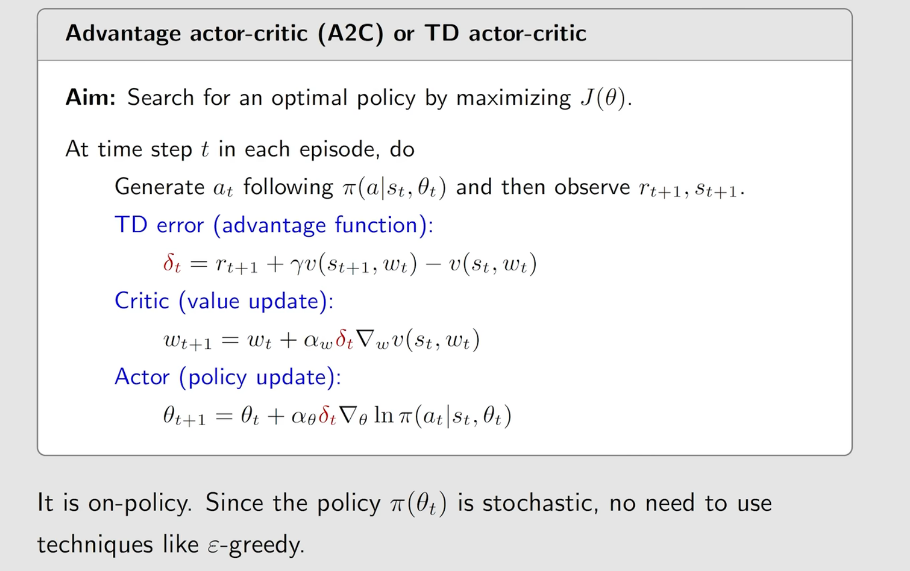

# 第 10 课 · Actor–Critic 方法

## 1. Introduction {#introduction}

Actor–Critic · Policy Gradient 与 Value Estimation

**Actor–Critic** 仍属于 **policy gradient methods**。它把策略梯度与基于价值的方法结合起来，用价值估计为策略梯度更新提供反馈。

What Are “Actor” and “Critic”?

- **Actor · Policy Update**。Actor 表示并更新策略 $\pi_\theta$。智能体在状态 $s$ 下按这个策略选择动作，所以称它为 actor。
- **Critic · Policy Evaluation / Value Estimation**。Critic 通过估计价值来评估当前策略。例如，动作价值 $q_{\pi_\theta}(s,a)$ 衡量在 $s$ 采取 $a$、随后按当前策略行动的期望回报。Critic 提供这样的评价，所以得名。

Actor 用当前策略与环境交互，Critic 从交互经验中评估该策略，Actor 再用评价结果更新策略参数。

上一课的 REINFORCE 用完整回合中的实际折扣回报估计动作价值。Actor–Critic 则可以用 Critic 学到的价值估计来构造策略更新。[第 9 课 · REINFORCE Algorithm](policy-gradient.md#reinforce-algorithm)

## 2. The Simplest Actor–Critic (QAC) {#qac}

### 2.1 From Policy Gradient to Actor and Critic {#qac-policy-gradient}

Review · 从目标函数到随机梯度更新

1. **Objective**。用标量 $J(\theta)$ 衡量策略表现，例如平均状态价值 $\bar v_\pi$ 或长期平均奖励 $\bar r_\pi$。
2. **Gradient ascent**。用 $\eta$ 表示归一化后的状态分布，令 $Z$ 为归一化前的权重总和，$\pi_t=\pi_{\theta_t}$ 为当前策略。在策略梯度等式成立时，动作价值的定义随目标而定。[第 9 课 · Gradients of the Metrics](policy-gradient.md#gradients-of-the-metrics)

$$
\begin{aligned}
\theta_{t+1}
&=\theta_t+\alpha\nabla_\theta J(\theta_t)\\
&=\theta_t+\alpha Z\,\mathbb E_{S\sim\eta,\,A\sim\pi_t(\cdot\mid S)}
\!\left[\nabla_\theta\ln\pi(A\mid S,\theta_t)\,q_{\pi_t}(S,A)\right].
\end{aligned}
$$

3. **Stochastic gradient ascent**。用抽到的 $(s_t,a_t)$ 代替期望中的随机变量，再用 $q_t(s_t,a_t)$ 估计未知的动作价值。以下沿用课件记法，把固定的正比例因子 $Z$ 并入步长。

$$
\theta_{t+1}
=\theta_t+\alpha\,\nabla_\theta\ln\pi(a_t\mid s_t,\theta_t)\,q_t(s_t,a_t).
$$

执行这条策略更新的是 **Actor**。估计 $q_t(s,a)$ 的算法是 **Critic**。

How to Estimate the Action Value?

- **Monte Carlo learning**。用完整回合的折扣回报 $G_t$ 估计 $q_{\pi_t}(s_t,a_t)$。上一课的 **REINFORCE** 就是这种 Monte Carlo policy gradient。
- **Temporal-difference learning**。用即时奖励和下一状态动作对的价值估计构造目标。QAC 的 Critic 用一步 TD，因此收到一条转移就可以更新。

### 2.2 QAC Algorithm {#qac-algorithm}

<figure>
  
</figure>

Critic (Value Update) · Sarsa with Function Approximation

第 $t$ 步在 $s_t$ 执行按策略选出的 $a_t$，观察 $r_{t+1}$ 和 $s_{t+1}$。若下一状态未终止，按课件在更新 $\theta_t$ 前从 $\pi(\cdot\mid s_{t+1},\theta_t)$ 抽取 $a_{t+1}$，形成 Sarsa 的一步 TD 目标。

$$
\begin{aligned}
\delta_t&=r_{t+1}+\gamma q(s_{t+1},a_{t+1},w_t)-q(s_t,a_t,w_t),\\
w_{t+1}&=w_t+\alpha_w\,\delta_t\,\nabla_w q(s_t,a_t,w_t).
\end{aligned}
$$

$w$ 是动作价值函数的参数，$\alpha_w$ 是 Critic 的学习率。半梯度更新只对当前预测 $q(s_t,a_t,w_t)$ 求导。终止转移的目标只取 $r_{t+1}$。[第 8 课 · Sarsa with Function Approximation](value-function-approximation.md#approximate-control)

Actor (Policy Update) · 用更新后的动作价值

课件先更新 Critic，再用 $q(s_t,a_t,w_{t+1})$ 对当前策略的 log-policy 梯度加权。$\alpha_\theta$ 是 Actor 的学习率。

$$
\theta_{t+1}
=\theta_t+\alpha_\theta\,\nabla_\theta\ln\pi(a_t\mid s_t,\theta_t)\,
q(s_t,a_t,w_{t+1}).
$$

QAC 中的 **Q** 指 Critic 学习动作价值 $q(s,a,w)$。Actor 的梯度由该动作价值加权，TD error $\delta_t$ 用于 Critic 的更新。

### 2.3 Why Is QAC On-policy? {#qac-on-policy}

Remarks · 同一策略负责采样和学习

- **On-policy**。这里的策略梯度期望本身按当前策略的状态访问分布和动作概率加权，所以用当前策略与环境交互。Critic 的 Sarsa 目标也用从该策略抽取的下一动作，评估的就是 Actor 正在改进的策略。
- **Exploration**。若 Actor 用 softmax 等随机策略，直接按动作概率采样就能探索，课件算法因此可以省去额外的 $\varepsilon$-greedy 动作选择。
- **Actor–Critic 的基本结构**。Critic 从新转移估计价值，Actor 用估计结果改进策略。沿用这套结构，可以更换价值估计方式或用不同的信号给策略梯度加权，得到其他 Actor–Critic 算法。

## 3. Advantage Actor–Critic (A2C) {#a2c}

在 QAC 的策略梯度中减去一个只依赖状态的 **baseline**，可以调整梯度估计的方差。取状态价值作为 baseline，就得到 **advantage**。本节的 A2C 用一步 TD error 估计这个 advantage。

### 3.1 Baseline Invariance {#baseline-invariance}

Why Is It Valid?

固定当前策略 $\pi=\pi_{\theta_t}$。设 $S\sim\eta$，$A\sim\pi(\cdot\mid S)$，记 $g(S,A)=\nabla_\theta\ln\pi(A\mid S,\theta_t)$。对任意只依赖状态的标量 $b(S)$，策略梯度的期望项满足

$$
\mathbb E[g(S,A)q_\pi(S,A)]
=\mathbb E[g(S,A)(q_\pi(S,A)-b(S))].
$$

证明从被减去的 baseline 项出发。用 $\pi\nabla_\theta\ln\pi=\nabla_\theta\pi$，并把 $b(s)$ 提出动作求和。

$$
\begin{aligned}
\mathbb E[g(S,A)b(S)]
&=\sum_s\eta(s)\sum_a\pi(a\mid s,\theta_t)g(s,a)b(s)\\
&=\sum_s\eta(s)\sum_a\nabla_\theta\pi(a\mid s,\theta_t)b(s)\\
&=\sum_s\eta(s)b(s)\sum_a\nabla_\theta\pi(a\mid s,\theta_t)\\
&=\sum_s\eta(s)b(s)\nabla_\theta\sum_a\pi(a\mid s,\theta_t)\\
&=\sum_s\eta(s)b(s)\nabla_\theta 1=0.
\end{aligned}
$$

这里求导只作用在动作概率上。若状态权重的归一化引入了比例因子，它同时乘在等式两边。

### 3.2 Choosing a Baseline {#choosing-a-baseline}

Why Is the Baseline Useful?

令 $X=g(S,A)(q_\pi(S,A)-b(S))$，$\bar x=\mathbb E[X]$。上一节的等式说明 $\bar x$ 对 $b$ 不变，但单个样本的梯度估计会随 $b$ 改变。用协方差矩阵的迹衡量各参数梯度分量的总方差，有

$$
\begin{aligned}
\operatorname{tr}(\operatorname{Cov}(X))
&=\mathbb E[X^\top X]-\bar x^\top\bar x,\\
\mathbb E[X^\top X]
&=\mathbb E\!\left[g(S,A)^\top g(S,A)(q_\pi(S,A)-b(S))^2\right]\\
&=\mathbb E\!\left[\|g(S,A)\|^2(q_\pi(S,A)-b(S))^2\right].
\end{aligned}
$$

例如，当动作价值的量级远小于 $10^6$，且策略梯度非零时，取 $b(s)=10^6$ 会把二阶矩放大。合适的 baseline 能减小单样本估计的波动。前面介绍的基础 REINFORCE 和 QAC 相当于取 $b(s)=0$，这个选择的方差取决于任务和策略。

Optimal Baseline · 用梯度范数平方加权

由于 $\bar x$ 固定，可以直接最小化二阶矩。固定状态 $s$，令 $c(s,a)=\|g(s,a)\|^2$，记 $\mathbb E_{A\mid s}$ 为按 $\pi(\cdot\mid s)$ 对动作取期望。对 $b$ 求一阶导数

$$
\frac{\partial}{\partial b}\,
\mathbb E_{A\mid s}\!\left[c(s,A)(q_\pi(s,A)-b)^2\right]
=2\,\mathbb E_{A\mid s}[c(s,A)(b-q_\pi(s,A))].
$$

在有正状态权重且 $\mathbb E_{A\mid s}[c(s,A)]>0$ 的状态，令上式等于零，得到最小化总方差的 baseline。若该分母为零，该状态的样本梯度为零，任选 baseline 都给出相同的方差。

$$
b^*(s)
=\frac{\mathbb E_{A\mid s}\!\left[c(s,A)q_\pi(s,A)\right]}
{\mathbb E_{A\mid s}[c(s,A)]}.
$$

实际可省去梯度范数权重，直接对动作价值取策略平均，得到状态价值 baseline。$v_\pi(s)$ 计算更简单，一般只在加权均值恰好等于普通均值时达到上述最小方差。[Greensmith 等 · Variance Reduction in Reinforcement Learning](https://www.jmlr.org/papers/volume5/greensmith04a/greensmith04a.pdf)

$$
b(s)=\mathbb E_{A\mid s}[q_\pi(s,A)]=v_\pi(s).
$$

### 3.3 Advantage-weighted Policy Update {#advantage-policy-update}

Advantage Function · 动作相对当前策略的价值

取 $b(s)=v_\pi(s)$，定义 **advantage function**。课件记为 $\delta_\pi(s,a)$，其值表示选择 $a$ 后继续按 $\pi$ 行动，相比从一开始就按 $\pi$ 抽取动作，期望回报高出多少。优势为正表示高于该状态下的策略平均水平，为负表示低于平均水平。

$$
\delta_\pi(s,a)=q_\pi(s,a)-v_\pi(s).
$$

在期望形式和随机形式中分别代入真实优势及其估计。沿用课件记法，把状态权重带来的固定比例因子并入步长。

$$
\begin{aligned}
\theta_{t+1}
&=\theta_t+\alpha\,\mathbb E[g(S,A)(q_\pi(S,A)-v_\pi(S))]\\
&=\theta_t+\alpha\,\mathbb E[g(S,A)\delta_\pi(S,A)].
\end{aligned}
$$

$$
\begin{aligned}
\theta_{t+1}
&=\theta_t+\alpha\,g(s_t,a_t)[q_t(s_t,a_t)-v_t(s_t)]\\
&=\theta_t+\alpha\,g(s_t,a_t)\delta_t(s_t,a_t).
\end{aligned}
$$

Effective Step Size · 用相对价值调节更新

用 log-derivative 恒等式把后一条更新写成沿动作概率梯度移动。

$$
\begin{aligned}
\theta_{t+1}
&=\theta_t+\alpha
  \frac{\nabla_\theta\pi(a_t\mid s_t,\theta_t)}
       {\pi(a_t\mid s_t,\theta_t)}\,\delta_t(s_t,a_t)\\
&=\theta_t+
  \underbrace{\alpha\frac{\delta_t(s_t,a_t)}{\pi(a_t\mid s_t,\theta_t)}}_{\text{effective step size}}
  \nabla_\theta\pi(a_t\mid s_t,\theta_t).
\end{aligned}
$$

优势估计的符号决定更新方向，正优势在足够小的步长下提高所采动作的概率，负优势则降低它。随机策略提供探索，高于平均水平的动作获得强化。分母反映该动作被采到的概率，实际更新量还取决于概率梯度。

### 3.4 One-step TD Actor–Critic {#a2c-algorithm}

Estimating the Advantage with TD Error

由动作价值的一步 Bellman 方程，真实状态价值下的一步 TD error 在给定状态和动作时，条件期望恰好等于真实优势。

$$
\begin{aligned}
q_\pi(s,a)
&=\mathbb E_\pi[R_{t+1}+\gamma v_\pi(S_{t+1})\mid S_t=s,A_t=a],\\
\delta_\pi(s,a)
&=\mathbb E_\pi[R_{t+1}+\gamma v_\pi(S_{t+1})-v_\pi(s)
\mid S_t=s,A_t=a].
\end{aligned}
$$

用 Critic 当前的估计 $v(s,w_t)$ 代入，得到单步样本 $\delta_t=r_{t+1}+\gamma v(s_{t+1},w_t)-v(s_t,w_t)$。估计的状态价值有误差时，$\delta_t$ 的条件期望也可能偏离真实优势。这个办法让 Critic 只需学习一个状态价值函数，便可从转移样本计算优势信号。

<figure>
  
</figure>

TD Error · Critic Update · Actor Update

每个回合的第 $t$ 步按 $\pi(\cdot\mid s_t,\theta_t)$ 抽取 $a_t$，观察 $r_{t+1},s_{t+1}$。先用更新前的 $w_t$ 算出 $\delta_t$，再把同一个数值用于两次更新。

$$
\begin{aligned}
\delta_t&=r_{t+1}+\gamma v(s_{t+1},w_t)-v(s_t,w_t),\\
w_{t+1}&=w_t+\alpha_w\delta_t\,\nabla_w v(s_t,w_t),\\
\theta_{t+1}&=\theta_t+\alpha_\theta\delta_t\,\nabla_\theta\ln\pi(a_t\mid s_t,\theta_t).
\end{aligned}
$$

这里 $\alpha_w$ 和 $\alpha_\theta$ 分别是 Critic 和 Actor 的学习率。Critic 用 $\delta_t$ 修正状态价值，Actor 把它作为已采样动作的优势估计。终止转移取下一状态价值为零。这个版本用正在优化的策略采集数据，因此是 **on-policy**。直接按随机策略采样即可探索，可以省去额外的 $\varepsilon$-greedy 动作选择。

