# 第 1 课 · 基本概念 · V1（逐页）

[切换到 V2（总结）](basic-concepts.md)

## Part 1 · 状态、动作与策略

### 第 01 页 · 本课要解决什么问题

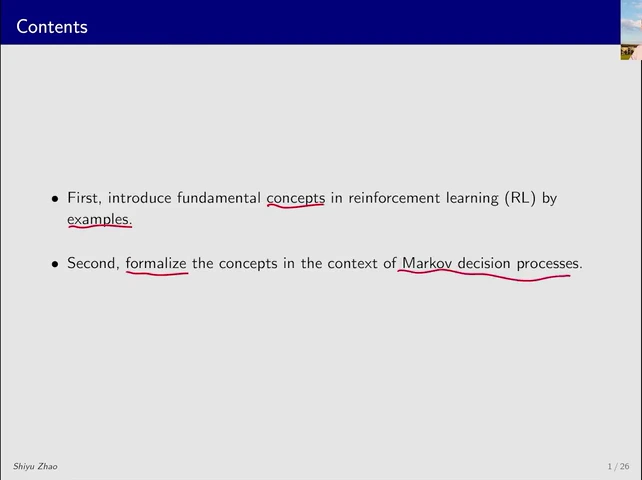

本课先用网格举例，再用马尔可夫决策过程（MDP）统一表述。先看机器人在哪里、能做什么、做完会怎样，再用奖励和回报判断路线的好坏。

### 第 02 页 · 网格世界（Grid World）

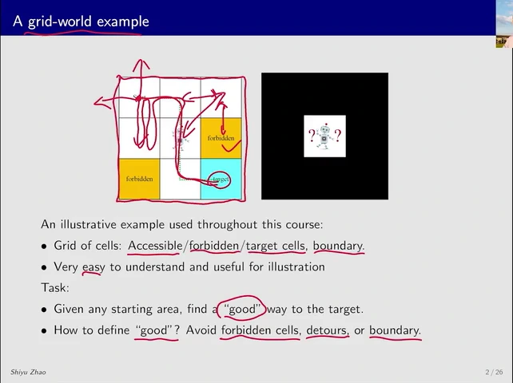

机器人是智能体（agent），网格及其规则构成环境（environment）。白格可通行，黄格是禁区，蓝格是目标，外框不可越过。机器人从任一格出发，只能沿上下左右移动。到达目标只是基本要求，还要比较是否踩进禁区、反复折返或试图越界。

### 第 03 页 · 状态和状态空间（State and State Space）

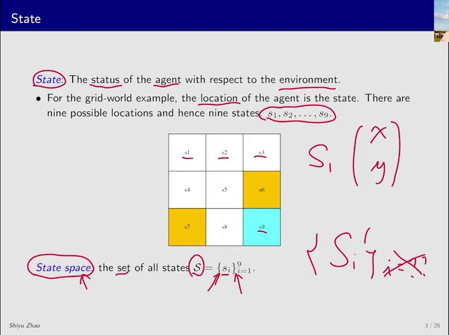

此刻机器人站在哪一格，就是它的状态。把格子从左上到右下按行编号，左上角就是 s₁，右下角是 s₉。九个可能状态放在一起，叫作状态空间，记作 𝒮 = {s₁, …, s₉}。

编号只是方便写，也可以用坐标 (x, y) 表示位置。真实机器人若经过同一位置时速度不同，下一步的运动也可能不同。这种情况下，状态还可以记录速度、加速度等信息。

### 第 04 页 · 动作和动作空间（Action and Action Space）

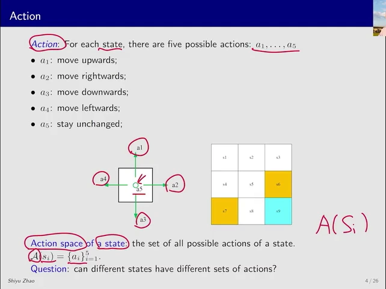

动作是机器人能发出的指令。课件把向上、向右、向下、向左和原地不动记作 a₁ 至 a₅，图中的圆圈表示 a₅。状态 s 下可选的指令组成动作空间 𝒜(s)，可随状态而变。本例在边角也允许发出向上的指令，是否能移动由环境决定。

### 第 05 页 · 一步状态转移（State Transition）

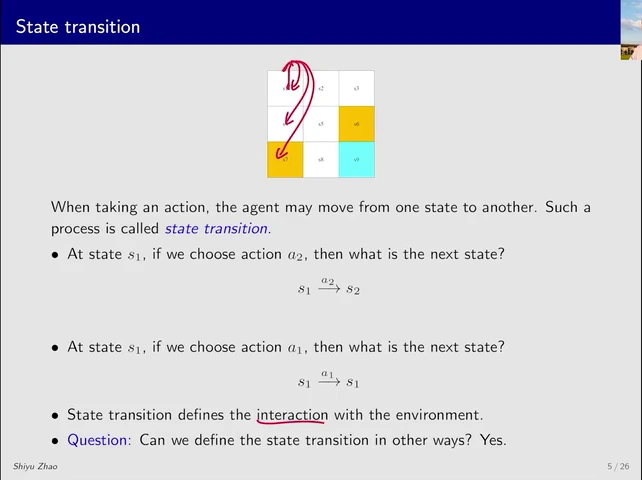

在左上角 s₁ 发出向右指令 a₂，下一格是 s₂。发出向上指令 a₁，机器人碰到外墙，下一格还是 s₁。从当前状态出发，执行动作并得到下一状态，就是一次状态转移。原地不动也可以是一种转移。

仿真可以另设规则，比如撞墙后弹到 s₄ 或 s₇。课件用这个设想说明，动作执行后的结果由环境规则决定，真实机器人则受物理条件约束。

### 第 06 页 · 禁区能不能走进去

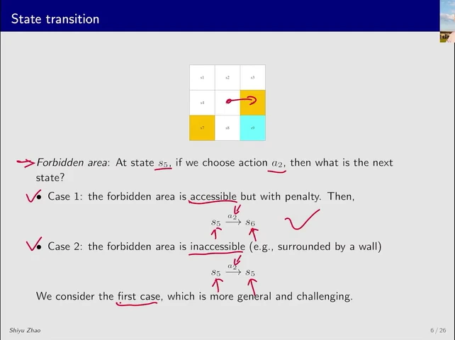

从中间的 s₅ 向右，面对的是禁区 s₆。把禁区当成墙，机器人就留在 s₅。允许进入、但进入要扣分，机器人就会走到 s₆。

后面的表格采用第二种设定。禁止进入时，可选路线少了。允许进入时，机器人还得比较经过禁区的代价和绕远的代价。

### 第 07 页 · 把状态转移写成表

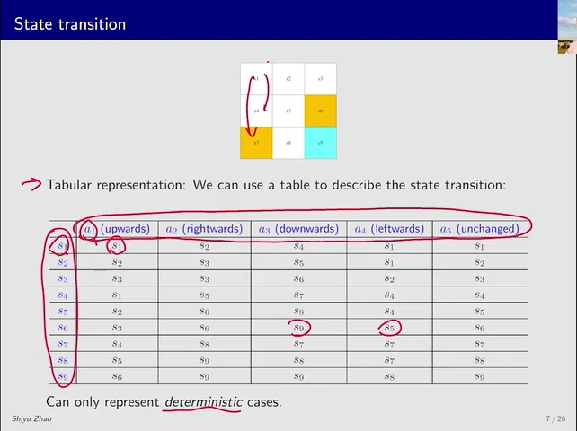

先找当前状态所在的行，再找执行动作所在的列。比如 s₅ 行、a₂ 列写着 s₆，就读作「从 s₅ 向右会到 s₆」。当每组状态和动作都只有一个结果时，每个单元格只需写一个下一状态。

老师先用 s₁、a₁ 示范，向上撞墙后还是 s₁。若另设规则，允许撞墙后以不同概率弹到 s₄ 或 s₇，这种每格只填一个落点的表就不够了。

展开完整状态转移表

<table>
  <thead><tr><th scope="col">状态</th><th scope="col">a₁ ↑</th><th scope="col">a₂ →</th><th scope="col">a₃ ↓</th><th scope="col">a₄ ←</th><th scope="col">a₅ ○</th></tr></thead>
  <tbody>
    <tr><th scope="row">s₁</th><td>s₁</td><td>s₂</td><td>s₄</td><td>s₁</td><td>s₁</td></tr>
    <tr><th scope="row">s₂</th><td>s₂</td><td>s₃</td><td>s₅</td><td>s₁</td><td>s₂</td></tr>
    <tr><th scope="row">s₃</th><td>s₃</td><td>s₃</td><td>s₆</td><td>s₂</td><td>s₃</td></tr>
    <tr><th scope="row">s₄</th><td>s₁</td><td>s₅</td><td>s₇</td><td>s₄</td><td>s₄</td></tr>
    <tr><th scope="row">s₅</th><td>s₂</td><td>s₆</td><td>s₈</td><td>s₄</td><td>s₅</td></tr>
    <tr><th scope="row">s₆</th><td>s₃</td><td>s₆</td><td>s₉</td><td>s₅</td><td>s₆</td></tr>
    <tr><th scope="row">s₇</th><td>s₄</td><td>s₈</td><td>s₇</td><td>s₇</td><td>s₇</td></tr>
    <tr><th scope="row">s₈</th><td>s₅</td><td>s₉</td><td>s₈</td><td>s₇</td><td>s₈</td></tr>
    <tr><th scope="row">s₉</th><td>s₆</td><td>s₉</td><td>s₉</td><td>s₈</td><td>s₉</td></tr>
  </tbody>
</table>

### 第 08 页 · 状态转移概率（State Transition Probability）

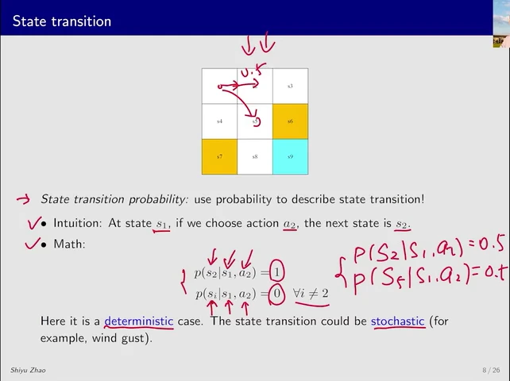

条件概率（conditional probability）p(s′ | s, a) 表示给定当前格 s 和动作 a 后，到达下一格 s′ 的概率。s₁ 向右时，无风必到 s₂，因此该落点的概率为 1，其他为 0。有风时，同一个向右动作可能各以 0.5 的概率把机器人带到 s₂ 或 s₅。

### 第 09 页 · 策略（Policy）

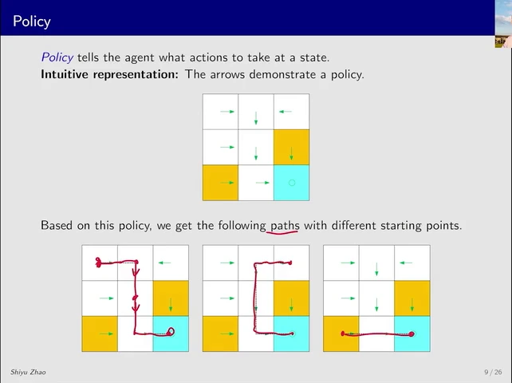

前面一直由我们指定动作。现在给机器人一套选动作的规则，这套规则就是策略。把每格该选的动作画成箭头，机器人就能从当前位置顺着箭头走。

- 从 s₁ 出发，依次经过 s₂、s₅、s₈，再到 s₉。
- 从 s₃ 出发，先向左走到 s₂，再沿同一条路到 s₉。
- 从 s₇ 出发，连续两次向右就到 s₉。目标格里的圆圈表示留在原地。

### 第 10 页 · 用概率写确定性策略（Deterministic Policy）

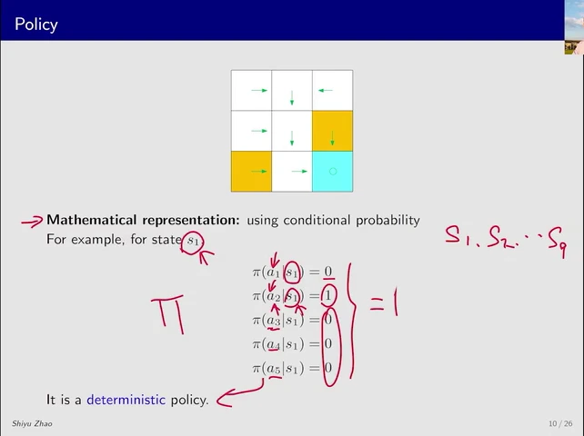

箭头能显示确定的走法。用条件概率 π(a | s) 则可以描述任意状态下选择各动作的机会。π（读作 pi）表示策略。同一格内，各动作的概率之和为 1。图中 s₁ 的向右概率 π(a₂ | s₁) 为 1，其余四项为 0。每格都这样指定一个动作，就是确定性策略。

### 第 11 页 · 随机策略（Stochastic Policy）

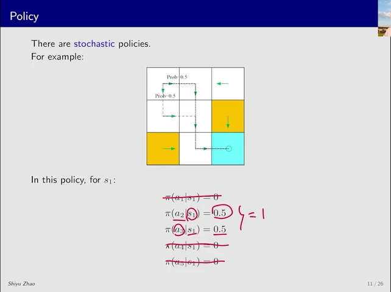

只改 s₁ 的规则，给向右和向下各 0.5 的机会，其余三个动作仍为 0。向右先到 s₂，向下先到 s₄。按照其他格原有的箭头，两条路都会在 s₅ 汇合，再经 s₈ 到 s₉。

这里的随机性来自选动作。第 08 页的风则会在动作已经选定之后改变落点。即使没有风，也可以用随机策略。

### 第 12 页 · 查策略表并抽取动作

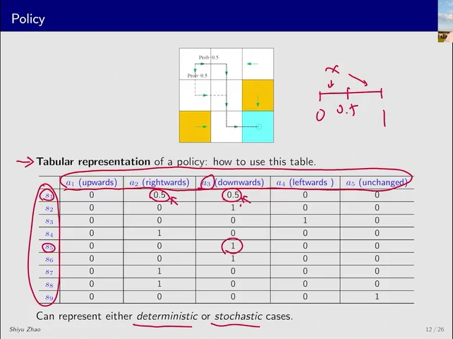

策略表的行是状态，列是动作，格子里填的是选动作的概率。比如 s₁ 行写出向右和向下各 0.5，s₅ 行写出向下为 1。一行的五个概率加起来为 1。把 s₁ 行改为 (0, 1, 0, 0, 0)，就得到第 10 页的确定性策略。

程序可以把整张表存成数组或矩阵。实际在 s₁ 选动作时，从 0 到 1 均匀抽一个数，取值包含 0、排除 1。抽到小于 0.5 就向右，其余就向下。

展开完整策略表

<table>
  <thead><tr><th scope="col">状态</th><th scope="col">a₁ ↑</th><th scope="col">a₂ →</th><th scope="col">a₃ ↓</th><th scope="col">a₄ ←</th><th scope="col">a₅ ○</th></tr></thead>
  <tbody>
    <tr><th scope="row">s₁</th><td>0</td><td>0.5</td><td>0.5</td><td>0</td><td>0</td></tr>
    <tr><th scope="row">s₂</th><td>0</td><td>0</td><td>1</td><td>0</td><td>0</td></tr>
    <tr><th scope="row">s₃</th><td>0</td><td>0</td><td>0</td><td>1</td><td>0</td></tr>
    <tr><th scope="row">s₄</th><td>0</td><td>1</td><td>0</td><td>0</td><td>0</td></tr>
    <tr><th scope="row">s₅</th><td>0</td><td>0</td><td>1</td><td>0</td><td>0</td></tr>
    <tr><th scope="row">s₆</th><td>0</td><td>0</td><td>1</td><td>0</td><td>0</td></tr>
    <tr><th scope="row">s₇</th><td>0</td><td>1</td><td>0</td><td>0</td><td>0</td></tr>
    <tr><th scope="row">s₈</th><td>0</td><td>1</td><td>0</td><td>0</td><td>0</td></tr>
    <tr><th scope="row">s₉</th><td>0</td><td>0</td><td>0</td><td>0</td><td>1</td></tr>
  </tbody>
</table>

## Part 2 · 奖励、回报与马尔可夫决策过程

### 第 13 页 · 奖励（Reward）

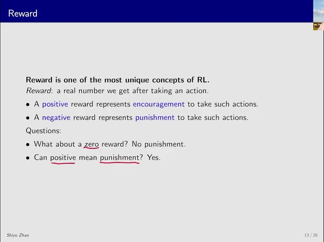

奖励（reward）是执行一次动作后收到的数。最大化总得分时，正数鼓励，负数惩罚，零表示没有奖惩，相对扣分仍更可取。也可以反过来用正数记惩罚、负数记鼓励，同时把目标改为最小化总成本。

### 第 14 页 · 给网格里的动作打分

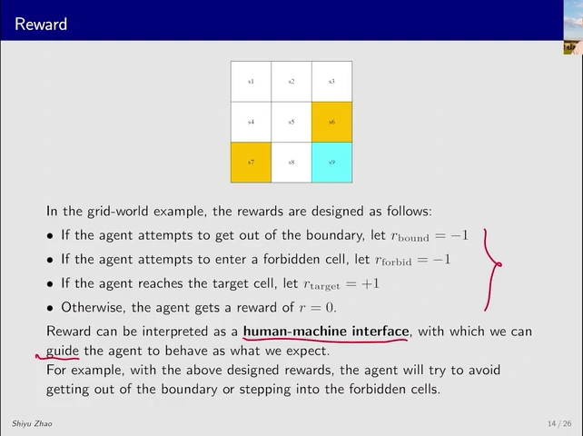

- 试图越过边界，得 −1。
- 进入禁区或主动在禁区停留，得 −1。
- 到达目标格或主动在目标格停留，得 +1。
- 其余情形得 0。

这些分数把「尽量到目标、少撞墙、少进禁区」写成机器人每走一步都能收到的反馈。沿着图走一次，从 s₁ 向右到 s₂。既没有撞墙，也没有进入禁区或目标格，因此得 0 分。

### 第 15 页 · 把奖励写成表

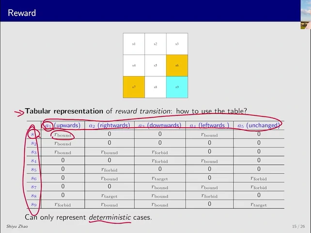

同样先找状态行，再找动作列。在 s₁ 向上时，奖励是 −1。选择原地不动时，奖励是 0。对照第 07 页会发现，这两个动作的下一状态都是 s₁，但得分不同。

这张表也只适用于每组状态和动作都给出一个确定奖励的情形。若奖励大小随机，就要写出各分数的概率。

展开完整奖励表

<table>
  <thead><tr><th scope="col">状态</th><th scope="col">a₁ ↑</th><th scope="col">a₂ →</th><th scope="col">a₃ ↓</th><th scope="col">a₄ ←</th><th scope="col">a₅ ○</th></tr></thead>
  <tbody>
    <tr><th scope="row">s₁</th><td>−1</td><td>0</td><td>0</td><td>−1</td><td>0</td></tr>
    <tr><th scope="row">s₂</th><td>−1</td><td>0</td><td>0</td><td>0</td><td>0</td></tr>
    <tr><th scope="row">s₃</th><td>−1</td><td>−1</td><td>−1</td><td>0</td><td>0</td></tr>
    <tr><th scope="row">s₄</th><td>0</td><td>0</td><td>−1</td><td>−1</td><td>0</td></tr>
    <tr><th scope="row">s₅</th><td>0</td><td>−1</td><td>0</td><td>0</td><td>0</td></tr>
    <tr><th scope="row">s₆</th><td>0</td><td>−1</td><td>+1</td><td>0</td><td>−1</td></tr>
    <tr><th scope="row">s₇</th><td>0</td><td>0</td><td>−1</td><td>−1</td><td>−1</td></tr>
    <tr><th scope="row">s₈</th><td>0</td><td>+1</td><td>−1</td><td>−1</td><td>0</td></tr>
    <tr><th scope="row">s₉</th><td>−1</td><td>−1</td><td>−1</td><td>0</td><td>+1</td></tr>
  </tbody>
</table>

### 第 16 页 · 奖励概率（Reward Probability）

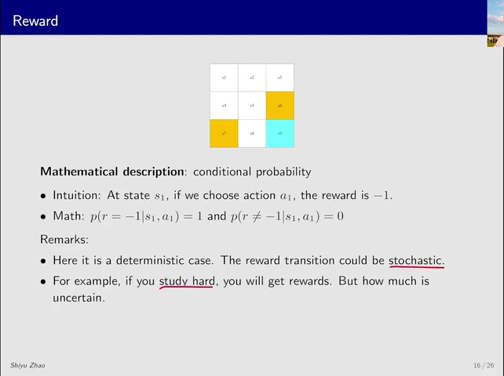

如果同一个状态和动作可能得到不同的分数，就写成 p(r | s, a)。这里 r 是想问的奖励。网格里 s₁ 向上必定撞墙，所以 p(−1 | s₁, a₁) = 1，其他分数的概率为 0。

随机奖励也可以始终是正数，只是大小不固定。老师用努力学习来类比。付出通常会有收获，但收获多少还受其他因素影响。

### 第 17 页 · 轨迹与回报（Trajectory and Return）

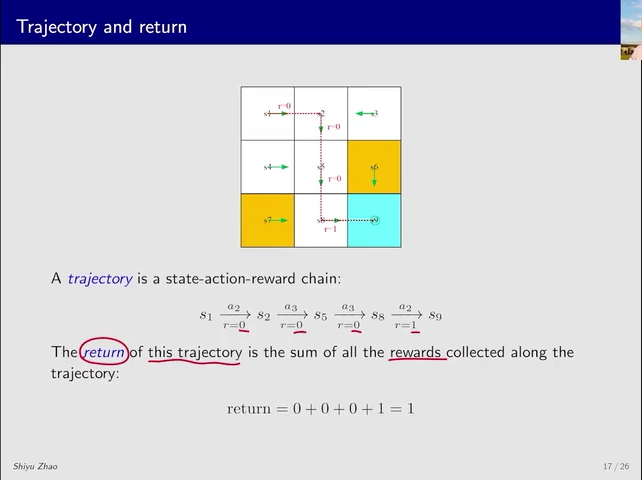

把起点、每一步选的动作、拿到的奖励和到达的状态依次记下来，就得到一条轨迹。从 s₁ 先向右，再向下两次，最后向右，就是第 09 页的路线。记到第一次到达目标为止：

> s₁ → s₂ → s₅ → s₈ → s₉。动作是 a₂、a₃、a₃、a₂，逐步奖励是 0、0、0、+1。

沿轨迹把这四步的奖励加起来，就是回报。这里的回报是 1。

### 第 18 页 · 换一套策略，走出另一条轨迹

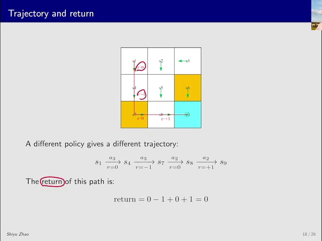

这次让机器人在 s₁ 和 s₄ 都向下，再向右两次。第二步会进入禁区 s₇。仍然只算到第一次到达目标：

> s₁ → s₄ → s₇ → s₈ → s₉。动作是 a₃、a₃、a₂、a₂，逐步奖励是 0、−1、0、+1。

最后也得到目标奖励，但中途扣了 1 分，所以回报是 0。

### 第 19 页 · 用回报比较路线

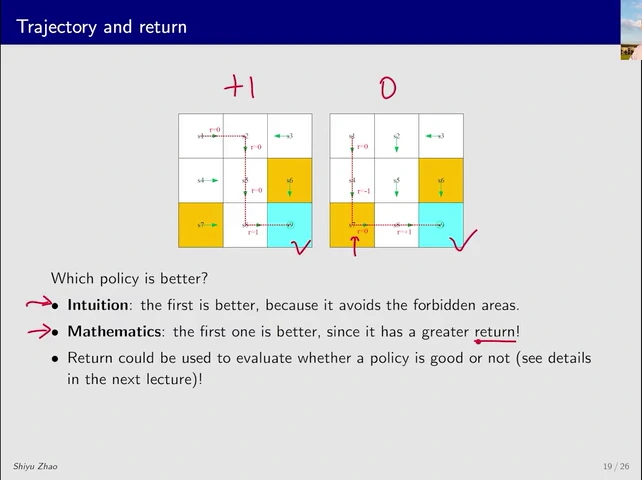

两条路线都用了四步，也都在最后一步拿到 +1。区别在第二步，右图经过禁区，回报从 1 降到了 0。如果同一策略可能产生多条轨迹，还要考虑各条轨迹发生的概率。

### 第 20 页 · 如果到达目标之后继续走

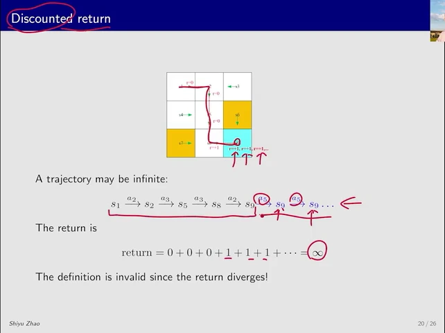

回到第 17 页的路线。到 s₉ 后如果一直执行 a₅，按第 14 页的规则，每次停留还会再拿 1 分。于是奖励变成 0、0、0、1、1、1、……。一直累加就会发散（diverge），即总分没有有限的结果。

### 第 21 页 · 折扣回报（Discounted Return）

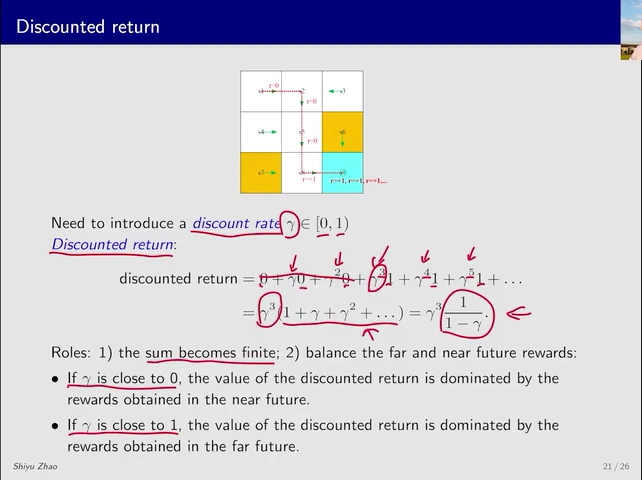

给越晚收到的分数越小的权重。用 γ 表示折扣因子（discount factor），取值满足 0 ≤ γ < 1。第一步奖励乘 1，第二步乘 γ，第三步乘 γ²，以此类推。例如 γ = 0.5 时，前三步分别按原值、一半和四分之一计入。

把当前决定的时刻记作 t，执行下一步以后得到的奖励记作 Rₜ₊₁。把以后的奖励按上述权重加起来，得到从时刻 t 起的折扣回报 Gₜ。

> Gₜ = Rₜ₊₁ + γRₜ₊₂ + γ²Rₜ₊₃ + …

第 20 页的例子从时刻 0 出发，第四步才拿到第一个 +1，所以第一项有分数的权重是 γ³。之后每步又得 +1，故 G₀ = γ³ + γ⁴ + …。提出 γ³，剩下 S = 1 + γ + γ² + …。乘以 γ 后，γS 就是去掉开头那个 1 的和，于是 S − γS = 1，得到 G₀ = γ³ / (1 − γ)。取 γ = 0.5 时，算得 0.25。

若每步奖励的绝对值有上限，γ 小于 1 就能使无限和保持有限。γ 越小，远处的奖励衰减越快。γ 越接近 1，远期奖励相对越有分量，因此改变 γ 也可能改变学到的策略。

### 第 22 页 · 回合与终止状态（Episode and Terminal State）

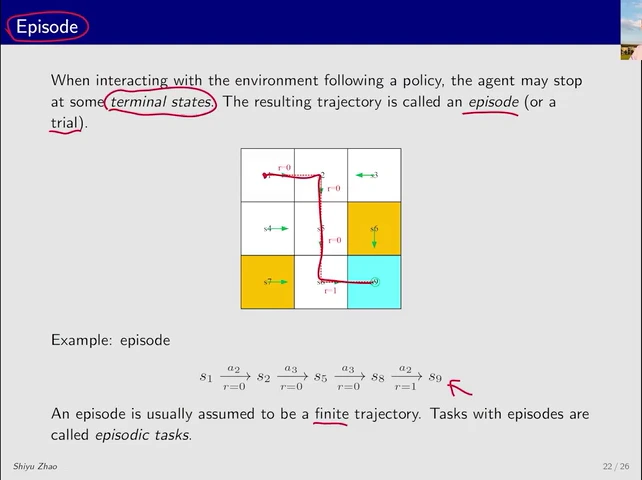

若规定机器人第一次到达 s₉ 就停止，s₉ 就是终止状态。从起点到终止状态的一次完整尝试叫作一个回合，也叫 trial，通常只走有限步。第 17、18 页分别记录了这样的一个回合。这类任务叫回合型任务（episodic task）。

### 第 23 页 · 持续型任务（Continuing Task）

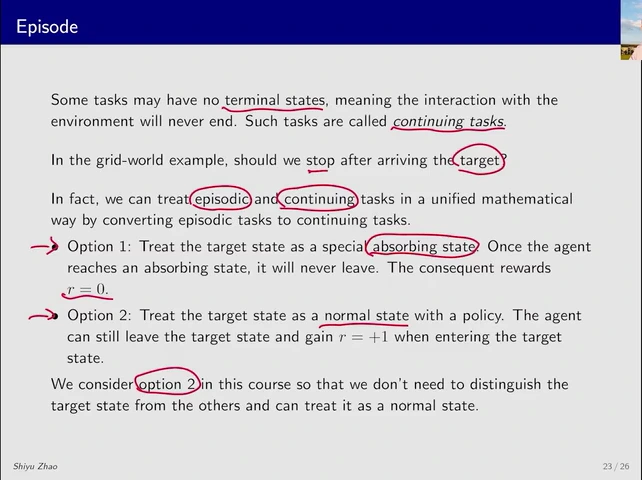

持续型任务没有规定在哪个状态终止。长期运行的任务也可以用这个设定来近似。若想把到达目标之后的动作也放进模型，可以有两种做法。

- 把 s₉ 设成吸收状态（absorbing state）。到达后无论选什么都留在 s₉，或者只保留 a₅。到达以后额外补上的步数都给 0 分，所以原回合的回报不变。
- 把 s₉ 当作普通状态。到达后仍按策略选动作，可以离开，也可以留下继续得分。课程采用这种设定，对目标格和其他格使用同一套规则，但需要考虑更多可能的行为。

### 第 24 页 · 马尔可夫决策过程（Markov Decision Process，MDP）

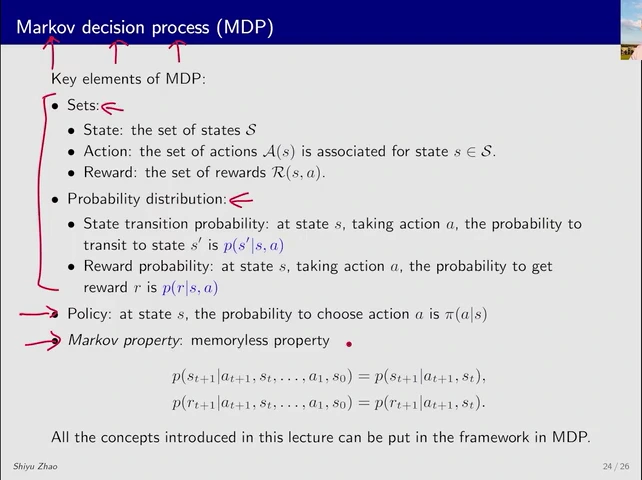

现在把前面的规则放在一起。𝒮 列出所有状态，𝒜(s) 列出在 s 可选的动作，ℛ(s, a) 列出在 s 执行 a 可能得到的分数。p(s′ | s, a) 和 p(r | s, a) 分别描述下一状态和奖励的概率。在这个环境里，策略 π(a | s) 再规定怎样选动作。

从上方走到 s₅，或者从左边走到 s₅，接下来只要都向右，就都会进 s₆ 并扣 1 分。知道当前状态和动作后，更早的路线不再改变下一状态和奖励的概率，这叫马尔可夫性质（Markov property），也叫无记忆性（memorylessness）。如果先前的信息确实会影响结果，就应把相关信息记录进当前状态。

记时刻 t 的状态、动作和此前的历史为 sₜ、aₜ、Hₜ。sₜ₊₁ 和 rₜ₊₁ 是这一步之后的状态与奖励。下面两个等式分别表示，省去更早的历史 Hₜ，概率也不变。

- p(sₜ₊₁ | sₜ, aₜ, Hₜ) = p(sₜ₊₁ | sₜ, aₜ)
- p(rₜ₊₁ | sₜ, aₜ, Hₜ) = p(rₜ₊₁ | sₜ, aₜ)

老师用三个词帮助记忆。Markov 指无记忆性，decision 指用策略做选择，process 指状态与奖励随交互逐步产生。

### 第 25 页 · 固定策略后，只看状态怎样变化

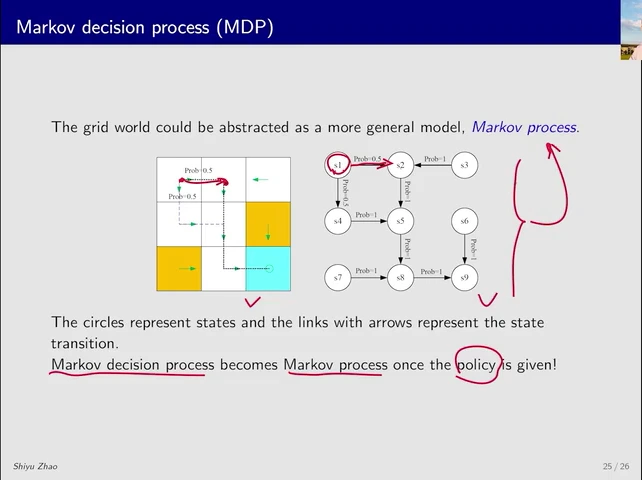

把第 11 页的策略固定下来。在 s₁ 有 0.5 的机会选向右，选中后一定到 s₂。因此从 s₁ 走到 s₂ 的概率是 0.5 × 1 = 0.5。向下到 s₄ 同理。如果几个动作都能到同一格，就把各动作通往该格的概率贡献加起来。

这样就把选动作和环境转移合成了状态之间的箭头。固定这个只按当前状态选动作的策略后，只看状态如何变化，就得到马尔可夫过程（Markov process）。

### 第 26 页 · 用一步行动串起全课

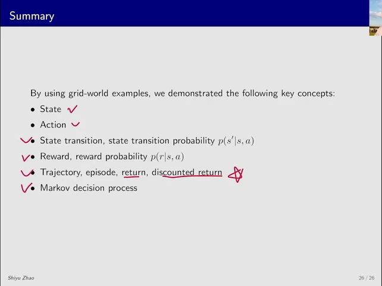

指着网格里的 s₁ 走一遍。当前位置是状态，向右是动作，策略给出选它的概率，环境决定下一格和这一步的奖励。连续走下去得到轨迹，在终止状态停下就完成一个回合。加总轨迹上的奖励得到回报，给未来奖励乘上逐步衰减的权重则得到折扣回报。马尔可夫决策过程把这些规则放进同一个模型。

下一课会用贝尔曼公式计算固定策略下的状态价值。 [第 2 课 · 贝尔曼公式 · V1（逐页）](bellman-equation-slides.md)
