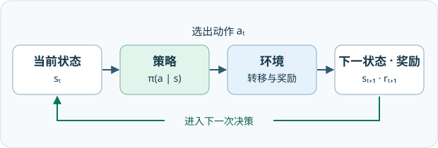

# 第 1 课 · 基本概念

想象一个机器人站在左上角，要走到右下角。它可以向右，也可以向下。两条路都可能到终点，但有的会经过禁区。要让机器人自己选择，我们得先弄清有哪些动作、每个动作会发生什么，以及怎样比较不同路线。

## 1. 状态、动作与环境反馈

机器人是做决定的一方，叫作智能体（agent）。网格和它的运行规则构成环境（environment）。机器人站在哪一格，就是它此刻的状态（state）。从图中任意一格都可以出发，任务是到达蓝格，同时尽量避免进入黄格、绕路或撞墙。

<figure>
  
  <figcaption>从上到下、从左到右给九格编号。黄色是禁区，蓝色是目标，外框是边界。</figcaption>
</figure>

左上角的 s₁ 读作「状态 1」。编号只是位置的简写，也可以用二维坐标 (x, y) 表示。把所有可能的状态放在一起，就得到状态空间（state space），这里记作 𝒮 = {s₁, …, s₉}。在更复杂的问题里，状态还可以记录速度、加速度等影响运动结果的信息。

动作（action）是机器人发出的指令。a₁、a₂、a₃、a₄、a₅ 分别表示向上、向右、向下、向左和原地不动，不能斜走。给定一格 s，把能在这里发出的指令列出来，就得到这格的动作空间（action space）𝒜(s)。本例每格都允许这五个指令，其他问题中可选动作可以随状态而变。

从左上角 s₁ 开始，向右会走到 s₂，向上撞墙则留在 s₁。机器人执行动作后从当前格到达下一格，这一步叫作状态转移（state transition）。仿真可以另设规则，比如撞墙后弹到 s₄ 或 s₇。真实机器人的运动受物理条件约束。

再看中间的 s₅。向右会遇到黄色的 s₆。如果把禁区当成墙，机器人会留在 s₅。如果禁区能进入但扣分，机器人就会到 s₆。课程采用第二种设定，机器人可以权衡绕远和经过禁区的代价。直接禁止进入时，它需要考虑的路线更少。

怎么让机器人知道这一步好不好？环境在每次执行动作后给它一个数，叫作奖励（reward）。若目标是让总得分更高，正数鼓励、负数惩罚，零比负数更可取。也可以用正数记代价，再把目标改成让总成本尽量低。

本例越界扣 1 分，走进禁区或主动停在禁区也扣 1 分。走进目标格或选择留在目标格得 1 分，其余情况得 0 分。比如在 s₁，向上撞墙和主动停留都回到 s₁，但奖励分别是 −1 和 0。下一格相同，这一步的得分也可能不同。

<figure>
  
  <figcaption>沿箭头读一轮。机器人从当前格发出动作，环境返回下一格和这一步的奖励。到了下一格，机器人再做一次决定。</figcaption>
</figure>

展开状态转移与奖励表

先找当前格所在的行，再找动作所在的列。比如 s₁ 行和 a₁ 列交会处写着「s₁，−1」，意思是向上撞墙后留在 s₁ 并扣 1 分。下表适用于每组状态和动作的结果都唯一的情形。

<table>
  <thead><tr><th scope="col">状态</th><th scope="col">a₁ ↑</th><th scope="col">a₂ →</th><th scope="col">a₃ ↓</th><th scope="col">a₄ ←</th><th scope="col">a₅ ○</th></tr></thead>
  <tbody>
    <tr><th scope="row">s₁</th><td>s₁，−1</td><td>s₂，0</td><td>s₄，0</td><td>s₁，−1</td><td>s₁，0</td></tr>
    <tr><th scope="row">s₂</th><td>s₂，−1</td><td>s₃，0</td><td>s₅，0</td><td>s₁，0</td><td>s₂，0</td></tr>
    <tr><th scope="row">s₃</th><td>s₃，−1</td><td>s₃，−1</td><td>s₆，−1</td><td>s₂，0</td><td>s₃，0</td></tr>
    <tr><th scope="row">s₄</th><td>s₁，0</td><td>s₅，0</td><td>s₇，−1</td><td>s₄，−1</td><td>s₄，0</td></tr>
    <tr><th scope="row">s₅</th><td>s₂，0</td><td>s₆，−1</td><td>s₈，0</td><td>s₄，0</td><td>s₅，0</td></tr>
    <tr><th scope="row">s₆</th><td>s₃，0</td><td>s₆，−1</td><td>s₉，+1</td><td>s₅，0</td><td>s₆，−1</td></tr>
    <tr><th scope="row">s₇</th><td>s₄，0</td><td>s₈，0</td><td>s₇，−1</td><td>s₇，−1</td><td>s₇，−1</td></tr>
    <tr><th scope="row">s₈</th><td>s₅，0</td><td>s₉，+1</td><td>s₈，−1</td><td>s₇，−1</td><td>s₈，0</td></tr>
    <tr><th scope="row">s₉</th><td>s₆，−1</td><td>s₉，−1</td><td>s₉，−1</td><td>s₈，0</td><td>s₉，+1</td></tr>
  </tbody>
</table>

如果机器人向右时可能被风吹偏，表格里只填一个落点就不够了。可以先固定「从哪一格出发、发出哪个指令」，再写出各种结果出现的可能性。这种写法叫作条件概率（conditional probability）。符号 p 表示概率，竖线右边是已经给定的条件，左边是想知道的结果。概率为 1 表示一定发生，0 表示不会发生，0.5 表示有一半的可能。

- 状态转移概率（state transition probability）写作 p(s′ | s, a)。s 是当前格，a 是动作，s′ 是可能到达的下一格。无风时，s₁ 向右一定到 s₂，其他落点概率为 0。有风时，同一动作可能各以 0.5 的概率落在 s₂ 或 s₅。
- 奖励概率（reward probability）写作 p(r | s, a)，r 是这一步可能得到的分数。s₁ 向上时，r 为 −1 的概率是 1，其他分数的概率是 0。奖励也可能有随机性，例如努力学习会有收获，但收获多少还取决于其他因素。

## 2. 策略决定选哪个动作

前面我们替机器人指定了向上或向右。现在让它自己选。告诉机器人「到了哪一格就怎么选」的整套规则，叫作策略（policy）。用 π（读作 pi）表示策略，π(a | s) 表示给定当前格 s，选动作 a 的概率。一格里所有可选动作的概率加起来是 1。

- 确定性策略（deterministic policy）在每一格都指定唯一的动作，选它的概率为 1。例如 s₁ 向右到 s₂，接着在 s₂ 和 s₅ 都向下，到 s₈ 后再向右。从 s₃ 出发会先向左到 s₂，之后走同一条路。从 s₇ 出发则先向右到 s₈，再向右到 s₉。这个策略在目标格选择停留。
- 随机策略（stochastic policy）会在同一格给多个动作分配机会。比如只把 s₁ 改成一半机会向右、一半机会向下，就像抛一枚公平硬币。向右先到 s₂，向下先到 s₄，按其余格的规则继续走都会在 s₅ 汇合。程序里可以均匀抽取一个大于等于 0、小于 1 的数，小于 0.5 选 a₂，否则选 a₃。

展开策略表

表格的行列与转移表相同，但每个格子填写动作概率。下表的 s₁ 是随机选择，其余状态仍是确定性选择；把 s₁ 行改为 (0, 1, 0, 0, 0)，就得到上面的确定性策略。程序中可以用数组或矩阵保存这张表。

<table>
  <thead><tr><th scope="col">状态</th><th scope="col">a₁ ↑</th><th scope="col">a₂ →</th><th scope="col">a₃ ↓</th><th scope="col">a₄ ←</th><th scope="col">a₅ ○</th></tr></thead>
  <tbody>
    <tr><th scope="row">s₁</th><td>0</td><td>0.5</td><td>0.5</td><td>0</td><td>0</td></tr>
    <tr><th scope="row">s₂</th><td>0</td><td>0</td><td>1</td><td>0</td><td>0</td></tr>
    <tr><th scope="row">s₃</th><td>0</td><td>0</td><td>0</td><td>1</td><td>0</td></tr>
    <tr><th scope="row">s₄</th><td>0</td><td>1</td><td>0</td><td>0</td><td>0</td></tr>
    <tr><th scope="row">s₅</th><td>0</td><td>0</td><td>1</td><td>0</td><td>0</td></tr>
    <tr><th scope="row">s₆</th><td>0</td><td>0</td><td>1</td><td>0</td><td>0</td></tr>
    <tr><th scope="row">s₇</th><td>0</td><td>1</td><td>0</td><td>0</td><td>0</td></tr>
    <tr><th scope="row">s₈</th><td>0</td><td>1</td><td>0</td><td>0</td><td>0</td></tr>
    <tr><th scope="row">s₉</th><td>0</td><td>0</td><td>0</td><td>0</td><td>1</td></tr>
  </tbody>
</table>

策略的随机性来自「选什么动作」，环境的随机性来自「选定后得到什么结果」。例如，固定向右也可能被风吹到另一格；没有风时，随机选向右或向下也会走出不同路径。

## 3. 从单步奖励到整条轨迹的回报

回到开头的问题。从 s₁ 出发，两种走法都能到达 s₉，怎样比较它们？这里先只算抵达目标为止的分数。把从起点开始的每个状态、选过的动作和得到的奖励按顺序记下来，就得到一条轨迹（trajectory）。比如路线 A 的第一步记作「在 s₁ 向右，得 0 分，到 s₂」。把这条轨迹上每一步的奖励加起来，就是它的回报（return）。

路线 A 沿用上一节的确定性策略。路线 B 则在 s₁ 和 s₄ 连续两次向下，所以它经过左下角的 s₇。

<figure>
  
  <figcaption>两条路线都走四步，只有路线 B 经过黄色禁区。</figcaption>
</figure>

- **路线 A**：s₁ → s₂ → s₅ → s₈ → s₉，动作依次为 a₂、a₃、a₃、a₂。回报为 0 + 0 + 0 + 1 = 1。
- **路线 B**：s₁ → s₄ → s₇ → s₈ → s₉，动作依次为 a₃、a₃、a₂、a₂。回报为 0 − 1 + 0 + 1 = 0。

两条路线最后一步都得 1 分。差别出在第二步，路线 B 踩进 s₇，多扣了 1 分。如果同一套策略有时走出路线 A、有时走出路线 B，单看一次得分就无法评价整套策略。还要看这些路线各有多大机会发生。

## 4. 回合、持续任务与折扣回报

刚才在到达 s₉ 时就停止计分，相当于把 s₉ 设成终止状态（terminal state）。从起点到停止的这一次完整尝试，叫作一个回合（episode，也叫 trial），通常只走有限步。路线 A 和 B 各是一个回合，这类问题叫作回合型任务（episodic task）。如果机器人一直运行，没有规定在哪个状态结束，就是持续型任务（continuing task）。现实中长期运行的任务也可以这样近似。

可把到达目标后的行为也纳入持续模型：

- **吸收状态（absorbing state）**：进入目标后，无论选什么动作都留在该状态，也可以只保留「原地不动」这个动作。到达之后的奖励设为 0，补上的步数不改变原回合的回报。
- **普通状态（ordinary state）**：到达目标后仍按策略行动，可以离开，也可以停留并继续获得目标奖励。课程采用这种设定，对目标与其他状态使用同一套规则，代价是要搜索的行为更多。

现在让机器人走路线 A，到达 s₉ 后一直选择 a₅。每次停留仍得 +1，于是总分变成 0 + 0 + 0 + 1 + 1 + …，没有有限的结果。折扣（discounting）的做法是让越晚到手的奖励权重越小。比如折扣因子（discount factor）γ 取 0.5，接下来三步的奖励分别按原值、半价、四分之一计入。

把做出当前决定的时刻记为 t。下一步拿到的奖励记为 Rₜ₊₁，再下一步是 Rₜ₊₂。从时刻 t 往后按权重加总，得到折扣回报（discounted return）Gₜ。γ 可以取 0，但必须小于 1。

> Gₜ = Rₜ₊₁ + γRₜ₊₂ + γ²Rₜ₊₃ + …

回到路线 A。从出发时刻 t = 0 开始计，前三步得 0 分，第四步才第一次得 1 分，所以第一次得分的权重是 γ³。之后每步都得 1 分，G₀ 就是 γ³ + γ⁴ + …。提出 γ³，括号里剩下 1 + γ + γ² + …。把这个括号记作 S，γS 正好是它去掉第一项后的部分，所以 S − γS = 1，得到 G₀ = γ³ / (1 − γ)。例如 γ = 0.5 时，折扣回报为 0.25。

只要每一步奖励的绝对值都有上限，且 γ 小于 1，折扣总和就有有限值。γ 越小，远期奖励衰减越快。γ 越接近 1，远期奖励相对越有分量，改变 γ 也就可能改变学到的策略。

## 5. 马尔可夫决策过程

前面一直在用三类规则。第一类说有哪些状态和动作，也就是 𝒮 和 𝒜(s)。第二类说选了动作后会发生什么，包括可能的奖励集合 ℛ(s, a)、到达各下一状态的概率 p(s′ | s, a) 和得到各分数的概率 p(r | s, a)。第三类是策略 π(a | s)，它告诉机器人在前两类规则确定的环境里怎么选动作。

假设两次都从 s₅ 向右，一次是从上面走到 s₅ 的，一次是从左边走到 s₅ 的。在这套网格规则里，两次都会进 s₆ 并扣 1 分。只要知道现在在哪一格、发出什么指令，预测下一格和奖励就不需要回看整条路线。这叫作马尔可夫性质（Markov property），也叫无记忆性（memorylessness）。有这个性质的决策模型称为马尔可夫决策过程（Markov decision process，MDP）。如果过去的某条信息会改变结果，就要把相关信息纳入当前状态。

这里的 sₜ、aₜ 是时刻 t 的状态和动作，sₜ₊₁、rₜ₊₁ 是这一步之后的状态和奖励。令 Hₜ 表示此前的交互历史。下面两个等式的右边都去掉了 Hₜ，概率仍然相同。

- p(sₜ₊₁ | sₜ, aₜ, Hₜ) = p(sₜ₊₁ | sₜ, aₜ)
- p(rₜ₊₁ | sₜ, aₜ, Hₜ) = p(rₜ₊₁ | sₜ, aₜ)

<figure>
  
  <figcaption>固定策略后，圆圈表示状态，箭头和数字表示状态之间的转移及其概率。</figcaption>
</figure>

从图中的 s₁ 出发。策略有 0.5 的机会选向右，而一旦向右，环境就一定把机器人送到 s₂。两件事连起来，走到 s₂ 的概率是 0.5 × 1 = 0.5。向下到 s₄ 同理。若多个动作能到同一格，就把这些动作各自贡献的概率加起来。这样，固定一套策略之后，可以把选动作和环境转移合成一条状态到状态的箭头。只看这些状态之间如何变化，就得到一个马尔可夫过程（Markov process）。
