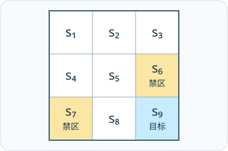
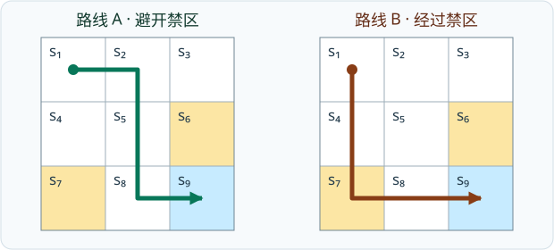
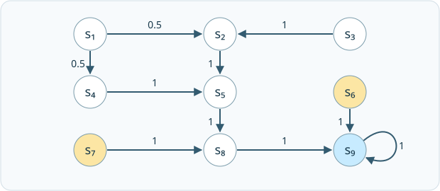

# 第 1 课 · 基本概念 · V2（总结）

[切换到 V1（逐页）](basic-concepts-slides.md)

## 1. 状态、动作与环境反馈

一次交互从当前状态开始。智能体先选动作，环境再返回一笔奖励和一个新状态。例如在左上角 $s_1$ 向右，会到达 $s_2$ 并得到 0 分。

- <strong>状态（state）</strong>记录智能体（agent）当前所处的情形。网格中用 $s_1$ 到 $s_9$ 表示位置，构成状态空间 $\mathcal S$。
- <strong>动作空间（action space）</strong> $\mathcal A(s)$ 是状态 $s$ 下可选的指令。本例 $a_1$ 至 $a_5$ 依次为上、右、下、左、原地不动。
- <strong>状态转移（state transition）</strong>由环境决定。$p(s'\mid s,a)$ 表示在 $s$ 做 $a$ 后到达 $s'$ 的概率。无风时 $s_1$ 向右必到 $s_2$，有风时则可能落在 $s_2$ 或 $s_5$。
- <strong>奖励（reward）</strong>是当前一步得到的分数。$p(r\mid s,a)$ 表示在 $s$ 做 $a$ 后得到 $r$ 的概率。从 $s_1$ 向上撞墙和主动停留都留在 $s_1$，但奖励分别是 $-1$ 和 0。只看落点还不能判断奖励。

<figure>
  
  <figcaption>越界、进入或停在禁区得 −1，进入或主动停在目标格得 +1，其余得 0。禁区允许进入，所以 s₅ 向右会到 s₆。</figcaption>
</figure>

展开状态转移与奖励表

按当前状态查行、按动作查列。每格依次给出下一状态和即时奖励。

<table>
  <thead><tr><th scope="col">状态</th><th scope="col">a₁ ↑</th><th scope="col">a₂ →</th><th scope="col">a₃ ↓</th><th scope="col">a₄ ←</th><th scope="col">a₅ ○</th></tr></thead>
  <tbody>
    <tr><th scope="row">s₁</th><td>s₁，−1</td><td>s₂，0</td><td>s₄，0</td><td>s₁，−1</td><td>s₁，0</td></tr>
    <tr><th scope="row">s₂</th><td>s₂，−1</td><td>s₃，0</td><td>s₅，0</td><td>s₁，0</td><td>s₂，0</td></tr>
    <tr><th scope="row">s₃</th><td>s₃，−1</td><td>s₃，−1</td><td>s₆，−1</td><td>s₂，0</td><td>s₃，0</td></tr>
    <tr><th scope="row">s₄</th><td>s₁，0</td><td>s₅，0</td><td>s₇，−1</td><td>s₄，−1</td><td>s₄，0</td></tr>
    <tr><th scope="row">s₅</th><td>s₂，0</td><td>s₆，−1</td><td>s₈，0</td><td>s₄，0</td><td>s₅，0</td></tr>
    <tr><th scope="row">s₆</th><td>s₃，0</td><td>s₆，−1</td><td>s₉，+1</td><td>s₅，0</td><td>s₆，−1</td></tr>
    <tr><th scope="row">s₇</th><td>s₄，0</td><td>s₈，0</td><td>s₇，−1</td><td>s₇，−1</td><td>s₇，−1</td></tr>
    <tr><th scope="row">s₈</th><td>s₅，0</td><td>s₉，+1</td><td>s₈，−1</td><td>s₇，−1</td><td>s₈，0</td></tr>
    <tr><th scope="row">s₉</th><td>s₆，−1</td><td>s₉，−1</td><td>s₉，−1</td><td>s₈，0</td><td>s₉，+1</td></tr>
  </tbody>
</table>

## 2. 策略决定选哪个动作

<strong>策略（policy）</strong> $\pi(a\mid s)$ 给出在 $s$ 选择 $a$ 的概率。同一个状态下，这些概率加起来为 1。换一个状态，就按新状态对应的规则选动作。

- <strong>确定性策略（deterministic policy）</strong>给一个动作概率 1。例如 $s_1$ 总是向右。
- <strong>随机策略（stochastic policy）</strong>给多个动作正概率。例如 $s_1$ 向右、向下各 0.5。

<strong>策略概率回答「打算怎么走」，转移概率回答「选定后会到哪儿」。</strong> 假设策略有 0.5 的概率选向右，而选中后又只有 0.8 的概率落到右边的 $s_2$。那么「选向右且落到 $s_2$」这条分支的概率是 $0.5\times0.8=0.4$。

展开策略表

每格是选动作的概率。把 s₁ 行改为 (0, 1, 0, 0, 0)，就得到例子里的确定性策略。

<table>
  <thead><tr><th scope="col">状态</th><th scope="col">a₁ ↑</th><th scope="col">a₂ →</th><th scope="col">a₃ ↓</th><th scope="col">a₄ ←</th><th scope="col">a₅ ○</th></tr></thead>
  <tbody>
    <tr><th scope="row">s₁</th><td>0</td><td>0.5</td><td>0.5</td><td>0</td><td>0</td></tr>
    <tr><th scope="row">s₂</th><td>0</td><td>0</td><td>1</td><td>0</td><td>0</td></tr>
    <tr><th scope="row">s₃</th><td>0</td><td>0</td><td>0</td><td>1</td><td>0</td></tr>
    <tr><th scope="row">s₄</th><td>0</td><td>1</td><td>0</td><td>0</td><td>0</td></tr>
    <tr><th scope="row">s₅</th><td>0</td><td>0</td><td>1</td><td>0</td><td>0</td></tr>
    <tr><th scope="row">s₆</th><td>0</td><td>0</td><td>1</td><td>0</td><td>0</td></tr>
    <tr><th scope="row">s₇</th><td>0</td><td>1</td><td>0</td><td>0</td><td>0</td></tr>
    <tr><th scope="row">s₈</th><td>0</td><td>1</td><td>0</td><td>0</td><td>0</td></tr>
    <tr><th scope="row">s₉</th><td>0</td><td>0</td><td>0</td><td>0</td><td>1</td></tr>
  </tbody>
</table>

## 3. 从单步奖励到整条轨迹的回报

<strong>轨迹（trajectory）</strong>按顺序记录状态、动作与奖励。从 $s_1$ 选向右、得到 0 分并到达 $s_2$，就是一条轨迹的第一步。<strong>回报（return）</strong>把一条轨迹上的奖励合起来。先比较下面两条只算到达目标那一步、暂时不做折扣的路线。

<figure>
  
  <figcaption>两条路都在第四步到达目标。路线 A 的回报为 0 + 0 + 0 + 1 = 1，路线 B 在第二步进了禁区，回报为 0 − 1 + 0 + 1 = 0。</figcaption>
</figure>

两条路线到达的是同一个目标，但累计分数不同。如果某个策略以 0.5 的概率走路线 A、以 0.5 的概率走路线 B，它一次实际运行的回报是 1 或 0，多次运行的平均回报是 $0.5(1)+0.5(0)=0.5$。第 2 课会用这个平均来评价策略。

## 4. 回合、持续任务与折扣回报

从起点一直走到<strong>终止状态（terminal state）</strong>，这段交互称为一个<strong>回合（episode）</strong>。到达目标是否意味着回合结束，由任务规则决定。<strong>持续型任务（continuing task）</strong>会在到达目标后继续计算后续交互。

- 把目标设为<strong>吸收状态（absorbing state）</strong>，到达后永远留在该状态。若后续奖励都设为 0，奖励序列可补上无限多个 0，原回合的回报不受影响。
- 把 $s_9$ 当作普通状态，到达后还可以选动作。如果原地停留每步都得 $+1$，直接相加会一直增长。此时用折扣来给不同时间的奖励设权重。

<strong>折扣回报（discounted return）</strong>从时刻 $t$ 开始加总未来奖励。下一步奖励记作 $R_{t+1}$，权重是 1。往后每迟一步，就多乘一次<strong>折扣因子（discount factor）</strong> $\gamma$，其中 $0\le\gamma<1$。

$$
G_t=R_{t+1}+\gamma R_{t+2}+\gamma^2R_{t+3}+\cdots.
$$

路线 A 如果到达目标就结束，第四步的 $+1$ 乘上 $\gamma^3$，之后没有奖励。如果到达后继续停留、每步得 $+1$，回报就从第四步起累加一串折扣奖励。

$$
\begin{aligned}
G_0 &= \gamma^3(1)+\gamma^4(1)+\gamma^5(1)+\cdots\\
    &= \gamma^3(1+\gamma+\gamma^2+\cdots)\\
    &= \frac{\gamma^3}{1-\gamma}.
\end{aligned}
$$

当 $\gamma=0.5$ 时，终止版本的回报是 $0.5^3=0.125$，持续版本是 $0.125/(1-0.5)=0.25$。$\gamma=0$ 时只计第一步，越接近 1 则越重视远期奖励。只要每步奖励有界，折扣后的总和就是有限的。

## 5. 马尔可夫决策过程

<strong>马尔可夫决策过程（Markov decision process，MDP）</strong>统一描述环境的状态、可选动作、奖励和状态转移。折扣因子决定怎样计算回报。策略 $\pi(a\mid s)$ 则是在这套规则下选动作的方案。

<strong>马尔可夫性质（Markov property）</strong>要求给定当前状态和动作后，更早的历史不会改变下一状态与奖励的概率。例如，无论从上方还是左侧到达 $s_5$，接下来向右都会进 $s_6$ 并扣 1 分。如果同一格的结果还取决于手里有没有钥匙，光记录位置就不够。把「是否有钥匙」也记入状态，才可以用当前状态来区分这两种情况。

<figure>
  
  <figcaption>固定策略后，把动作概率与其转移概率相乘。从 s₁ 选向右的概率是 0.5，选中后必到 s₂，所以这条边的概率是 0.5 × 1 = 0.5。</figcaption>
</figure>

多个动作可能通往同一状态。把「选中这个动作」与「这个动作落到 $s'$」的概率相乘，再把所有分支加起来，就得到按策略走一步的转移概率。

$$
p_\pi(s'\mid s)=\sum_a\pi(a\mid s)\,p(s'\mid s,a).
$$

固定一套只依赖当前状态的策略后，状态序列构成<strong>马尔可夫过程（Markov process）</strong>。图中原来由策略决定的两条分支，可以直接画成从 $s_1$ 出发的两条概率边。
