# 第 2 课 · 贝尔曼公式 · V1（逐页）

[切换到 V2（总结）](bellman-equation.md)

## Part 1 · 为什么要计算回报

### 第 01 页 · 贝尔曼公式在课程中的位置

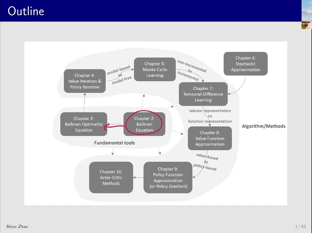

贝尔曼公式（Bellman equation）用来评价已经给定的策略。下一课的贝尔曼最优公式再讨论怎样找到最优策略。课件把这两种公式放在课程地图的基础工具部分，后续的值迭代、策略迭代、蒙特卡洛和时序差分都会用到这里的价值概念。

### 第 02 页 · 本课的概念与工具

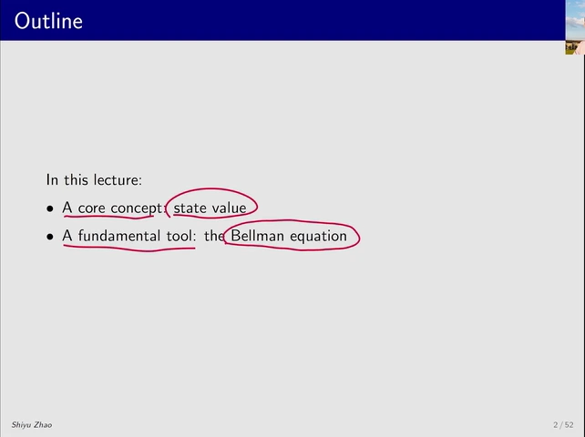

状态价值（state value）回答「从这一格出发，照给定策略走，平均能拿多少分」。贝尔曼公式把这笔分数拆成当前一步和剩余部分，帮助我们计算各格的价值。

### 第 03 页 · 本课安排

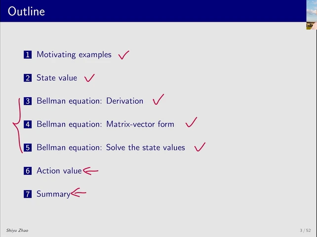

先比较三种走法的回报，再定义状态价值、推导贝尔曼公式。后半部分把公式写成矩阵并求解，最后讨论指定第一个动作后怎样计算价值。

### 第 04 页 · 从回报例子开始

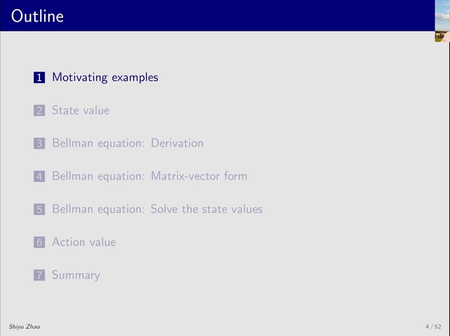

先固定起点和环境，再比较策略。三个例子使用同一个四格网格，区别只在起点选哪个动作。

### 第 05 页 · 用回报评价策略

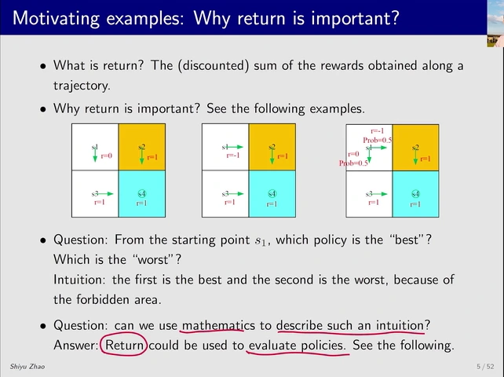

从左上角 $s_1$ 出发，左图先向下到 $s_3$，中图先向右进入禁区 $s_2$，右图以相同概率走两条路。三种策略第二步都到 $s_4$，随后留在目标格。直觉上应避开禁区，下面用折扣回报（discounted return）量化差别。

### 第 06 页 · 策略一的折扣回报

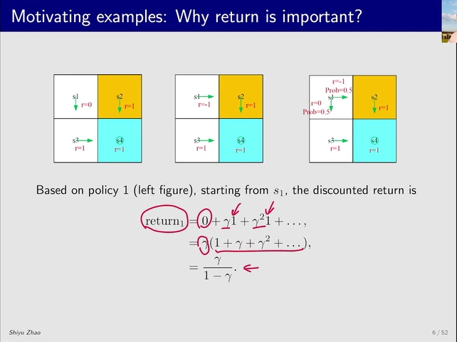

第一步到 $s_3$ 得 0，第二步进入 $s_4$ 得 1，此后每次停留仍得 1。折扣因子为 $\gamma$ 时，回报是 $0+\gamma+\gamma^2+\cdots=\gamma/(1-\gamma)$。第一个正奖励在第二步，权重从 $\gamma$ 开始。

### 第 07 页 · 策略二的折扣回报

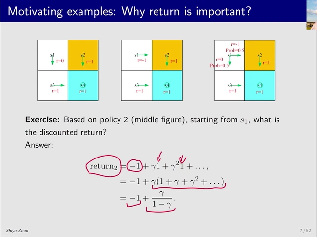

第一步进入 $s_2$ 得 −1，后续奖励序列与策略一相同。回报为 $-1+\gamma/(1-\gamma)$，恰好比策略一少 1，因为扣分发生在第一步，权重为 1。

### 第 08 页 · 策略三的平均回报

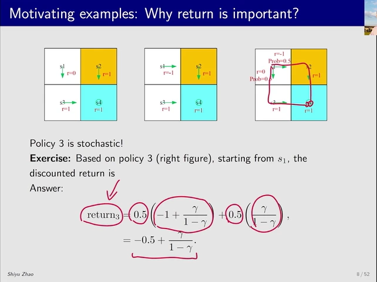

从 $s_1$ 向下与向右各有 0.5 的概率。一次实际走法只会拿到第 06 页或第 07 页的回报。按两条轨迹的概率求平均，得到 $0.5[\gamma/(1-\gamma)]+0.5[-1+\gamma/(1-\gamma)]=-0.5+\gamma/(1-\gamma)$。

### 第 09 页 · 比较三种策略

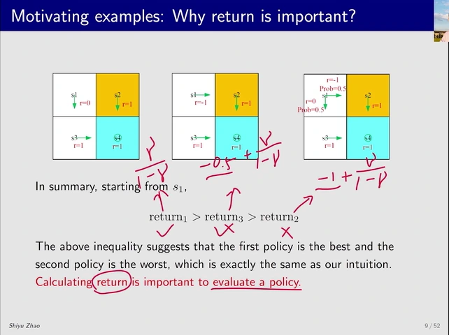

从同一个 $s_1$ 比较，后续奖励项相同，首步得分或平均得分依次为 0、−0.5、−1。因此策略一优于策略三，策略三优于策略二。这一排序针对当前起点。换到三个策略走法相同的格子，价值也可能相同。

### 第 10 页 · 方法一，按定义展开回报

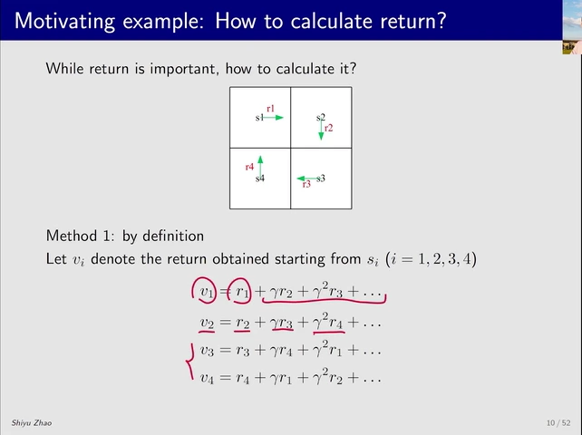

图中的箭头形成 $s_1\to s_2\to s_3\to s_4\to s_1$ 的循环，$r_i$ 是离开 $s_i$ 这一跳的奖励。记从 $s_i$ 出发的回报为 $v_i$，则 $v_1=r_1+\gamma r_2+\gamma^2r_3+\cdots$。从别的格出发时，按同一循环把奖励序列移到相应起点。

### 第 11 页 · 方法二，把剩余回报交给下一状态

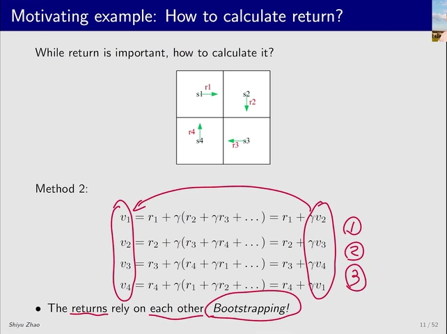

把 $v_1$ 的第一项拿出来，括号里剩下的 $r_2+\gamma r_3+\cdots$ 正是 $v_2$。同理可得 $v_1=r_1+\gamma v_2$、$v_2=r_2+\gamma v_3$、$v_3=r_3+\gamma v_4$、$v_4=r_4+\gamma v_1$。这些价值互相依赖，用下一状态的价值表示当前价值称为自举（bootstrapping）。

### 第 12 页 · 把四个递推式写在一起

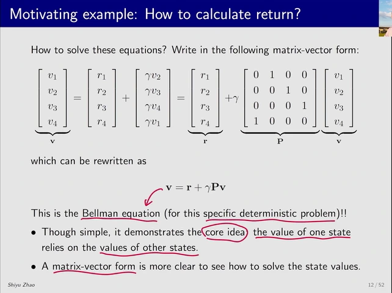

把 $v_i$ 和 $r_i$ 分别排成列向量。转移矩阵 $P$ 的四行各有一个 1，依次在第 2、3、4、1 列。因此 $P\mathbf v$ 依次取出 $v_2,v_3,v_4,v_1$，四式合成 $\mathbf v=\mathbf r+\gamma P\mathbf v$。

### 第 13 页 · 练习，先从目标格倒推

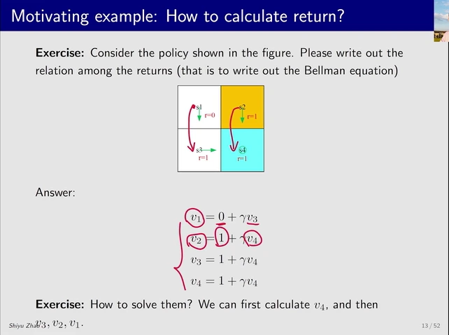

用第 06 页的策略写出 $v_1=\gamma v_3$、$v_2=1+\gamma v_4$、$v_3=1+\gamma v_4$、$v_4=1+\gamma v_4$。先解只有一个未知量的最后一式，再依次得到 $v_2,v_3,v_1$。这里能够逐个倒推，是因为三个格最终都进入目标格的自循环。

## Part 2 · 状态价值

### 第 14 页 · 从单条轨迹转向状态价值

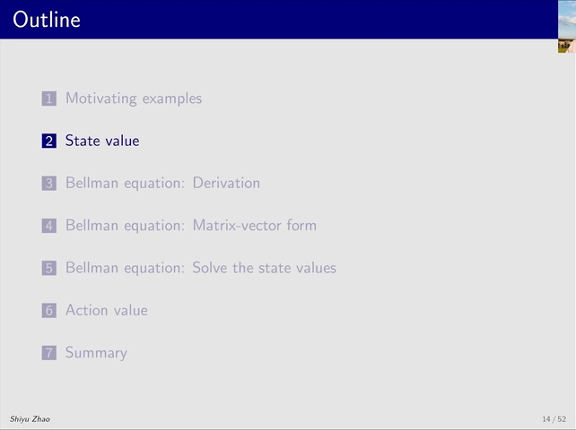

有随机性的策略或环境可能让同一起点产生不同回报。接下来给这些回报取条件期望，得到每个起点对应的一个状态价值。

### 第 15 页 · 记号与单步随机过程

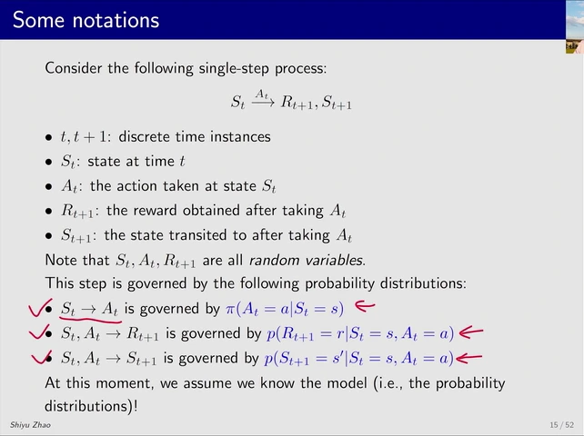

在时刻 $t$，状态是 $S_t$，动作是 $A_t$，随后得到奖励 $R_{t+1}$ 和下一状态 $S_{t+1}$。大写字母表示随机变量，小写 $s,a,r,s'$ 表示取到的具体值。

策略 $\pi(a\mid s)$ 决定怎么选动作。给定状态和动作，$p(r\mid s,a)$ 与 $p(s'\mid s,a)$ 分别描述奖励和状态转移。本课推导与直接求解时先假设这些概率已知。

### 第 16 页 · 轨迹上的随机折扣回报

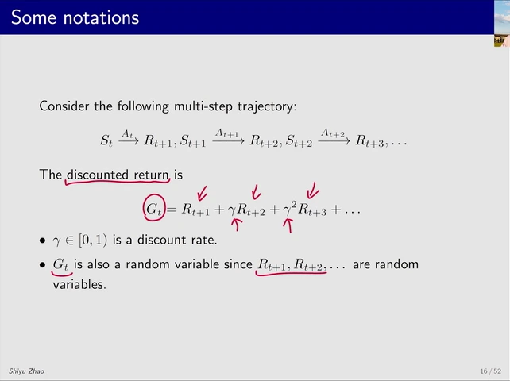

连续重复单步过程得到一条轨迹。从时刻 $t$ 算起，$G_t=R_{t+1}+\gamma R_{t+2}+\gamma^2 R_{t+3}+\cdots$。由于后续奖励可能随机，$G_t$ 也可能有多个取值。

### 第 17 页 · 状态价值是条件期望

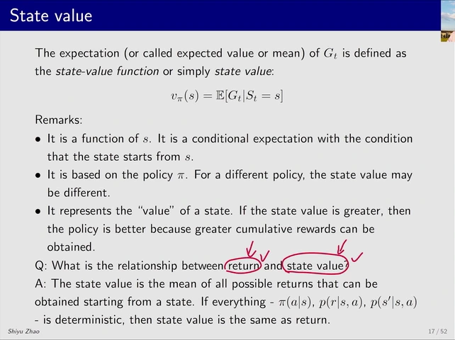

固定策略 $\pi$，从 $s$ 出发的平均回报是 $v_\pi(s)=\mathbb E_\pi[G_t\mid S_t=s]$。给定同一个 $s$，换策略可能改变平均回报。如果选动作、转移和奖励都是确定的，从 $s$ 出发只有一种回报，期望就等于该回报。

### 第 18 页 · 把三个结果写成状态价值

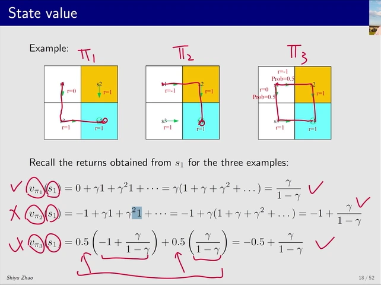

第 06、07 页各只有一个回报，第 08 页有两个可能的回报。因此 $v_{\pi_1}(s_1)=\gamma/(1-\gamma)$，$v_{\pi_2}(s_1)=-1+\gamma/(1-\gamma)$，$v_{\pi_3}(s_1)=-0.5+\gamma/(1-\gamma)$。第三个值是平均值，一次实际走完只会得到两个分支之一的回报。

## Part 3 · 贝尔曼公式的推导

### 第 19 页 · 进入贝尔曼公式的推导

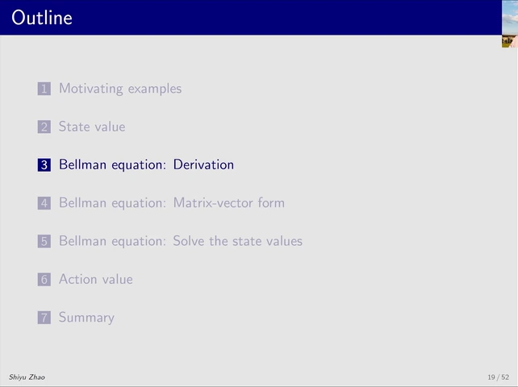

已经知道状态价值是什么。现在把定义里的无限奖励序列拆开，用一步的转移概率和下一状态的价值计算它。

### 第 20 页 · 状态价值为何可以递推

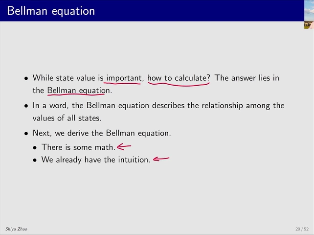

从 $s$ 出发的回报由当前一步以及后续轨迹组成。下一步可能去多个状态，所以当前价值会依赖这些状态的价值。前面的循环例子只有一个确定落点，下面把这个关系推广到随机情形。

### 第 21 页 · 把回报拆成两项

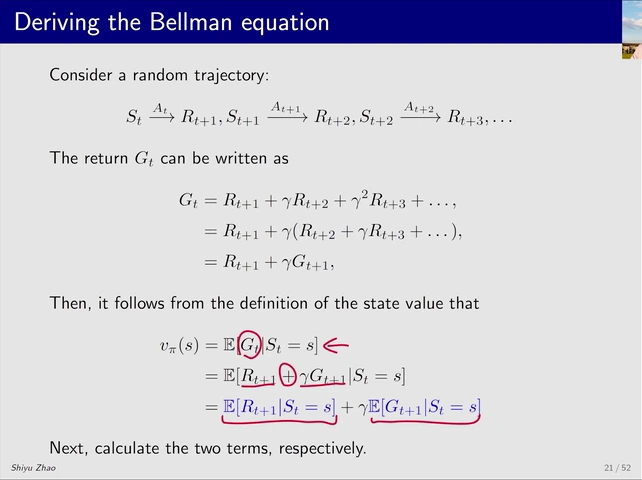

从定义提出第一项，得到 $G_t=R_{t+1}+\gamma G_{t+1}$。对给定 $S_t=s$ 的两项分别取期望：

$$
v_\pi(s)=\mathbb E_\pi[R_{t+1}\mid S_t=s]
+\gamma\,\mathbb E_\pi[G_{t+1}\mid S_t=s].
$$

### 第 22 页 · 第一项，平均即时奖励

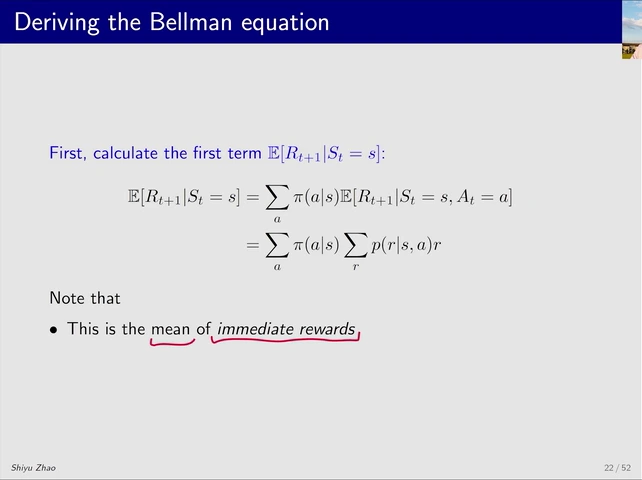

先固定动作 $a$，按 $p(r\mid s,a)$ 对即时奖励 $r$ 加权。动作本身也由策略随机选择，所以再按 $\pi(a\mid s)$ 对不同动作的结果加权。

$$
\mathbb E_\pi[R_{t+1}\mid S_t=s]
=\sum_a\pi(a\mid s)\sum_r p(r\mid s,a)r.
$$

### 第 23 页 · 第二项，平均后续回报

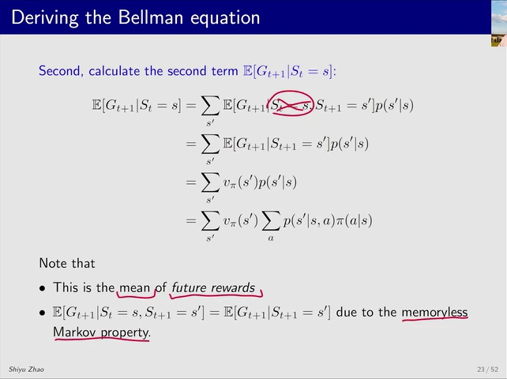

先按下一状态 $s'$ 分组。固定同一策略，在 $s'$ 已知后，马尔可夫性质让我们只用 $v_\pi(s')$ 表示此后的平均回报。到达 $s'$ 的概率本身要把所有动作的贡献加起来。

$$
\mathbb E_\pi[G_{t+1}\mid S_t=s]
=\sum_{s'}v_\pi(s')\sum_a \pi(a\mid s)p(s'\mid s,a).
$$

### 第 24 页 · 合成贝尔曼公式

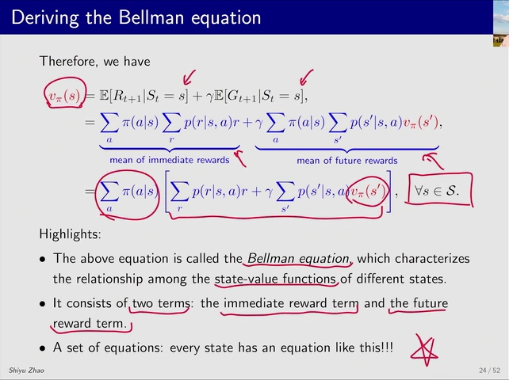

第 22 页与第 23 页都按同一个策略对动作求平均。把 $\pi(a\mid s)$ 提出来，括号内便是选中 $a$ 后的平均即时奖励，加上折扣后的下一状态平均价值。

$$
v_\pi(s)=\sum_a\pi(a\mid s)
\left[\sum_r p(r\mid s,a)r
+\gamma\sum_{s'}p(s'\mid s,a)v_\pi(s')\right].
$$

每个状态都有一条这样的方程。

### 第 25 页 · 区分给定量与未知量

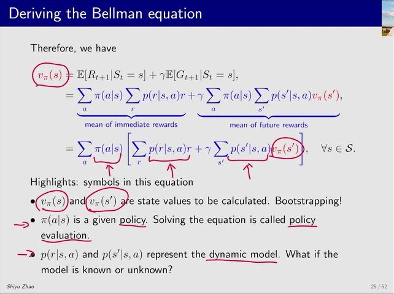

$\pi(a\mid s)$ 是要评价的策略，两个 $p$ 是环境模型给出的概率。$v_\pi(s)$ 和 $v_\pi(s')$ 都是待求的状态价值。给定策略求价值叫策略评估（policy evaluation）。如果模型未知，就不能直接把这些概率代进方程，后续课程会用交互经验来估计价值。

### 第 26 页 · 确定性例子，先写起点的方程

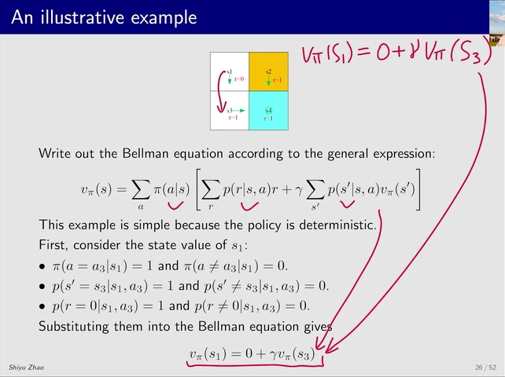

在 $s_1$，向下的概率为 1，落到 $s_3$ 且拿到 0 分的概率也为 1。代入第 24 页时，其他动作、落点和奖励的项都为 0，于是得到 $v_\pi(s_1)=0+\gamma v_\pi(s_3)$。

### 第 27 页 · 把四个格子的方程列全

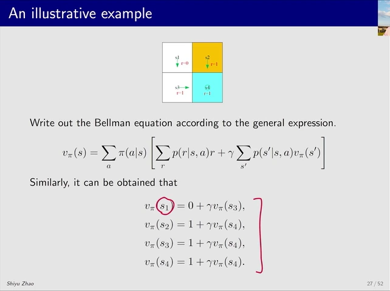

$s_2$ 和 $s_3$ 都以 +1 进入 $s_4$。到了 $s_4$ 后原地不动，每步仍为 +1。令 $v_i=v_\pi(s_i)$，四个等式为 $v_1=\gamma v_3$、$v_2=1+\gamma v_4$、$v_3=1+\gamma v_4$、$v_4=1+\gamma v_4$。

### 第 28 页 · 从自循环解出目标格

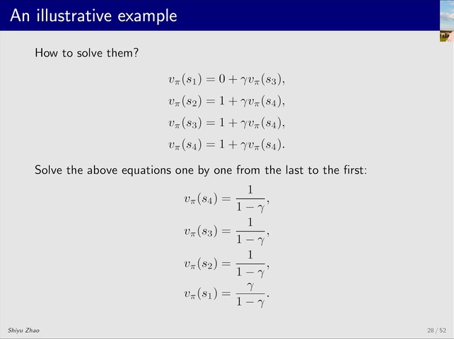

先把 $\gamma v_4$ 移到左边，得到 $v_4=1/(1-\gamma)$。代入得 $v_2=v_3=1/(1-\gamma)$，最后 $v_1=\gamma/(1-\gamma)$。这与第 06 页沿轨迹累加的结果相同。

### 第 29 页 · 代入折扣因子核对价值

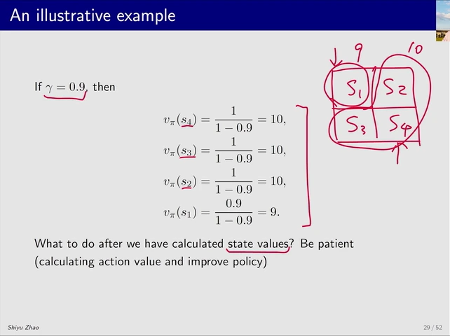

取 $\gamma=0.9$，得到 $(v_1,v_2,v_3,v_4)=(9,10,10,10)$。虽然 $s_2$ 是禁区，但从那里出发时，进入禁区的惩罚已发生在过去。下一步直接到目标拿 +1，所以它的状态价值仍为 10。

### 第 30 页 · 练习，把起点改为随机策略

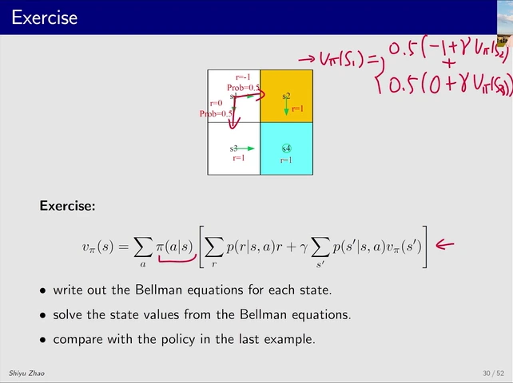

$s_1$ 各以 0.5 的概率向右和向下。右转立即得 −1 并到 $s_2$，向下立即得 0 并到 $s_3$。先写两条分支各自的「奖励加折扣后续价值」，再按 0.5 加权。其余三个状态的方程与第 27 页相同。

### 第 31 页 · 随机策略练习的解

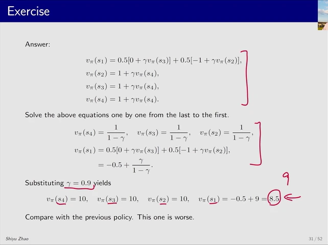

$v_1=0.5(-1+\gamma v_2)+0.5(0+\gamma v_3)$。代入 $v_2=v_3=1/(1-\gamma)$，得 $v_1=-0.5+\gamma/(1-\gamma)$。取 $\gamma=0.9$，起点价值为 8.5，其余三个格仍为 10。与第 29 页相比，起点降低的 0.5 来自一半概率的首步惩罚。

## Part 4 · 矩阵形式与求解

### 第 32 页 · 转入矩阵形式

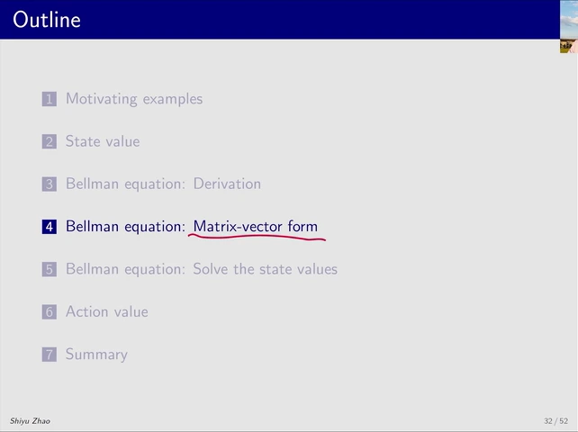

逐状态公式已经把当前价值和下一状态的价值连了起来。现在将所有状态的方程排成一组，用矩阵表达，便于统一求解。

### 第 33 页 · 为什么需要矩阵

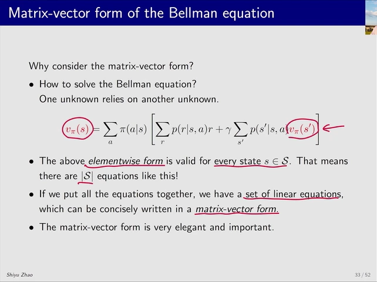

有 $n$ 个状态就有 $n$ 条方程，每条都可能引用其他状态的价值。固定策略和模型后，这些概率都已知，未知量只有 $n$ 个状态价值，因此它们组成线性方程组。

### 第 34 页 · 先把策略平均进奖励和转移

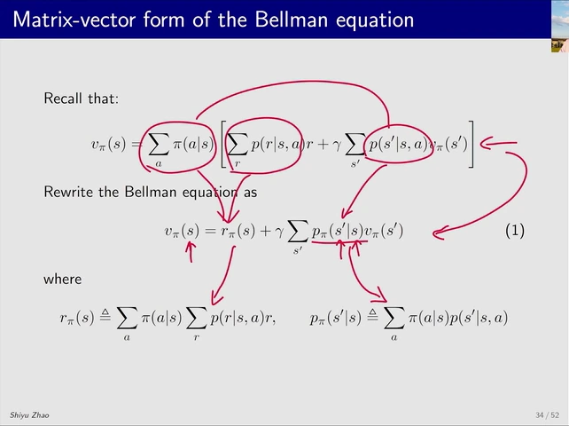

把动作选择纳入环境的一步统计量。$r_\pi(s)$ 是从 $s$ 按策略选动作后的平均即时奖励，$p_\pi(s'\mid s)$ 是走到 $s'$ 的概率。

$$
r_\pi(s)=\sum_a\pi(a\mid s)\sum_r p(r\mid s,a)r,\qquad
p_\pi(s'\mid s)=\sum_a\pi(a\mid s)p(s'\mid s,a).
$$

于是逐状态式可写为 $v_\pi(s)=r_\pi(s)+\gamma\sum_{s'}p_\pi(s'\mid s)v_\pi(s')$。

### 第 35 页 · 把所有状态排成矩阵

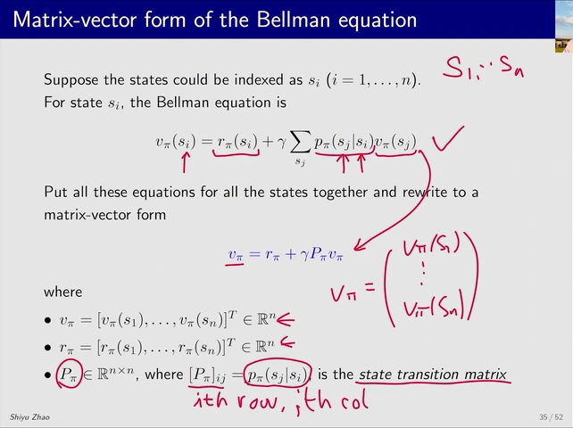

$\mathbf v_\pi$ 与 $\mathbf r_\pi$ 各有 $n$ 个分量。$P_\pi$ 是 $n\times n$ 的转移矩阵，第 $i$ 行第 $j$ 列表示从 $s_i$ 到 $s_j$ 的概率。每行概率之和为 1。

$$
\mathbf v_\pi=\mathbf r_\pi+\gamma P_\pi\mathbf v_\pi.
$$

矩阵乘法的第 $i$ 个分量就是第 $i$ 个状态的下一步平均价值。

### 第 36 页 · 确定性策略的转移矩阵

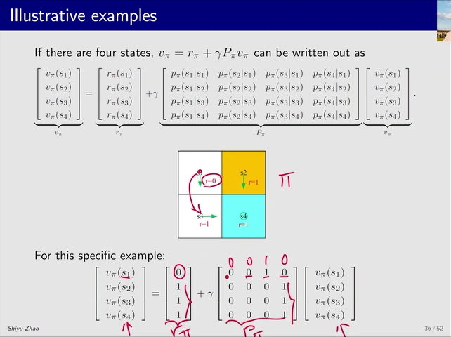

按 $s_1,s_2,s_3,s_4$ 排列，$\mathbf r_\pi=(0,1,1,1)^\mathsf T$。$P_\pi$ 第一行的 1 在第 3 列，表示 $s_1$ 必到 $s_3$。其余三行的 1 都在第 4 列，最后一行表示 $s_4$ 的自循环。

### 第 37 页 · 随机策略的转移矩阵

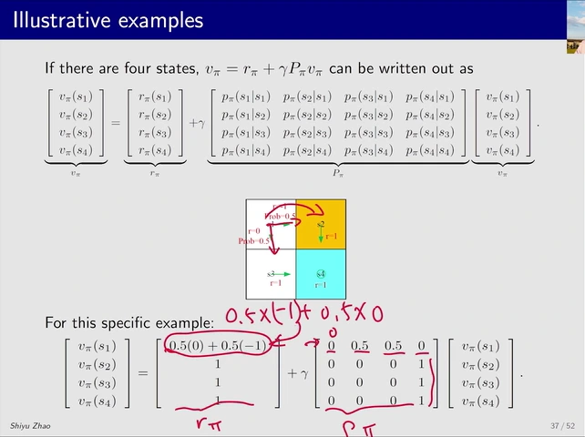

随机策略只改第一行。它是 $(0,0.5,0.5,0)$，分别对应向右到 $s_2$ 和向下到 $s_3$。奖励向量的第一项也变成 $0.5(-1)+0.5(0)=-0.5$。代回矩阵的第一行，就得到第 31 页的起点方程。

### 第 38 页 · 进入策略评估的求解

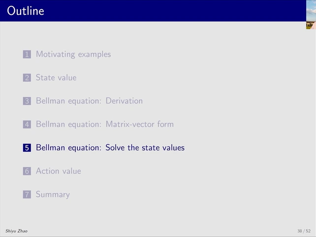

矩阵里的奖励和转移由给定策略决定。接下来用这组已知量求 $\mathbf v_\pi$，也就是执行策略评估。

### 第 39 页 · 为什么要解状态价值

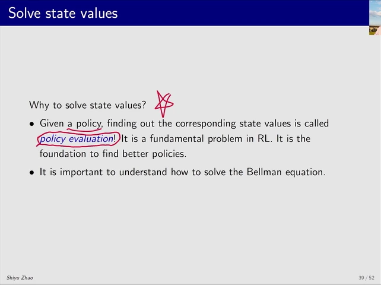

状态价值让我们比较同一策略在不同起点下的表现，也能为后续改进策略提供依据。课件接下来用闭式解与迭代解说明怎样计算它。

### 第 40 页 · 闭式解与迭代解

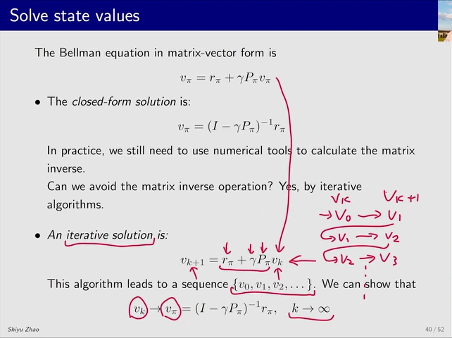

移项得到 $(I-\gamma P_\pi)\mathbf v_\pi=\mathbf r_\pi$，其中 $I$ 是单位矩阵。有限状态、$0\le\gamma<1$ 时，闭式解和迭代式分别是

$$
\mathbf v_\pi=(I-\gamma P_\pi)^{-1}\mathbf r_\pi,
\qquad
\mathbf v_{k+1}=\mathbf r_\pi+\gamma P_\pi\mathbf v_k.
$$

闭式解给出精确关系，实际可以求解线性方程组。迭代从任意初值开始，反复用上一轮的价值更新全部状态，避免显式求逆。

### 第 41 页 · 为什么迭代会收敛

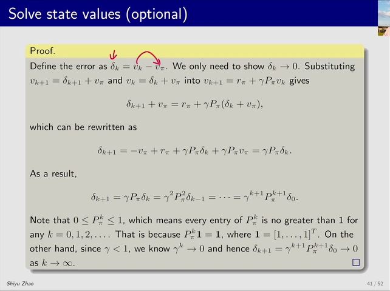

把第 $k$ 轮与真值之差记为 $\delta_k=\mathbf v_k-\mathbf v_\pi$。将迭代式减去真值满足的贝尔曼方程，奖励项抵消，得到 $\delta_{k+1}=\gamma P_\pi\delta_k$。重复展开就是 $\delta_k=\gamma^k P_\pi^k\delta_0$。$P_\pi^k$ 的每行仍是概率分布，所以其加权平均不会放大最大绝对误差。$\gamma^k$ 趋向 0，因此迭代收敛到真值。

### 第 42 页 · 较好策略的状态价值

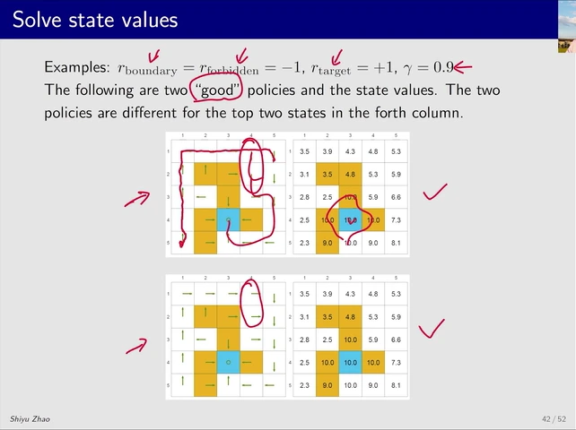

五格乘五格的例子使用边界和禁区奖励 −1、目标奖励 +1，以及 $\gamma=0.9$。图左是动作箭头，图右是每格的价值。两个策略只在第四列最上方两格的动作不同。沿图读数，目标附近的格子回报较高，目标格持续拿 +1 时价值是 10。

### 第 43 页 · 较差策略的状态价值

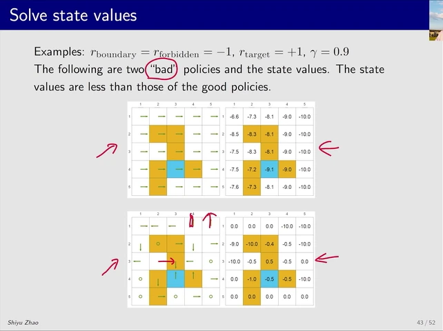

奖励和折扣保持相同，换成另外两组箭头后，图中的许多状态价值明显降低。沿箭头查看是反复撞边界、走进禁区，还是一直停在普通格，可以把价值图上的负数或零和实际走法对应起来。

## Part 5 · 动作价值

### 第 44 页 · 进入动作价值

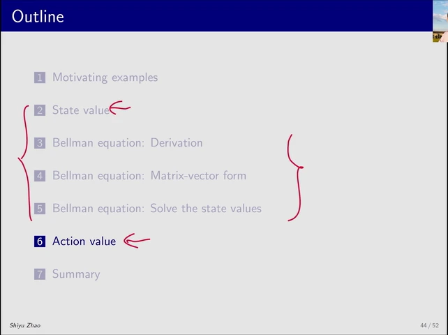

状态价值把所有可能的首步动作按策略平均。接下来固定第一个动作，看看从同一格选择不同指令各值多少。

### 第 45 页 · 状态价值与动作价值的区别

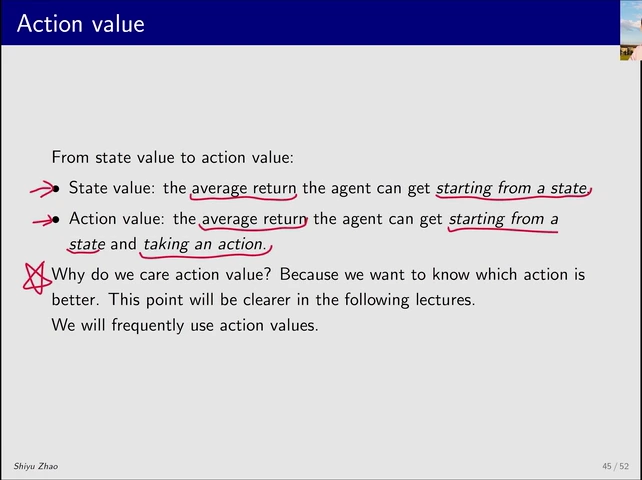

状态价值给定起点，首步仍由策略选择。动作价值（action value）同时给定起点和首步动作，从第二步起再按原策略走。要比较在同一格向右和向下，动作价值就能把两种选择分开。

### 第 46 页 · 动作价值的定义

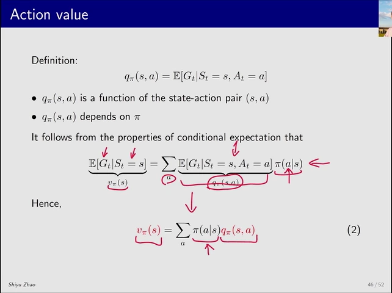

$q_\pi(s,a)=\mathbb E_\pi[G_t\mid S_t=s,A_t=a]$。它取决于状态、指定动作和之后采用的策略。若把第一个动作交回给策略，就按其概率平均：

$$
v_\pi(s)=\sum_a\pi(a\mid s)q_\pi(s,a).
$$

### 第 47 页 · 用下一状态的价值计算动作价值

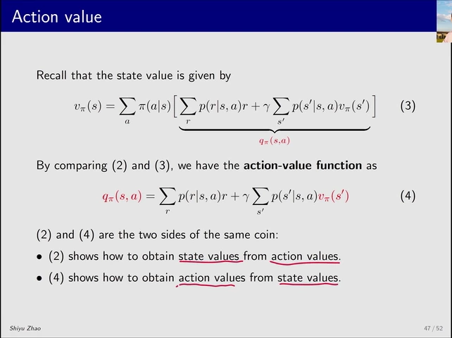

贝尔曼公式中按动作加权的括号，正是固定首步动作后得到的价值。

$$
q_\pi(s,a)=\sum_r p(r\mid s,a)r
+\gamma\sum_{s'}p(s'\mid s,a)v_\pi(s').
$$

已知 $v_\pi$ 可以算 $q_\pi$。已知 $q_\pi$ 则可按第 46 页的动作概率得到 $v_\pi$。

### 第 48 页 · 从起点向右的动作价值

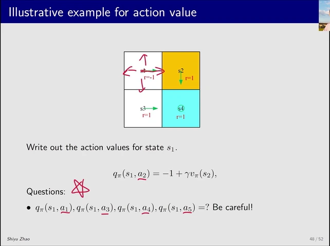

本例固定的是第 07 页的策略。从 $s_1$ 向右进入禁区 $s_2$，立即得 −1，之后按该策略走。所以 $q_\pi(s_1,a_2)=-1+\gamma v_\pi(s_2)$。也可以考察策略在 $s_1$ 本来不会选的动作，只需在第一步指定它。

### 第 49 页 · 从起点执行其余四个动作

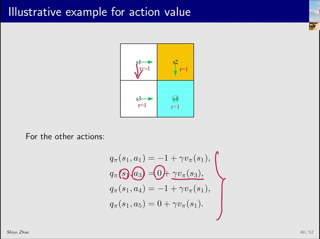

向上和向左都撞墙，扣 1 分并留在 $s_1$。向下到 $s_3$ 得 0 分，原地不动也得 0 分。四个动作的价值分别是

$$
\begin{aligned}
q_\pi(s_1,a_1)&=-1+\gamma v_\pi(s_1),\\
q_\pi(s_1,a_3)&=\gamma v_\pi(s_3),\\
q_\pi(s_1,a_4)&=-1+\gamma v_\pi(s_1),\\
q_\pi(s_1,a_5)&=\gamma v_\pi(s_1).
\end{aligned}
$$

如果第一步撞墙或停留而回到 $s_1$，第二步起就恢复执行原策略。

### 第 50 页 · 动作价值用来比较动作

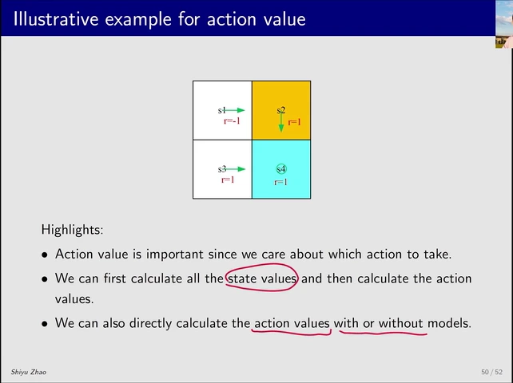

先用贝尔曼方程求状态价值，再代入第 47 页，就能比较同一状态下的动作。后续课程也会介绍直接估计动作价值的方法，包括模型未知时利用交互数据的做法。

### 第 51 页 · 回顾本课的计算顺序

从一条轨迹的折扣回报出发，对给定起点的回报取平均得到状态价值。把即时奖励和后续价值拆开，就能写出贝尔曼方程，最后把固定首步动作的部分单独拿出来定义动作价值。

### 第 52 页 · 公式回顾

状态价值是给定状态的平均回报，动作价值再固定首步动作。逐状态贝尔曼公式计算平均即时奖励加上折扣后的下一状态平均价值。把各状态的式子并起来得到 $\mathbf v_\pi=\mathbf r_\pi+\gamma P_\pi\mathbf v_\pi$，可解线性方程组，也可迭代更新。
