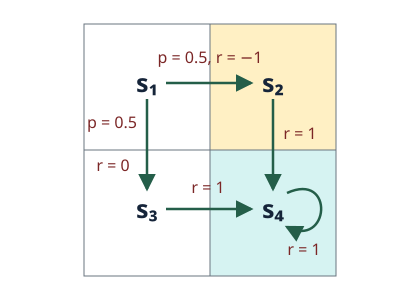

# 第 2 课 · 贝尔曼公式

## 1. Return & State Value

### 1.1 交互记号、轨迹与折扣回报 {#_1-交互记号、轨迹与折扣回报}

Some notations · 从单步交互到多步回报

在离散时刻 $t$，智能体处于状态 $S_t$，执行动作 $A_t$；环境随后给出即时奖励 $R_{t+1}$ 和下一状态 $S_{t+1}$。

$$
S_t\xrightarrow{A_t}R_{t+1},\,S_{t+1}.
$$

大写 $S_t,A_t,R_{t+1},S_{t+1}$ 表示<strong>随机变量（random variables）</strong>；小写 $s,a,r,s'$ 表示它们的具体取值。

- <strong>策略（policy）</strong>：$\pi(a\mid s)=\Pr_\pi(A_t=a\mid S_t=s)$，给定状态后选中动作 $a$ 的概率。
- <strong>奖励概率（reward probability）</strong>：$p(r\mid s,a)=\Pr(R_{t+1}=r\mid S_t=s,A_t=a)$，给定状态和动作后获得奖励 $r$ 的概率。
- <strong>状态转移概率（state transition probability）</strong>：$p(s'\mid s,a)=\Pr(S_{t+1}=s'\mid S_t=s,A_t=a)$，给定状态和动作后到达 $s'$ 的概率。

把单步交互接起来，就得到一条<strong>轨迹（trajectory）</strong>：

$$
S_t\xrightarrow{A_t}R_{t+1},\,S_{t+1}
\xrightarrow{A_{t+1}}R_{t+2},\,S_{t+2}
\xrightarrow{A_{t+2}}R_{t+3},\,\ldots
$$

从时刻 $t$ 算起，<strong>折扣回报（discounted return）</strong>是：

$$
G_t=R_{t+1}+\gamma R_{t+2}+\gamma^2R_{t+3}+\cdots.
$$

$\gamma\in[0,1)$ 是<strong>折扣因子（discount factor）</strong>。执行 $A_t$ 后收到的第一笔奖励权重为 $1$，之后每晚一步就多乘一个 $\gamma$。因为各步奖励是随机变量，$G_t$ 也是随机变量；即使起点相同，不同轨迹也可能得到不同的回报。

### 1.2 状态价值 {#_2-状态价值}

State value · 给定起点的平均回报

给定策略 $\pi$，从状态 $s$ 出发，第一步和后续动作都按 $\pi$ 选择。对可能的折扣回报按概率取平均，得到<strong>状态价值（state value）</strong>：

$$
v_\pi(s)=\mathbb E_\pi[G_t\mid S_t=s].
$$

- <strong>为什么是条件期望？</strong>这里只对以 $S_t=s$ 为起点的轨迹取平均；固定策略后，$v_\pi$ 就是以 $s$ 为输入的函数。
- <strong>为什么要标出策略？</strong>不同策略会选不同的动作。同一状态在不同策略下的价值可能不同；从同一个 $s$ 出发，$v_\pi(s)$ 越高，表示该策略的预期折扣回报越高。

## 2. Bellman Expectation Equation

### 2.1 把回报拆成两项 {#_1-把回报拆成两项}

Deriving the Bellman equation · 从轨迹到期望

沿用上一节的随机轨迹：在时刻 $t$ 执行动作 $A_t$，先收到 $R_{t+1}$，再从 $S_{t+1}$ 继续。把第一笔奖励单独拿出来：

$$
\begin{aligned}
G_t &= R_{t+1}+\gamma R_{t+2}+\gamma^2 R_{t+3}+\cdots\\
    &= R_{t+1}+\gamma(R_{t+2}+\gamma R_{t+3}+\cdots)\\
    &= R_{t+1}+\gamma G_{t+1}.
\end{aligned}
$$

$R_{t+2}$ 在 $G_{t+1}$ 中是第一笔奖励，权重为 $1$；换回时刻 $t$ 计价时，整段后续回报要再乘一次 $\gamma$。

固定起点 $S_t=s$，把上式代入状态价值定义。由条件期望的线性性质，两项可以分别计算，无须假设它们独立：

$$
\begin{aligned}
v_\pi(s)&=\mathbb E_\pi[G_t\mid S_t=s]\\
&=\mathbb E_\pi[R_{t+1}+\gamma G_{t+1}\mid S_t=s]\\
&=\underbrace{\mathbb E_\pi[R_{t+1}\mid S_t=s]}_{\text{平均即时奖励}}
+\gamma\underbrace{\mathbb E_\pi[G_{t+1}\mid S_t=s]}_{\text{下一时刻的平均回报}}.
\end{aligned}
$$

### 2.2 Expected Immediate Reward {#expected-immediate-reward}

（2）第一项 · 平均即时奖励

只固定了起点 $s$，因此第一步动作仍由策略 $\pi$ 选择。按动作使用<strong>全期望公式（law of total expectation）</strong>：

$$
\begin{aligned}
r_\pi(s)
&=\mathbb E_\pi[R_{t+1}\mid S_t=s]\\
&=\sum_a\pi(a\mid s)\,\mathbb E[R_{t+1}\mid S_t=s,A_t=a]\\
&=\sum_a\pi(a\mid s)\sum_r p(r\mid s,a)\,r.
\end{aligned}
$$

给定 $a$ 后，内层按环境的奖励概率计算平均奖励；外层再按策略选择各动作的概率加权。这一项只计算执行 $A_t$ 后收到的 $R_{t+1}$。

### 2.3 Expected Future Return {#expected-future-return}

（3）第二项 · 下一时刻的平均回报

第一项按<strong>动作</strong>分组，这一项先按<strong>下一状态</strong>分组。令 $p_\pi(s'\mid s)$ 表示按策略从 $s$ 走一步到达 $s'$ 的概率。

$$
\begin{aligned}
&\mathbb E_\pi[G_{t+1}\mid S_t=s]\\
&=\sum_{s'}p_\pi(s'\mid s)\,
   \mathbb E_\pi[G_{t+1}\mid S_t=s,S_{t+1}=s']\\
&=\sum_{s'}p_\pi(s'\mid s)\,
   \mathbb E_\pi[G_{t+1}\mid S_{t+1}=s']\\
&=\sum_{s'}p_\pi(s'\mid s)\,v_\pi(s').
\end{aligned}
$$

这三步分别是：<strong>按落点取全期望</strong>；利用马尔可夫性质和只依赖当前状态的策略去掉旧状态 $S_t=s$；认出剩下的条件期望正是 $v_\pi(s')$。

下一步的落点概率由所有可能的动作共同决定。对「选中 $a$ 且到达 $s'$」求和：

$$
\begin{aligned}
p_\pi(s'\mid s)
&=\sum_a\Pr_\pi(A_t=a,S_{t+1}=s'\mid S_t=s)\\
&=\sum_a\pi(a\mid s)\,p(s'\mid s,a).
\end{aligned}
$$

代回后，把求和顺序从「先列落点」改成「先列动作」，方便与第一项合并：

$$
\begin{aligned}
\mathbb E_\pi[G_{t+1}\mid S_t=s]
&=\sum_{s'}v_\pi(s')\sum_a \pi(a\mid s)\,p(s'\mid s,a)\\
&=\sum_a\pi(a\mid s)\sum_{s'}p(s'\mid s,a)\,v_\pi(s').
\end{aligned}
$$

这项包含从下一时刻开始的奖励（第一笔是 $R_{t+2}$）。合回 $v_\pi(s)$ 时再乘一次 $\gamma$。

### 2.4 Putting Both Terms Together {#putting-both-terms-together}

（4）合并两项 · 贝尔曼期望方程与环境模型

把两项分别代入，再提出共同的动作权重 $\pi(a\mid s)$：

$$
\begin{aligned}
v_\pi(s)
&=\underbrace{\sum_a\pi(a\mid s)\sum_r p(r\mid s,a)\,r}_{\text{平均即时奖励}}\\
&\quad+\underbrace{\gamma\sum_a\pi(a\mid s)\sum_{s'}p(s'\mid s,a)\,v_\pi(s')}_{\text{折扣后的平均后续回报}}\\[4pt]
&=\sum_a\pi(a\mid s)\left[\sum_r p(r\mid s,a)\,r
   +\gamma\sum_{s'}p(s'\mid s,a)\,v_\pi(s')\right],
   \qquad \forall s\in\mathcal S .
\end{aligned}
$$

贝尔曼期望方程把<strong>当前状态的价值与可能到达的下一状态的价值</strong>联系起来，下一状态也可能是当前状态。有限状态下，每个状态给出一个方程，合起来就是一组关于各状态价值的联立方程。给定策略求这些价值，叫作<strong>策略评估（policy evaluation）</strong>。

方程里的 $p(r\mid s,a)$ 和 $p(s'\mid s,a)$ 描述了<strong>环境模型（dynamics model）</strong>中用于这两项期望的奖励概率和转移概率；$\pi(a\mid s)$ 则来自给定的策略。

- <strong>模型已知</strong>：可以直接按概率求和，再用下一节的矩阵形式或迭代法求状态价值。
- <strong>模型未知</strong>：贝尔曼方程仍然成立，但无法直接代入真实概率。可以用交互数据估计模型再求解，也可以直接从采样的回报或转移中估计价值，例如后面的 Monte Carlo 和 Temporal-Difference 方法。

## 3. Matrix Form & Policy Evaluation

### 3.1 先对动作求平均，再合并各状态的方程 {#_1-先对动作求平均-再合并各状态的方程}

Matrix-vector form · 从逐状态到矩阵

固定策略 $\pi$ 后，把动作概率吸收到<strong>平均即时奖励</strong> $r_\pi(s)$ 和<strong>一步转移概率</strong> $p_\pi(s'\mid s)$ 里：

$$
\begin{aligned}
r_\pi(s)&=\sum_a\pi(a\mid s)\sum_r p(r\mid s,a)\,r,\\
p_\pi(s'\mid s)&=\sum_a\pi(a\mid s)\,p(s'\mid s,a),\\[3pt]
v_\pi(s)&=r_\pi(s)+\gamma\sum_{s'}p_\pi(s'\mid s)v_\pi(s').
\end{aligned}
$$

把有限个状态编号为 $s_1,\ldots,s_n$。第 $i$ 个状态的方程是 $v_\pi(s_i)=r_\pi(s_i)+\gamma\sum_{j=1}^{n}p_\pi(s_j\mid s_i)v_\pi(s_j)$。按同一顺序排列这些方程：

$$
\begin{aligned}
\mathbf v_\pi&=[v_\pi(s_1),\ldots,v_\pi(s_n)]^\mathsf T\in\mathbb R^n,\\
\mathbf r_\pi&=[r_\pi(s_1),\ldots,r_\pi(s_n)]^\mathsf T\in\mathbb R^n,\\
P_\pi&\in\mathbb R^{n\times n},\qquad [P_\pi]_{ij}=p_\pi(s_j\mid s_i).
\end{aligned}
$$

<strong>状态转移矩阵（state transition matrix）</strong>的行代表当前状态，列代表下一状态，每行概率之和为 $1$。将各状态的方程合起来：

$$
\mathbf v_\pi=\mathbf r_\pi+\gamma P_\pi\mathbf v_\pi.
$$

### 3.2 四个状态时矩阵怎样展开 {#_2-四个状态时矩阵怎样展开}

Matrix-vector form · 四个状态的符号展开

简写 $v_i=v_\pi(s_i)$、$r_i=r_\pi(s_i)$、$p_{ij}=p_\pi(s_j\mid s_i)$。矩阵式逐项写开就是：

$$
\underbrace{\begin{bmatrix}v_1\\v_2\\v_3\\v_4\end{bmatrix}}_{\mathbf v_\pi}
=\underbrace{\begin{bmatrix}r_1\\r_2\\r_3\\r_4\end{bmatrix}}_{\mathbf r_\pi}
+\gamma
\underbrace{\begin{bmatrix}
p_{11}&p_{12}&p_{13}&p_{14}\\
p_{21}&p_{22}&p_{23}&p_{24}\\
p_{31}&p_{32}&p_{33}&p_{34}\\
p_{41}&p_{42}&p_{43}&p_{44}
\end{bmatrix}}_{P_\pi}
\underbrace{\begin{bmatrix}v_1\\v_2\\v_3\\v_4\end{bmatrix}}_{\mathbf v_\pi}.
$$

例如第一行就是 $v_1=r_1+\gamma(p_{11}v_1+p_{12}v_2+p_{13}v_3+p_{14}v_4)$。每一行都是同一规则，只是起点不同。

### 3.3 策略评估：闭式解与迭代解 {#_3-策略评估-闭式解与迭代解}

Solve state values · Policy evaluation

<strong>策略评估（policy evaluation）</strong>是给定策略，求它在各状态的价值。先知道当前策略的表现，才有依据判断怎样改进策略。

#### 3.3.1 Closed-form Solution {#closed-form-solution}

把含有 $\mathbf v_\pi$ 的项移到左边。$I$ 是单位矩阵；在这里 $I-\gamma P_\pi$ 可逆：

$$
\begin{aligned}
(I-\gamma P_\pi)\mathbf v_\pi&=\mathbf r_\pi,\\
\mathbf v_\pi&=(I-\gamma P_\pi)^{-1}\mathbf r_\pi.
\end{aligned}
$$

这是<strong>闭式解（closed-form solution）</strong>。实际计算时，可以用数值工具直接解第一行的线性方程组，无须显式构造逆矩阵。

#### 3.3.2 Iterative Solution {#iterative-solution}

<strong>迭代解（iterative solution）</strong>不执行矩阵求逆。从任意初值 $\mathbf v_0$ 出发，用整份旧价值计算整份新价值，之后再一起替换，这叫<strong>同步更新（synchronous update）</strong>：

$$
\mathbf v_{k+1}=\mathbf r_\pi+\gamma P_\pi\mathbf v_k,
\qquad
\mathbf v_0\longrightarrow\mathbf v_1\longrightarrow\mathbf v_2\longrightarrow\cdots.
$$

在 $0\le\gamma<1$ 时，$\mathbf v_k$ 收敛到与闭式解相同的 $\mathbf v_\pi$。实际可检查相邻两轮的最大变化 $\Delta=\|\mathbf v_{k+1}-\mathbf v_k\|_\infty$，由 $\|\mathbf v_{k+1}-\mathbf v_\pi\|_\infty\le\gamma\Delta/(1-\gamma)$ 估计当前误差。[收敛证明见附录](appendix.md#policy-evaluation-convergence)。

## 4. State Value & Action Value · 双向换算

### 4.1 Action Value → State Value {#action-value-→-state-value}

（1）Action value · 按首步动作求平均

<strong>动作价值（action value）</strong>是从状态 $s$ 出发，先执行指定动作 $a$，再按策略 $\pi$ 行动所得到的期望折扣回报：

$$
q_\pi(s,a)=\mathbb E_\pi[G_t\mid S_t=s,A_t=a].
$$

它以<strong>状态动作对（state–action pair）</strong> $(s,a)$ 为输入。即使首步已经固定，之后的动作仍由 $\pi$ 决定，所以它依赖策略。即使 $\pi(a\mid s)=0$，也可以指定第一步执行这个可用动作，再从下一步起按 $\pi$ 行动。

如果只固定起点 $s$，首步也交给策略。按 $A_t$ 使用全期望公式，每个动作分支的条件期望就是对应的动作价值：

$$
\begin{aligned}
\underbrace{\mathbb E_\pi[G_t\mid S_t=s]}_{v_\pi(s)}
&=\sum_a \pi(a\mid s)\,
  \underbrace{\mathbb E_\pi[G_t\mid S_t=s,A_t=a]}_{q_\pi(s,a)}\\[3pt]
&=\sum_a\pi(a\mid s)q_\pi(s,a).
\end{aligned}
$$

### 4.2 State Value → Action Value {#state-value-→-action-value}

（2）Action value · 从贝尔曼方程读出单个分支

回看状态价值的贝尔曼方程。外层按策略对首步动作求平均；括号里算的是<strong>给定首步动作 $a$</strong>后的预期回报：

$$
v_\pi(s)=\sum_a\pi(a\mid s)
\underbrace{\left[
\sum_r p(r\mid s,a)\,r
+\gamma\sum_{s'}p(s'\mid s,a)\,v_\pi(s')
\right]}_{q_\pi(s,a)}.
$$

固定 $A_t=a$ 时，直接把 $G_t=R_{t+1}+\gamma G_{t+1}$ 代入动作价值的定义，得到：

$$
\begin{aligned}
q_\pi(s,a)
&=\mathbb E_\pi[R_{t+1}+\gamma G_{t+1}\mid S_t=s,A_t=a]\\
&=\underbrace{\sum_r p(r\mid s,a)\,r}_{\text{平均即时奖励}}\\
&\quad+\underbrace{\gamma\sum_{s'}p(s'\mid s,a)\,v_\pi(s')}_{\text{折扣后的平均后续价值}}.
\end{aligned}
$$

因此，<strong>从 $q_\pi$ 求 $v_\pi$</strong>时，用策略概率对各动作分支加权；<strong>从 $v_\pi$ 求 $q_\pi$</strong>时，固定首步动作，用环境的奖励和转移概率算这一个分支。

<!-- 四状态练习暂时隐藏；恢复时移除此注释边界。
## 5. Exercise · 四状态策略评估

Exercise · 从转移图写出贝尔曼方程

<figure>
  
  <figcaption>从 $s_1$ 出发，策略以相同概率选右或下；其余状态只走图示动作。$s_4$ 每步留在原地并获得 $+1$，所以它不是终止状态。</figcaption>
</figure>

<strong>逐状态列式。</strong> 每条分支的价值是「即时奖励 + 折扣后的下一状态价值」，再按策略概率加权。令 $v_i=v_\pi(s_i)$：

$$
\begin{aligned}
v_1&=0.5(0+\gamma v_3)+0.5(-1+\gamma v_2),\\
v_2&=1+\gamma v_4,\\
v_3&=1+\gamma v_4,\\
v_4&=1+\gamma v_4.
\end{aligned}
$$

<strong>从最后一行往回代。</strong> 先移项求出 $v_4$，再求 $v_2,v_3$，最后代回 $v_1$：

$$
\begin{aligned}
v_4&=\frac{1}{1-\gamma},\\
v_2=v_3&=1+\frac{\gamma}{1-\gamma}=\frac{1}{1-\gamma},\\
v_1&=-0.5+\frac{\gamma}{1-\gamma}.
\end{aligned}
$$

取 $\gamma=0.9$，得到 $(v_1,v_2,v_3,v_4)=(8.5,10,10,10)$。与课件前一个策略相比，若在 $s_1$ 总是向下且其余动作不变，$v_1=0+0.9\times10=9$。两个分支的下一状态价值相同，随机策略的起点价值<strong>少了 $0.5$，完全来自一半概率的首步惩罚</strong>。

-->
