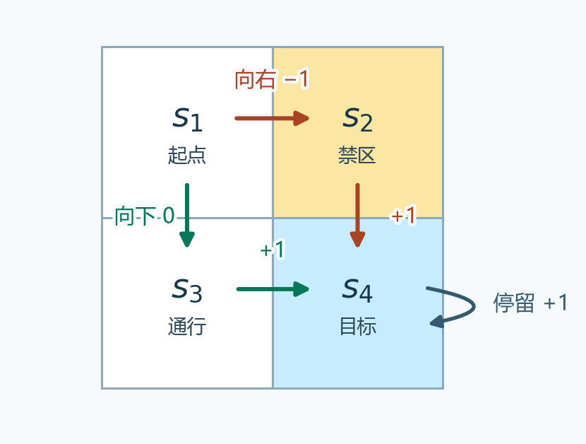

# 第 2 课 · 贝尔曼公式 · V2（总结）

[切换到 V1（逐页）](bellman-equation-slides.md)

## 1. 回报、状态价值与动作价值

从时刻 $t$ 开始，执行 $A_t$ 后收到的第一笔奖励记为 $R_{t+1}$。一条实际轨迹的折扣回报（discounted return）是 $G_t=R_{t+1}+\gamma R_{t+2}+\gamma^2R_{t+3}+\cdots$，其中 $0\le\gamma<1$。策略或环境有随机性时，同一格出发可以得到不同的 $G_t$。

- 状态价值（state value）$v_\pi(s)=\mathbb E_\pi[G_t\mid S_t=s]$。固定起点 $s$，首步和后续动作都按策略 $\pi$ 选择。
- 动作价值（action value）$q_\pi(s,a)=\mathbb E_\pi[G_t\mid S_t=s,A_t=a]$。固定起点 $s$ 和首步动作 $a$，从第二步起按 $\pi$ 走。即使 $\pi$ 在 $s$ 不会选择 $a$，也能评价「第一步指定做 $a$」的结果。

<figure>
  
  <figcaption>沿绿色箭头走，首步得 0。沿红色箭头走，首步扣 1。两条路线第二步都进入蓝色目标格，之后一直停留，每步得 +1。</figcaption>
</figure>

三个策略只在起点 $s_1$ 的首步选择上不同。两条路线从第二步起的奖励序列相同，因此那部分折扣回报都是 $C=\gamma+\gamma^2+\cdots=\gamma/(1-\gamma)$。

- 策略一固定向下，$v_{\pi_1}(s_1)=C$。
- 策略二固定向右，$v_{\pi_2}(s_1)=C-1$。
- 策略三向下、向右各占一半，$v_{\pi_3}(s_1)=0.5C+0.5(C-1)=C-0.5$。

取 $\gamma=0.9$，三者分别是 9、8、8.5。策略三实际走一次只会得到 9 或 8。8.5 是按分支概率加权的平均回报。

## 2. 贝尔曼公式如何得到

把回报拆成首步奖励与剩余回报，得到 $G_t=R_{t+1}+\gamma G_{t+1}$。$G_{t+1}$ 是从下一时刻开始算的回报，换算回当前时刻要再乘一次 $\gamma$。固定起点 $S_t=s$ 后，对两项分别取条件期望。

$$
v_\pi(s)=
\underbrace{\mathbb E_\pi[R_{t+1}\mid S_t=s]}_{\text{平均即时奖励}}
+\gamma\underbrace{\mathbb E_\pi[G_{t+1}\mid S_t=s]}_{\text{下一时刻的平均回报}}.
$$

### 第一项 · 平均即时奖励

只知道起点 $s$ 时，既不知道策略会选哪个动作，也不知道环境会给什么奖励。先固定一个动作 $a$，把各个可能的奖励按环境给出的概率加权。再把每个动作的平均奖励按策略给出的概率加权。

$$
\begin{aligned}
\mathbb E[R_{t+1}\mid S_t=s,A_t=a]
&=\sum_r p(r\mid s,a)r,\\
\mathbb E_\pi[R_{t+1}\mid S_t=s]
&=\sum_a\pi(a\mid s)\,\mathbb E[R_{t+1}\mid S_t=s,A_t=a]\\
&=\sum_a\pi(a\mid s)\sum_r p(r\mid s,a)r.
\end{aligned}
$$

看四格图中的 $s_1$。策略三以 0.5 的概率向右，给定向右，环境必定扣 1 分。另有 0.5 的概率向下，给定向下，环境必定给 0 分。因此第一项是 $0.5(-1)+0.5(0)=-0.5$。

### 第二项 · 下一时刻的平均回报

先固定首步动作 $a$，再按下一状态 $s'$ 分组。给定 $s'$ 后，马尔可夫性质保证继续按同一策略时，之后的平均回报只取决于 $s'$。所以即使条件里还写着出发格 $s$ 和刚执行的动作 $a$，后续回报的期望仍是 $v_\pi(s')$。

$$
\begin{aligned}
\mathbb E_\pi[G_{t+1}\mid S_t=s,A_t=a,S_{t+1}=s']
&=v_\pi(s'),\\
\mathbb E_\pi[G_{t+1}\mid S_t=s,A_t=a]
&=\sum_{s'}p(s'\mid s,a)v_\pi(s'),\\
\mathbb E_\pi[G_{t+1}\mid S_t=s]
&=\sum_a\pi(a\mid s)\sum_{s'}p(s'\mid s,a)v_\pi(s').
\end{aligned}
$$

仍看策略三。首步向右必到 $s_2$，向下必到 $s_3$，因此第二项折扣前是 $0.5v_{\pi_3}(s_2)+0.5v_{\pi_3}(s_3)$。进入禁区的 −1 已算在第一项。从 $s_2$ 或 $s_3$ 开始计分时，下一步都进入目标，因此两格的价值都是 $1/(1-\gamma)$。取 $\gamma=0.9$，第二项折扣前为 10，乘上 $\gamma$ 后为 9。两项相加得到 $-0.5+9=8.5$。

### 合并为贝尔曼期望方程

合并两项，得到每个状态都满足的贝尔曼期望方程（Bellman expectation equation）。

$$
v_\pi(s)=\sum_a\pi(a\mid s)
\left[\sum_r p(r\mid s,a)r+
\gamma\sum_{s'}p(s'\mid s,a)v_\pi(s')\right].
$$

左边是当前状态的价值，右边包含其他状态的未知价值。有限状态下，每个状态各给出一个方程，合起来才能解。给定策略求出这些价值，叫策略评估（policy evaluation）。

## 3. 四格例子怎样逐个求值

用策略一，记 $v_i=v_{\pi_1}(s_i)$。从 $s_1$ 向下到 $s_3$ 得 0，$s_2$ 和 $s_3$ 都直接进入目标得 +1，目标格每步停留也得 +1。因此

$$
v_1=\gamma v_3,\qquad
v_2=1+\gamma v_4,\qquad
v_3=1+\gamma v_4,\qquad
v_4=1+\gamma v_4.
$$

先用最后一式得到 $v_4=1/(1-\gamma)$，代回得 $v_2=v_3=v_4$，再得 $v_1=\gamma/(1-\gamma)$。取 $\gamma=0.9$，四格价值为 $(9,10,10,10)$。禁区 $s_2$ 的价值也为 10，因为从该格开始计分时，进入禁区的扣分已经发生。

若换成策略三，只改第一式。两条分支各自先加即时奖励，再加折扣后的下一格价值：

$$
v_1=0.5(0+\gamma v_3)+0.5(-1+\gamma v_2).
$$

其余三式未变。代回可得 $v_1=-0.5+\gamma/(1-\gamma)$，与按轨迹求平均的结果一致。

## 4. 矩阵形式与两种解法

把动作概率平均进即时奖励和转移概率。设 $r_\pi(s)$ 是从 $s$ 按策略走一步的平均奖励，$p_\pi(s'\mid s)$ 是按策略走一步到达 $s'$ 的概率。

$$
r_\pi(s)=\sum_a\pi(a\mid s)\sum_r p(r\mid s,a)r,\qquad
p_\pi(s'\mid s)=\sum_a\pi(a\mid s)p(s'\mid s,a).
$$

把价值和平均奖励排成列向量。转移矩阵 $P_\pi$ 的第 $i$ 行第 $j$ 列是从 $s_i$ 到 $s_j$ 的概率，每行之和为 1。

$$
\mathbf v_\pi=\mathbf r_\pi+\gamma P_\pi\mathbf v_\pi.
$$

四格策略一的奖励向量是 $(0,1,1,1)^\mathsf T$，$P_\pi$ 第一行为 $(0,0,1,0)$，其余三行为 $(0,0,0,1)$。改用策略三时，奖励向量第一项变为 −0.5，转移矩阵第一行变为 $(0,0.5,0.5,0)$。

- 闭式解（closed-form solution）来自 $(I-\gamma P_\pi)\mathbf v_\pi=\mathbf r_\pi$。可直接求解线性方程组，公式写作 $\mathbf v_\pi=(I-\gamma P_\pi)^{-1}\mathbf r_\pi$。
- 迭代解（iterative solution）从任意初值 $\mathbf v_0$ 开始，用 $\mathbf v_{k+1}=\mathbf r_\pi+\gamma P_\pi\mathbf v_k$ 同步更新。用策略一、$\gamma=0.9$ 和零向量起步，前两轮依次得到 $(0,1,1,1)^\mathsf T$ 和 $(0.9,1.9,1.9,1.9)^\mathsf T$，最终收敛到 $(9,10,10,10)^\mathsf T$。

迭代式减去真值满足的方程，得到误差 $\delta_{k+1}=\gamma P_\pi\delta_k$。每行都是概率加权平均，所以一轮后的最大绝对误差至多是上一轮的 $\gamma$ 倍。这也说明 $\gamma$ 接近 1 时，误差上界衰减较慢。

## 5. 状态价值和动作价值怎样互相换算

### 从状态价值算动作价值

指定首步动作 $a$ 后，贝尔曼公式的外层动作平均就暂时不需要了。括号里保留两项，即这个动作的平均即时奖励，以及到达下一状态后继续按 $\pi$ 走的折扣价值。

$$
q_\pi(s,a)=\sum_r p(r\mid s,a)r
+\gamma\sum_{s'}p(s'\mid s,a)v_\pi(s').
$$

用四格图和策略三，取 $\gamma=0.9$，已知 $v_{\pi_3}(s_2)=v_{\pi_3}(s_3)=10$。若指定首步向右 $a_2$，得到 $q_{\pi_3}(s_1,a_2)=-1+0.9\times10=8$。若指定首步向下 $a_3$，得到 $q_{\pi_3}(s_1,a_3)=0+0.9\times10=9$。两种算式从第二步起都继续按同一个 $\pi_3$ 走。

### 从动作价值算回状态价值

把首步选择交回策略。每个动作价值描述一个首步分支，用策略选择该分支的概率作为权重。固定策略下，状态价值就是这些动作价值的加权平均。

$$
v_\pi(s)=\sum_a\pi(a\mid s)q_\pi(s,a).
$$

策略三向右、向下各占一半，因此 $v_{\pi_3}(s_1)=0.5\times8+0.5\times9=8.5$，与第二节先算两项再相加的结果一致。如果改为策略二，首步一定向右，则 $v_{\pi_2}(s_1)=q_{\pi_2}(s_1,a_2)=8$。在策略二下，仍能单独计算「首步指定向下」的 $q_{\pi_2}(s_1,a_3)=9$，只是它在 $v_{\pi_2}(s_1)$ 的平均式里权重为 0。
