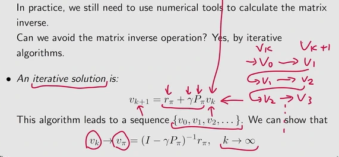

# 第 2 课 · 贝尔曼公式 · V2（总结）

[切换到 V1（逐页）](bellman-equation-slides.md)

## 1. Return, State Value & Action Value

#### （1）单步交互与概率记号

Some notations · 单步交互

在离散时刻 $t$，智能体处于状态 $S_t$，执行动作 $A_t$；环境随后给出即时奖励 $R_{t+1}$ 和下一状态 $S_{t+1}$。

$$
S_t\xrightarrow{A_t}R_{t+1},\,S_{t+1}.
$$

大写 $S_t,A_t,R_{t+1},S_{t+1}$ 表示<strong>随机变量（random variables）</strong>；小写 $s,a,r,s'$ 表示它们的具体取值。

- <strong>策略（policy）</strong>：$\pi(a\mid s)=\Pr_\pi(A_t=a\mid S_t=s)$，给定状态后选中动作 $a$ 的概率。
- <strong>奖励概率（reward probability）</strong>：$p(r\mid s,a)=\Pr(R_{t+1}=r\mid S_t=s,A_t=a)$，给定状态和动作后获得奖励 $r$ 的概率。
- <strong>状态转移概率（state transition probability）</strong>：$p(s'\mid s,a)=\Pr(S_{t+1}=s'\mid S_t=s,A_t=a)$，给定状态和动作后到达 $s'$ 的概率。

#### （2）多步轨迹与折扣回报

Some notations · 多步轨迹

把单步交互接起来，就得到一条<strong>轨迹（trajectory）</strong>：

$$
S_t\xrightarrow{A_t}R_{t+1},\,S_{t+1}
\xrightarrow{A_{t+1}}R_{t+2},\,S_{t+2}
\xrightarrow{A_{t+2}}R_{t+3},\,\ldots
$$

从时刻 $t$ 算起，<strong>折扣回报（discounted return）</strong>是：

$$
G_t=R_{t+1}+\gamma R_{t+2}+\gamma^2R_{t+3}+\cdots.
$$

$\gamma\in[0,1)$ 是<strong>折扣因子（discount factor）</strong>。执行 $A_t$ 后收到的第一笔奖励权重为 $1$，之后每晚一步就多乘一个 $\gamma$。因为各步奖励是随机变量，$G_t$ 也是随机变量；即使起点相同，不同轨迹也可能得到不同的回报。

#### （3）状态价值与动作价值

State value · 给定起点的平均回报

给定策略 $\pi$，从状态 $s$ 出发，第一步和后续动作都按 $\pi$ 选择。对可能的折扣回报按概率取平均，得到<strong>状态价值（state value）</strong>：

$$
v_\pi(s)=\mathbb E_\pi[G_t\mid S_t=s].
$$

- <strong>为什么是条件期望？</strong>这里只对以 $S_t=s$ 为起点的轨迹取平均；固定策略后，$v_\pi$ 就是以 $s$ 为输入的函数。
- <strong>为什么要标出策略？</strong>不同策略会选不同的动作。同一状态在不同策略下的价值可能不同；从同一个 $s$ 出发，$v_\pi(s)$ 越高，表示该策略的预期折扣回报越高。

<strong>动作价值（action value）</strong>还指定第一步做 $a$，从第二步起按 $\pi$ 走。即使 $\pi$ 平常不会在 $s$ 选 $a$，也可以计算强制第一步做 $a$ 会怎样。

$$
q_\pi(s,a)=\mathbb E_\pi[G_t\mid S_t=s,A_t=a].
$$

## 2. Bellman Expectation Equation

#### （1）把回报拆成两项

Deriving the Bellman equation · 从轨迹到期望

沿用上一节的随机轨迹：在时刻 $t$ 执行动作 $A_t$，先收到 $R_{t+1}$，再从 $S_{t+1}$ 继续。把第一笔奖励单独拿出来：

$$
\begin{aligned}
G_t &= R_{t+1}+\gamma R_{t+2}+\gamma^2 R_{t+3}+\cdots\\
    &= R_{t+1}+\gamma(R_{t+2}+\gamma R_{t+3}+\cdots)\\
    &= R_{t+1}+\gamma G_{t+1}.
\end{aligned}
$$

$R_{t+2}$ 在 $G_{t+1}$ 中是第一笔奖励，权重为 $1$；换回时刻 $t$ 计价时，整段后续回报要再乘一次 $\gamma$。

固定起点 $S_t=s$，把上式代入状态价值定义。由条件期望的线性性质，两项可以分别计算，无须假设它们独立：

$$
\begin{aligned}
v_\pi(s)&=\mathbb E_\pi[G_t\mid S_t=s]\\
&=\mathbb E_\pi[R_{t+1}+\gamma G_{t+1}\mid S_t=s]\\
&=\underbrace{\mathbb E_\pi[R_{t+1}\mid S_t=s]}_{\text{平均即时奖励}}
+\gamma\underbrace{\mathbb E_\pi[G_{t+1}\mid S_t=s]}_{\text{下一时刻的平均回报}}.
\end{aligned}
$$

### Expected Immediate Reward

（2）第一项 · 平均即时奖励

只固定了起点 $s$，因此第一步动作仍由策略 $\pi$ 选择。按动作使用<strong>全期望公式（law of total expectation）</strong>：

$$
\begin{aligned}
r_\pi(s)
&=\mathbb E_\pi[R_{t+1}\mid S_t=s]\\
&=\sum_a\pi(a\mid s)\,\mathbb E[R_{t+1}\mid S_t=s,A_t=a]\\
&=\sum_a\pi(a\mid s)\sum_r p(r\mid s,a)\,r.
\end{aligned}
$$

给定 $a$ 后，内层按环境的奖励概率计算平均奖励；外层再按策略选择各动作的概率加权。这一项只计算执行 $A_t$ 后收到的 $R_{t+1}$。

### Expected Future Return

（3）第二项 · 下一时刻的平均回报

第一项按<strong>动作</strong>分组，这一项先按<strong>下一状态</strong>分组。令 $p_\pi(s'\mid s)$ 表示按策略从 $s$ 走一步到达 $s'$ 的概率。

$$
\begin{aligned}
&\mathbb E_\pi[G_{t+1}\mid S_t=s]\\
&=\sum_{s'}p_\pi(s'\mid s)\,
   \mathbb E_\pi[G_{t+1}\mid S_t=s,S_{t+1}=s']\\
&=\sum_{s'}p_\pi(s'\mid s)\,
   \mathbb E_\pi[G_{t+1}\mid S_{t+1}=s']\\
&=\sum_{s'}p_\pi(s'\mid s)\,v_\pi(s').
\end{aligned}
$$

这三步分别是：<strong>按落点取全期望</strong>；利用马尔可夫性质和只依赖当前状态的策略去掉旧状态 $S_t=s$；认出剩下的条件期望正是 $v_\pi(s')$。

下一步的落点概率由所有可能的动作共同决定。对「选中 $a$ 且到达 $s'$」求和：

$$
\begin{aligned}
p_\pi(s'\mid s)
&=\sum_a\Pr_\pi(A_t=a,S_{t+1}=s'\mid S_t=s)\\
&=\sum_a\pi(a\mid s)\,p(s'\mid s,a).
\end{aligned}
$$

代回后，把求和顺序从「先列落点」改成「先列动作」，方便与第一项合并：

$$
\begin{aligned}
\mathbb E_\pi[G_{t+1}\mid S_t=s]
&=\sum_{s'}v_\pi(s')\sum_a \pi(a\mid s)\,p(s'\mid s,a)\\
&=\sum_a\pi(a\mid s)\sum_{s'}p(s'\mid s,a)\,v_\pi(s').
\end{aligned}
$$

这项包含从下一时刻开始的奖励（第一笔是 $R_{t+2}$）。合回 $v_\pi(s)$ 时再乘一次 $\gamma$。

### Putting Both Terms Together

（4）合并两项 · Bellman Expectation Equation

把两项分别代入，再提出共同的动作权重 $\pi(a\mid s)$：

$$
\begin{aligned}
v_\pi(s)
&=\underbrace{\sum_a\pi(a\mid s)\sum_r p(r\mid s,a)\,r}_{\text{平均即时奖励}}\\
&\quad+\underbrace{\gamma\sum_a\pi(a\mid s)\sum_{s'}p(s'\mid s,a)\,v_\pi(s')}_{\text{折扣后的平均后续回报}}\\[4pt]
&=\sum_a\pi(a\mid s)\left[\sum_r p(r\mid s,a)\,r
   +\gamma\sum_{s'}p(s'\mid s,a)\,v_\pi(s')\right],
   \qquad \forall s\in\mathcal S .
\end{aligned}
$$

贝尔曼期望方程把<strong>当前状态的价值与可能到达的下一状态的价值</strong>联系起来，下一状态也可能是当前状态。有限状态下，每个状态给出一个方程，合起来就是一组关于各状态价值的联立方程。给定策略求这些价值，叫作<strong>策略评估（policy evaluation）</strong>。

#### （5）模型已知与未知

Dynamics model · 已知与未知

方程里的 $p(r\mid s,a)$ 和 $p(s'\mid s,a)$ 描述了<strong>环境模型（dynamics model）</strong>中用于这两项期望的奖励概率和转移概率；$\pi(a\mid s)$ 则来自给定的策略。

- <strong>模型已知</strong>：可以直接按概率求和，再用下一节的矩阵形式或迭代法求状态价值。
- <strong>模型未知</strong>：贝尔曼方程仍然成立，但无法直接代入真实概率。可以用交互数据估计模型再求解，也可以直接从采样的回报或转移中估计价值，例如后面的 Monte Carlo 和 Temporal-Difference 方法。

## 3. Matrix Form & Policy Evaluation

把动作概率平均进即时奖励和转移概率。设 $r_\pi(s)$ 是从 $s$ 按策略走一步的平均奖励，$p_\pi(s'\mid s)$ 是按策略走一步到达 $s'$ 的概率。

$$
\begin{aligned}
r_\pi(s)&=\sum_a\pi(a\mid s)\sum_r p(r\mid s,a)r,\\
p_\pi(s'\mid s)&=\sum_a\pi(a\mid s)p(s'\mid s,a).
\end{aligned}
$$

把价值和平均奖励排成列向量（column vectors）。转移矩阵（transition matrix） $P_\pi$ 的第 $i$ 行第 $j$ 列是从 $s_i$ 到 $s_j$ 的概率，每行之和为 1。

$$
\mathbf v_\pi=\mathbf r_\pi+\gamma P_\pi\mathbf v_\pi.
$$

### Closed-form Solution

把含有 $\mathbf v_\pi$ 的项放在左边。$I$ 是单位矩阵，满足 $I\mathbf v_\pi=\mathbf v_\pi$。

$$
\begin{aligned}
\mathbf v_\pi-\gamma P_\pi\mathbf v_\pi&=\mathbf r_\pi,\\
(I-\gamma P_\pi)\mathbf v_\pi&=\mathbf r_\pi,\\
\mathbf v_\pi&=(I-\gamma P_\pi)^{-1}\mathbf r_\pi.
\end{aligned}
$$

最后一行是<strong>闭式解（closed-form solution）</strong>。因为 $\gamma<1$，若一个非零向量 $\mathbf x$ 满足 $\mathbf x=\gamma P_\pi\mathbf x$，它的最大绝对分量就至多是自身的 $\gamma$ 倍，产生矛盾。因此 $I-\gamma P_\pi$ 可逆。实际可以直接解第二行的线性方程组。

### Iterative Solution

<strong>迭代解（iterative solution）</strong>把第 $k$ 轮的整组价值 $\mathbf v_k$ 放到等式右边，得到下一轮 $\mathbf v_{k+1}=\mathbf r_\pi+\gamma P_\pi\mathbf v_k$。全轮都用旧值，算完一组才一起换新值，这叫同步更新（synchronous update）。

令 $\boldsymbol\delta_k=\mathbf v_k-\mathbf v_\pi$。迭代式减去贝尔曼方程后，奖励项抵消。$P_\pi$ 每行的概率之和是 1，所以加权平均无法放大最大绝对误差。

$$
\begin{aligned}
\boldsymbol\delta_{k+1}
&=\gamma P_\pi(\mathbf v_k-\mathbf v_\pi)\\
&=\gamma P_\pi\boldsymbol\delta_k,\\
\|\boldsymbol\delta_k\|_\infty
&\le\gamma^k\|\boldsymbol\delta_0\|_\infty
\longrightarrow 0.
\end{aligned}
$$

#### Iterative Policy Evaluation · 课件原页

<figure>
  
</figure>

一轮内固定策略和整份旧价值。误差递推给出 $\|V-v_\pi\|_\infty\le\gamma\Delta/(1-\gamma)$，其中 $V$ 指刚完成更新后的向量。

## 4. State Value & Action Value · 双向换算

### State Value → Action Value

指定首步动作 $a$ 后，贝尔曼公式的外层动作平均就暂时不需要了。括号里保留两项，即这个动作的平均即时奖励，以及到达下一状态后继续按 $\pi$ 走的折扣价值。

$$
\begin{aligned}
q_\pi(s,a)&=\sum_r p(r\mid s,a)r\\
&\quad+\gamma\sum_{s'}p(s'\mid s,a)v_\pi(s').
\end{aligned}
$$

### Action Value → State Value

把首步选择交回策略。每个动作价值描述一个首步分支，用策略选择该分支的概率作为权重。<strong>状态价值是各动作价值的加权平均（weighted average）。</strong>

$$
v_\pi(s)=\sum_a\pi(a\mid s)q_\pi(s,a).
$$
