# 第 3 课 · 贝尔曼最优公式 · V1（逐页）

[切换到 V2（总结）](bellman-optimality.md)

## Part 1 · Policy Evaluation & Improvement

### 第 01 页 · 从策略评估到最优策略

上一课用贝尔曼公式求给定策略的价值。本课在此基础上寻找最优状态价值和最优策略。课件中的课程地图把贝尔曼公式与贝尔曼最优公式列为基础工具，后面会用它们理解值迭代和策略迭代。

### 第 02 页 · 本课的概念与工具

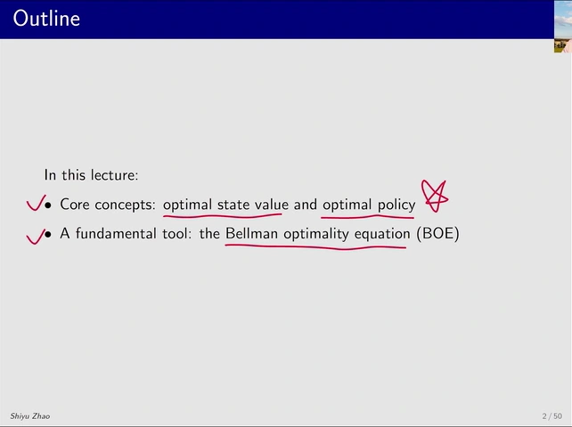

核心概念是最优状态价值（optimal state value）和最优策略（optimal policy），核心工具是贝尔曼最优公式（Bellman optimality equation，BOE）。一个回答每个起点最多能拿多少回报，另一个回答怎样选动作才能拿到这些回报。

### 第 03 页 · 本课安排

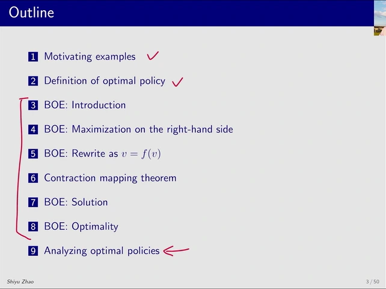

先在四格网格里改一个动作，再定义最优策略、解释最优公式右侧的最大化，并用收缩映射研究求解。最后回到网格，观察奖励和折扣改变后策略怎样变化。

### 第 04 页 · 从改进现有策略开始

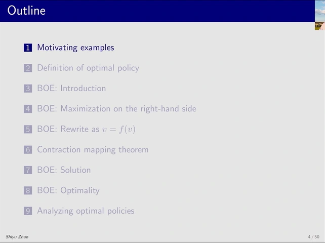

先沿用第 2 课中从左上角进入禁区的策略，算出原策略的表现，再比较从这个起点可以采取的其他动作。

### 第 05 页 · Policy Evaluation · 计算旧策略价值

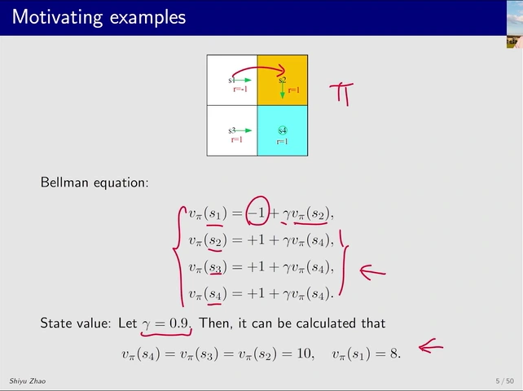

旧策略在 $s_1$ 向右进入禁区 $s_2$，首步得 −1。$s_2,s_3$ 都一步进入目标 $s_4$ 得 +1，之后停在目标每步继续得 +1。记 $v_i=v_\pi(s_i)$，则 $v_1=-1+\gamma v_2$，$v_2=v_3=1+\gamma v_4$，$v_4=1+\gamma v_4$。取 $\gamma=0.9$，得到 $(8,10,10,10)$。

### 第 06 页 · Action Values · 比较首步

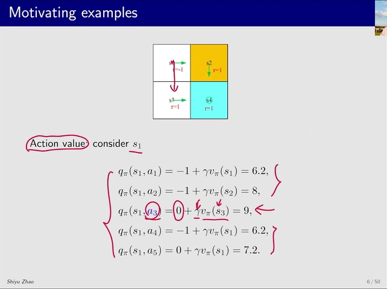

首步可以指定任一个可选动作，第二步起仍按旧策略 $\pi$ 行动。在 $s_1$ 向上或向左会撞墙，各得 $-1+0.9\times8=6.2$。向右进禁区得 $-1+0.9\times10=8$，向下到 $s_3$ 得 $0+0.9\times10=9$，原地停留得 $0+0.9\times8=7.2$。向下的动作价值最高。

### 第 07 页 · 旧策略在起点怎样选动作

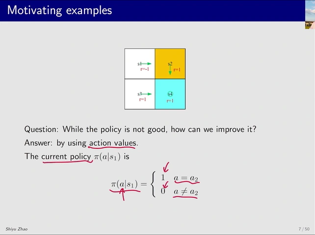

旧策略把 $s_1$ 的全部概率给向右 $a_2$，所以 $v_\pi(s_1)=q_\pi(s_1,a_2)=8$。要改进它，可以利用刚才算出的五个动作价值，看是否有更好的首步。

### 第 08 页 · Greedy Action · 选择最大值

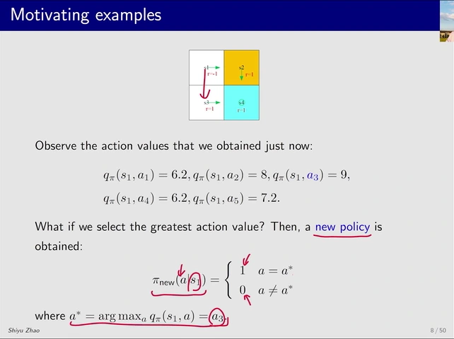

$\arg\max_a q_\pi(s_1,a)$ 找出使动作价值最大的动作，这里是向下的 $a_3$。把新策略在 $s_1$ 的概率全部给 $a_3$，其他格沿用原动作，就避开了首步扣分。这里用来比较的是旧策略下的 $q_\pi$，还没求出新策略在所有格的价值。

### 第 09 页 · 为什么这样选可以改进策略

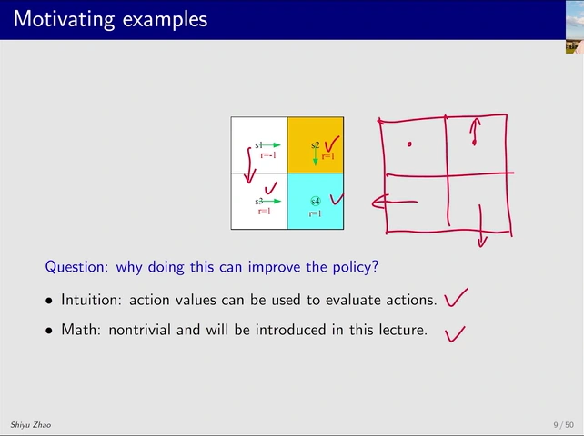

动作价值衡量指定首步后再按旧策略行动的回报。这个例子里另外三格的动作已经最优，$s_1$ 改向下就能避开禁区。如果 $s_2$ 向上、$s_3$ 向左、$s_4$ 向下，旧策略的后续走法也有问题，用它算出的最大动作值未必能一次给出真正最优的首步。老师预告了策略迭代的思路：每轮重新评价策略，再对每个状态选贪心动作，重复改进直到得到最优策略。

## Part 2 · Optimal Policy & Bellman Optimality Equation

### 第 10 页 · 进入最优策略的定义

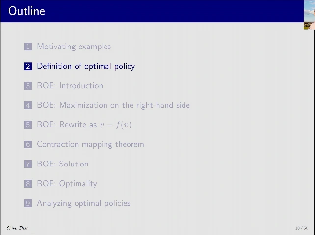

四格例子只比较了一个起点。接下来把比较标准扩展到所有起点，说明什么叫一个策略在整个环境里最优。

### 第 11 页 · Optimal Policy · 定义

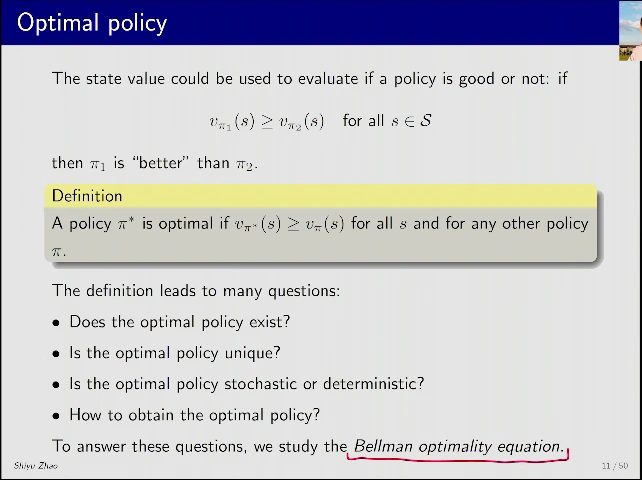

若 $v_{\pi_1}(s)\ge v_{\pi_2}(s)$ 对每个状态都成立，就可以说 $\pi_1$ 至少和 $\pi_2$ 一样好。最优策略 $\pi^*$ 必须对任何策略 $\pi$ 和任何状态 $s$ 满足 $v_{\pi^*}(s)\ge v_\pi(s)$。若两个策略分别在不同起点占优，单凭这些值还不能认定其中一个全局占优。接下来要回答最优策略是否存在、是否唯一、能否取确定性策略，以及怎样求得。

### 第 12 页 · 进入贝尔曼最优公式

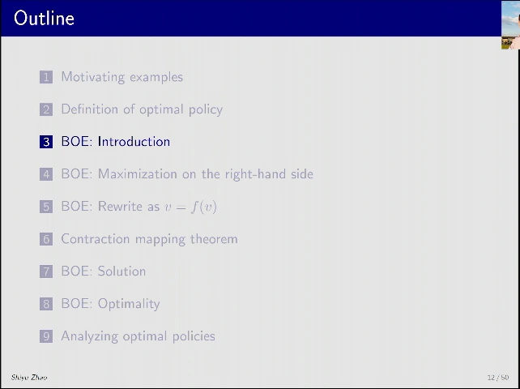

把第 2 课固定策略的方程作为出发点。现在除了状态价值，连每个状态该怎样选动作也待确定。

### 第 13 页 · Elementwise Form

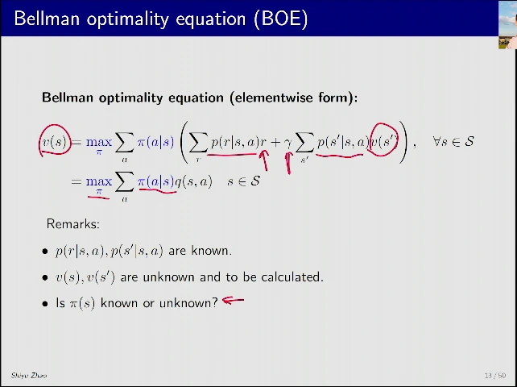

给定一组候选状态价值 $v$，先计算每个动作的平均即时奖励与折扣后续价值。原来的贝尔曼方程按已知策略求平均，最优公式则选择能使这个平均最大的动作分布。

$$
v(s)=\max_{\pi}\sum_a\pi(a\mid s)
\left[\sum_r p(r\mid s,a)r+\gamma\sum_{s'}p(s'\mid s,a)v(s')\right].
$$

环境的奖励概率与转移概率已知，方程要求出价值，并找出能实现最大值的动作分布。

### 第 14 页 · Matrix–Vector Form

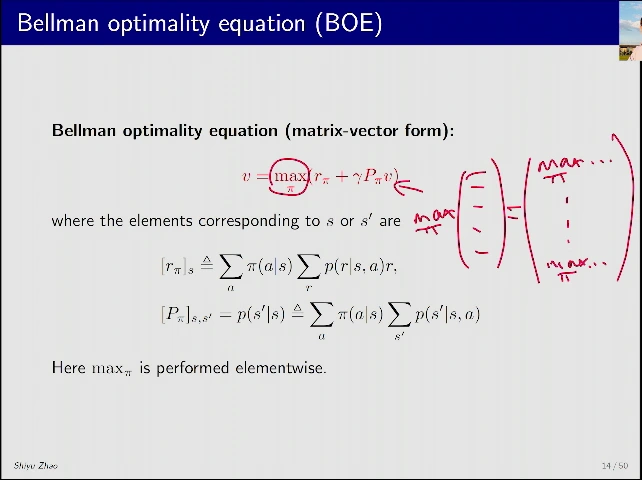

把固定策略下各状态的平均即时奖励排成 $\mathbf r_\pi$，把状态间的转移概率排成 $P_\pi$。其中 $r_\pi(s)=\sum_a\pi(a\mid s)\sum_r p(r\mid s,a)r$，$[P_\pi]_{ss'}=\sum_a\pi(a\mid s)p(s'\mid s,a)$。最优公式写成 $\mathbf v=\max_\pi(\mathbf r_\pi+\gamma P_\pi\mathbf v)$。最大值按状态分量取，每一行可以选择适合该状态的动作。

### 第 15 页 · 这个方程需要回答什么

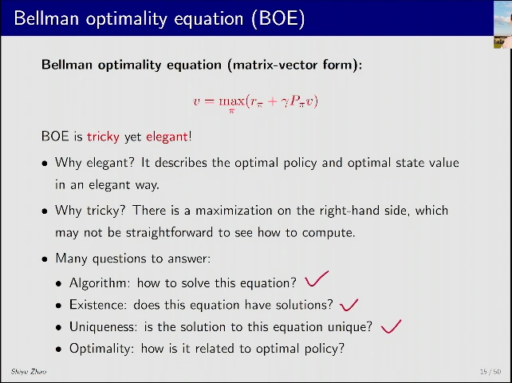

同一个式子里既有未知价值，又有对策略的最大化。需要说明怎样计算、解是否存在、价值解是否唯一，以及方程的解为什么确实代表最优价值和最优策略。

### 第 16 页 · Inner Maximization · 固定候选价值

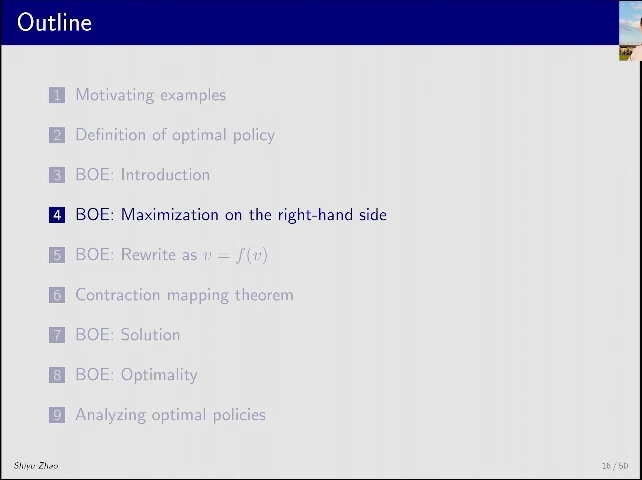

先暂时固定右侧出现的候选价值 $v(s')$。这样每个状态和动作对应的括号值就成了已知数，可以先处理策略概率怎样分配。

### 第 17 页 · Scalar Example · 两个未知量

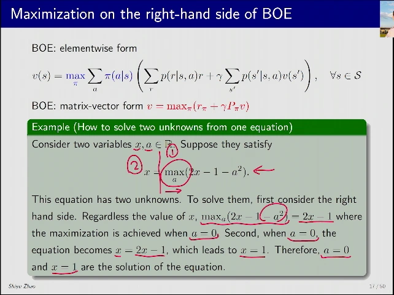

课件用 $x=\max_a(2x-1-a^2)$ 举例。先把 $x$ 固定，右侧在 $a=0$ 时最大，因为平方项非负。代回得到 $x=2x-1$，所以 $x=1$。这个例子说明，可以先消去内部的最大化，再解外层方程。

### 第 18 页 · 为什么概率加权不能超过最大动作值

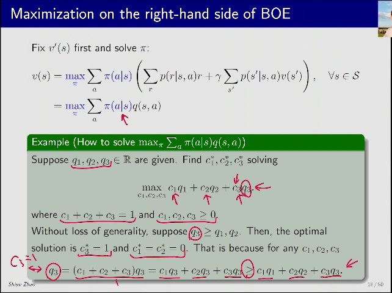

若三个动作值满足 $q_3\ge q_1,q_2$，任何满足 $c_i\ge0$、$\sum_i c_i=1$ 的加权平均都不超过 $q_3$。令 $c_3=1$ 就达到上界。若有几个动作并列最大，把概率任意分给这些动作也能达到同样的上界。

### 第 19 页 · 把对策略的最大化改为对动作取最大

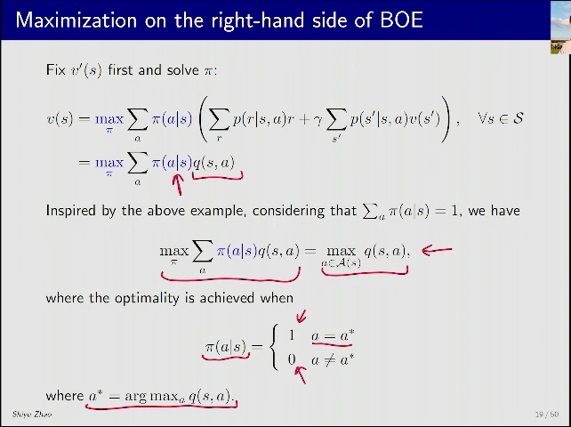

定义 $q_v(s,a)=\sum_r p(r\mid s,a)r+\gamma\sum_{s'}p(s'\mid s,a)v(s')$。由上页的加权平均结论，$\max_\pi\sum_a\pi(a\mid s)q_v(s,a)=\max_a q_v(s,a)$。每个状态选一个达到最大值的动作，就得到一个确定性贪心策略。只有当 $v=v^*$ 时，这里的候选动作值才是最优动作价值 $q^*$。

## Part 3 · Solving the Bellman Optimality Equation

### 第 20 页 · Fixed-point Form

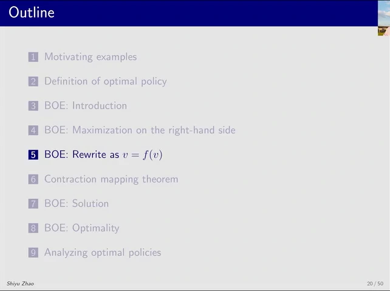

右侧最大化可以直接计算了。现在把整个右端当成一个输入价值、输出新价值的映射，研究反复应用它会不会稳定下来。

### 第 21 页 · Bellman Optimality Operator

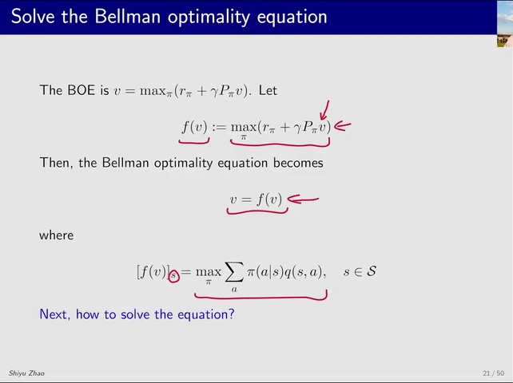

对任意输入价值 $v$，逐状态计算 $[Tv](s)=\max_{a\in\mathcal A(s)}q_v(s,a)$。因此贝尔曼最优公式等价于 $v=Tv$。输入与输出相同的那组价值就是要找的不动点。

### 第 22 页 · 用收缩映射研究解

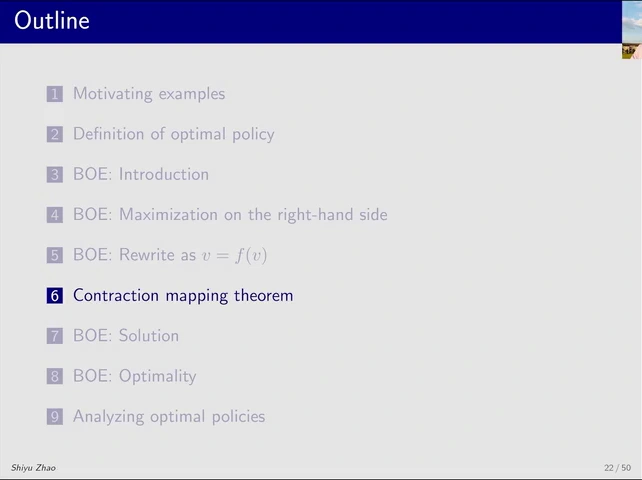

下一步要说明 $T$ 怎样改变两组价值之间的距离。若每次更新都能按固定比例缩小距离，就能证明解存在、唯一，并给出求解方法。

### 第 23 页 · Fixed Point & Contraction Mapping

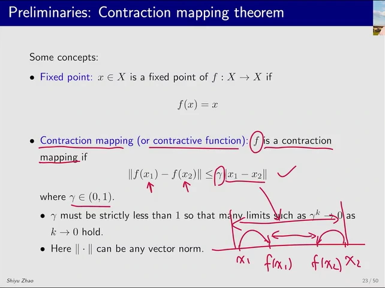

$f(x)=x$ 时，$x$ 是不动点（fixed point）。若存在 $0\le c<1$，使 $\|f(x)-f(y)\|\le c\|x-y\|$，则 $f$ 是收缩映射（contraction mapping）。重复应用时，距离上界每次多乘一个 $c$，所以 $c^k$ 随 $k$ 增大趋于 0。

### 第 24 页 · 两个收缩例子

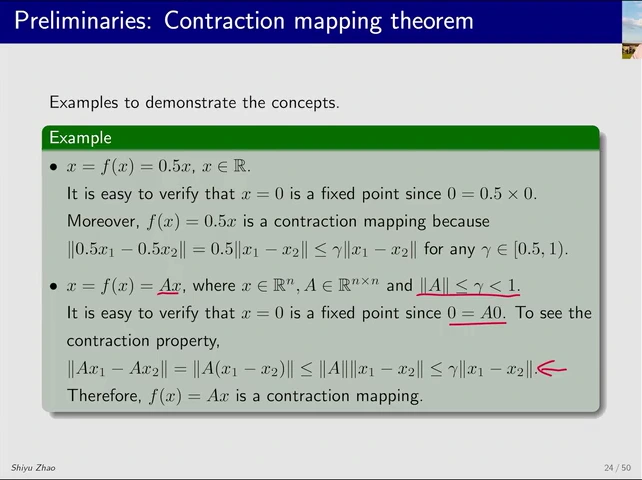

实数上的 $f(x)=0.5x$ 有不动点 0，并把距离缩到一半。矩阵映射 $f(x)=Ax$ 同样固定零向量。若与向量范数相配的矩阵范数满足 $\|A\|<1$，则 $\|Ax-Ay\|\le\|A\|\|x-y\|$，所以它也是收缩。

### 第 25 页 · Contraction Mapping Theorem

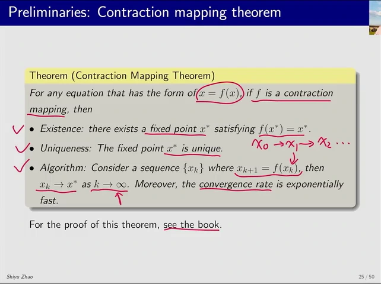

在完备空间中，收缩映射有且只有一个不动点。从任意初值用 $x_{k+1}=f(x_k)$ 迭代都会趋向它，误差至多按收缩系数做几何衰减。实际计算达到所需精度即可停止。有限维价值向量所在的 $\mathbb R^n$ 满足所需的完备性。

### 第 26 页 · 把定理用在前面的例子

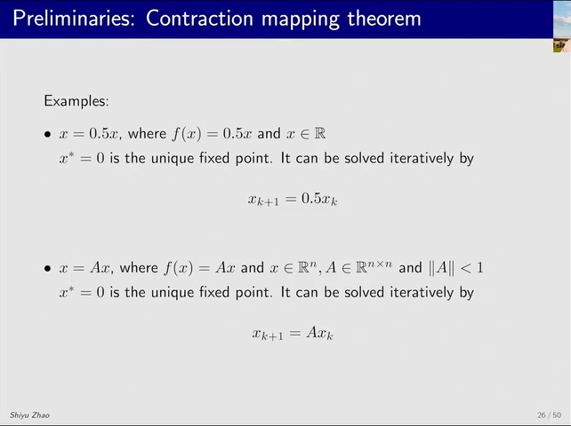

标量例子可直接迭代 $x_{k+1}=0.5x_k$，从任意实数出发都会趋向 0。矩阵例子用 $x_{k+1}=Ax_k$，在 $\|A\|<1$ 时也趋向 0。两者都不需要先猜出不动点。

### 第 27 页 · 回到贝尔曼最优方程的求解

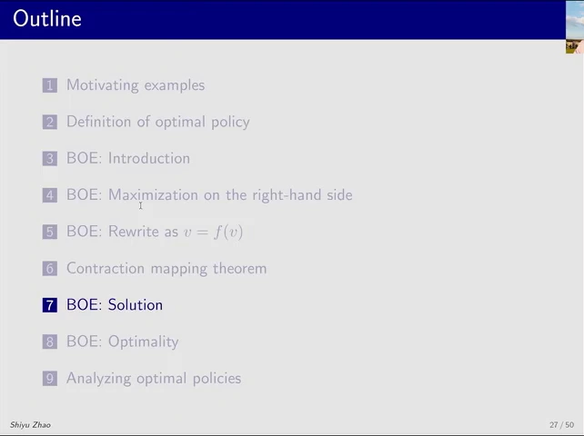

把一般定理应用到 $T$，关键是找一个范数，并证明 $T$ 在该范数下确实缩小两组价值的差距。

### 第 28 页 · Contraction in the Sup Norm

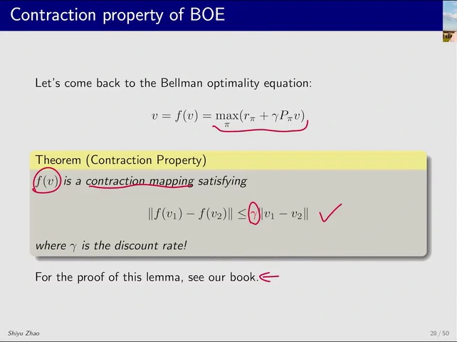

用最大绝对分量范数 $\|v\|_\infty=\max_s|v(s)|$。对同一个动作，比较 $q_v(s,a)$ 和 $q_w(s,a)$ 时，奖励项抵消。下一状态概率的加权平均不会放大最大差距，所以差值绝对值至多为 $\gamma\|v-w\|_\infty$。取两个动作列表的最大值后，差距也不会超过各对应项的最大差距。

$$
\|Tv-Tw\|_\infty\le\gamma\|v-w\|_\infty.
$$

### 第 29 页 · Uniqueness & Convergence

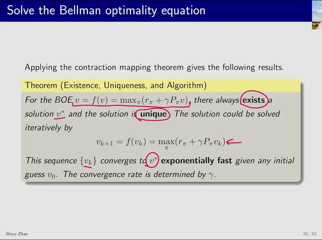

有限状态且 $0\le\gamma<1$ 时，$T$ 有唯一不动点 $v^*$。从任意 $v_0$ 做 $v_{k+1}=Tv_k$，有 $\|v_k-v^*\|_\infty\le\gamma^k\|v_0-v^*\|_\infty$。这里证明的是价值解唯一，策略是否唯一还要看哪些动作并列达到最大。

当前视频从第 29 页跳到第 36 页。第 30–35 页由作者公开课件补齐。

### 第 30 页 · Elementwise Update · 从旧值到新值（课件补充）

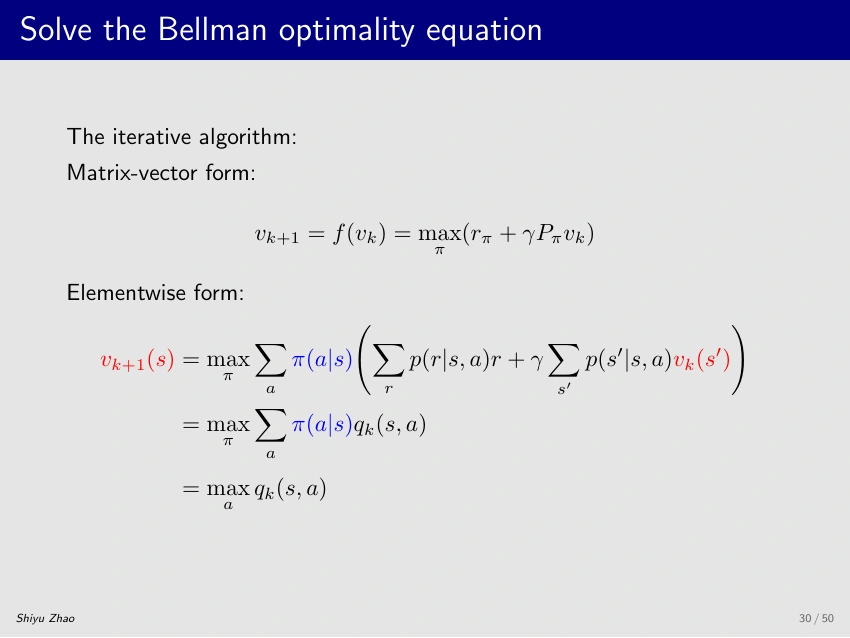

从任意初始价值 $v_0$ 出发，每一轮把当前价值代入贝尔曼最优算子。对状态 $s$，新值就是基于旧值算出的最大动作价值。也可以用向量形式写成 $\mathbf v_{k+1}=\max_\pi(\mathbf r_\pi+\gamma P_\pi\mathbf v_k)$，其中最大值逐分量取。

### 第 31 页 · Value Iteration · 更新步骤（课件补充）

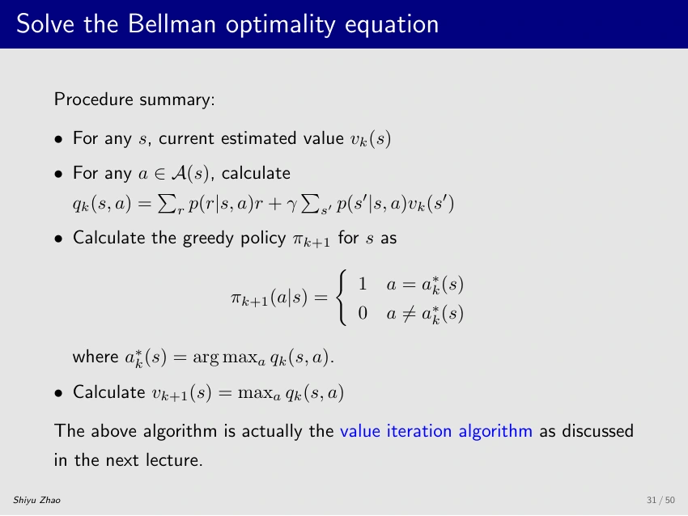

每一轮对每个状态 $s$ 的所有动作计算 $q_{v_k}(s,a)$，选一个最大动作作为这一轮的贪心动作，并把最大值写入 $v_{k+1}(s)$。本页展示的同步更新在整轮中使用同一份 $v_k$。这就是值迭代（value iteration）的基本更新，下一课会进一步讨论相关算法。

### 第 32 页 · 用于手算的三格网格（课件补充）

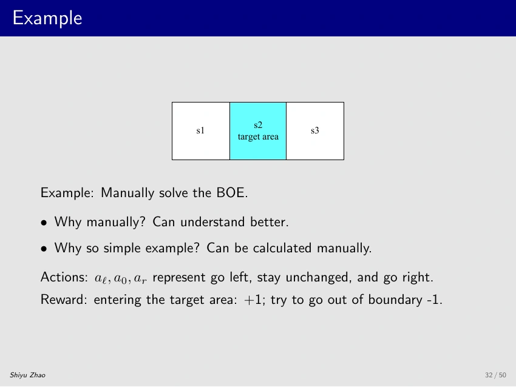

课件把网格缩成三格，方便手算并看清每一步更新。三个状态从左到右为 $s_1,s_2,s_3$，中间是目标，动作可以向左、原地停留或向右。进入目标或留在目标每步得 $+1$，撞到边界时留在原地并得 $-1$，其余转移得 0。

### 第 33 页 · Action Values · 列出三种走法（课件补充）

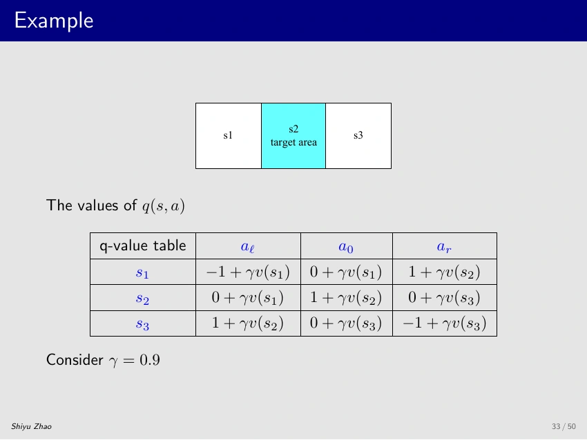

令 $v_i=v_k(s_i)$，列依次为向左、停留、向右。每一项都是实际即时奖励加上折扣后的到达格价值。课件的手算取 $\gamma=0.9$。

$$
\begin{pmatrix}
-1+\gamma v_1 & \gamma v_1 & 1+\gamma v_2\\
\gamma v_1 & 1+\gamma v_2 & \gamma v_3\\
1+\gamma v_2 & \gamma v_3 & -1+\gamma v_3
\end{pmatrix}
$$

### 第 34 页 · 从全零初值做第一轮（课件补充）

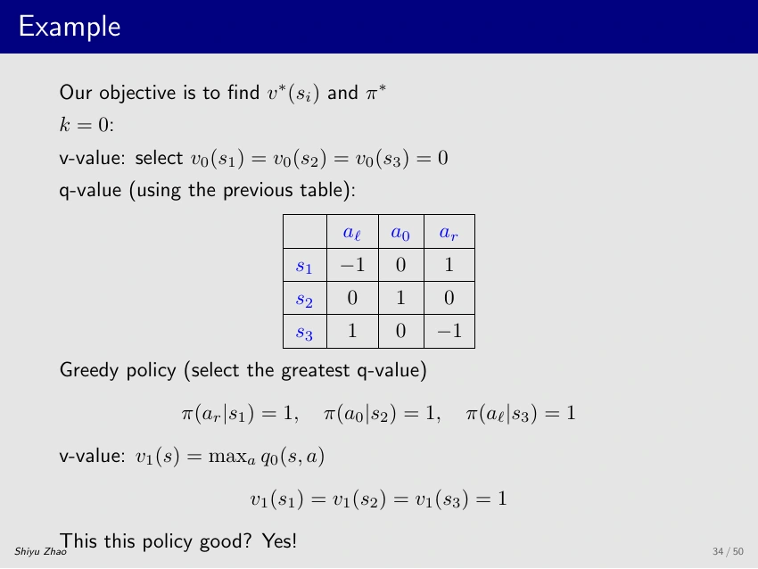

三个状态的动作价值分别为 $(-1,0,1)$、$(0,1,0)$、$(1,0,-1)$。逐行取最大值得到 $v_1=(1,1,1)$，对应的贪心动作是向右、停留、向左。

### 第 35 页 · 做第二轮并观察价值变化（课件补充）

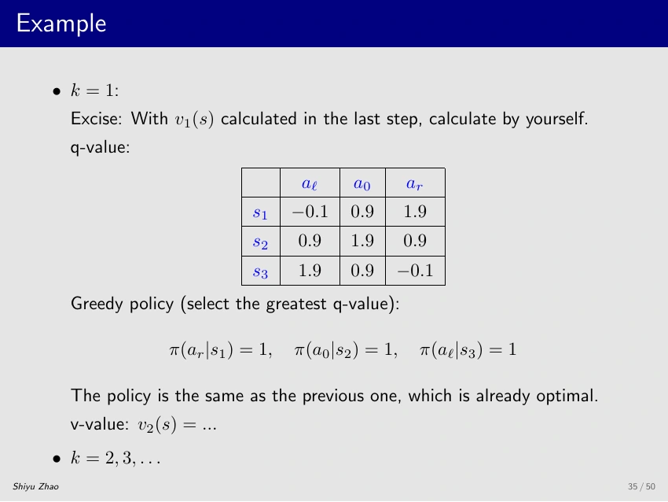

将 $v_1$ 代回，三行分别变为 $(-0.1,0.9,1.9)$、$(0.9,1.9,0.9)$、$(1.9,0.9,-0.1)$。动作仍选向右、停留、向左，但 $v_2=(1.9,1.9,1.9)$，价值还在变。每个状态都可以从第一步开始持续得到 $+1$，继续迭代时各分量趋于 $1/(1-0.9)=10$。

### 第 36 页 · 验证方程的解是否最优

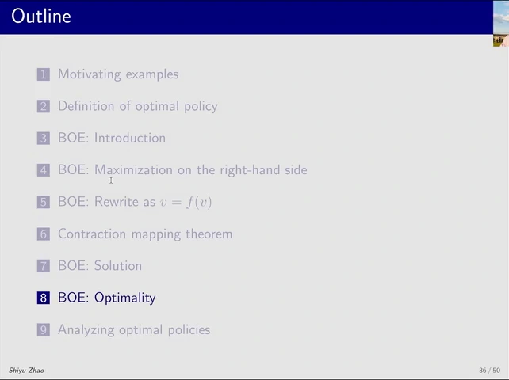

前面证明了方程存在唯一解，也给出了计算方法。现在要说明这个解能由一个策略实现，并且任意其他策略的价值都不会比它高。

### 第 37 页 · Greedy Policy · 实现价值解

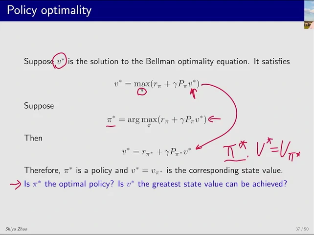

在每个状态对 $v^*$ 算出动作价值，并选一个最大动作。这样构成的 $\pi^*$ 把最优公式右边的最大值实现为固定策略的期望，所以 $v^*=r_{\pi^*}+\gamma P_{\pi^*}v^*$。固定策略的贝尔曼方程也有唯一解，故 $v_{\pi^*}=v^*$。从这个角度看，贝尔曼最优公式求出的价值也满足一个特定策略的贝尔曼方程。

### 第 38 页 · 为什么任意其他策略都超不过它

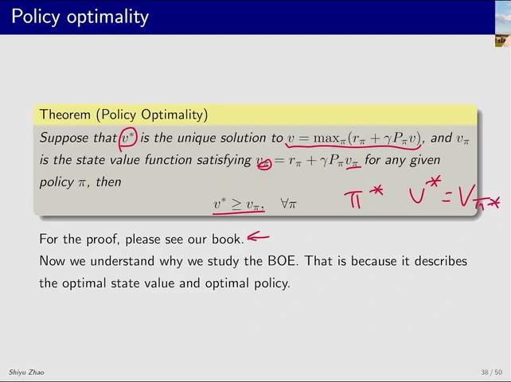

定理说明对任意策略 $\pi$ 和任意状态 $s$，都有 $v^*(s)\ge v_\pi(s)$。把 $\pi$ 的贝尔曼算子记为 $T_\pi$，则 $v^*=Tv^*\ge T_\pi v^*$。由于转移概率非负，$T_\pi$ 保持逐状态大小关系，反复应用得到 $v^*\ge T_\pi^k v^*$。右侧趋于 $v_\pi$，所以贪心策略实现的确实是所有状态的最优价值。

### 第 39 页 · Policy Extraction · 取出最优策略

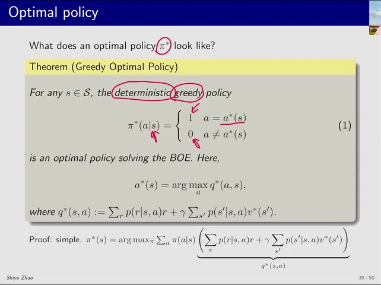

解出 $v^*$ 后，由 $q^*(s,a)=q_{v^*}(s,a)$ 得到最优动作价值。$\max_a$ 返回最大的数值，$\arg\max_a$ 返回达到该数值的动作。每个状态选一个最大动作即可构成确定性最优策略。若出现并列，可以选其中任一个，也可以只在并列的最大动作之间分配概率。最优价值唯一，最优策略可以有多个。

## Part 4 · Properties of Optimal Policies

### 第 40 页 · 转向最优策略的性质

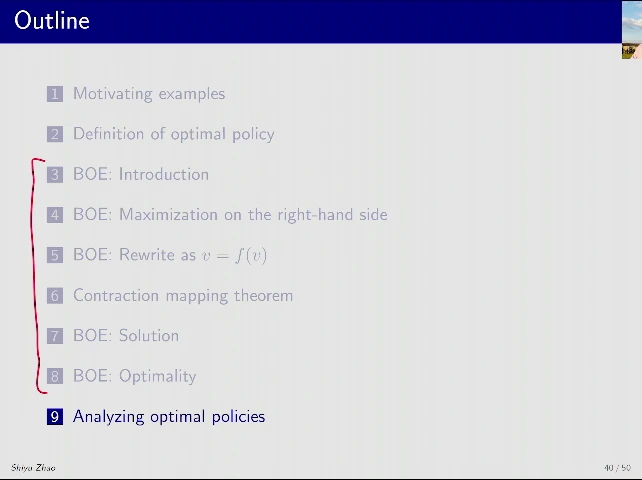

接下来在同一类网格环境中改变折扣或奖励，观察最优策略会不会改变，以及改变的原因。

### 第 41 页 · 什么决定最优策略

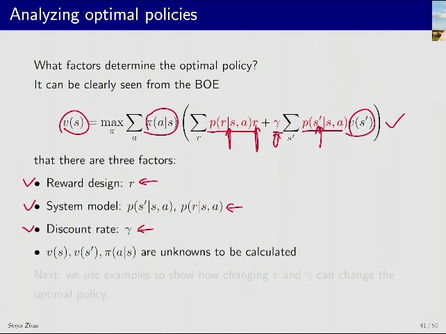

贝尔曼最优公式的已知量包括奖励分布、状态转移概率和折扣因子。用这些量先求 $v^*$，再从最大动作得到 $\pi^*$。改变已知量会改变动作之间的比较，进而可能改变最优策略。环境的转移规律通常难以调整，下面的例子固定转移，只改变奖励或折扣。

### 第 42 页 · Discount Factor · 0.9

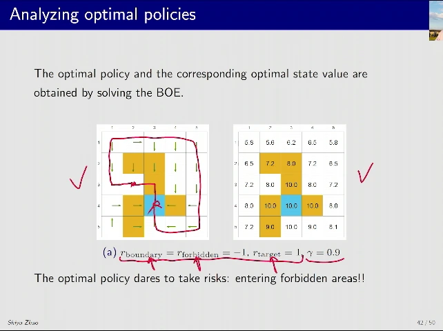

图中黄色格为禁区，蓝色格为目标。撞边界或进入禁区得 $-1$，到达或留在目标得 $+1$，其余为 0。左图是各状态的最优动作，右图是对应的最优状态价值。$\gamma=0.9$ 时未来奖励仍占较大权重，一些起点宁可承担一次禁区扣分，也会走能更早开始持续拿分的捷径。

### 第 43 页 · Discount Factor · 0.5

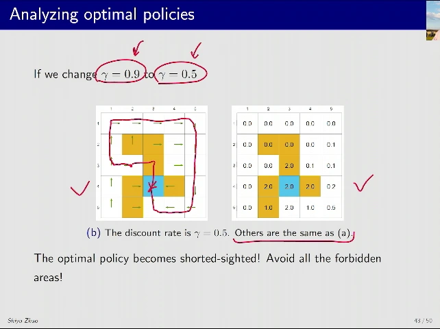

奖励和转移规则照旧。$\gamma=0.5$ 时远期正奖励衰减更快，图中的最优路线绕开禁区。目标格每步得 $+1$，价值由 $1/(1-0.9)=10$ 降为 $1/(1-0.5)=2$。

### 第 44 页 · Discount Factor · 0

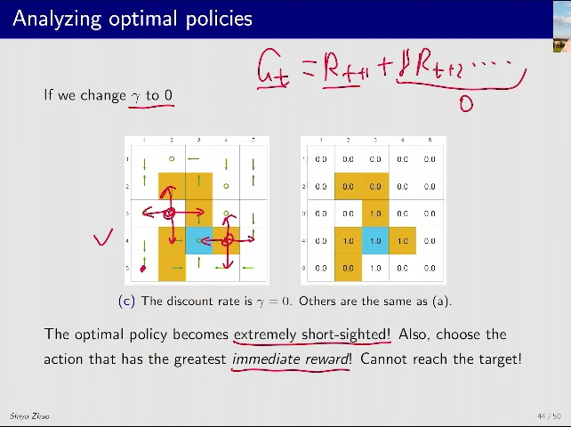

此时动作价值等于期望即时奖励。紧邻目标的格子可以因立刻得到 $+1$ 而选向目标的动作。老师指出图中有一格向左和停留同得 0，程序从并列动作中随机选了停留。因此有些起点会一直留在原地，仍然满足这个折扣下的最优定义。

### 第 45 页 · Reward Penalty · 提高禁区惩罚

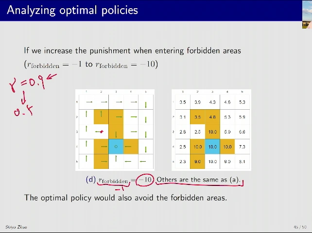

回到 $\gamma=0.9$，把禁区奖励由 $-1$ 改为 $-10$，其他奖励照旧。穿过禁区的即时损失变大，提前到目标的收益无法抵消这笔损失，图中的最优策略避开禁区。

### 第 46 页 · Reward Shift · 每步加 1

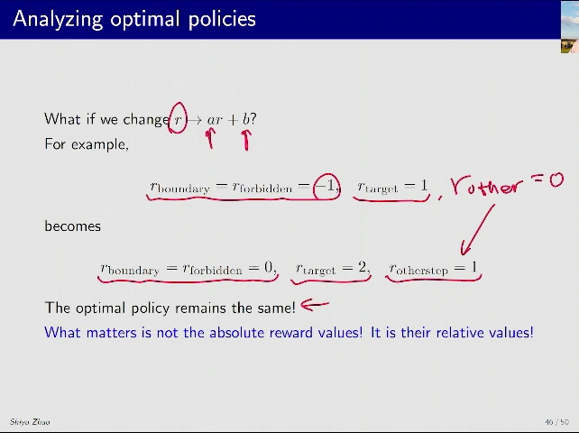

原来的边界、禁区、目标和普通转移奖励分别为 $(-1,-1,1,0)$，平移后变成 $(0,0,2,1)$。在持续折扣任务中，每条轨迹每一步都多得 1，因此每个起点的任意策略价值都加上同一个 $1/(1-\gamma)$。图中的最优动作没有变化。

### 第 47 页 · Positive Affine Transformation

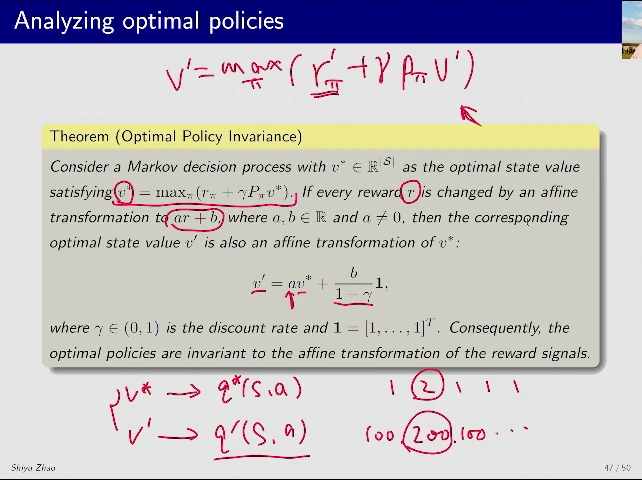

对持续折扣任务，若每一步的奖励都变为 $r'=ar+b$，则 $v'_\pi(s)=a v_\pi(s)+b/(1-\gamma)$，动作价值也遵循同样的变换。保持最优策略需要 $a>0$。例如把动作值 $(1,2,1,1)$ 放大为 $(100,200,100,100)$，最大动作仍是第二个。原页写的是 $a\ne0$，其中负数会把回报大小关系反过来。若在终止时刻停止加常数，不同长度的轨迹可能累加不同的平移量，需要按任务的回报定义重新比较。

### 第 48 页 · Delayed Rewards · 绕路的代价

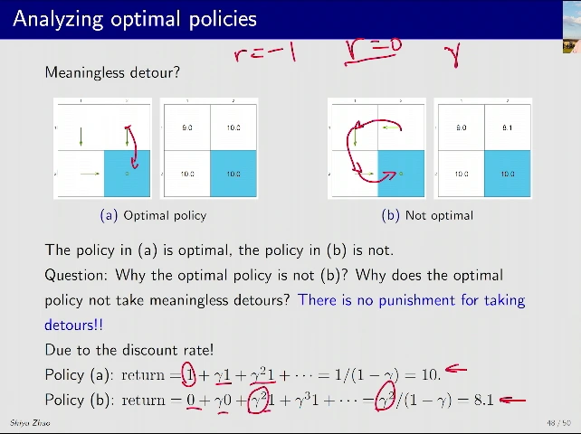

右上角的例子中，直接到目标的第一步就得 $+1$，之后留在目标持续得分，$\gamma=0.9$ 时回报为 10。绕路的前两步得 0，第三步才开始获得同样的奖励流，所以回报是 $0.9^2\times10=8.1$。逐步扣分可以表示行动的能耗，而在这个例子里即使不设步长惩罚，折扣也会让更早到达的路径占优。

### 第 49 页 · 回顾最优公式的两种写法

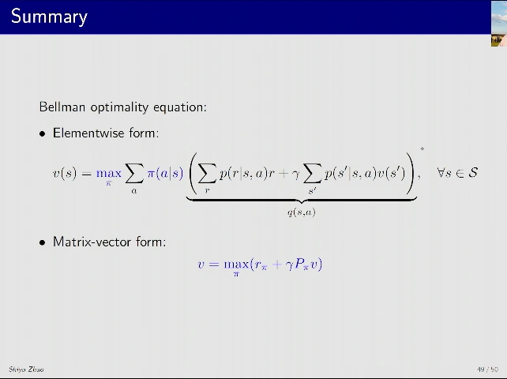

逐状态写法是在期望即时奖励加折扣后续价值的基础上，对动作取最大。向量写法是 $\mathbf v^*=\max_\pi(\mathbf r_\pi+\gamma P_\pi\mathbf v^*)$。前者直接展示某个动作怎样产生价值，后者把所有状态一起写出，最大化仍逐状态进行。

### 第 50 页 · 回顾求解与最优策略

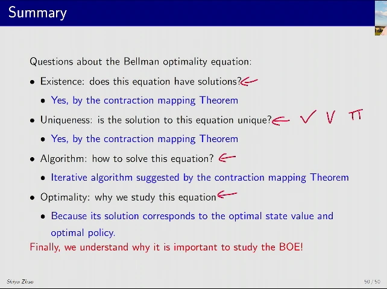

把右端看作收缩映射，可知最优价值存在且唯一，并能从任意初值迭代求得。由最优价值算出 $q^*$ 后，每个状态取一个最大动作，即可得到确定性最优策略。动作并列时可以有多个最优策略，它们实现同一个 $v^*$。
