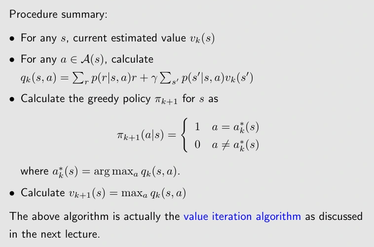

# 第 3 课 · 贝尔曼最优公式 · V2（总结）

[切换到 V1（逐页）](bellman-optimality-slides.md)

## 1. Optimal Policy & Optimal Value

Optimal policy · 怎样比较策略？

本课讨论有限状态、有限动作、奖励有界、$0\le\gamma<1$ 的任务。若

$$
v_{\pi_1}(s)\ge v_{\pi_2}(s),\qquad \forall s\in\mathcal S,
$$

则策略 $\pi_1$ 从任何起点出发都不比 $\pi_2$ 差。若一个策略在某些状态更好、在另一些状态更差，就无法用这个标准把两者排出先后。

<strong>定义 · 最优策略（optimal policy）</strong>：同一个策略 $\pi^*$ 必须在<strong>每个起点</strong>都达到最高价值，也就是

$$
v_{\pi^*}(s)\ge v_\pi(s),\qquad \forall s\in\mathcal S,\ \forall\pi.
$$

它实现的状态价值称为<strong>最优状态价值（optimal state value）</strong>，记为 $v^*(s)=v_{\pi^*}(s)$。在这个设定下，最优价值唯一，最优策略至少有一个是确定性的；如果多个动作并列最优，策略可以不唯一，也可以在并列动作间随机选择。下面先写出方程，第 6 节再说明怎样从它的解得到最优策略。

## 2. Bellman Optimality Equation

### Elementwise Form

（1）Elementwise form · 对每个状态写一个方程

第 2 课的贝尔曼期望方程按<strong>给定策略</strong>的概率对首步动作取平均。<strong>贝尔曼最优方程（Bellman optimality equation，BOE）</strong>则要在所有可行的动作分布中找到能让这一平均值最大的分布：

$$
\begin{aligned}
v(s)
&=\max_{\pi(\cdot\mid s)}\sum_a \pi(a\mid s)
\left[\sum_r p(r\mid s,a)\,r
 +\gamma\sum_{s'}p(s'\mid s,a)\,v(s')\right]\\
&=\max_{\pi(\cdot\mid s)}\sum_a \pi(a\mid s)\,q_v(s,a),
\qquad s\in\mathcal S.
\end{aligned}
$$

括号里的 $q_v(s,a)$ 是<strong>一步前瞻（one-step lookahead）</strong>：指定首步做 $a$，把平均即时奖励与按候选价值 $v$ 计算的折扣后续价值相加。

- <strong>已知：</strong>环境的奖励概率 $p(r\mid s,a)$、转移概率 $p(s'\mid s,a)$ 和折扣因子 $\gamma$。
- <strong>待求：</strong>整组状态价值 $v$ 同时出现在等式两侧；使右侧最大的策略 $\pi$ 也没有预先给定。$v(s)$ 和 $v(s')$ 是同一组未知价值在不同状态上的分量。

### Matrix–Vector Form

（2）Matrix–vector form · 把状态方程合在一起

沿用第 2 课的记号，$\mathbf v$ 是价值列向量，$\mathbf r_\pi$ 和 $P_\pi$ 分别是按策略平均后的即时奖励向量和状态转移矩阵：

$$
\begin{aligned}
r_\pi(s)&=\sum_a\pi(a\mid s)\sum_r p(r\mid s,a)\,r,\\
[P_\pi]_{ss'}&=\sum_a\pi(a\mid s)p(s'\mid s,a),\\[3pt]
\mathbf v&=\max_\pi\bigl(\mathbf r_\pi+\gamma P_\pi\mathbf v\bigr).
\end{aligned}
$$

这里的最大值是<strong>逐分量（componentwise）</strong>取的：每个状态可以选自己的动作分布，再把这些选择合成一套完整策略。这条式子同时刻画了价值和策略；难点是右侧还要做一次最大化，不能直接照搬固定策略时的线性方程求解法。

## 3. Solving for Value and Policy

#### （1）两个未知量：先处理右边的最大化

Two unknowns · 先最大化，再解等式

课件先看 $x,a\in\mathbb R$ 的例子。把 $x$ 暂时当成常数，右侧只有 $-a^2$ 随 $a$ 变化；它在 $a=0$ 时取最大值 $0$。因此可以先消去 $a$，再求 $x$：

$$
x=\max_a(2x-1-a^2)
\ \Longrightarrow\ x=2x-1
\ \Longrightarrow\ x=1,\quad a^*=0.
$$

BOE 也按这个顺序：<strong>先固定一组候选价值 $v$，算出右侧最大值；再找出使等式成立的整组 $v$。</strong> 与上面的例子不同，BOE 中取得最大值的动作可能随候选 $v$ 变化。

### Inner Maximization · 从策略到动作

（2）Inner maximization · 加权平均不会超过最大项

固定候选 $v$ 后，每个动作的 $q_v(s,a)$ 都是已知数。课件把三个动作的概率记为 $c_1,c_2,c_3$，其中 $c_i\ge0$、$\sum_i c_i=1$。若 $q_3$ 最大，则

$$
c_1q_1+c_2q_2+c_3q_3
\le (c_1+c_2+c_3)q_3=q_3.
$$

取 $c_3=1$、$c_1=c_2=0$ 就能达到上界。放回 BOE，策略概率同样非负且和为 $1$，所以

$$
\max_{\pi(\cdot\mid s)}\sum_a\pi(a\mid s)q_v(s,a)
=\max_{a\in\mathcal A(s)}q_v(s,a).
$$

对当前候选 $v$，任选一个 $a_v^*(s)\in\arg\max_{a\in\mathcal A(s)}q_v(s,a)$。一种达到最大值的策略是把全部概率给它：

$$
\pi(a\mid s)=
\begin{cases}
1,&a=a_v^*(s),\\
0,&a\ne a_v^*(s).
\end{cases}
$$

如果有多个动作并列最大，在这些动作之间分配概率也能达到同一个上界。这一步求出的是<strong>对当前候选 $v$ 的贪心选择</strong>；等 $v$ 求到最优值后，才能据此得到最优策略。

#### （3）剩下的未知量是整组价值

把右端记成<strong>贝尔曼最优算子（Bellman optimality operator）</strong> $[Tv](s)=\max_{a\in\mathcal A(s)}q_v(s,a)$。原方程现在变为

$$
v=Tv.
$$

输入一组价值，逐状态找最好的首步，输出仍然是原来这组价值，这就叫一个不动点。接下来用收缩映射说明为什么它有唯一解，以及怎样用迭代找到它。

## 4. Fixed Points & Contraction

若 $f(x^*)=x^*$，则 $x^*$ 是 $f$ 的<strong>不动点（fixed point）</strong>，也就是更新后保持原值的输入。若存在同一个 $0\le c<1$，使任意两点 $x,y$ 经过 $f$ 后的距离都至多是原来的 $c$ 倍，那么 $f$ 就是<strong>收缩映射（contraction mapping，也称压缩映射）</strong>。

$$
\|f(x)-f(y)\|\le c\|x-y\|.
$$

价值向量之间的距离用最大范数衡量。

### Existence, Uniqueness & Convergence

<strong>收缩映射定理（contraction mapping theorem）</strong>要求 $f$ 把一个完备空间映到自身。完备性保证一个各项最终彼此任意接近的序列会在这个空间里收敛。有限维实数价值向量满足这个条件。

| Conclusion | Derivation |
| --- | --- |
| Existence | 令 $x_{k+1}=f(x_k)$、$d=\|x_1-x_0\|$。相邻距离至多是 $c^kd$，第 $k$ 步之后的总移动距离至多是 $c^kd/(1-c)$。由完备性得到极限 $x^*$，由连续性得 $f(x^*)=x^*$。 |
| Uniqueness | 若 $x^*,y^*$ 都是不动点，则 $\|x^*-y^*\|\le c\|x^*-y^*\|$。由于 $c<1$，两点的距离只能是 0。 |
| Convergence | 任意 $x_0$ 下，每次迭代到不动点的距离至多乘一次 $c$，故 $\|x_k-x^*\|\le c^k\|x_0-x^*\|$。 |

### The Bellman Operator Is a Contraction

用<strong>最大范数（sup norm）</strong> $\|v-w\|_\infty=\max_s|v(s)-w(s)|$ 衡量两组价值的距离。先在每个状态求差的绝对值，再挑最大的一个。

第一步，固定同一个状态和动作。两次计算用的是同一条奖励规则，因此即时奖励相减后抵消。相减后只剩下一状态价值的差。

$$
\begin{aligned}
&|q_v(s,a)-q_w(s,a)|\\
&\quad=\gamma\left|\sum_{s'}p(s'\mid s,a)(v(s')-w(s'))\right|\\
&\quad\le\gamma\sum_{s'}p(s'\mid s,a)|v(s')-w(s')|\\
&\quad\le\gamma\|v-w\|_\infty.
\end{aligned}
$$

最后一步把每个绝对值都换成最大差距，而所有转移概率加起来是 1。

第二步，对动作取最大值。设每个动作值最多改变 $d=\gamma\|v-w\|_\infty$。即使取最大值的动作换了，新列表中的每一项也至多等于旧列表的最大值加 $d$。反过来同理，所以两个最大值最多差 $d$。这对每个状态都成立，于是

$$
\|Tv-Tw\|_\infty\le\gamma\|v-w\|_\infty.
$$

因为 $\gamma<1$，定理适用。<strong>方程存在唯一的价值解，从任何初值反复应用 $T$ 都会趋近它。</strong>

## 5. Value Iteration

<strong>值迭代（value iteration）</strong>从任意一组 $v_0$ 出发，常用全零值。一次完整更新分三步。

1. 用同一份旧值 $v_k$，计算每个状态下所有动作的 $q_{v_k}(s,a)$。
2. 对每个状态取最大值，写入 $v_{k+1}(s)=\max_a q_{v_k}(s,a)$，并可记录取得最大值的动作。
3. 全部状态更新完后，用 $v_{k+1}$ 作为下一轮的输入。可以检查两轮价值最大的差距，判断下一轮还能改变多少。若相邻两轮最多差 $d$，之后每轮差距依次至多是 $\gamma d,\gamma^2d,\ldots$，所以当前新值与最终解最多差 $\gamma d/(1-\gamma)$。

### Fixed-point Iteration · 课件原页

<figure>
  
</figure>

$V$ 是价值估计。用最终价值重新比较动作，得到与返回值对应的贪心策略。

## 6. Extracting a Greedy Policy

求得价值解 $v^*$ 后，固定第一步做 $a$，之后用 $v^*$ 计算后续回报，就得到<strong>最优动作价值（optimal action value）</strong>。

$$
\begin{aligned}
q^*(s,a)&=q_{v^*}(s,a)\\
&=\sum_r p(r\mid s,a)r\\
&\quad+\gamma\sum_{s'}p(s'\mid s,a)v^*(s').
\end{aligned}
$$

允许首步也自由选择时，$v^*(s)=\max_a q^*(s,a)$。$\max$ 给出最大的<strong>数值</strong>，$\arg\max$ 给出取得最大值的<strong>动作</strong>。每个状态都挑一个最大动作，就得到一套确定性的<strong>贪心策略（greedy policy）</strong>。

### Why the Greedy Policy Is Optimal

**先看这套贪心策略能不能实现 $v^*$。** 记 $T_\pi v=\mathbf r_\pi+\gamma P_\pi v$ 为固定策略的一步更新。$T$ 取各动作的最大值，而贪心策略 $\pi^*$ 在每个状态恰好选中这个最大值，所以 $T_{\pi^*}v^*=Tv^*=v^*$。这就是策略 $\pi^*$ 的贝尔曼方程。该方程的解唯一，所以这套策略实际走出来的价值就是 $v^*$。

**再看其他策略能不能超过 $v^*$。** 从同一组 $v^*$ 出发，任意策略 $\pi$ 用概率对动作值取平均，平均值不会超过最大值，故 $T_\pi v^*\le v^*$。这条不等式逐状态成立。再次应用 $T_\pi$ 时，非负的转移概率会保持大小关系，因此 $T_\pi^2v^*\le T_\pi v^*\le v^*$。依此类推，每轮都不超过 $v^*$。根据第 2 课的策略评估迭代，左边最终趋向该策略的真实价值 $v_\pi$。因此从任何状态出发，$\pi$ 的价值都不会超过 $v^*$。

有多个动作并列最大时，可以用并列处理规则（tie-breaking rule）任选一个，也可以只在这些动作之间分配概率。两种做法都能实现同一个 $v^*$。<strong>最优价值唯一，最优策略可以有多个。</strong>

## 7. Reward Transformations

### Positive Affine Transformation

奖励的正仿射变换（positive affine transformation）指先乘正数再加常数。把 $ax+b$ 用于奖励时，$x$ 就是每一步的原始奖励。为免与动作 $a$ 混淆，把缩放系数和平移量记为 $\alpha,\beta$。设持续折扣任务中每一步的奖励都变为 $r'=\alpha r+\beta$，环境转移和折扣因子 $\gamma$ 固定。把新奖励代入一条轨迹的回报，

$$
\begin{aligned}
G'_t
&=\sum_{k=0}^\infty\gamma^k(\alpha R_{t+k+1}+\beta)\\
&=\alpha G_t+\beta\sum_{k=0}^\infty\gamma^k\\
&=\alpha G_t+\frac{\beta}{1-\gamma}.
\end{aligned}
$$

展开看，第一步多出的常数是 $\beta$，第二步是 $\gamma\beta$，第三步是 $\gamma^2\beta$。不管智能体怎么走，这部分都是同一个数。对轨迹回报取平均，得到 $v'_\pi(s)=\alpha v_\pi(s)+\beta/(1-\gamma)$。固定首步动作再取平均，动作价值也遵循同样的变换。

比较同一起点下的两套策略时，减去对方的价值，两边的常数正好消掉，原来的差距只乘一次缩放系数。<strong>缩放系数为正时，领先的仍然领先，并列的仍然并列。</strong> 第 47 页写的是 $a\ne0$，其中 $a<0$ 会反转大小关系，$a=0$ 会让所有回报相同。

如果只在终止前加 $\beta$，不同长度的轨迹累加的折扣常数可能不同，策略排序就可能改变。
