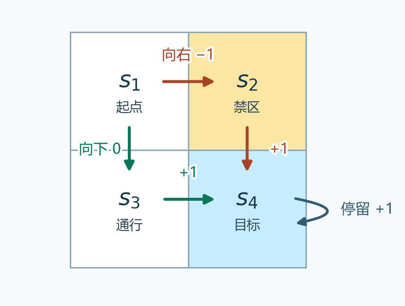
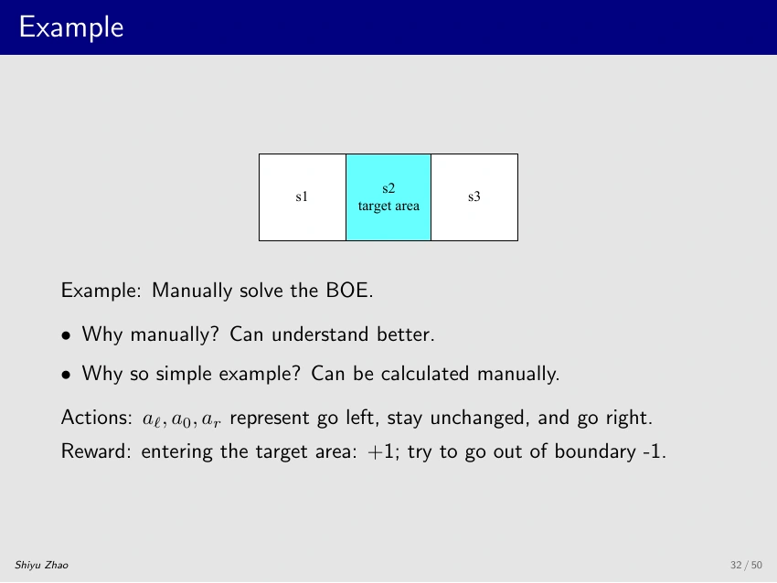

# 第 3 课 · 贝尔曼最优公式 · V2（总结）

[切换到 V1（逐页）](bellman-optimality-slides.md)

## 1. 定义最优策略

状态 $s$ 表示智能体当前在哪一格，动作 $a$ 表示下一步怎么走。策略 $\pi$ 为每个状态指定动作或动作概率，例如 $\pi(\text{向右}\mid s_1)=1$ 表示在 $s_1$ 一定向右。下文以有限状态、有限动作、奖励有界的持续任务为例，折扣因子满足 $0\le\gamma<1$。

从时刻 $t$ 出发，第一步奖励记为 $R_{t+1}$，第二步记为 $R_{t+2}$。把各步奖励按时间折算后相加，就得到<strong>折扣回报（discounted return）</strong>。

$$
G_t=R_{t+1}+\gamma R_{t+2}+\gamma^2R_{t+3}+\cdots.
$$

取 $\gamma=0.9$ 时，第一步得 1 分计作 1，第二步才得 1 分计作 0.9。把从同一状态 $s$ 出发、全程按 $\pi$ 行动的回报取平均，就得到<strong>状态价值（state value）</strong> $v_\pi(s)$。这个平均同时考虑策略选动作和环境产生结果时可能存在的随机性。

比较策略时，要从同一个起点比较各自的回报。若 $\pi_1$ 在每个状态的价值都至少和 $\pi_2$ 一样高，就说 $\pi_1$ 至少和 $\pi_2$ 一样好。比如在两个起点，策略甲的价值依次是 $(5,2)$，策略乙是 $(4,3)$。从第一个起点出发选甲，从第二个起点出发选乙，所以按这个标准，两者谁也没有全面占优。

<strong>最优策略（optimal policy）</strong> $\pi^*$ 是一套完整的行动规则，它从每个起点出发都能达到该起点的最高价值。策略可以在不同状态选不同动作，并且允许其他策略在某些状态与它打平。它实现的状态价值称为<strong>最优状态价值（optimal state value）</strong> $v^*$。

$$
\begin{aligned}
v_{\pi^*}(s)&\ge v_\pi(s) &&\text{对任意 }s,\pi,\\
v^*(s)&=v_{\pi^*}(s).
\end{aligned}
$$

### 四格例子 · 从比较动作到改进策略

<figure>
  
  <figcaption>从左上角出发，旧策略向右进入禁区。改为向下，两条路线仍在第二步到达目标。</figcaption>
</figure>

取 $\gamma=0.9$。进入禁区或撞墙扣 1 分，进入目标或留在目标得 1 分，其他动作得 0 分。旧策略 $\pi$ 在 $s_1$ 向右，到了 $s_2$ 或 $s_3$ 都直接去 $s_4$，此后一直停在目标。价值从目标格往回算。

$$
\begin{aligned}
v_\pi(s_4)&=1+0.9v_\pi(s_4),\\
v_\pi(s_4)&=\frac{1}{1-0.9}=10,\\
v_\pi(s_2)&=v_\pi(s_3)=1+0.9(10)=10,\\
v_\pi(s_1)&=-1+0.9(10)=8.
\end{aligned}
$$

在 $s_4$ 停留一步会马上拿到 1 分，下一步仍从 $s_4$ 出发，所以同一个 $v_\pi(s_4)$ 同时出现在等式两边。从 $s_2$ 或 $s_3$ 出发，第一步进目标已经拿到 1 分，接下来继续留在目标，奖励序列也是 $1,1,1,\ldots$。从 $s_1$ 按旧策略出发，第一步先扣 1 分，再从 $s_2$ 开始拿分。

为了比较更好的首步，用<strong>动作价值（action value）</strong> $q_\pi(s_1,a)$。先指定动作 $a$，从第二步起再沿用旧策略。比如第一步向下，立即得到 0 分并到达 $s_3$，从那里开始按旧策略还能拿到价值 10，折回当前就是 $0+0.9(10)=9$。撞墙和原地停留都会回到 $s_1$，所以它们的后续价值都用旧策略在 $s_1$ 的值 8。

| 首步动作 | 即时奖励 | 下一状态的旧价值 | 动作价值 |
| --- | ---: | ---: | ---: |
| 向上或向左撞墙 | $-1$ | $8$ | $-1+0.9(8)=6.2$ |
| 向右进禁区 $s_2$ | $-1$ | $10$ | $-1+0.9(10)=8$ |
| 向下进普通格 $s_3$ | $0$ | $10$ | $0+0.9(10)=9$ |
| 原地停留 | $0$ | $8$ | $0+0.9(8)=7.2$ |

这一步叫<strong>策略改进（policy improvement）</strong>。把 $s_1$ 的动作改为「向下」，后续仍是从 $s_3$ 进目标、留在目标。两条路线都在第二步到目标，所以只差首步扣不扣 1 分，新策略的起点价值从 8 提到 9。其余三格本来就能从第一步起持续拿到每步最多的 1 分，所以在这个例子里改一次就够了。如果别处的动作也需要改，按旧走法算出的后续价值会影响首步比较。后面的最优公式会同时考虑各状态改好后的价值。

## 2. 贝尔曼最优公式的两种形式

### 逐状态形式（elementwise form）

把回报拆成 $G_t=R_{t+1}+\gamma G_{t+1}$。第一项是当前动作直接带来的奖励，第二项涵盖下一步开始的全部回报。$G_{t+1}$ 是站在下一时刻计价的，所以要再乘一次 $\gamma$ 折回当前。给定当前状态 $s$、动作 $a$，暂用 $v(s')$ 表示到达 $s'$ 后的候选价值。把奖励和下一状态分别按环境给出的概率取平均，得到

$$
\begin{aligned}
q_v(s,a)
&=\underbrace{\sum_r p(r\mid s,a)r}_{\text{期望即时奖励}}\\
&\quad+\gamma\underbrace{\sum_{s'}p(s'\mid s,a)v(s')}_{\text{期望下一状态价值}}.
\end{aligned}
$$

这里 $p(r\mid s,a)$ 是做完 $a$ 后得到奖励 $r$ 的概率，$p(s'\mid s,a)$ 是到达下一状态 $s'$ 的概率。四格图中 $s_1$ 向右必得 $-1$、必到 $s_2$，所以两项就是 $-1$ 和 $0.9v(s_2)$。如果同一个动作有 75% 的概率扣 1 分到达价值为 10 的格子，25% 的概率得 0 分并留在价值为 8 的格子，两项就分别为

$$
\begin{aligned}
0.75(-1)+0.25(0)&=-0.75,\\
0.9\bigl(0.75(10)+0.25(8)\bigr)&=8.55.
\end{aligned}
$$

上面已经固定了动作，概率来自环境。如果现在只知道起点，给定策略会用 $\pi(a\mid s)$ 选择动作，还要在各个动作值外面再做一层平均。例如在原四格图里，旧后续价值下向右值 8、向下值 9，两者各选一半时起点价值是 8.5。<strong>贝尔曼最优公式（Bellman optimality equation，BOE）</strong>把策略的这层概率也作为待选量，寻找能得到最大值的分配。

$$
v(s)=\max_{\pi(\cdot\mid s)}
\sum_a\pi(a\mid s)q_v(s,a).
$$

左边是从 $s$ 出发的价值，右边是用同一组 $v$ 评价后续、再选最好首步的价值。解方程时，每个状态的两边都要相等。为什么这个解就是 $v^*$，第 6 节会通过构造策略来验证。

### 矩阵向量形式（matrix–vector form）

把所有状态的价值排成列向量 $\mathbf v$。$\mathbf r_\pi$ 的第 $s$ 项是按策略选动作后的期望即时奖励，$P_\pi$ 的第 $s$ 行是按策略选动作后到各下一状态的概率。

$$
\begin{aligned}
r_\pi(s)&=\sum_a\pi(a\mid s)\sum_r p(r\mid s,a)r,\\
[P_\pi]_{ss'}&=\sum_a\pi(a\mid s)p(s'\mid s,a),\\
\mathbf v&=\max_\pi\bigl(\mathbf r_\pi+\gamma P_\pi\mathbf v\bigr).
\end{aligned}
$$

矩阵乘法的第 $s$ 行就是把各个 $v(s')$ 按转移概率加权。以旧策略的 $s_1$ 为例，$r_\pi(s_1)=-1$，而 $P_\pi$ 的第一行是 $(0,1,0,0)$，因为向右必到 $s_2$。这一行乘上 $\mathbf v$ 只留下 $v(s_2)$，所以右端第一项是 $-1+0.9v(s_2)$。如果把 $s_1$ 的动作改为向下，奖励变成 0，第一行变成 $(0,0,1,0)$，这一项就变成 $0+0.9v(s_3)$。

因此 $\max_\pi$ 要<strong>逐状态分量</strong>计算。每一行可以选自己的动作分布，比如 $s_1$ 选向下、$s_4$ 选停留。把各行的选择合起来就是完整策略。给定策略后，$\mathbf r_\pi$ 和 $P_\pi$ 都已确定，方程就回到第 2 课的策略评价。

## 3. 如何求解 · 两个未知量怎样处理

公式里有两个未知量。<strong>价值 $v$</strong> 同时出现在等式左边和右边的后续价值里。<strong>策略 $\pi$</strong> 则藏在右边的最大化里。处理顺序是先把 $v$ 当作已知，解出右侧最大值的表达式，再用这个表达式求满足整条等式的 $v$。

### 先用一个只含两个数的例子

课件用 $x=\max_{a\in\mathbb R}(2x-1-a^2)$ 示范。先固定 $x$，那么 $2x-1$ 是常数。因为 $a^2\ge0$，取 $a=0$ 才能使减掉的量最小。右侧的最大值因此是 $2x-1$。再解 $x=2x-1$，得到 $x=1$。回代检查，右侧为 $2(1)-1-0^2=1$，与左侧相等。

### 用同样顺序处理价值和策略

贝尔曼最优公式也按这个顺序处理。固定候选 $v$ 后，每个 $q_v(s,a)$ 都是一个已知数。以 $m=\max_a q_v(s,a)$ 为上界，概率加权平均满足

$$
\sum_a \pi(a\mid s)q_v(s,a)
\le \sum_a \pi(a\mid s)m
=m.
$$

四格例子中，暂把旧价值 $(8,10,10,10)$ 当作输入。$s_1$ 向右得 8，向下得 9，各选一半只能得 8.5。其余动作的值也低于 9，因此给向下概率 1 就取得这个状态的最大值。换一组输入，动作值和最大动作可能跟着变，所以<strong>每轮更新价值之后，都要重新比较动作</strong>。

内层优化可以直接对动作取最大，逐状态的公式化为

$$
v(s)=\max_{a\in\mathcal A(s)}q_v(s,a).
$$

把右端记为<strong>贝尔曼最优算子（Bellman optimality operator）</strong> $[Tv](s)=\max_a q_v(s,a)$。整组状态价值的求解问题写成

$$
v=Tv.
$$

读作「输入整组 $v$，在每个状态算出所有动作的值并取最大，输出恰好还是这组 $v$」。用上面的旧价值作输入时，$[Tv](s_1)=9$，而输入的 $v(s_1)=8$，所以旧价值还没有满足方程。

## 4. 不动点与收缩映射定理

若 $f(x^*)=x^*$，则 $x^*$ 是 $f$ 的<strong>不动点（fixed point）</strong>，也就是更新后保持原值的输入。若存在同一个 $0\le c<1$，使任意两点 $x,y$ 经过 $f$ 后的距离都至多是原来的 $c$ 倍，那么 $f$ 就是<strong>收缩映射（contraction mapping，也称压缩映射）</strong>。

$$
\|f(x)-f(y)\|\le c\|x-y\|.
$$

例如 $f(x)=0.5x$。输入 8 和 4 时相差 4，输出变成 4 和 2，相差 2。每做一次都减半。从 8 出发重复更新得到 $8\to4\to2\to1\to\cdots$，趋近不动点 0。对价值向量来说，每个点是一整组状态价值，距离的量法见下文。

### 定理给出的三件事

<strong>收缩映射定理（contraction mapping theorem）</strong>要求 $f$ 把一个完备空间映到自身。完备性保证一个各项最终彼此任意接近的序列会在这个空间里收敛。有限维实数价值向量满足这个条件。

1. <strong>存在性（existence）</strong>。从任意点反复更新，每两次相邻更新之间的距离至少按几何速度缩小，后面所有更新的总移动距离也趋于零。完备性保证这串点有极限。收缩映射是连续的，因此对极限再做一次更新，结果还是这个极限。
2. <strong>唯一性（uniqueness）</strong>。假设有两个不同的不动点。更新后它们各自都不动，距离自然保持不变。但收缩要求两个不同点的距离变小，所以只能有一个不动点。
3. <strong>迭代收敛（convergence）</strong>。从任意 $x_0$ 出发，反复做 $x_{k+1}=f(x_k)$ 都趋向同一个 $x^*$。每轮与 $x^*$ 的距离至多乘一次 $c$，因此 $\|x_k-x^*\|\le c^k\|x_0-x^*\|$。

### 为什么贝尔曼最优算子满足定理

用<strong>最大范数（maximum norm）</strong> $\|v-w\|_\infty=\max_s|v(s)-w(s)|$ 衡量两组价值的距离。先在每个状态求差的绝对值，再挑最大的一个。例如 $(8,10,10,10)$ 与 $(9,10,10,10)$ 的距离是 1。

第一步，固定同一个状态和动作。两次计算用的是同一条奖励规则，因此即时奖励相减后抵消。相减后只剩下一状态价值的差。

$$
\begin{aligned}
&|q_v(s,a)-q_w(s,a)|\\
&\quad=\gamma\left|\sum_{s'}p(s'\mid s,a)(v(s')-w(s'))\right|\\
&\quad\le\gamma\sum_{s'}p(s'\mid s,a)|v(s')-w(s')|\\
&\quad\le\gamma\|v-w\|_\infty.
\end{aligned}
$$

最后一步把每个绝对值都换成最大差距，而所有转移概率加起来是 1。

第二步，对动作取最大值。设每个动作值最多改变 $d=\gamma\|v-w\|_\infty$。即使取最大值的动作换了，新列表中的每一项也至多等于旧列表的最大值加 $d$。反过来同理，所以两个最大值最多差 $d$。这对每个状态都成立，于是

$$
\|Tv-Tw\|_\infty\le\gamma\|v-w\|_\infty.
$$

因为 $\gamma<1$，定理适用。<strong>方程存在唯一的价值解，从任何初值反复应用 $T$ 都会趋近它。</strong>

## 5. 如何迭代求解 · 值迭代

<strong>值迭代（value iteration）</strong>从任意一组 $v_0$ 出发，常用全零值。一次完整更新分三步。

1. 用同一份旧值 $v_k$，计算每个状态下所有动作的 $q_{v_k}(s,a)$。
2. 对每个状态取最大值，写入 $v_{k+1}(s)=\max_a q_{v_k}(s,a)$，并可记录取得最大值的动作。
3. 全部状态更新完后，用 $v_{k+1}$ 作为下一轮的输入。可以检查两轮价值最大的差距，判断下一轮还能改变多少。若相邻两轮最多差 $d$，之后每轮差距依次至多是 $\gamma d,\gamma^2d,\ldots$，所以当前新值与最终解最多差 $\gamma d/(1-\gamma)$。

### 三格网格手算两轮

<figure>
  
  <figcaption>进入或留在中间的目标格得 +1，撞边界得 −1，其余转移得 0。取折扣因子 0.9。</figcaption>
</figure>

每轮都用同一份旧值计算各动作。以 $s_1$ 为例，向左撞墙、停留、向右到目标依次是 $-1+0.9v_k(s_1)$、$0.9v_k(s_1)$、$1+0.9v_k(s_2)$。

| 状态 | 第 1 轮动作值（左、停、右） | 第 2 轮动作值（左、停、右） | 两轮的最大动作 |
| --- | --- | --- | --- |
| $s_1$ | $(-1,0,1)$ | $(-0.1,0.9,1.9)$ | 向右 |
| $s_2$ | $(0,1,0)$ | $(0.9,1.9,0.9)$ | 停留 |
| $s_3$ | $(1,0,-1)$ | $(1.9,0.9,-0.1)$ | 向左 |

<strong>第 1 轮。</strong> 从 $v_0=(0,0,0)$ 开始，所有后续价值都是 0，因此表中的动作值就是即时奖励。每个状态都能立即拿到 1 分，逐行取最大得到 $v_1=(1,1,1)$。

<strong>第 2 轮。</strong> 用 $v_1$ 计算，每个落点的价值都为 1，所以三个动作各在即时奖励的基础上加 $0.9$。例如 $s_1$ 向右到目标得 $1+0.9(1)=1.9$，向左撞墙则得 $-1+0.9(1)=-0.1$。逐行取最大得到 $v_2=(1.9,1.9,1.9)$。

从全零值出发，第 $k$ 轮等于往前看 $k$ 步的最优折扣回报。这里前两轮的最大动作已经相同，但第 1 轮只计了第一笔 1 分，第 2 轮计了 $1+0.9$，第 3 轮还会加上 $0.9^2$。三个状态都可以从第一步起每步拿 1 分，所以最后都趋于 $1/(1-0.9)=10$。

## 6. 从价值解取出最优策略

求得价值解 $v^*$ 后，固定第一步做 $a$，之后用 $v^*$ 计算后续回报，就得到<strong>最优动作价值（optimal action value）</strong>。

$$
\begin{aligned}
q^*(s,a)&=q_{v^*}(s,a)\\
&=\sum_r p(r\mid s,a)r\\
&\quad+\gamma\sum_{s'}p(s'\mid s,a)v^*(s').
\end{aligned}
$$

四格例子求出的价值是 $(9,10,10,10)$。在 $s_1$ 指定向右时，动作价值是 $-1+0.9(10)=8$。指定向下时是 $0+0.9(10)=9$。指定原地停留时是 $0+0.9(9)=8.1$。最后这个值与旧策略下的 7.2 不同，因为停留一步后仍在 $s_1$，接下来会按最优策略向下。

允许首步也自由选择时，$v^*(s)=\max_a q^*(s,a)$。$\max$ 给出最大的<strong>数值</strong>，$\arg\max$ 给出取得最大值的<strong>动作</strong>。在 $s_1$，两者分别是 9 和向下。每个状态都挑一个最大动作，就得到一套确定性的<strong>贪心策略（greedy policy）</strong>。

### 为什么这套动作能从每个起点达到最优

**先看这套贪心策略能不能实现 $v^*$。** 记 $T_\pi v=\mathbf r_\pi+\gamma P_\pi v$ 为固定策略的一步更新。$T$ 取各动作的最大值，而贪心策略 $\pi^*$ 在每个状态恰好选中这个最大值，所以 $T_{\pi^*}v^*=Tv^*=v^*$。这就是策略 $\pi^*$ 的贝尔曼方程。该方程的解唯一，所以这套策略实际走出来的价值就是 $v^*$。

**再看其他策略能不能超过 $v^*$。** 从同一组 $v^*$ 出发，任意策略 $\pi$ 用概率对动作值取平均，平均值不会超过最大值，故 $T_\pi v^*\le v^*$。这条不等式逐状态成立。再次应用 $T_\pi$ 时，非负的转移概率会保持大小关系，因此 $T_\pi^2v^*\le T_\pi v^*\le v^*$。依此类推，每轮都不超过 $v^*$。根据第 2 课的策略评估迭代，左边最终趋向该策略的真实价值 $v_\pi$。因此从任何状态出发，$\pi$ 的价值都不会超过 $v^*$。

有多个动作并列最大时，任选一个，或者只在这些动作之间分配概率，都能实现同一个 $v^*$。<strong>最优价值唯一，最优策略可以有多个。</strong>

## 7. 为什么奖励的正仿射变换保持最优策略

### 正仿射变换保持回报排序

把 $ax+b$ 用于奖励时，$x$ 就是每一步的原始奖励。为免与动作 $a$ 混淆，把缩放系数和平移量记为 $\alpha,\beta$。设持续折扣任务中每一步的奖励都变为 $r'=\alpha r+\beta$，环境转移和折扣因子 $\gamma$ 固定。把新奖励代入一条轨迹的回报，

$$
\begin{aligned}
G'_t
&=\sum_{k=0}^\infty\gamma^k(\alpha R_{t+k+1}+\beta)\\
&=\alpha G_t+\beta\sum_{k=0}^\infty\gamma^k\\
&=\alpha G_t+\frac{\beta}{1-\gamma}.
\end{aligned}
$$

展开看，第一步多出的常数是 $\beta$，第二步是 $\gamma\beta$，第三步是 $\gamma^2\beta$。不管智能体怎么走，这部分都是同一个数。对轨迹回报取平均，得到 $v'_\pi(s)=\alpha v_\pi(s)+\beta/(1-\gamma)$。固定首步动作再取平均，动作价值也遵循同样的变换。

比较同一起点下的两套策略时，减去对方的价值，两边的常数正好消掉，原来的差距只乘一次缩放系数。<strong>缩放系数为正时，领先的仍然领先，并列的仍然并列。</strong> 第 47 页写的是 $a\ne0$，其中 $a<0$ 会反转大小关系，$a=0$ 会让所有回报相同。

例如在四格网格中给每一步奖励加 1，$\gamma=0.9$ 时每个策略的价值都增加 $1/(1-0.9)=10$。$s_1$ 向右和向下对应的回报从 8、9 变成 18、19，仍应向下。如果只在终止前加 $\beta$，不同长度的轨迹累加的折扣常数可能不同，策略排序就可能改变。

### 哪些改动会改变动作比较

- <strong>只提高禁区惩罚</strong>。课件把禁区奖励从 $-1$ 改成 $-10$，保持 $\gamma=0.9$，最优路线避开了原先可能经过的禁区捷径。
- <strong>改变折扣因子</strong>。课件把 $\gamma$ 从 0.9 降至 0.5，提前到达目标的收益变小，图中的路线绕开禁区。降到 0 时只比较即时奖励，离目标较远的格子可能在移动和原地停留之间并列。
- <strong>推迟获得同一串奖励</strong>。即使绕路的步子得 0 分，仍可能更差。若第一步起持续得 $+1$，回报是 10。若前两步得 0、第三步起持续得 $+1$，回报是 $0.9^2\times10=8.1$。
