# 第 5 课 · 蒙特卡洛方法 · V1（逐页）

[切换到 V2（总结）](monte-carlo.md)

页码按公开课件的 50 页版本编排。视频截图的页脚总页数随分段使用的课件版本而变化。

## Part 1 · Monte Carlo Estimation

### 第 01 页 · 从 Model-based 到 Model-free

第 4 课的策略迭代用已知转移概率和奖励模型计算价值。本课保留「评价策略、改进策略」的循环，把评价所需的信息换成与环境交互得到的样本。

### 第 02 页 · Lecture Outline

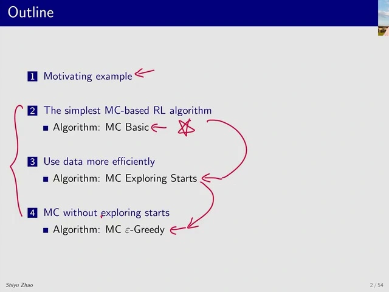

先用投硬币说明 Monte Carlo estimation，再依次介绍 MC Basic、MC Exploring Starts 和 MC ε-Greedy。三种算法的区别主要在于怎样收集和利用回合。

### 第 03 页 · Motivating Example

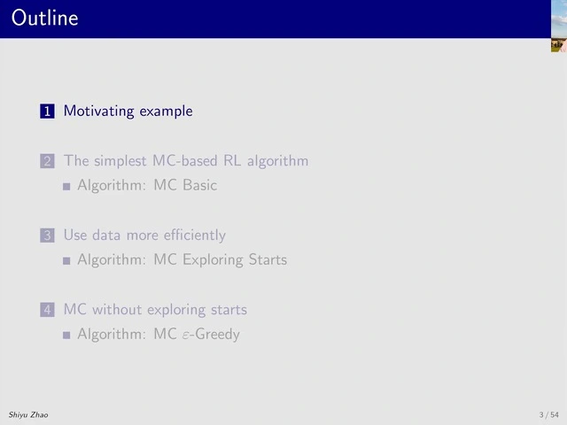

先把强化学习问题缩小成一个统计问题：概率分布不知道时，如何估计随机变量的期望？

### 第 04 页 · Coin Toss · 编码随机结果

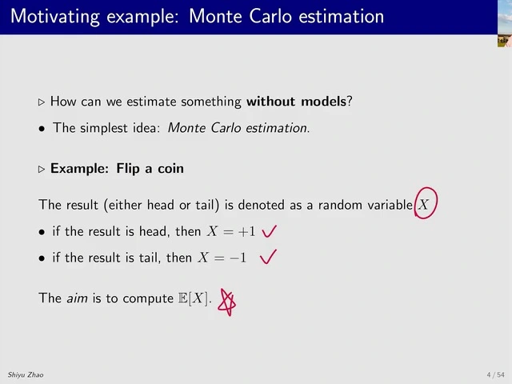

用随机变量 $X$ 表示抛硬币结果。正面记作 $+1$，反面记作 $-1$，要估计的是长期平均 $\mathbb E[X]$。

### 第 05 页 · Model-based Estimation

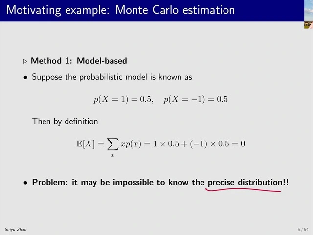

若已知正反面概率各是 0.5，直接按概率加权，$\mathbb E[X]=0.5(1)+0.5(-1)=0$。未知概率时就无法直接用这套计算。

### 第 06 页 · Monte Carlo Estimation

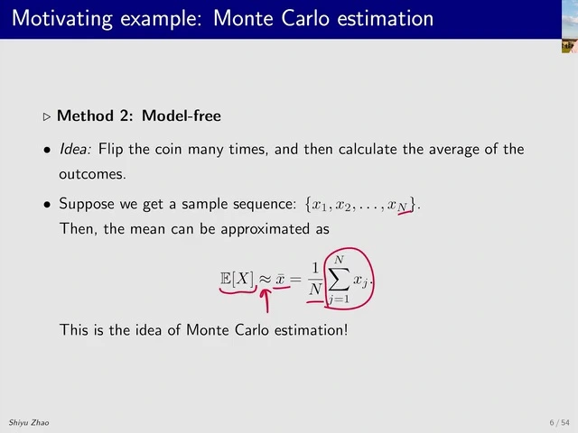

独立抛 $N$ 次得到 $x_1,\ldots,x_N$，用 $\bar x_N=(x_1+\cdots+x_N)/N$ 估计期望。实际只需要看到每次结果。

### 第 07 页 · Sample Size · 怎样读曲线

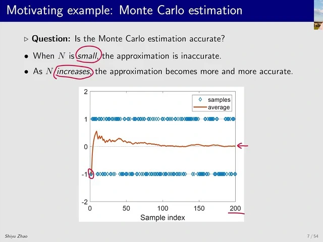

散点是每次投出的 $+1$ 或 $-1$，曲线是到该时刻为止的样本均值。开始时单次结果能明显改变均值，样本积累后曲线总体接近 0，途中仍可出现波动。

### 第 08 页 · Law of Large Numbers

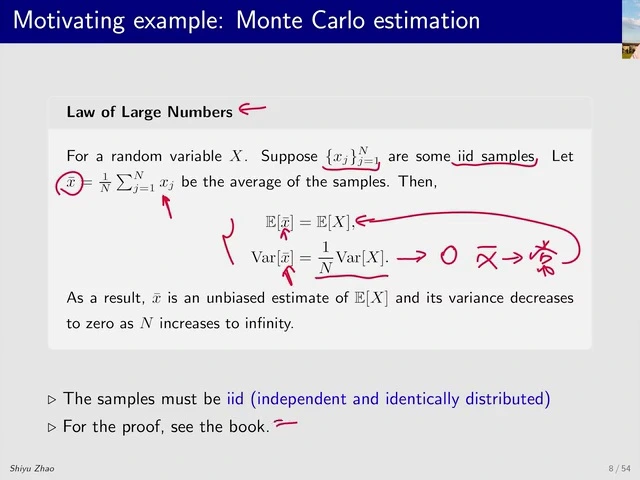

样本独立同分布（iid）且方差有限时，$\mathbb E[\bar X_N]=\mathbb E[X]$，而 $\mathrm{Var}(\bar X_N)=\mathrm{Var}(X)/N$。无偏是说反复做整组实验所得估计的平均正确。方差变小才解释了一次实验里的均值为什么逐渐稳定。

### 第 09 页 · From Samples to Value

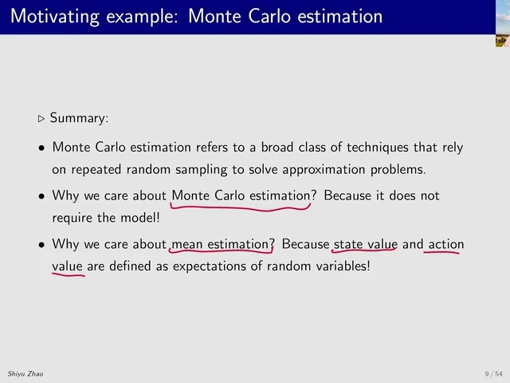

Monte Carlo 用重复采样近似待求的量。本课关心的是均值估计，因为状态价值和动作价值都是未来回报的期望。

## Part 2 · MC Basic

### 第 10 页 · MC Basic · 算法介绍

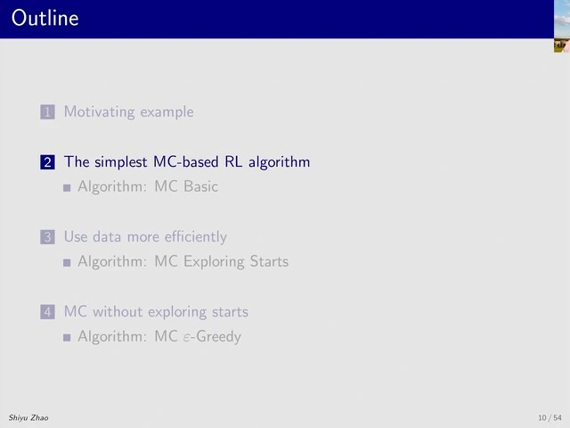

接下来把采样均值放进策略迭代，先找出原算法哪一步要访问模型、哪一步只需要比较动作价值。

### 第 11 页 · Model-free Policy Iteration

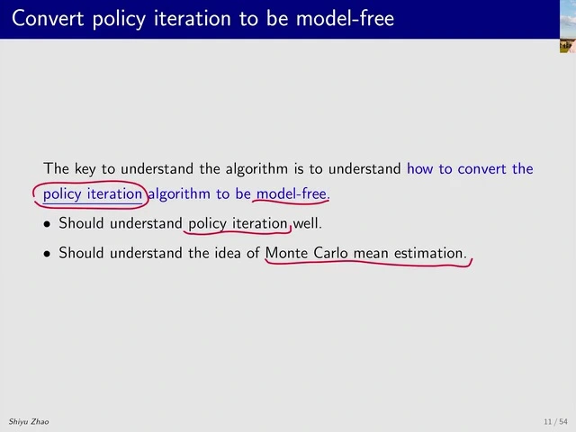

理解 MC Basic 需要两件事：策略迭代交替做评价和改进，MC 可以用样本均值估计期望。把这两件事接起来，就能在未知模型的情况下改策略。

### 第 12 页 · Policy Improvement · 真正需要的量

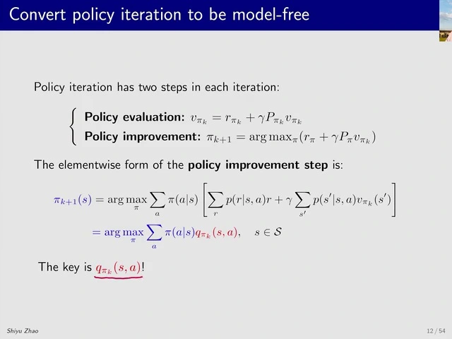

原策略迭代先解出 $v_{\pi_k}$，再按 $\sum_a\pi(a\mid s)q_{\pi_k}(s,a)$ 改进策略。每个状态只需比较动作价值并挑出最大者，所以关键是取得 $q_{\pi_k}$。

### 第 13 页 · Action Value · 两种计算路径

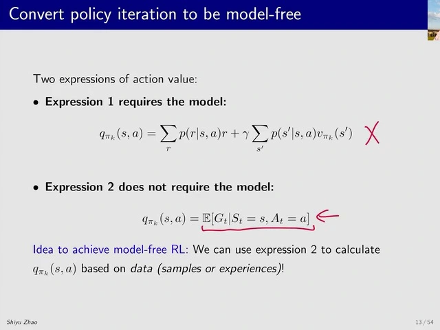

已知模型时，可用「期望即时奖励＋折扣后的下一状态价值」计算。根据定义，$q_\pi(s,a)$ 也是指定状态和首步动作、此后按 $\pi$ 行动所得回报的条件期望，因此可以从实际轨迹直接估计。

### 第 14 页 · Sample Returns · 从一次到多次

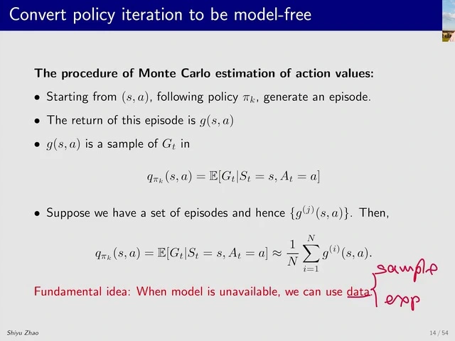

从 $(s,a)$ 出发，执行首步 $a$，后面照当前策略走完回合，算出一个折扣回报。重复产生回合，把这些回报平均，得到同一 $(s,a)$ 的动作价值估计。

### 第 15 页 · MC Basic · 两步循环

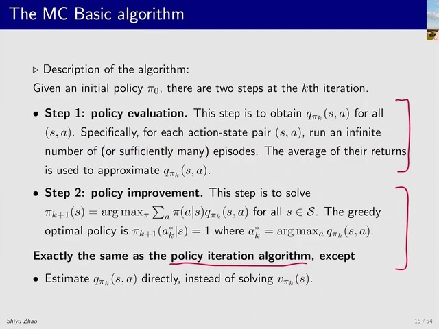

Policy evaluation 为每一个 $(s,a)$ 单独采集足够多的回合，计算平均回报。Policy improvement 用这张动作值表逐状态选最大动作。它与第 4 课的不同在于直接估计 $q_\pi$，省去了求 $v_\pi$ 和查模型的过程。

### 第 16 页 · MC Basic Pseudocode

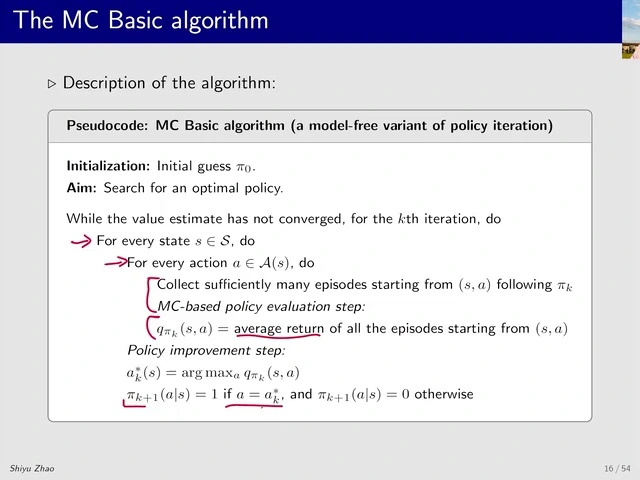

给定初始策略。外层每轮固定它，内层遍历全部状态与可用动作，强制指定首步来采样。评价完成后才整体改成贪心策略，继续交替到估计稳定。

### 第 17 页 · MC Basic · 为什么估计 Q

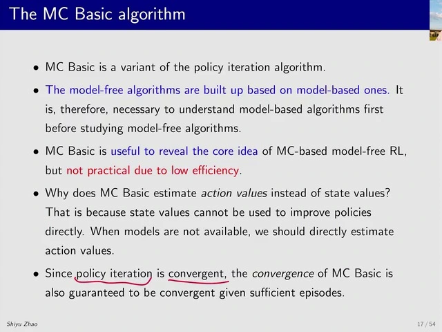

MC Basic 是老师为这个教学版本起的名称，用来先看清从 model-based 到 model-free 的改动。单有状态价值时，未知转移模型便无法判断一个未做过的动作会去哪里、立即得多少分。直接估计动作价值可比较不同首步。若评价精确，算法就回到策略迭代的更新。有限样本下贪心比较可能有误，逐对重采样也很昂贵。

## Part 3 · MC Basic Examples

### 第 18 页 · Gridworld · 三乘三算例

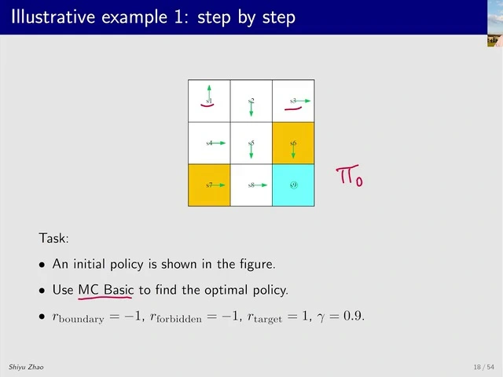

以箭头所示策略为起点。越界和进入禁区扣 1，进入目标得 1，$\gamma=0.9$。到目标后若按箭头原地停留，则持续得 1。

### 第 19 页 · Count the State–Action Pairs

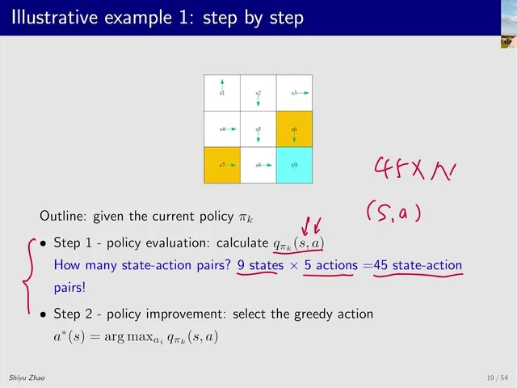

九格、每格五个动作，共 45 个状态动作对。原则上每对都需评价，之后才在每个状态选动作。接下来只展开左上角 $s_1$。

### 第 20 页 · Deterministic Rollout

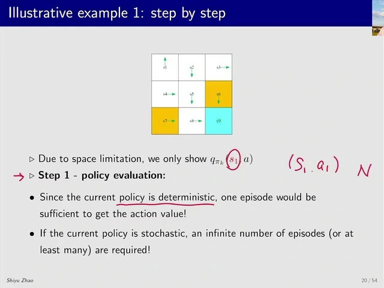

这个算例的环境和当前策略都确定，给定首步后完整轨迹唯一，所以同一起点重复采样不会提供新信息。策略或环境随机时需要多条轨迹来估计期望。

### 第 21 页 · Rollout · 向上、向右和向下

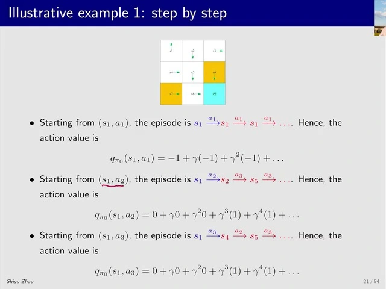

向上撞墙，之后按旧策略继续向上，每步 $-1$，回报为 $-10$。向右经 $s_2$、向下经 $s_4$，两路都到 $s_5$ 再去目标，前 3 步得 0，第四步起得 1，回报为 $0.9^3/(1-0.9)=7.29$。

### 第 22 页 · Rollout · 向左和停留

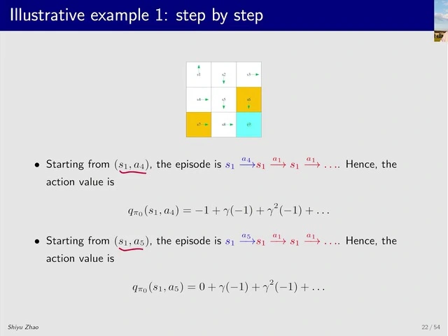

向左先撞墙扣 1，回到 $s_1$ 后按旧策略继续撞墙，回报 $-10$。原地停留的第一步得 0，第二步起才一直扣 1，因此回报 $-0.9/(1-0.9)=-9$。

### 第 23 页 · Greedy Improvement · 并列最大

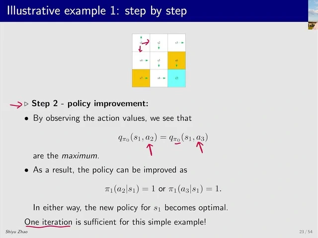

向右与向下同为 7.29，比其余动作好。任取一个作为新策略在 $s_1$ 的确定性动作。本例该起点的一次改进就得到最优动作，复杂情形仍需反复评价和改进。

### 第 24 页 · Exercise · 更新另一个起点

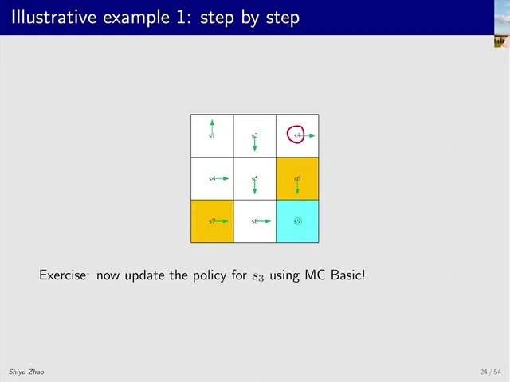

改从右上角 $s_3$ 出发。逐个指定首步，接下去沿旧箭头行走，列出各条奖励序列并比较其折扣和。

### 第 25 页 · Episode Length · 截断持续任务

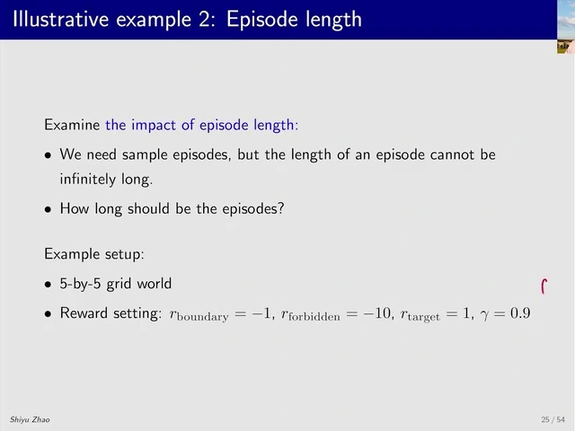

仿真无法记录无限长的回合。五乘五例子取越界 $-1$、禁区 $-10$、目标 $+1$，$\gamma=0.9$。用不同的采样长度观察价值估计和策略。

### 第 26 页 · Short Episodes · 长度 1 至 4

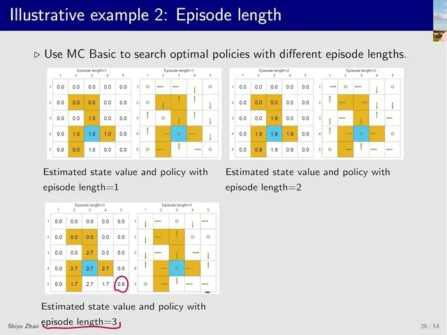

长度 1 只能看即时奖励，离目标远的格子看不到后续正回报。随着长度增加，奖励能进入更多格子的回报，图中的箭头和价值随之变化。老师把回合长度比作找水的探索半径。还没看到目标时，几个动作可能同为 0，偶然选对方向也不代表已经学到这条路。

### 第 27 页 · Longer Episodes · 长度 14 至 100

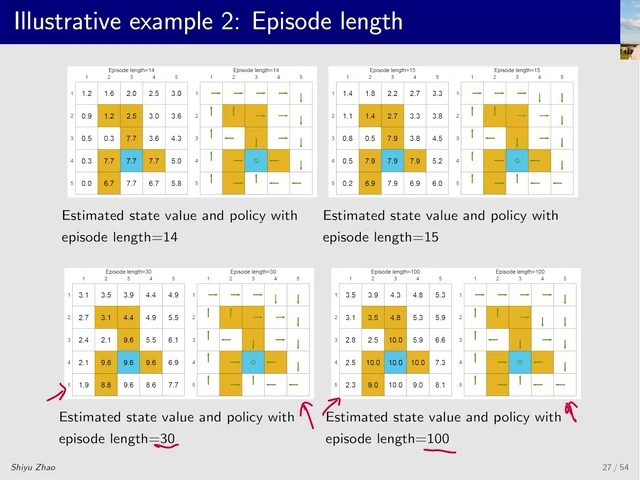

比较 14、15、30、100 步。较远状态需要足够长的回合才能观察到目标奖励。实验里有的起点要走 14 步、另一些要走 15 步。长度加到 30 或 100 后，路线基本稳定，目标处持续得分的折扣尾项仍会改变价值估计。

### 第 28 页 · Truncation · 怎样理解长度

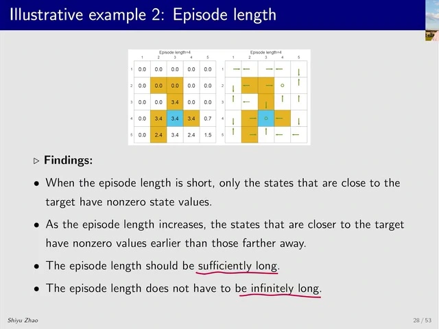

在图示任务中，靠近目标的状态先得到非零的正价值。回合要长到能反映有意义的后续回报；当折扣尾部足够小，再加长度的影响会减少。终止任务则应按真正终止来计算。

## Part 4 · MC Exploring Starts

### 第 29 页 · MC Exploring Starts

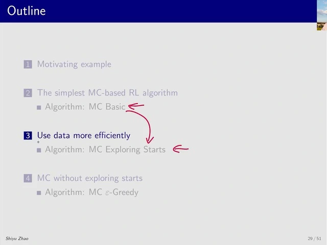

接下来解决 MC Basic 的两项开销：一条回合只用于起点，以及每次要等整轮评价完成才更新策略。

### 第 30 页 · Sample Efficiency

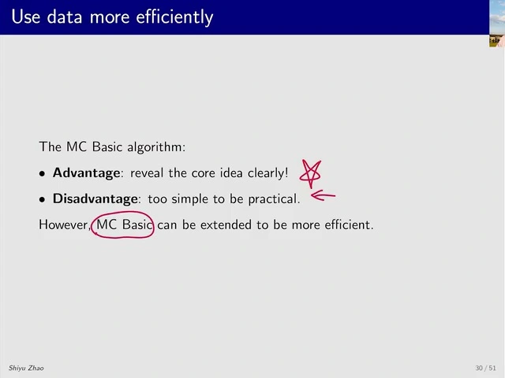

MC Basic 清楚展示了无模型策略迭代，但同一条轨迹包含的中间访问也有价值，完全可以用来更新其他状态动作对。

### 第 31 页 · Initial-visit Method

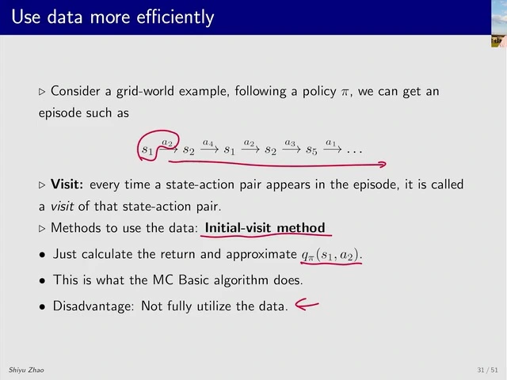

轨迹依次访问 $(s_1,a_2)$、$(s_2,a_4)$、$(s_1,a_2)$、$(s_2,a_3)$、$(s_5,a_1)$。每出现一次就叫一次 visit。Initial-visit 只用最开头的回报估计 $q(s_1,a_2)$。

### 第 32 页 · First-visit & Every-visit

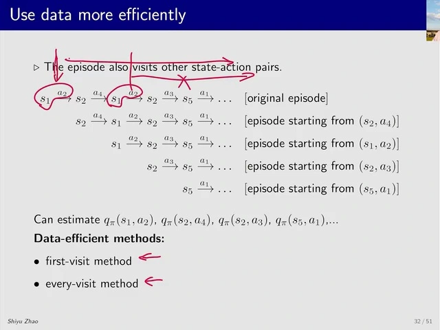

从任意访问时刻算到回合结尾，都得到从那次访问出发的回报。First-visit 对每个状态动作对每回合只取最早的一次。Every-visit 保留所有出现的位置，包括同一对的第二次访问。

### 第 33 页 · Episode-by-episode Update

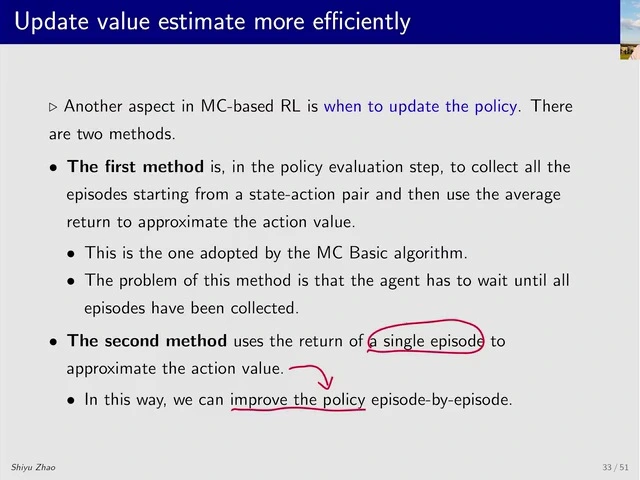

MC Basic 等本轮全部样本收齐才改策略。也可以每结束一条回合就把其中的回报加入已有统计，用更新后的均值改策略，下一回合便能用上新动作。

### 第 34 页 · Generalized Policy Iteration

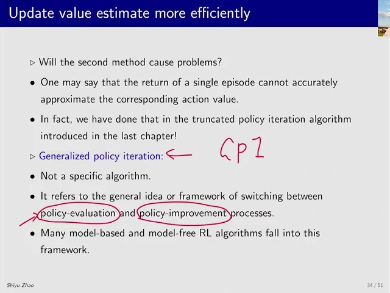

单条回合给的估计可能不准，但可以在评价尚未完全收敛时就改进，再继续采样评价。第 4 课的截断策略迭代也允许提前结束评价。Generalized policy iteration（GPI）指评价和改进交替进行的框架。

### 第 35 页 · MC Exploring Starts Pseudocode

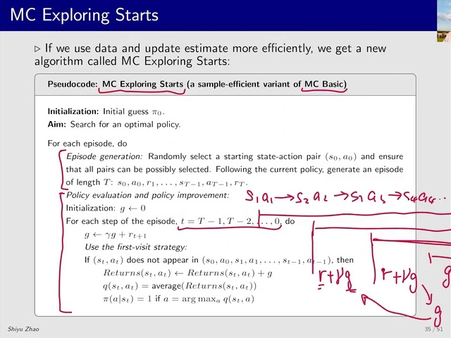

随机指定首状态和动作，随后沿本轮策略生成轨迹。从后往前用 $G_t=r_{t+1}+\gamma G_{t+1}$ 算各段回报。若同一对在当前时刻之前未出现，就用这条回报更新该对的样本均值，并在相应状态贪心改进。倒序计算时，首次访问仍指时间最早的那个。

### 第 36 页 · Exploring Starts · 起点覆盖（课件补充）

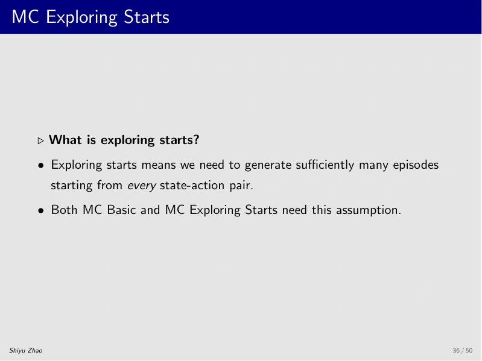

当前视频由第 35 页跳到第 37 页，这一页用公开课件补齐。MC Basic 和 MC Exploring Starts 都依赖从每个状态动作对开始采样的能力。后者让每对都有非零概率被选作起点，反复运行才能逐渐积累覆盖。

### 第 37 页 · Exploring Starts · 现实限制

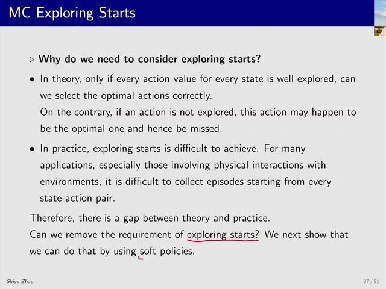

动作从未被试过，就可能漏掉真正最优的选择。从这一对发起（start）与在途中经过（visit）都能提供回报，后者的覆盖取决于策略和环境。探索性起点可以强制试遍动作，但机器人等实际系统未必能任意重置到指定状态。下一步改用策略自身的随机性探索。

## Part 5 · MC ε-Greedy

### 第 38 页 · MC ε-Greedy

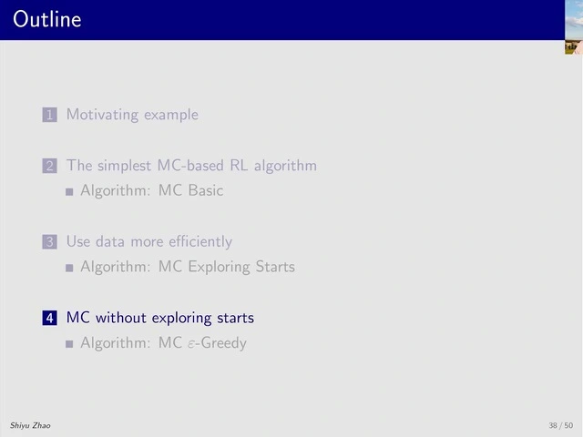

这一段将贪心改进替换成带探索的改进，后面的实验再比较不同探索强度和不同轨迹长度。

### 第 39 页 · Soft Policy

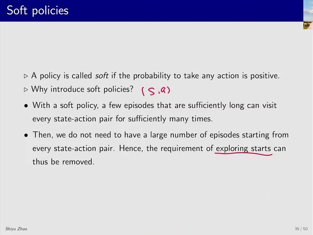

在每个状态，soft policy 给所有可用动作正概率。只要目标状态能从起点到达，反复采样便有机会访问相关动作。正概率不会让本来不可达的状态突然可达。

### 第 40 页 · ε-Greedy · 分配动作概率

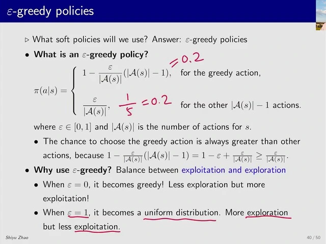

以 $1-\varepsilon$ 的概率选一个贪心动作，以 $\varepsilon$ 的概率在 $m$ 个动作中均匀抽取。最大动作得到 $1-\varepsilon+\varepsilon/m$，其余各得 $\varepsilon/m$。五个动作且 $\varepsilon=0.2$ 时，其他四个动作各得 0.04，贪心动作得 $1-4(0.04)=0.84$。$\varepsilon=0$ 是纯贪心，$\varepsilon=1$ 是均匀策略。

### 第 41 页 · Unrestricted Greedy Improvement

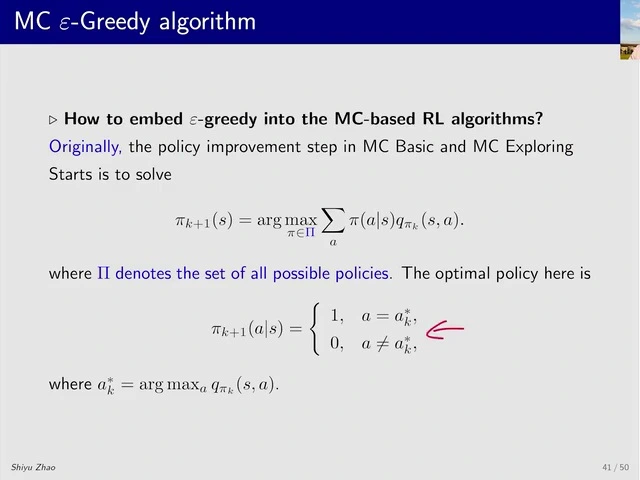

原来的策略改进可在所有动作分布中选择，因此给最大 $q$ 的动作概率 1 就可达到最大值。这个规则本身不会给其他动作留下探索概率。

### 第 42 页 · Improvement within ε-Greedy Policies

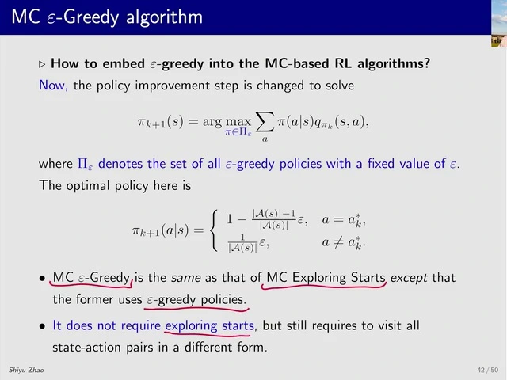

固定 $\varepsilon$，每个动作先分到 $\varepsilon/m$，能自由分配的是余下 $1-\varepsilon$。把这一份给最大动作就完成改进。覆盖由软策略产生，不必把所有状态动作对逐个指定为回合起点。

### 第 43 页 · MC ε-Greedy Pseudocode

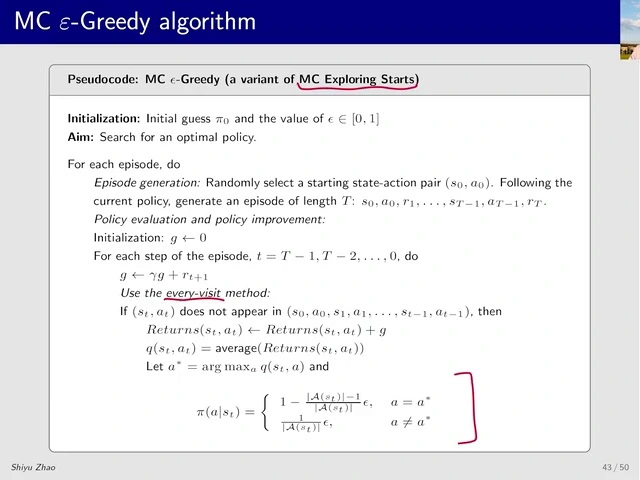

按当前策略生成回合，倒序算折扣回报。课件示例用 every-visit，将每次访问的回报加入相应统计，再在该状态重新设置 ε-greedy 概率。长回合中同一对可能访问很多次，这样都能用上。首状态按任务允许的方式选取，首动作也可由软策略选。

## Part 6 · MC ε-Greedy Examples

### 第 44 页 · Exploration · 均匀策略

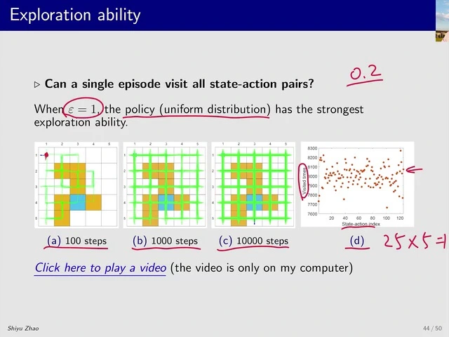

$\varepsilon=1$ 时各动作等概率。五乘五例子对比 100、1,000、10,000 步，以及一百万步里 125 个状态动作对各自的访问次数。时间增加后覆盖变广，但均匀选动作并不意味着不同状态的访问次数也均匀。

### 第 45 页 · Exploration · 较小的 ε

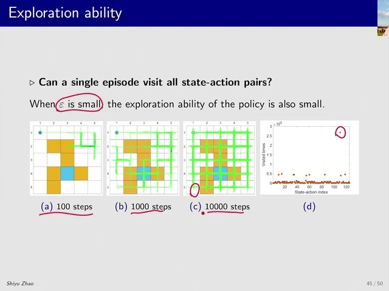

$\varepsilon$ 较小时，轨迹更常沿着当前偏好的路径走。即使样本很多，少走到的区域和少选的动作仍可能只有很少的访问次数，价值估计会较不稳定。图中一百万步的统计仍明显集中在少数状态动作对。

### 第 46 页 · One Long Episode per Iteration

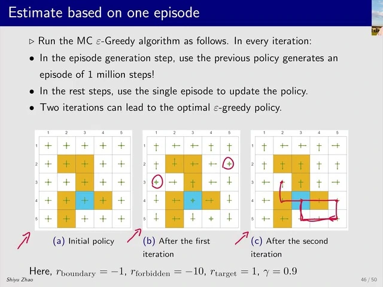

实验每轮用上一套策略生成一条一百万步轨迹，再用轨迹中的访问更新价值和策略。初始策略对每个动作等概率，第一轮仍有一些区域的主要动作待调整。图中两轮已得到该实验的最优 ε-greedy 策略。这依赖环境、覆盖和样本量，两轮不是通用保证。

### 第 47 页 · Exploration vs. Optimality

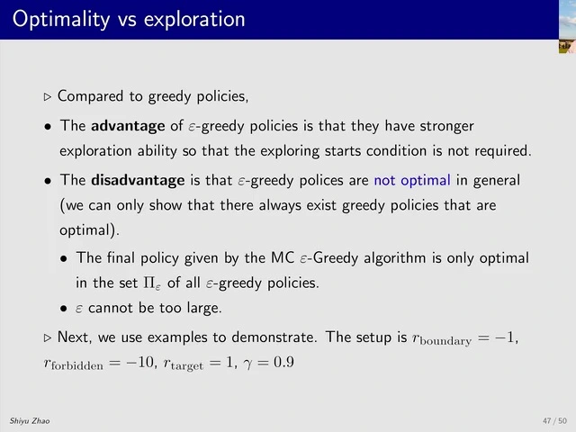

固定正的 $\varepsilon$ 可以保留探索，但即使找到该策略类里的最优解，也必须偶尔做次优动作。越界 $-1$、禁区 $-10$、目标 $+1$ 的网格能看清这项代价。老师也讨论了先探索、再逐渐降低 $\varepsilon$ 的做法，降低探索时仍须留意样本覆盖。

### 第 48 页 · Evaluate a Fixed Greedy Direction

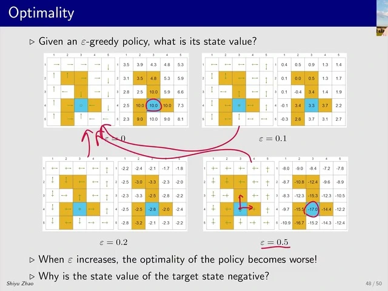

比较同一组贪心方向在 $\varepsilon=0,0.1,0.2,0.5$ 下的价值。探索越频繁，越可能离开目标或踩进附近禁区；课件用贝尔曼期望方程评估这组策略。目标格的值依次约为 10.0、3.3、−2.8、−17.0，说明从目标出发仍可能因为后续进入禁区而得到负回报。

### 第 49 页 · Optimize the ε-Greedy Policy

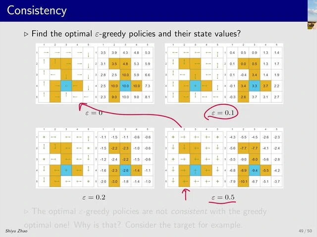

重新在每个固定 $\varepsilon$ 的策略类内优化，最佳箭头也可能改变。原因是未来会继续随机行动，所以某个动作的后续价值会反映接下来被迫探索的风险。在课件网格中，0.1 时取概率最高的动作仍得到原最优箭头，0.2 和 0.5 时则出现差异。训练结束后去掉随机探索，并不自动保证取到纯贪心最优策略。

### 第 50 页 · Summary

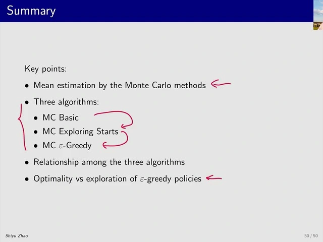

MC 用回合回报均值估计动作价值。MC Basic 按起点逐对采样；MC Exploring Starts 复用访问并逐回合更新；MC ε-Greedy 用软策略收集样本。比较它们时要同时看数据利用、覆盖能力和固定探索对最终策略的影响。
