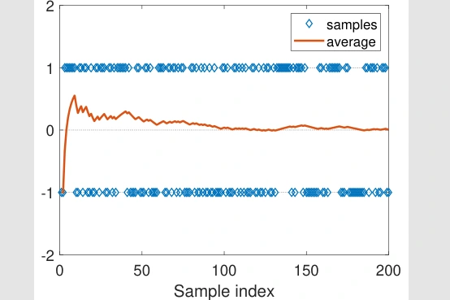
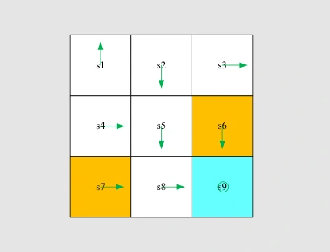
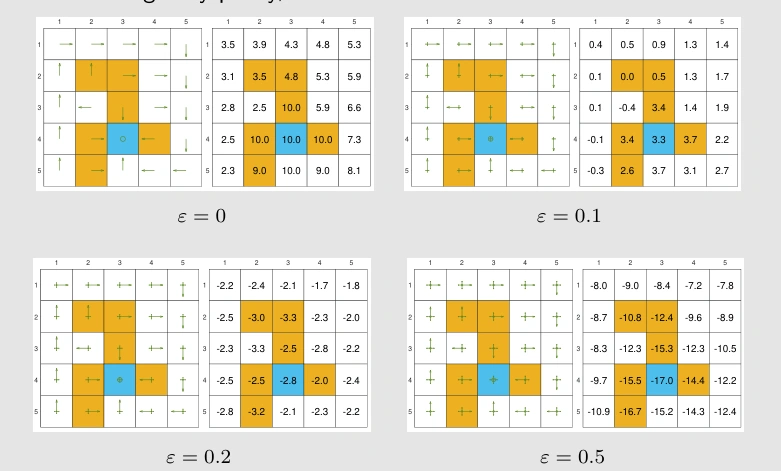

# 第 5 课 · 蒙特卡洛方法 · V2（总结）

[切换到 V1（逐页）](monte-carlo-slides.md)

## 1. Monte Carlo Estimation · 用样本代替概率模型

第 4 课用已知的奖励和转移概率做<strong>策略评价（policy evaluation）</strong>。如果环境的概率模型未知，但我们可以执行动作、记录奖励，就能改用<strong>样本均值（sample mean）</strong>估计价值。这就是本课的 model-free 思路。

以硬币为例，正面记 $+1$，反面记 $-1$。若正反面各半，可直接算出期望 0。如果不知道正反面的概率，独立投四次得到 $1,-1,1,1$，就用样本均值 $0.5$ 估计。换四次可能得到另一结果。

<figure>
  
  <figcaption>散点是每次试验的结果，曲线是累计均值。后期每个新样本占的权重更小，曲线总体更稳定。</figcaption>
</figure>

### Law of Large Numbers

若 $X_1,\ldots,X_N$ 独立同分布（iid），均值为 $\mu$，方差为 $\sigma^2$，那么

$$
\begin{aligned}
\bar X_N &= \frac1N\sum_{i=1}^N X_i,\\
\mathbb E[\bar X_N] &= \frac{N\mu}{N}=\mu,\\
\mathrm{Var}(\bar X_N)&=\frac{N\sigma^2}{N^2}
=\frac{\sigma^2}{N}.
\end{aligned}
$$

独立性让不同样本之间的协方差为零，所以方差可以直接相加。期望等于真值称为<strong>无偏（unbiased）</strong>，方差随样本量下降表示估计逐渐集中。一次实验里，均值仍可能短暂偏离真值。后面从同一轨迹取的多个回报可能相关，不能直接用这里的 iid 方差公式。

## 2. MC Basic · 从回合回报估计 Action Value

### 为什么要估计 Q

在状态 $s$ 强制执行首步动作 $a$，此后一直照策略 $\pi$ 走。一条完整回合（episode）产生一个回报样本 $G_t$。同样的起点和首步重复多次，后续可能因为策略或环境的随机性而不同。对回报取条件期望，就得到<strong>动作价值（action value）</strong>。

$$
\begin{aligned}
G_t &= R_{t+1}+\gamma R_{t+2}+\cdots,\\
q_\pi(s,a) &= \mathbb E_\pi[G_t\mid S_t=s,A_t=a],\\
\widehat q_\pi(s,a) &= \frac1N\sum_{i=1}^N g_i(s,a).
\end{aligned}
$$

其中 $g_i(s,a)$ 是第 $i$ 条回合的折扣回报。比较首步时，需要知道每个候选动作的回报。状态价值 $v_\pi(s)$ 只告诉我们按照旧策略选择首步时的平均结果。若不知道不同动作通往哪、会给什么奖励，单凭这个平均值无法还原每个动作的价值。

### Policy Evaluation & Improvement

1. <strong>Policy evaluation</strong>。固定旧策略。对每个状态动作对都指定首步，收集足够多的回合，将回报取平均。
2. <strong>Policy improvement</strong>。每个状态选出估计值最大的动作，组成新的 greedy policy，再进入下一轮。

三乘三网格每个状态有五个动作，共 45 对。如果每对都采 100 条回合，一轮评价就要收集 4,500 条。只用每条回合的首对来更新，其余访问还没有利用起来。

### Gridworld · 从同一个起点试五个动作

<figure>
  
  <figcaption>先任选一个首步，第二步开始沿图中的旧箭头走。取折扣因子 0.9。</figcaption>
</figure>

| 首步 Action | 奖励序列 | 回报 Return |
| --- | --- | ---: |
| Up 或 Left | $-1,-1,-1,\ldots$ | $-10$ |
| Right 或 Down | $0,0,0,1,1,\ldots$ | $7.29$ |
| Stay | $0,-1,-1,\ldots$ | $-9$ |

向右经 $s_2$，向下经 $s_4$，两路在 $s_5$ 汇合，第四步到目标。之后留在目标每步得 1，因此两者都是 $\gamma^3/(1-\gamma)=7.29$。原地停留只免掉第一步惩罚，下一步仍沿旧策略撞墙，所以它的回报是 $-\gamma/(1-\gamma)=-9$。在 $s_1$ 可以任选向右或向下作为改进动作。

环境和旧策略在此例中都是确定的，指定首步后轨迹唯一。无限轨迹的回报在这里能通过几何级数算出。实际持续任务若只记录 $L$ 步，省去的尾项大小至多为 $\gamma^L R_{\max}/(1-\gamma)$，其中 $R_{\max}$ 是每步奖励绝对值的上界。五乘五实验中，短回合只能让靠近目标的起点看到正奖励。课上用「找水的探索半径」解释这个现象。回合长度从 14 增到 15 时，更远的格子才第一次有机会走到目标；延长到 30、100 步后，箭头可以先稳定，价值估计还会继续变化。

## 3. MC Exploring Starts · 从一条轨迹多取样本

### Initial-visit, First-visit & Every-visit

假设一条回合在时刻 0 和时刻 2 两次访问 $(s_1,a_2)$，在时刻 1 访问 $(s_2,a_4)$。每次访问都有自己的回报，包含该动作得到的奖励以及后续折扣奖励。

- <strong>Initial-visit</strong>只用时刻 0 的回报，更新回合起点那一对。
- <strong>First-visit</strong>对每个不同的状态动作对取时间上最早的访问。因此用时刻 0 和 1 的回报，跳过时刻 2 的重复访问。
- <strong>Every-visit</strong>用每次访问的回报。时刻 0、1、2 都参与更新。

例如一条三步回合的奖励依次是 $0,-1,2$，取 $\gamma=0.9$。从结尾倒算，$G_2=2$，$G_1=-1+0.9(2)=0.8$，$G_0=0+0.9(0.8)=0.72$。若时刻 0 和 2 是同一对，first-visit 取 $0.72$，every-visit 同时取 $0.72$ 和 $2$。<strong>倒序计算回报，仍按正向时间判断首次访问。</strong>

### Episode-by-episode Update

<strong>Exploring Starts</strong>让每个可用状态动作对都有正概率成为回合的第一对。之后沿当前策略生成整条轨迹。回合结束后，课件算法用 first-visit 更新已访问对的回报均值，再在这些状态重新选贪心动作。

单条回合里的回报可能偏高或偏低。更新时将它加入已有样本的统计，因此每结束一条回合就可以评价一点、改进一步。这是<strong>广义策略迭代（generalized policy iteration，GPI）</strong>。它延续了第 4 课截断策略迭代的思路，允许评价尚未完全稳定时就进行策略改进。

任意指定首状态和动作，在仿真中容易做到。在真实环境里，可能没有办法把机器人重置到任意状态。此时可以从任务允许的起点出发，让策略主动探索可达状态的其他动作。

## 4. MC ε-Greedy · 让策略在途中探索

### Soft Policy & ε-Greedy

<strong>软策略（soft policy）</strong>给当前状态的每个可用动作都留正概率。只要某些状态能够从允许的起点到达，反复采样就有机会通过中途访问收集数据。正概率本身无法保证一条有限轨迹遍历全部状态，也无法覆盖不可达的区域。

在 $\varepsilon$-greedy 策略中，以 $1-\varepsilon$ 的概率选贪心动作 $a^*$，以 $\varepsilon$ 的概率在所有 $m$ 个动作中均匀抽取。随机抽取时也可能选到 $a^*$，所以

$$
\pi(a\mid s)=
\begin{cases}
1-\varepsilon+\varepsilon/m,& a=a^*,\\
\varepsilon/m,& a\ne a^*.
\end{cases}
$$

有五个动作、$\varepsilon=0.2$ 时，每个动作先分到 $0.2/5=0.04$。贪心动作再加 $0.8$，合计 $0.84$。五项相加是 $0.84+4(0.04)=1$。$\varepsilon=0$ 时完全利用已有估计（exploitation），$\varepsilon=1$ 时均匀尝试所有动作（exploration）。

### Policy Improvement under a Fixed ε

对任意给定动作值 $q(s,a)$，若把主要概率给动作 $b$，整个分布的加权动作值是

$$
\begin{aligned}
\sum_a\pi(a\mid s)q(s,a)
&=\frac{\varepsilon}{m}\sum_a q(s,a)\\
&\quad+(1-\varepsilon)q(s,b).
\end{aligned}
$$

第一项与选谁做贪心动作无关。对 $0\le\varepsilon<1$，要让第二项最大，就选 $q$ 最大的 $b$。MC ε-Greedy 在每次采样后继续用回报均值更新动作值，课件伪代码使用 every-visit。改进时保留每个动作的探索概率。

## 5. Exploration vs. Optimality

<figure>
  
  <figcaption>保持主要动作方向相同，逐步提高 ε。图中目标价值随探索增加而下降，较大 ε 下甚至为负。</figcaption>
</figure>

课件比较了 100、1,000、10,000 步的访问次数。均匀选动作时覆盖更广，但各对的访问次数仍可能不同。较小的 $\varepsilon$ 会把更多访问集中在当前策略偏好的路径。另一个实验用每轮一百万步的轨迹，两轮找到了该网格的最优 $\varepsilon$-greedy 策略。这个轮数是算例结果。

<strong>固定方向再加入探索</strong>和<strong>给定 $\varepsilon$ 后重新求最优方向</strong>是两项不同的操作。第一种保持箭头，只修改概率，目标附近若有禁区，偶尔走错就可能抵消目标带来的收益。第二种重新比较长期回报，贪心方向也可能随之变化。课件中 $\varepsilon=0.1$ 时，主要方向和纯贪心最优策略一致；到 0.2、0.5 时，一些方向已经不同。固定正的 $\varepsilon$ 所优化的是相应的策略类。逐渐减小 $\varepsilon$ 可以让最终策略更接近贪心，衰减时仍要确保相关状态动作对获得足够访问。

| Algorithm | 采样怎样开始 | 一条回合怎样用 |
| --- | --- | --- |
| MC Basic | 每对单独发起 | 只更新起点，收齐再改策略 |
| MC Exploring Starts | 随机选探索性起点 | First-visit，逐回合改进 |
| MC ε-Greedy | 从允许的起点按软策略探索 | 课件用 Every-visit，改进后保留探索概率 |
