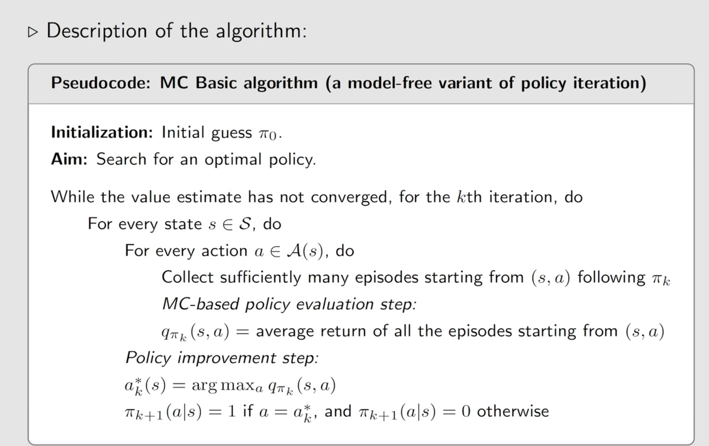
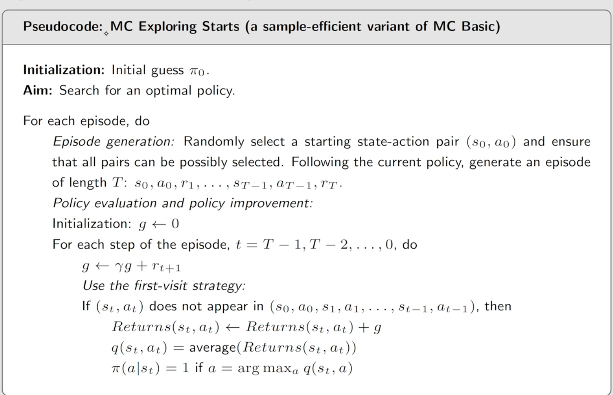
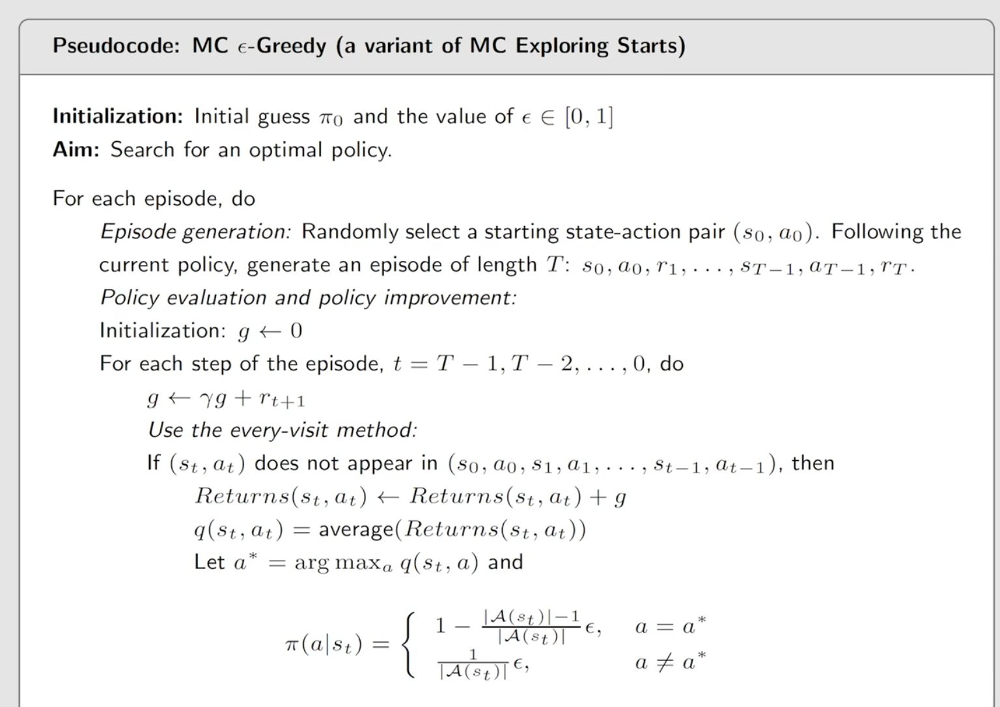

# 第 5 课 · Monte Carlo Methods

## 1. From Policy Iteration to Model-Free RL

### 1.1 From Model-Based to Model-Free {#_1-from-model-based-to-model-free}

From Model-Based to Model-Free

第五课从第四课的 [Policy Iteration](value-policy-iteration.md#_2-policy-iteration) 出发。仍然交替进行 **policy evaluation** 和 **policy improvement**，要解决的问题是怎样在不知道环境模型时完成这两步。

### 1.2 Policy Evaluation and Policy Improvement {#_1-回顾策略迭代的两步}

Policy Evaluation and Policy Improvement

第 $k$ 轮先求当前 policy $\pi_k$ 的 **state value**，再选使一步前瞻值最大的 policy：

$$
\begin{aligned}
\mathbf v_{\pi_k}
&=\mathbf r_{\pi_k}+\gamma P_{\pi_k}\mathbf v_{\pi_k},\\
\pi_{k+1}
&\in\arg\max_{\pi}\bigl(\mathbf r_{\pi}+\gamma P_{\pi}\mathbf v_{\pi_k}\bigr).
\end{aligned}
$$

把 policy improvement 展开到单个 state $s$，括号里的两项合起来就是 **action value** $q_{\pi_k}(s,a)$：

$$
\begin{aligned}
\pi_{k+1}(\cdot\mid s)
&\in\arg\max_{\pi(\cdot\mid s)}\sum_a \pi(a\mid s)
\Bigl[\sum_r p(r\mid s,a)r\\
&\qquad\qquad +\gamma\sum_{s'}p(s'\mid s,a)v_{\pi_k}(s')\Bigr]\\
&=\arg\max_{\pi(\cdot\mid s)}\sum_a \pi(a\mid s)q_{\pi_k}(s,a).
\end{aligned}
$$

因此，只要拿到各 action 的 $q_{\pi_k}(s,a)$，就可以完成 policy improvement。

### 1.3 Two Expressions of Action Value {#_2-动作价值的两种写法}

Two Expressions of Action Value

**Model-based expression** 用 **reward distribution** $p(r\mid s,a)$ 和 **state transition probabilities** $p(s'\mid s,a)$ 加权：

$$
\begin{aligned}
q_{\pi_k}(s,a)&=\sum_r p(r\mid s,a)r\\
&\quad +\gamma\sum_{s'}p(s'\mid s,a)v_{\pi_k}(s').
\end{aligned}
$$

**Model-free expression** 从 state $s$ 出发，首步执行 action $a$，之后按 $\pi_k$ 行动，对 **return** $G_t$ 取条件期望：

$$
q_{\pi_k}(s,a)=\mathbb E_{\pi_k}[G_t\mid S_t=s,\ A_t=a].
$$

第二种写法给出了采样办法。与环境交互，记录实际获得的 return，就可以用数据估计这个期望。

## 2. MC Basic and MC Exploring Starts

### 2.1 MC Basic {#_2-mc-basic}

#### 2.1.1 Monte Carlo Estimation of Action Values {#monte-carlo-estimation-of-action-values}

Monte Carlo Estimation of Action Values

固定 policy $\pi_k$ 和一个 **state–action pair** $(s,a)$。

1. **Generate an episode**。从 $s$ 开始，首步执行 $a$，随后按 $\pi_k$ 行动到 episode 结束。
2. **Calculate its return**。第 $i$ 条 episode 的 **discounted return** $g^{(i)}(s,a)$ 是 $G_t$ 的一次观测。
3. **Average the returns**。用 $N$ 条 episode 的 **sample mean** 估计 $q_{\pi_k}(s,a)$：

$$
\widehat q_{\pi_k}(s,a)=\frac1N\sum_{i=1}^N g^{(i)}(s,a).
$$

估计期间保持 $\pi_k$ 固定。如果各 episode 独立地按相同规则采集且 return 的期望有限，sample mean 会随 $N$ 增大趋近真实的 action value。实际计算使用数量足够的有限样本。

#### 2.1.2 The MC Basic Algorithm {#policy-evaluation-policy-improvement}

The MC Basic Algorithm

1. **Policy evaluation**。从 $\pi_0$ 开始，第 $k$ 轮为每个 $(s,a)$ 单独收集 episodes，用平均 return 估计 $\widehat q_{\pi_k}(s,a)$。
2. **Policy improvement**。每个 state 选取估计值最大的 action $a_k^*(s)$，得到 **greedy policy**，然后进入下一轮。

$$
\begin{aligned}
a_k^*(s)&\in\arg\max_{a\in\mathcal A(s)}\widehat q_{\pi_k}(s,a),\\
\pi_{k+1}(a\mid s)&=
\begin{cases}
1,&a=a_k^*(s),\\
0,&a\ne a_k^*(s).
\end{cases}
\end{aligned}
$$

这两步沿用 Policy Iteration 的结构。MC Basic 直接通过 samples 估计 action value，省去了先解 state value、再用模型计算 action value 的步骤。

#### 2.1.3 MC Basic Pseudocode {#procedure-summary-pseudocode}

MC Basic Pseudocode

目标是找到 **optimal policy**。每轮先用固定的 $\pi_k$ 采样，为每个 state 的全部可用 actions 算出平均 return，再做 greedy update。课件以 action value 的估计趋于稳定作为停止条件。有限样本仍可能把数值接近的 actions 排错顺序。

<figure>
  
</figure>

#### 2.1.4 Episode Length {#episode-length-·-回合长度怎么设}

Episode Length

在课件的例子中，只有到达 target 才获得 reward。

- **Short episodes**。只有靠近 target 的 states 有机会在截止前拿到 reward，较远 states 的 **state value estimates** 会保持为零。
- **Longer episodes**。随着步数上限增大，近处的 states 通常先出现非零估计，远处的 states 随后才可能采到 reward。

例如，从某个 state 最少需要 8 步到达 target，设 5 步上限时，采再多条 episodes 也观察不到这笔 reward。设到至少 8 步才有机会，实际所需的长度还取决于当前 policy 通常怎样走。**Episode length 要足够覆盖重要的延迟 rewards，有限的步数上限就可以做到。** 增加 episode 数量可以减少采样波动，延长单条 episode 才能把原先截掉的 reward 纳入估计。

### 2.2 MC Exploring Starts {#_3-mc-exploring-starts}

#### 2.2.1 Visits and the Initial-Visit Method {#一条回合里的多次访问}

Visits and the Initial-Visit Method

在 **grid world** 中，按 policy $\pi$ 采到的一条 episode 可能经过：

$$
s_1\xrightarrow{a_2}s_2\xrightarrow{a_4}s_1
\xrightarrow{a_2}s_2\xrightarrow{a_3}s_5
\xrightarrow{a_1}\cdots
$$

每次出现一个 state–action pair，就算一次 **visit**。**Initial-visit** 只用 $t=0$ 的 return $G_0$ 估计 $q_\pi(s_1,a_2)$。MC Basic 采用这个办法，因此一条 episode 只为起点提供一个 sample。

#### 2.2.2 First-Visit and Every-Visit {#_2-first-visit-and-every-visit}

First-Visit and Every-Visit

从 episode 的中途截取后半段，同样可以计算该时刻的 return。上面的轨迹从 $t=1$、$2$、$3$、$4$ 起算，分别为 $(s_2,a_4)$、$(s_1,a_2)$、$(s_2,a_3)$、$(s_5,a_1)$ 提供 $G_1$、$G_2$、$G_3$、$G_4$。

- **First-visit** 对每个出现过的 state–action pair，只取 episode 中时间最早的一次。$(s_1,a_2)$ 虽然出现两次，也只用 $G_0$。
- **Every-visit** 计入每一次 visit。$(s_1,a_2)$ 的两次访问分别贡献 $G_0$ 和 $G_2$。

#### 2.2.3 When to Update the Policy {#什么时候改进策略}

When to Update the Policy

- **After a batch of episodes**。MC Basic 为各 state–action pairs 收齐所需的 episodes，再用平均 return 做一轮 policy improvement。
- **Episode by episode**。每采完一条 episode，就用新的 returns 更新 action value estimates，并在更新过的 states 上做 greedy improvement。下一条 episode 使用更新后的 policy。

#### 2.2.4 Generalized Policy Iteration {#_4-generalized-policy-iteration}

Generalized Policy Iteration

单条 episode 的 return 可能偏离真实的 action value，但 policy evaluation 可以在估计尚未稳定时就与 policy improvement 交替推进。第四课的 [Truncated Policy Iteration](value-policy-iteration.md#truncated-policy-iteration) 也允许只做一部分 evaluation 就进行 improvement。**Generalized Policy Iteration（GPI）** 指这种交替推进的框架，有模型和无模型算法都可以采用。

#### 2.2.5 MC Exploring Starts Pseudocode {#mc-exploring-starts-伪代码}

MC Exploring Starts Pseudocode

从初始 policy $\pi_0$ 开始。每条 episode 随机选择起始 pair $(s_0,a_0)$，并让每个可用的 state–action pair 都有正概率被选中，这就是 **Exploring Starts**。首步之后按当前 policy 生成剩余轨迹，episode 结束后采用 first-visit 更新 `Returns` 和 action value estimates，并做 greedy improvement。

<figure>
  
</figure>

**为什么 $t$ 从后往前遍历？** 在终点令 $G_T=0$。从 $t=T-1$ 开始往前走，每一步都能复用上一步已经算好的 $G_{t+1}$：

$$
G_T=0,\qquad G_t=r_{t+1}+\gamma G_{t+1}.
$$

这样一趟即可算完所有 returns。

**First-visit 仍按时间正序判定。** 倒序先碰到 $t=2$ 的 $(s_1,a_2)$，因为它在 $t=0$ 已经出现，所以跳过 $t=2$ 的 action value 更新，最后用 $G_0$ 更新。

即使跳过更新，也要把当步的 reward 计入递推。

#### 2.2.6 Why Exploring Starts? {#为什么需要探索性起始}

Why Exploring Starts?

一直执行 greedy policy 时，估计值偏低的 action 可能没机会得到尝试，即使它实际是 optimal action。让每个 state–action pair 都有机会成为起点，有助于收集这些样本。现实环境往往难以重置到任意 state 并指定首步 action，因此下一节用 **soft policies** 把探索放到 episode 途中。

## 3. MC ε-Greedy {#_4-mc-ε-greedy}

### 3.1 Soft Policies {#soft-policies-·-把探索放到回合途中}

Soft Policies

**Soft policy** 在每个 state 对所有可用 actions 分配正概率，即 $\pi(a\mid s)>0$。

- **Explore during an episode**。到达一个 state 后，有机会尝试其中的每个 action。
- **Collect data from visits**。利用中途的 visits，可以省去把每个 pair 都设为起点的要求。

能否采到足够 samples，取决于 state 的可达性、episode length 和采样次数。

### 3.2 ε-Greedy Policies {#ε-greedy-·-平衡探索与利用}

ε-Greedy Policies

设 $m=|\mathcal A(s)|$，且 $\varepsilon\in[0,1]$。用概率 $1-\varepsilon$ 直接选择 **greedy action** $a^*(s)$，用概率 $\varepsilon$ 在全部 $m$ 个 actions 中均匀抽取。均匀抽取也可能选中 $a^*(s)$：

$$
\pi(a\mid s)=
\begin{cases}
1-\varepsilon+\dfrac{\varepsilon}{m},&a=a^*(s),\\[3pt]
\dfrac{\varepsilon}{m},&a\ne a^*(s).
\end{cases}
$$

Greedy action 的概率至少和其他 actions 一样大。

- **$\varepsilon=0$**。只选 greedy action，采用 **greedy policy**。
- **$\varepsilon=1$**。所有 actions 等概率，采用 **uniform distribution**。

中间取值用来平衡 **exploitation** 和 **exploration**。

### 3.3 Policy Improvement over All Policies {#_3-policy-improvement-over-all-policies}

Policy Improvement over All Policies

MC Basic 和 MC Exploring Starts 的 policy improvement 在所有候选 policies $\Pi$ 中优化同一个目标：

$$
\pi_{k+1}(\cdot\mid s)\in
\arg\max_{\pi\in\Pi}\sum_a\pi(a\mid s)q_{\pi_k}(s,a).
$$

取 $a_k^*(s)\in\arg\max_{a\in\mathcal A(s)}q_{\pi_k}(s,a)$ 后，可以把它的概率设为 $1$，其余 actions 的概率设为 $0$。

### 3.4 Policy Improvement over ε-Greedy Policies {#policy-improvement-·-在固定-ε-的策略中选}

Policy Improvement over ε-Greedy Policies

MC ε-Greedy 把候选范围换成固定 $\varepsilon$ 的 policy 集合 $\Pi_\varepsilon$。实际更新用 **action value estimate** $\widehat q_{\pi_k}$：

$$
\pi_{k+1}(\cdot\mid s)\in
\arg\max_{\pi\in\Pi_\varepsilon}\sum_a\pi(a\mid s)\widehat q_{\pi_k}(s,a).
$$

每个 action 先分到 $\varepsilon/m$，再把剩余的 $1-\varepsilon$ 给估计值最大的 action，就得到上面的 ε-greedy policy。MC ε-Greedy 仍然交替做 policy evaluation 和 policy improvement，靠途中采样覆盖 state–action pairs。

### 3.5 MC ε-Greedy Pseudocode {#mc-ε-greedy-伪代码}

MC ε-Greedy Pseudocode

给定初始 policy 和 $\varepsilon$，从环境允许的起点生成 episode。结束后令 $g=0$，倒序递推 $g\leftarrow r_{t+1}+\gamma g$，用采到的 returns 更新 action value estimates，再用更新后的估计设置 ε-greedy 概率。

<figure>
  
</figure>

**为什么这里用 every-visit？** 使用 soft policy 后，一条较长的 episode 可能在途中多次访问同一个 pair。以上一节的 $(s_1,a_2)$ 为例：

- **Every-visit** 同时计入 $G_0$ 和 $G_2$。
- **First-visit** 只计入 $G_0$。

同一条轨迹内的 returns 可能共享后续 rewards，因此它们可能相关。ε-greedy 决定怎样选 action，visit method 决定哪些 returns 进入估计，所以 ε-greedy 也可以搭配 first-visit。

**课件图里的两行写法不一致。** 图中写着 every-visit，但下面的 `If` 只在 $(s_t,a_t)$ 之前没有出现时更新，实际对应 first-visit。要执行 every-visit，删掉这条检查，算出每个 $G_t$ 后都更新一次。

