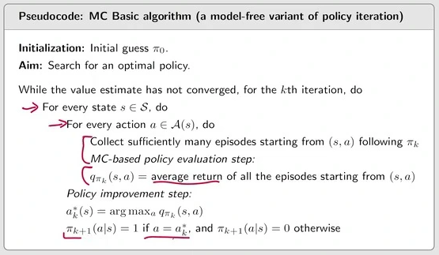
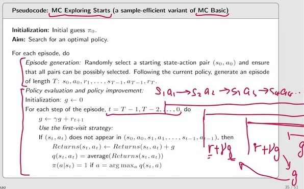
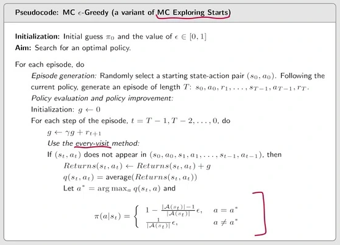

# 第 5 课 · 蒙特卡洛方法 · V2（总结）

## 1. Monte Carlo Estimation · 用样本代替概率模型

第 4 课用已知的奖励和转移概率做<strong>策略评价（policy evaluation）</strong>。如果环境的概率模型未知，但我们可以执行动作、记录奖励，就能改用<strong>样本均值（sample mean）</strong>估计价值。这就是本课的 model-free 思路。

已知概率分布时可直接求期望。模型未知时，用同一采样规则得到的样本均值估计期望。

### Law of Large Numbers

若 $X_1,\ldots,X_N$ 独立同分布（iid），均值为 $\mu$，方差为 $\sigma^2$，那么

$$
\begin{aligned}
\bar X_N &= \frac1N\sum_{i=1}^N X_i,\\
\mathbb E[\bar X_N] &= \frac{N\mu}{N}=\mu,\\
\mathrm{Var}(\bar X_N)&=\frac{N\sigma^2}{N^2}
=\frac{\sigma^2}{N}.
\end{aligned}
$$

独立性让不同样本之间的协方差为零，所以方差可以直接相加。期望等于真值称为<strong>无偏（unbiased）</strong>，方差随样本量下降表示估计逐渐集中。一次实验里，均值仍可能短暂偏离真值。后面从同一轨迹取的多个回报可能相关，不能直接用这里的 iid 方差公式。

## 2. MC Basic · 从回合回报估计 Action Value

### 为什么要估计 Q

在状态 $s$ 强制执行首步动作 $a$，此后一直照策略 $\pi$ 走。一条完整回合（episode）产生一个回报样本 $G_t$。同样的起点和首步重复多次，后续可能因为策略或环境的随机性而不同。对回报取条件期望，就得到<strong>动作价值（action value）</strong>。

$$
\begin{aligned}
G_t &= R_{t+1}+\gamma R_{t+2}+\cdots,\\
q_\pi(s,a) &= \mathbb E_\pi[G_t\mid S_t=s,A_t=a],\\
\widehat q_\pi(s,a) &= \frac1N\sum_{i=1}^N g_i(s,a).
\end{aligned}
$$

其中 $g_i(s,a)$ 是第 $i$ 条回合的折扣回报。比较首步时，需要知道每个候选动作的回报。状态价值 $v_\pi(s)$ 只告诉我们按照旧策略选择首步时的平均结果。若不知道不同动作通往哪、会给什么奖励，单凭这个平均值无法还原每个动作的价值。

### Policy Evaluation & Improvement

1. <strong>Policy evaluation</strong>。固定旧策略。对每个状态动作对都指定首步，收集足够多的回合，将回报取平均。
2. <strong>Policy improvement</strong>。每个状态选出估计值最大的动作，组成新的 greedy policy，再进入下一轮。

#### MC Basic Pseudocode · PPT 16

动作价值的两种写法给出两条计算路径。

$$
\begin{aligned}
q_\pi(s,a)&=\bar r(s,a)+\gamma\sum_{s'}p(s'\mid s,a)v_\pi(s')\\
&=\mathbb E_\pi[G_t\mid S_t=s,A_t=a].
\end{aligned}
$$

第一行用模型加权，$\bar r(s,a)$ 是平均即时奖励。第二行直接对固定首步后的回报取期望。MC 用样本估计第二行。

<figure>
  
</figure>

精确评价时，MC Basic 与策略迭代的贪心改进一致。有限样本下，动作值接近时可能排错序。策略暂时不变也不能证明已经最优。

若共有 $M$ 个状态动作对，每对独立收集 $N$ 条回合，一轮需要 $MN$ 条。MC Basic 每条回合只用于起点。

持续任务只记录 $L$ 步时，若 $|R_t|\le R_{\max}$，遗漏的折扣尾项满足

$$
\left|G_t-G_t^{(L)}\right|
\le \sum_{j=L}^{\infty}\gamma^jR_{\max}
=\frac{\gamma^L R_{\max}}{1-\gamma}.
$$

环境和策略都确定时，固定首步便确定整条轨迹。随机情形下，增加回合条数可降低估计波动，延长回合则减少截断误差。回合太短时，远期奖励还没有进入估计，策略可能靠并列选择产生箭头。策略稳定后，估计值仍可能随长度变化。

## 3. MC Exploring Starts · 从一条轨迹多取样本

### Initial-visit, First-visit & Every-visit

回合长度为 $T$ 时，从 $G_T=0$ 倒序计算 $G_t=R_{t+1}+\gamma G_{t+1}$。对状态动作对 $(s,a)$，记访问时刻集合为 $I(s,a)=\{t:(S_t,A_t)=(s,a)\}$。

| Method | 保留的时刻 | 更新范围 |
| --- | --- | --- |
| Initial-visit | $t=0$ | 只更新回合起点 |
| First-visit | $\min I(s,a)$ | 每个已访问对在一条回合中最多一次 |
| Every-visit | 所有 $t\in I(s,a)$ | 计入重复访问 |

<strong>First-visit 取时间最早的一次。</strong> 倒序算回报时，最先算到的访问反而是时间最晚的。

### Episode-by-episode Update

<strong>Exploring Starts</strong>让每个可用状态动作对都有正概率成为回合的第一对。之后沿当前策略生成整条轨迹。回合结束后，课件算法用 first-visit 更新已访问对的回报均值，再在这些状态重新选贪心动作。

单条回合里的回报可能偏高或偏低。更新时将它加入已有样本的统计，因此每结束一条回合就可以评价一点、改进一步。这是<strong>广义策略迭代（generalized policy iteration，GPI）</strong>。它延续了第 4 课截断策略迭代的思路，允许评价尚未完全稳定时就进行策略改进。

任意指定首状态和动作，在仿真中容易做到。在真实环境里，可能没有办法把机器人重置到任意状态。此时可以从任务允许的起点出发，让策略主动探索可达状态的其他动作。

### MC Exploring Starts Pseudocode · PPT 35

<figure>
  
</figure>

实现时可以用累计次数与增量均值代替截图里的 Returns 列表。第 $N$ 个回报 $G$ 到来时，

$$
Q_{\mathrm{new}}
=\frac{(N-1)Q_{\mathrm{old}}+G}{N}
=Q_{\mathrm{old}}+\frac{G-Q_{\mathrm{old}}}{N}.
$$

计数跨回合保留，采样期间策略固定。实现时可以正向记录每对的首次索引，再倒序算回报，避免每一步都重新扫描前缀。

## 4. MC ε-Greedy · 让策略在途中探索

### Soft Policy & ε-Greedy

<strong>软策略（soft policy）</strong>给当前状态的每个可用动作都留正概率。只要某些状态能够从允许的起点到达，反复采样就有机会通过中途访问收集数据。正概率本身无法保证一条有限轨迹遍历全部状态，也无法覆盖不可达的区域。

在 $\varepsilon$-greedy 策略中，以 $1-\varepsilon$ 的概率选贪心动作 $a^*$，以 $\varepsilon$ 的概率在所有 $m$ 个动作中均匀抽取。随机抽取时也可能选到 $a^*$，所以

$$
\pi(a\mid s)=
\begin{cases}
1-\varepsilon+\varepsilon/m,& a=a^*,\\
\varepsilon/m,& a\ne a^*.
\end{cases}
$$

两种分支对应 <strong>exploitation</strong>（利用当前最好动作）和 <strong>exploration</strong>（随机试动作）。$\varepsilon=0$ 时是纯贪心，$\varepsilon=1$ 时是均匀分布。

贪心动作与任意其他动作的概率相差 $1-\varepsilon$。为保证每个动作都有探索概率，需要 $\varepsilon>0$。

### Policy Improvement under a Fixed ε

对任意给定动作值 $q(s,a)$，若把主要概率给动作 $b$，整个分布的加权动作值是

$$
\begin{aligned}
\sum_a\pi(a\mid s)q(s,a)
&=\frac{\varepsilon}{m}\sum_a q(s,a)\\
&\quad+(1-\varepsilon)q(s,b).
\end{aligned}
$$

第一项与选谁做贪心动作无关。对 $0\le\varepsilon<1$，要让第二项最大，就选 $q$ 最大的 $b$。MC ε-Greedy 在每次采样后继续用回报均值更新动作值，课件伪代码使用 every-visit。改进时保留每个动作的探索概率。

用这个分解可以写出固定 $\varepsilon$ 时的最优 Bellman 更新，其中 $m=|\mathcal A(s)|$。

$$
\begin{aligned}
[T_\varepsilon v](s)
&=(1-\varepsilon)\max_a q_v(s,a)\\
&\quad+\frac{\varepsilon}{m}\sum_a q_v(s,a).
\end{aligned}
$$

这里 $q_v$ 是用候选价值 $v$ 做一步前瞻的分数。这条公式刻画给定探索概率时的优化目标。MC 算法仍用采样回报估计动作价值。只要 $\varepsilon>0$，即使贪心动作已经找准，均匀探索项也仍会影响最终价值。

### MC ε-Greedy Pseudocode · PPT 43

<figure>
  
</figure>

第 43 页同时写了 every-visit 和「此前未出现」的判断，后者属于 first-visit。按 every-visit 实现时应略过这条过滤判断，计入同一回合内的重复访问。若无需探索性起点，回合从任务允许的起点开始，首步也按软策略采样。

## 5. Exploration vs. Optimality

| Comparison | 课件实验说明 |
| --- | --- |
| Exploration | 课件比较 100、1,000、10,000 步的覆盖。均匀策略在该网格覆盖更广。较小的 $\varepsilon$ 使访问集中在已有偏好上，少见动作的估计仍可能不准。 |
| Fixed directions | 保持贪心方向，只提高 $\varepsilon$ 时，执行次优动作的频率上升。目标附近的高惩罚动作可能使目标状态价值为负。 |
| Reoptimized directions | 固定 $\varepsilon$ 再优化，最优性是在对应的策略类内比较。课件中 $\varepsilon=0.1$ 时主要方向仍与纯贪心最优策略一致，取 0.2 或 0.5 时已有部分方向改变。 |

课件中每轮用一条一百万步的轨迹，两轮取得该网格的最优 $\varepsilon$-greedy 策略。所需轮数取决于覆盖与环境。逐渐降低 $\varepsilon$ 可让策略更接近纯贪心，同时仍要让各状态动作对获得足够访问。

| Algorithm | 采样怎样开始 | 一条回合怎样用 |
| --- | --- | --- |
| MC Basic | 每对单独发起 | 只更新起点，收齐再改策略 |
| MC Exploring Starts | 随机选探索性起点 | First-visit，逐回合改进 |
| MC ε-Greedy | 从允许的起点按软策略探索 | 课件用 Every-visit，改进后保留探索概率 |
