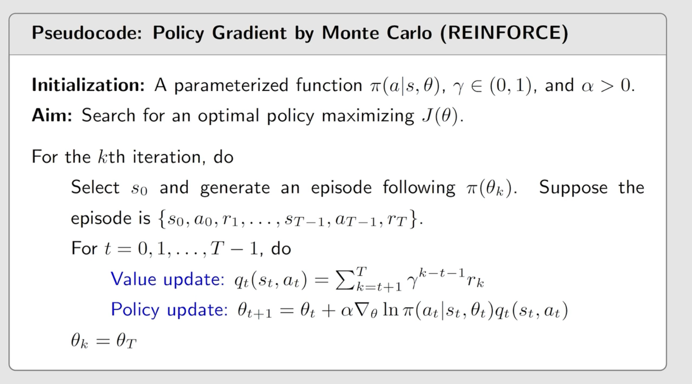

# 第 9 课 · 策略梯度方法

## 1. Basic Idea of Policy Gradient {#basic-idea-of-policy-gradient}

### 1.1 从 Tabular Policy 到 Parameterized Policy

Tabular Policy · 每个状态动作对有一个概率

在 **tabular representation** 中，用状态 $s$ 和动作 $a$ 索引一个表项 $\pi(a\mid s)$。每个状态的一行存放所有可用动作的概率。

Parameterized Policy · 多个状态共享参数

把策略写成 **parameterized function** $\pi(a\mid s,\theta)$，其中 $\theta\in\mathbb R^m$ 是 **parameter vector**。例如，在离散动作空间中，神经网络以状态 $s$ 为输入，以 $\theta$ 为网络参数，输出这一状态下各个动作的概率。

- **Storage**。大状态空间下，可以用同一组参数表示多个状态的策略，减少逐状态存储。
- **Generalization**。用某个状态的经验更新共享参数，可能同时改变其他状态的动作概率。

### 1.2 两种表示如何定义、读取和更新策略？

Optimal Policy · 怎样定义最优？

- **Tabular policy**。前面课程中的最优策略要同时达到每个状态的最优价值 $v^*(s)$。
- **Parameterized policy**。共享参数可能让不同状态的价值此消彼长，因此选一个 **scalar metric** $J(\theta)$，在给定的参数化策略族中寻找使它最大的策略。

Action Probability · 怎样读取动作概率？

- **Tabular policy**。直接查表得到 $\pi(a\mid s)$。
- **Parameterized policy**。给定函数结构和当前参数 $\theta$，计算 $\pi(a\mid s,\theta)$。

Policy Update · 怎样更新策略？

- **Tabular policy**。直接修改某个状态下各动作的概率表项。
- **Parameterized policy**。更新 $\theta$，再由函数给出新的动作概率。

### 1.3 Policy Gradient · 先定义目标，再沿梯度更新

Basic Idea · Objective Function 与 Gradient Ascent

1. **Define the objective**。选定标量目标 $J(\theta)$，衡量策略 $\pi(\cdot\mid\cdot,\theta)$ 的表现。
2. **Optimize the parameters**。用 **gradient ascent** 沿 $J$ 增大的方向更新 $\theta$。

$$
\theta_{t+1}=\theta_t+\alpha\nabla_\theta J(\theta_t).
$$

$\alpha>0$ 是 step size，$\nabla_\theta J(\theta_t)$ 就是 **policy gradient**。

## 2. Metrics to Define Optimal Policies {#metrics-to-define-optimal-policies}

### 2.1 Average Value {#average-value}

Metric 1 · Average State Value

课件介绍两种衡量策略表现的指标。第一种是 **average state value**，简称 **average value**。它把各状态在策略 $\pi$ 下的价值加权成一个标量。

$$
\bar v_\pi=\sum_{s\in\mathcal S}d(s)v_\pi(s)
=\mathbb E_{S\sim d}[v_\pi(S)].
$$

每个状态的权重满足 $d(s)\ge 0$，且 $\sum_s d(s)=1$，因此可以把 $d$ 看作状态分布。

Vector-product Form

按同一状态顺序，把权重和状态价值分别排成列向量 $d$ 与 $v_\pi$，两者都属于 $\mathbb R^{|\mathcal S|}$。Average value 就是它们的内积。

$$
\begin{aligned}
v_\pi&=[v_\pi(s_1),\ldots,v_\pi(s_{|\mathcal S|})]^\top,\\
d&=[d(s_1),\ldots,d(s_{|\mathcal S|})]^\top,\\
\bar v_\pi&=\sum_{s\in\mathcal S}d(s)v_\pi(s)=d^\top v_\pi.
\end{aligned}
$$

Case 1 · 与策略无关的固定分布

将固定分布记为 $d_0$，对应指标为 $\bar v_\pi^{\,0}=d_0^\top v_\pi$。策略参数变化时，$d_0$ 保持不变，求梯度时只需对状态价值求导。

- **Uniform distribution**。取 $d_0(s)=1/|\mathcal S|$，给所有状态相同的权重。
- **Fixed initial state**。如果每个 episode 都从 $s_0$ 开始，取 $d_0(s_0)=1$，且对 $s\ne s_0$ 取 $d_0(s)=0$。此时 $\bar v_\pi^{\,0}=v_\pi(s_0)$，衡量的是从 $s_0$ 出发的期望折扣回报。

Case 2 · 随策略变化的 Stationary Distribution

也可以取 $d=d_\pi$，即策略 $\pi$ 诱导的 **stationary distribution**。令 $P_\pi$ 为该策略下的状态转移概率矩阵，则

$$
d_\pi^\top P_\pi=d_\pi^\top,
\qquad
\bar v_\pi=d_\pi^\top v_\pi.
$$

在遍历条件下，长期访问频率越高的状态权重越大，较少访问的状态权重较小。策略变化时，$d_\pi$ 也可能随之变化。[第八课 · Stationary Distribution](value-function-approximation.md#_2-2-stationary-distribution)

### 2.2 Average Reward {#average-reward}

Metric 2 · Average One-step Reward

**Average reward** 用平稳分布 $d_\pi$ 对各状态的期望单步奖励加权。

$$
\bar r_\pi=\sum_{s\in\mathcal S}d_\pi(s)r_\pi(s)
=\mathbb E_{S\sim d_\pi}[r_\pi(S)].
$$

其中 $r_\pi(s)$ 先按策略对动作取平均，$r(s,a)$ 是给定状态和动作的期望即时奖励。

$$
\begin{aligned}
r_\pi(s)&=\sum_{a\in\mathcal A(s)}\pi(a\mid s)r(s,a),\\
r(s,a)&=\mathbb E[R\mid s,a]=\sum_r r\,p(r\mid s,a).
\end{aligned}
$$

Equivalent Definition · 长期每步奖励

从 $S_t=s_0$ 开始按 $\pi$ 行动，得到奖励序列 $(R_{t+1},R_{t+2},\ldots)$。前 $n$ 步的每步期望奖励等于奖励总和的期望除以 $n$。

$$
\begin{aligned}
&\frac1n\mathbb E_\pi\!\left[R_{t+1}+\cdots+R_{t+n}\mid S_t=s_0\right]\\
&\quad=\frac1n\sum_{k=1}^n\sum_s
\Pr_\pi(S_{t+k-1}=s\mid S_t=s_0)\,r_\pi(s).
\end{aligned}
$$

若策略诱导的有限 Markov chain 遍历且奖励期望有限，式中的状态分布趋于 $d_\pi$。每步期望奖励及其时间平均都趋于 $\sum_s d_\pi(s)r_\pi(s)$，因此

$$
\begin{aligned}
\lim_{n\to\infty}\frac1n
\mathbb E_\pi\!\left[\sum_{k=1}^n R_{t+k}\mid S_t=s_0\right]
&=\lim_{n\to\infty}\frac1n
\mathbb E_\pi\!\left[\sum_{k=1}^n R_{t+k}\right]\\
&=\sum_s d_\pi(s)r_\pi(s)
=\bar r_\pi.
\end{aligned}
$$

任意起点 $s_0$ 都给出同一个极限，因此也可对任意起始分布取期望。按平稳分布加权和沿轨迹取长期平均，是 $\bar r_\pi$ 的两个等价定义。

### 2.3 Remarks on the Metrics {#remarks-on-policy-metrics}

Remarks 1–2 · 参数与折扣

- **Parameter dependence**。两种指标都随策略 $\pi_\theta$ 变化，因此都可以选作要最大化的 $J(\theta)$。
- **Discounted and undiscounted settings**。Average value 来自折扣回报，通常取 $0\le\gamma<1$。在持续任务中，若采用 $\gamma=1$，无限奖励总和可能发散，可以用每步长期平均的 $\bar r_\pi$ 定义目标。

Remark 3 · 平稳条件下的关系

Average reward 在定义里只出现单步奖励，但 $d_\pi$ 已包含策略长期访问各状态的频率。若 Average Value 也用 $d=d_\pi$ 加权，并且 $0\le\gamma<1$，则

$$
\bar r_\pi=(1-\gamma)\bar v_\pi.
$$

从 $S_0\sim d_\pi$ 出发，之后每一步的状态分布都是 $d_\pi$，所以每步期望奖励都等于 $\bar r_\pi$。把它代入折扣回报并对几何级数求和，即得 $\bar v_\pi=\bar r_\pi/(1-\gamma)$。固定 $\gamma$ 时，这两个指标对策略的排序相同。用一般的固定起点分布 $d_0$ 加权时，这一比例关系一般不成立。

### 2.4 Exercise · Expected Discounted Return {#expected-discounted-return}

Exercise · 期望折扣回报对应哪个指标？

令 $G_0=\sum_{t=0}^\infty\gamma^t R_{t+1}$，目标为 $J(\theta)=\mathbb E[G_0]$。从 $S_0\sim d$ 开始生成轨迹。

$$
S_0,A_0,R_1,S_1,A_1,R_2,S_2,\ldots
$$

每步先按策略抽取 $A_t\sim\pi_\theta(\cdot\mid S_t)$，再由环境的联合分布 $p(r,s'\mid S_t,A_t)$ 生成 $(R_{t+1},S_{t+1})$。期望同时涵盖起始状态、动作和环境转移的随机性。

对起始状态应用 **law of total expectation**。

$$
\begin{aligned}
J(\theta)
&=\sum_{s\in\mathcal S}d(s)\mathbb E_{\pi_\theta}[G_0\mid S_0=s]\\
&=\sum_{s\in\mathcal S}d(s)v_{\pi_\theta}(s)\\
&=\bar v_{\pi_\theta}.
\end{aligned}
$$

所以它就是以起始分布 $d$ 加权的 **Average Value**。

## 3. Gradients of the Metrics {#gradients-of-the-metrics}

### 3.1 Policy Gradient for Each Metric {#policy-gradient-for-each-metric}

Common Form · 状态加权的策略梯度

选定目标 $J(\theta)$ 后，先求 $\nabla_\theta J(\theta)$，再用梯度上升更新策略参数。上一节的三个目标 $\bar r_\pi$、$\bar v_\pi$ 和 $\bar v_\pi^{\,0}$ 可以用同一种加权求和形式来表达梯度或其近似。

$$
\begin{aligned}
g_\pi(s;q)&=\sum_{a\in\mathcal A(s)}
\nabla_\theta\pi(a\mid s,\theta)\,q(s,a),\\
\sum_{s\in\mathcal S}\eta(s)\,g_\pi(s;q)
&=\sum_{s\in\mathcal S}\eta(s)
\sum_{a\in\mathcal A(s)}\nabla_\theta\pi(a\mid s,\theta)\,q(s,a).
\end{aligned}
$$

$\eta(s)$ 是状态权重。求导时要同时看目标（固定起点的 $\bar v_\pi^{\,0}$、平稳加权的 $\bar v_\pi$ 或 $\bar r_\pi$）及回报设定（折扣或不折扣）。下面分别写出精确梯度和课件采用的近似。由归一化带来的常数比例将在 3.2 节中保留。

Average Reward and Stationary Average Value

对长期平均奖励 $\bar r_\pi$，状态权重取平稳分布 $d_\pi$。在有限遍历情形下，用折扣动作价值 $q_\pi^\gamma$ 可以得到课件中的近似。若采用平均奖励设定下的 **differential action value** $q_\pi^{\mathrm{diff}}$，以 $R_{t+1}-\bar r_\pi$ 为中心化奖励来衡量后续回报，则策略梯度定理给出精确梯度。[Sutton 等 · Policy Gradient Theorem](https://proceedings.neurips.cc/paper_files/paper/1999/file/464d828b85b0bed98e80ade0a5c43b0f-Paper.pdf)

$$
\begin{aligned}
\nabla_\theta\bar r_\pi
&\approx\sum_s d_\pi(s)\sum_a
\nabla_\theta\pi(a\mid s,\theta)\,q_\pi^\gamma(s,a)
\qquad(\gamma\to1^-),\\
\nabla_\theta\bar r_\pi
&=\sum_s d_\pi(s)\,g_\pi(s;q_\pi^{\mathrm{diff}}).
\end{aligned}
$$

若 $\bar v_\pi$ 也以 $d_\pi$ 加权，由上一节的 $\bar r_\pi=(1-\gamma)\bar v_\pi$，在固定 $0\le\gamma<1$ 时可直接得到

$$
\nabla_\theta\bar v_\pi=\frac{1}{1-\gamma}\nabla_\theta\bar r_\pi.
$$

Fixed Start Distribution · 折扣状态访问权重

对 $\bar v_\pi^{\,0}$，轨迹从固定分布 $d_0$ 出发。令 $\rho_\pi(s)$ 为从 $d_0$ 出发后访问状态 $s$ 的 **discounted occupancy**，第 $t$ 步的访问概率按 $\gamma^t$ 加权。

$$
\begin{aligned}
\rho_\pi(s)&=\sum_{t=0}^{\infty}\gamma^t
\Pr_{S_0\sim d_0,\,\pi}(S_t=s),\\
\nabla_\theta\bar v_\pi^{\,0}
&=\sum_s\rho_\pi(s)\sum_a
\nabla_\theta\pi(a\mid s,\theta)\,q_\pi^\gamma(s,a).
\end{aligned}
$$

在持续任务中，$\sum_s\rho_\pi(s)=1/(1-\gamma)$。因此 $(1-\gamma)\rho_\pi$ 是可用于采样的概率分布，用它写成期望时需保留外部因子 $1/(1-\gamma)$ 才得到原梯度。

### 3.2 Log-policy Form {#log-policy-form}

A Compact Form of the Gradient

先令 $Z=\sum_s\eta(s)>0$，将状态权重归一化为 $\tilde\eta(s)=\eta(s)/Z$。取 $S\sim\tilde\eta$、$A\sim\pi(\cdot\mid S,\theta)$，前面的加权求和可写成

$$
\sum_s\eta(s)\,g_\pi(s;q)
=Z\,\mathbb E\!\left[\nabla_\theta\ln\pi(A\mid S,\theta)\,q(S,A)\right].
$$

Sample-based Gradient · 用样本估计梯度

按 $S\sim\tilde\eta$、$A\sim\pi(\cdot\mid S,\theta)$ 抽到一个样本 $(s,a)$ 后，可用

$$
Z\,\nabla_\theta\ln\pi(a\mid s,\theta)\,q(s,a)
$$

估计上面的加权和。若该加权和等于目标的精确梯度，且采用对应的真实动作价值，这就是一个无偏梯度估计。多个样本可以取平均。状态从哪个分布采样，决定了这组样本估计的是哪种加权和。

How to Prove It? · Log-derivative Trick

对正概率动作，由链式法则有

$$
\nabla_\theta\ln\pi(a\mid s,\theta)
=\frac{\nabla_\theta\pi(a\mid s,\theta)}{\pi(a\mid s,\theta)}.
$$

因此 $\nabla_\theta\pi=\pi\,\nabla_\theta\ln\pi$。出现的 $\pi(a\mid s,\theta)$ 恰好是动作的条件概率。用上面定义的 $Z$ 和 $\tilde\eta$，先把状态求和写成 $S\sim\tilde\eta$ 的期望，再把动作求和写成 $A\sim\pi(\cdot\mid S,\theta)$ 的条件期望。

$$
\begin{aligned}
\sum_s\eta(s)\,g_\pi(s;q)
&=\sum_s\eta(s)\sum_a\pi(a\mid s,\theta)
  \nabla_\theta\ln\pi(a\mid s,\theta)\,q(s,a)\\
&=Z\,\mathbb E_{S\sim\tilde\eta}\!\left[
  \sum_a\pi(a\mid S,\theta)
  \nabla_\theta\ln\pi(a\mid S,\theta)\,q(S,a)\right]\\
&=Z\,\mathbb E_{S\sim\tilde\eta}
  \left[\mathbb E_{A\sim\pi(\cdot\mid S,\theta)}
  \!\left[\nabla_\theta\ln\pi(A\mid S,\theta)\,q(S,A)\right]\right]\\
&=Z\,\mathbb E\!\left[\nabla_\theta\ln\pi(A\mid S,\theta)\,q(S,A)\right].
\end{aligned}
$$

若 $\eta$ 本身是概率分布，如 $d_\pi$，则 $Z=1$。

### 3.3 Softmax Policy {#softmax-policy}

Softmax · 从动作分数到概率

计算 $\ln\pi(a\mid s,\theta)$ 需要正概率。对有限实数向量 $x=[x_1,\ldots,x_n]^\top$，**softmax** 给出的 $z_i$ 均为正，且 $\sum_i z_i=1$。

$$
z_i=\frac{e^{x_i}}{\sum_{j=1}^n e^{x_j}}.
$$

把状态 $s$ 输入参数为 $\theta$ 的神经网络，令 $h(s,a,\theta)$ 为动作 $a$ 的 **logit**。对可用动作的分数做 softmax，即得到策略

$$
\pi(a\mid s,\theta)
=\frac{e^{h(s,a,\theta)}}
{\sum_{a'\in\mathcal A(s)} e^{h(s,a',\theta)}}.
$$

Neural Network Policy · 输出层与探索

当所有状态共用动作集合 $\mathcal A$ 时，网络有 $|\mathcal A|$ 个动作输出。输出层使用 softmax，将每个动作的 logit 转成对应的 $\pi(a\mid s,\theta)$。有两个或更多可用动作时，每个动作的概率都在 $(0,1)$ 内，因此可按这个随机策略在访问到的状态探索各个动作。也有直接对确定性策略求梯度的 **Deterministic Policy Gradient（DPG）** 方法。

## 4. Gradient-ascent Algorithm {#gradient-ascent-algorithm}

### 4.1 From Expected to Stochastic Updates {#stochastic-policy-updates}

Gradient Ascent · 从期望到样本

令 $\pi_t=\pi(\cdot\mid\cdot,\theta_t)$。在上一节的梯度表达式成立时，令 $Z$ 为状态权重总和，$\tilde\eta$ 为归一化后的状态分布。用正的学习率 $\alpha$ 沿梯度方向更新参数。

$$
\begin{aligned}
\theta_{t+1}
&=\theta_t+\alpha\nabla_\theta J(\theta_t)\\
&=\theta_t+\alpha Z\,\mathbb E\!\left[
\nabla_\theta\ln\pi(A\mid S,\theta_t)\,q_{\pi_t}(S,A)\right].
\end{aligned}
$$

从对应的分布采到一个 $(s_t,a_t)$ 后，先用含真实动作价值的单样本代替期望。以下沿用课件记法，将固定的正比例因子 $Z$ 并入 $\alpha$。

$$
\theta_{t+1}
=\theta_t+\alpha\,\nabla_\theta\ln\pi(a_t\mid s_t,\theta_t)\,
q_{\pi_t}(s_t,a_t).
$$

真实的 $q_{\pi_t}$ 通常未知。再以估计值 $q_t(s_t,a_t)$ 代入，得到实际使用的随机更新。

$$
\theta_{t+1}
=\theta_t+\alpha\,\nabla_\theta\ln\pi(a_t\mid s_t,\theta_t)\,
q_t(s_t,a_t).
$$

本课的 **REINFORCE** 用 Monte Carlo 回报估计动作价值。下一课再讨论 TD 估计。

### 4.2 On-policy Sampling {#on-policy-gradient-sampling}

Remark 1 · How to Do Sampling?

- **状态 $S$**。对以 $d_\pi$ 加权的目标，在遍历条件下，按当前策略运行得到的长期状态频率可近似 $d_\pi$。对固定起点的折扣目标，从 $d_0$ 出发产生轨迹，并按上一节的折扣访问权重计入各时间步。
- **动作 $A$**。在采到的状态 $s_t$，按当前策略抽取 $a_t\sim\pi(\cdot\mid s_t,\theta_t)$。用于更新的轨迹来自待优化的策略，因此这里采用 **on-policy** 采样。

### 4.3 Interpreting the Update {#interpreting-the-policy-update}

Remark 2 · How Does the Sampled Action Probability Change?

用上一节的 log-derivative 恒等式，可把随机更新改写为动作概率梯度乘上有符号的系数 $\beta_t$。

$$
\beta_t=\frac{q_t(s_t,a_t)}{\pi(a_t\mid s_t,\theta_t)},
\qquad
\theta_{t+1}=\theta_t+\alpha\beta_t\nabla_\theta\pi(a_t\mid s_t,\theta_t).
$$

记 $p_t(\theta)=\pi(a_t\mid s_t,\theta)$。对抽到的这个状态和动作做一阶 Taylor 展开。

$$
\begin{aligned}
p_t(\theta_{t+1})-p_t(\theta_t)
&\approx \nabla_\theta p_t(\theta_t)^\top
(\theta_{t+1}-\theta_t)\\
&=\alpha\beta_t\,\nabla_\theta p_t(\theta_t)^\top
\nabla_\theta p_t(\theta_t)\\
&=\alpha\beta_t\left\|\nabla_\theta p_t(\theta_t)\right\|^2.
\end{aligned}
$$

当步长足够小且 $\nabla_\theta p_t(\theta_t)\ne 0$ 时，有

- $\beta_t>0$ 沿动作概率的梯度前进，$\pi(a_t\mid s_t,\theta_{t+1})>\pi(a_t\mid s_t,\theta_t)$。
- $\beta_t<0$ 沿反方向前进，$\pi(a_t\mid s_t,\theta_{t+1})<\pi(a_t\mid s_t,\theta_t)$。
- $\beta_t=0$ 时，本次更新量为零。

Exploration and Exploitation · 系数 $\beta_t$ 的两部分

- **分子 $q_t(s_t,a_t)$**。在动作概率和概率梯度给定时，价值估计越高，一阶概率增量越大。
- **分母 $\pi(a_t\mid s_t,\theta_t)$**。在价值估计和概率梯度给定时，概率较低的动作一旦被采到，系数的绝对值更大。对动作取期望时，分母与采样概率抵消，恢复动作求和中的 $\nabla_\theta\pi(a\mid s,\theta_t)$。实际更新的幅度还取决于概率梯度，探索来自按随机策略采样。

### 4.4 REINFORCE Algorithm {#reinforce-algorithm}

Monte Carlo Policy Gradient

**REINFORCE** 是早期的策略梯度算法之一。它先用同一策略生成一个完整回合，再对每个 $(s_t,a_t)$ 以从该步到终止的实际折扣回报 **return-to-go** 作为动作价值估计。

$$
G_t=\sum_{j=t+1}^{T}\gamma^{j-t-1}r_j,
\qquad
q_t(s_t,a_t)=G_t.
$$

在生成该回合的策略下，$G_t$ 的条件期望就是 $q_\pi^\gamma(s_t,a_t)$。得到完整回报后，再用它给 log-policy 梯度加权。

<figure>
  
</figure>

课件中的 $\theta_k$ 是第 $k$ 轮生成回合时的参数，内层 $\theta_t$ 从这组参数开始更新。末尾的 $\theta_k=\theta_T$ 表示把更新完的参数带入下一轮，用外层下标可写成 $\theta_{k+1}\gets\theta_T$。

若要用整条轨迹构造固定起点折扣目标 $\bar v_\pi^{\,0}$ 的无偏梯度估计，可在采样回合的参数处计算所有 log-policy 梯度，将每步的 $G_t$ 乘上 $\gamma^t$ 后求和，再统一更新。$\gamma^t$ 对应状态的折扣访问权重，$G_t$ 内的折扣则从该步开始计算。[Sutton & Barto · §13.3 REINFORCE](https://web.stanford.edu/class/psych209/Readings/SuttonBartoRL.pdf)
