---
---

# 第 6 课 · 随机近似与随机梯度下降 · V1（逐页）

按公开视频分段排列，页号采用公开课件编号。**课件补充**表示使用公开课件原页；第 7 课部分视频的页脚总数与公开课件不同。

## Part 1 · Incremental Mean Estimation

### 第 01 页 · Course Map

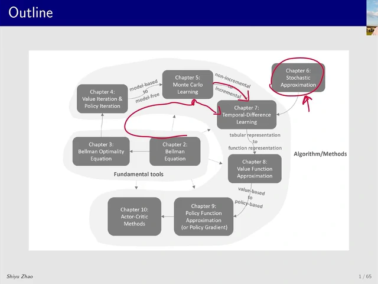

上一课用回合回报的均值做 MC，下节课把价值随每次转移更新。本课给出这类增量更新的数学工具。

### 第 02 页 · From MC to TD

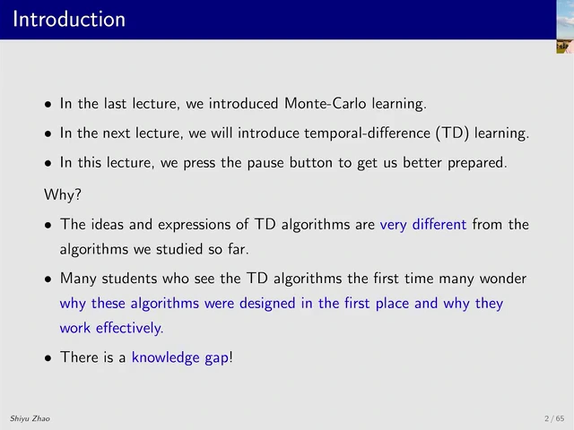

MC 可以等样本齐全再平均，TD 接收新数据后就更新。理解这个差别要先弄清递推均值和带噪声的迭代。

### 第 03 页 · Stochastic Approximation

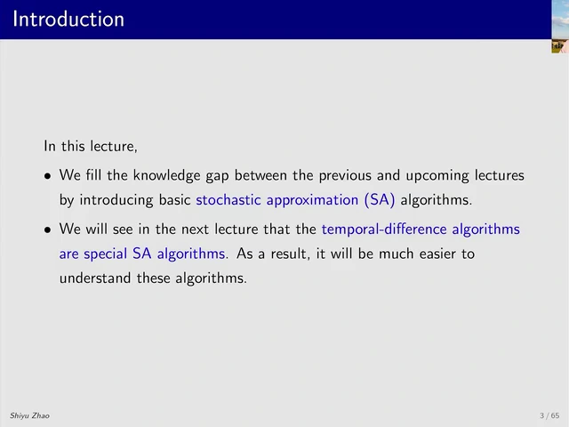

随机近似（SA）用带噪声的观测迭代求根或优化。TD 更新可以视为用它求解贝尔曼方程。

### 第 04 页 · Lecture Outline

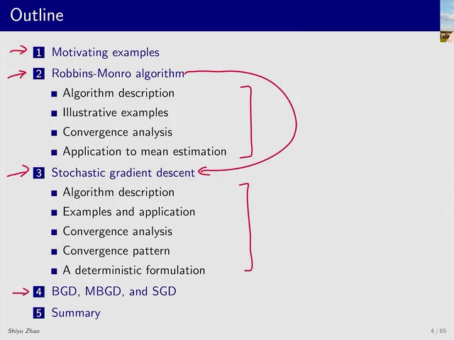

先推导在线均值，再研究 Robbins–Monro 的算法与收敛，最后用同一框架理解 SGD。

### 第 05 页 · Mean Estimation

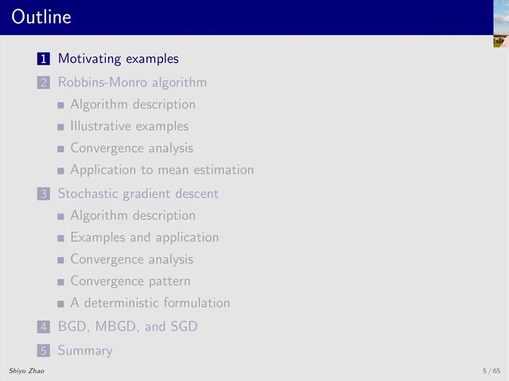

先问如何在只看到一个新样本时利用过去的统计量。

### 第 06 页 · Sample Mean

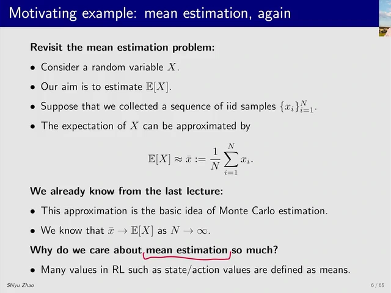

对 iid 样本 $x_1,\ldots,x_N$ 取平均估计 $\mathbb E[X]$。这里要解决的是如何计算这个平均。

### 第 07 页 · Batch vs. Incremental

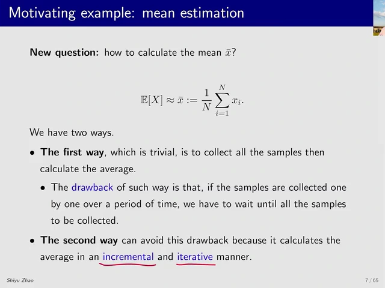

批量法存齐数据再求和。增量法只保留旧估计和计数，每收到样本就可得到新的均值。

### 第 08 页 · Derive the Incremental Mean

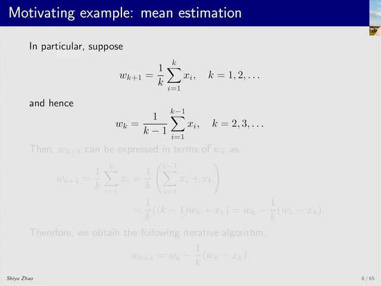

把前 $k-1$ 项之和替换为 $(k-1)w_k$，得到 $w_{k+1}=((k-1)w_k+x_k)/k=w_k+(x_k-w_k)/k$。$w_{k+1}$ 才是前 $k$ 个样本的平均。

### 第 09 页 · Read the Index

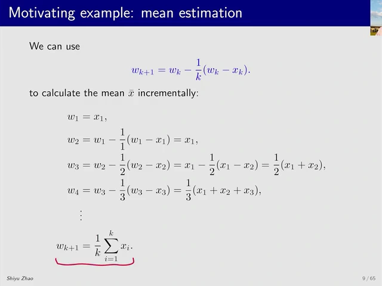

第一步 $1/k=1$，所以 $w_2=x_1$。之后 $w_3=(x_1+x_2)/2$，$w_4=(x_1+x_2+x_3)/3$。初始猜测被第一步消去。

### 第 10 页 · Online Update

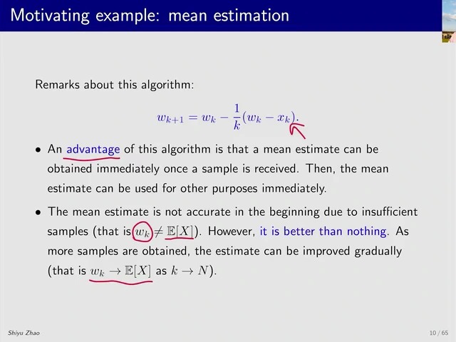

每次修正量由新样本与旧估计的差和步长决定。无需重扫全部样本，可用于数据逐个到来的场景。

### 第 11 页 · General Step Size

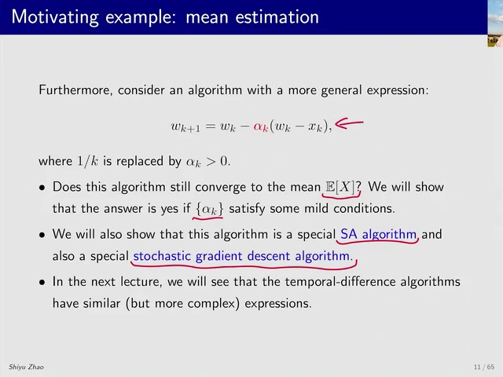

把 $1/k$ 换成 $\alpha_k>0$ 仍可做增量更新，但估计一般不再是等权样本平均。能否收敛要检查步长和噪声。

## Part 2 · Robbins–Monro · Algorithm and Examples

### 第 12 页 · Robbins–Monro Roadmap

接下来把均值估计放进更一般的带噪声求根问题。

### 第 13 页 · Algorithm Description

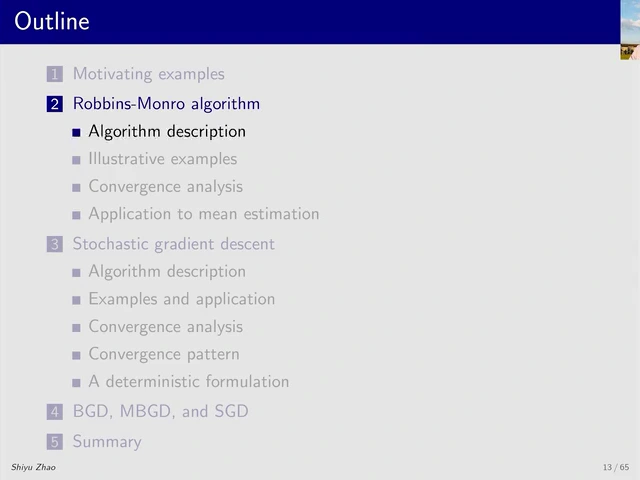

先确定目标方程，再说明每次可以观测什么。

### 第 14 页 · Root Finding under Noise

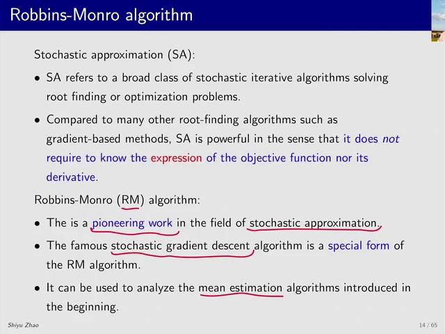

随机近似包含求根和优化。Robbins–Monro（RM）用函数值的噪声观测递推，不要求每步显式求导。

### 第 15 页 · Problem Statement

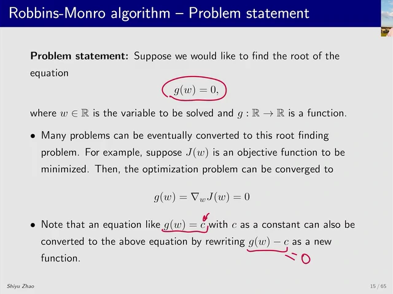

求 $g(w)=0$ 的根。可微优化的一阶条件与均值估计都能写成这种形式。

### 第 16 页 · Available Observation

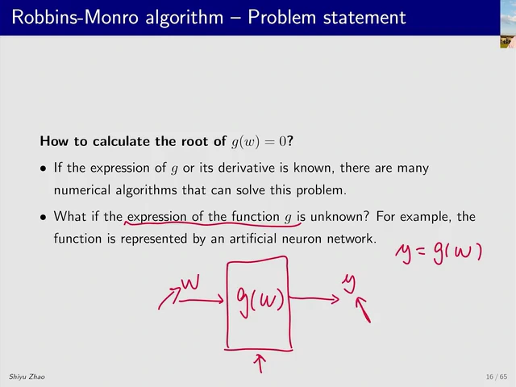

若函数已知可用常规数值方法。现在只能在查询点 $w$ 取得 $\widetilde g(w,\eta)=g(w)+\eta$，需要通过多次观测抵消噪声。

### 第 17 页 · RM Update

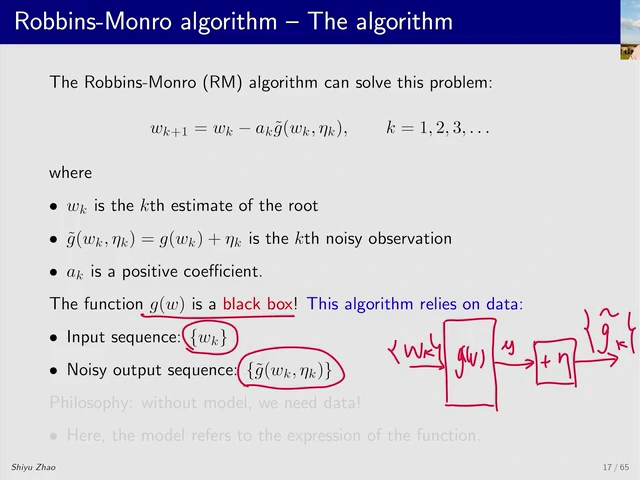

每轮在当前 $w_k$ 观测 $\widetilde g$，再做 $w_{k+1}=w_k-a_k\widetilde g(w_k,\eta_k)$。$a_k$ 决定修正量。

### 第 18 页 · Illustrative Examples（课件补充）

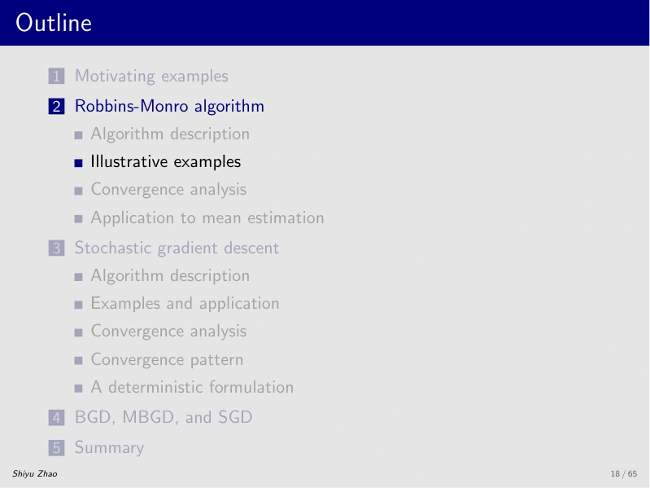

先看无噪声的线性方程，再看带噪声的非线性方程。

### 第 19 页 · Linear Root（课件补充）

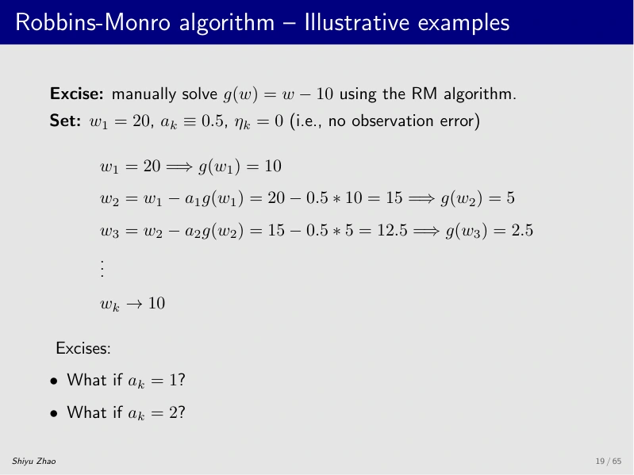

$g(w)=w-10$、$a_k=0.5$ 时，误差每次减半。从 20 开始依次经过 15、12.5、11.25，趋近 10。

### 第 20 页 · Noisy Cubic（课件补充）

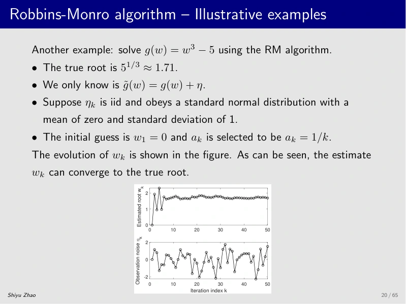

$g(w)=w^3-5$ 的根为 $5^{1/3}$。正态噪声使轨迹波动，步长逐渐减小后波动趋弱。这一数值结果依赖初值和步长。

### 第 21 页 · Convergence Roadmap

先用更新方向解释为什么能接近根，再用定理给出严格条件。

### 第 22 页 · What Makes RM Converge

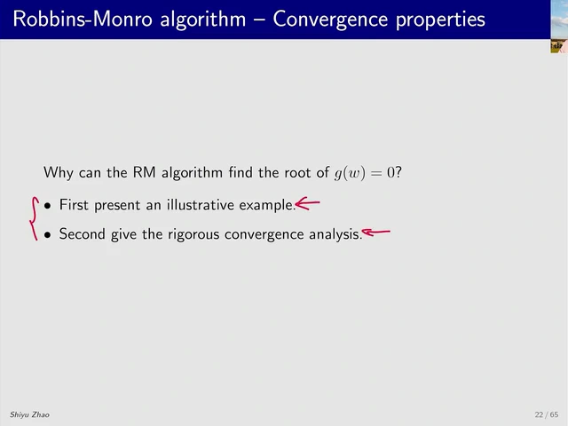

要区分移动方向正确、长期足以移动、噪声不会不断累积这三个问题。

### 第 23 页 · Tanh Illustration

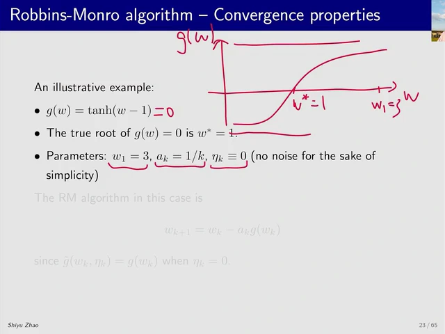

对 $g(w)=\tanh(w-1)$，根为 1。图示取 $w_1=3$、$a_k=1/k$、无噪声，跟踪每轮估计。

### 第 24 页 · Direction of Correction

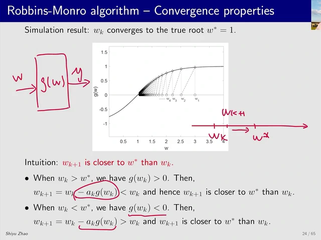

$w_k>w^*$ 时 $g(w_k)>0$，更新减小估计；在根左侧则相反。步长过大仍可能越过根，所以方向直觉不足以证明收敛。

## Part 3 · Robbins–Monro · Convergence and Applications

### 第 25 页 · RM Theorem

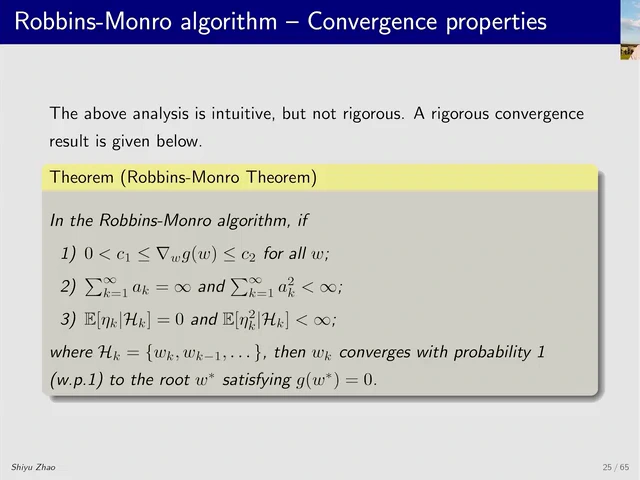

课件要求 $0<c_1\le g'(w)\le c_2$、$\sum a_k=\infty$、$\sum a_k^2<\infty$，以及给定历史的零均值与二阶矩条件，结论为几乎必然收敛。严格使用时还需能控制条件二阶矩，例如统一有界。

### 第 26 页 · Interpret the Conditions

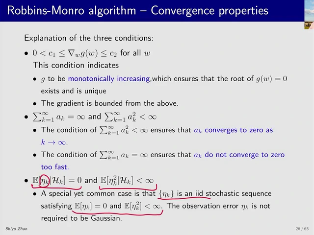

斜率正下界保证全局增长和唯一根，上界控制更新幅度。步长要变小但累计不能有限。独立、零均值且方差有限的噪声是足够的常见情形，高斯分布并非必要。

### 第 27 页 · Square Summability

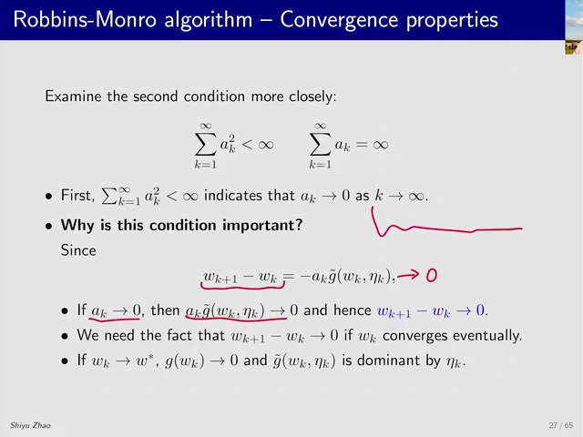

$\sum a_k^2<\infty$ 推出 $a_k\to0$，有助于控制加权噪声的累计方差。

### 第 28 页 · Infinite Total Step Size

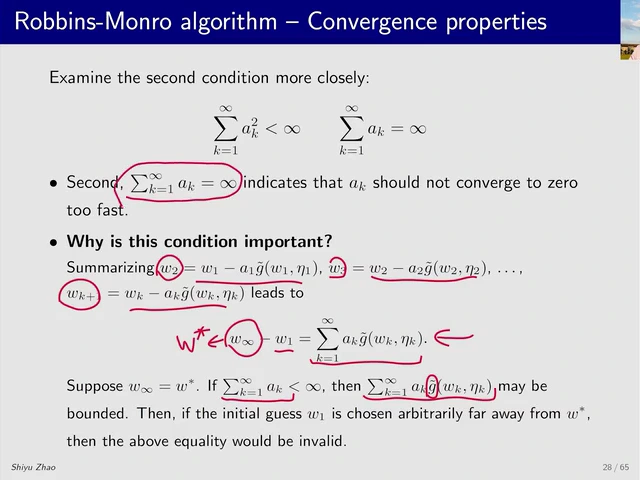

$\sum a_k=\infty$ 保留足够的总移动量，避免步长过早耗尽、估计仍停在根外。

### 第 29 页 · Choose a Schedule

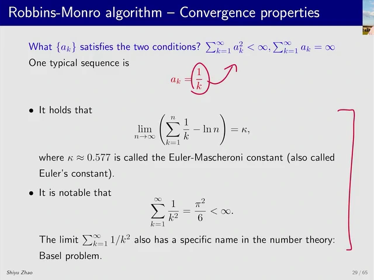

$1/k$ 的总和发散而平方和收敛。常数步长和 $1/k^2$ 分别违反平方可和与总和发散条件。

### 第 30 页 · Conditions Can Fail

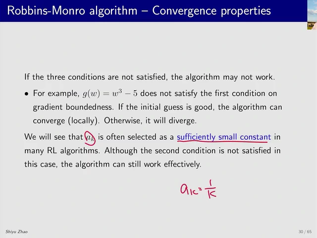

立方函数斜率无全局上下界。若初值过大，更新量可能很大并发散；一个初值的成功仿真无法替代收敛条件。

### 第 31 页 · Apply RM to the Mean

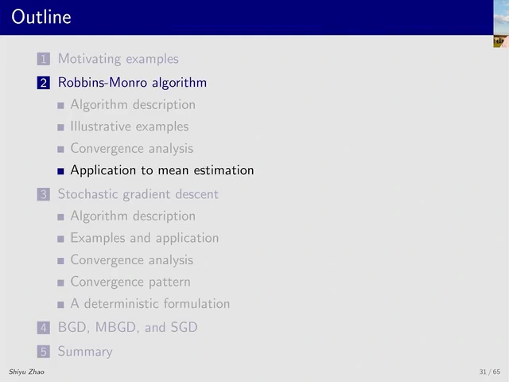

返回递推均值，说明为什么一类不同于 $1/k$ 的步长也能估计期望。

### 第 32 页 · From Average to Root

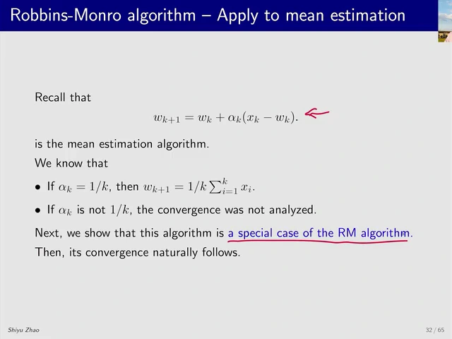

$\alpha_k=1/k$ 时得到精确样本均值；其他步长需要从求根的角度处理。

### 第 33 页 · Identify the Noise

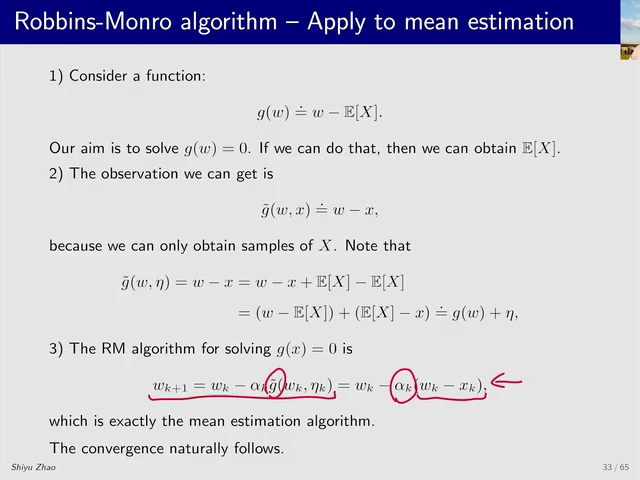

令 $g(w)=w-\mu$、$\widetilde g(w,x)=w-x$，噪声是 $\mu-x$。斜率恒为 1，iid 样本且方差有限时满足噪声条件，所以合适的步长可收敛到 $\mu$。

### 第 34 页 · Dvoretzky’s Theorem · Optional

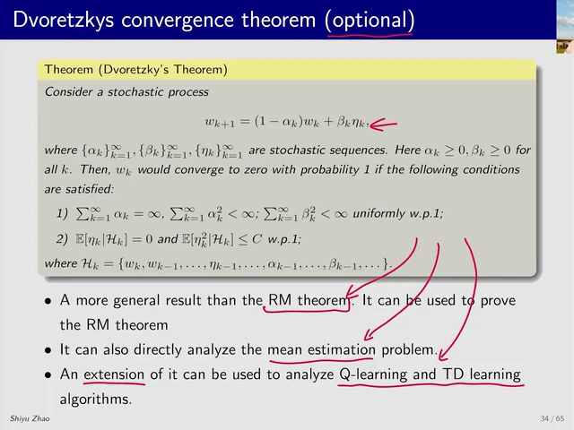

递推 $w_{k+1}=(1-\alpha_k)w_k+\beta_k\eta_k$。累计收缩发散、$\alpha_k,\beta_k$ 平方可和，加上条件零均值与有界二阶矩，可证明误差趋于零。它也可推广到 TD 的分析。

## Part 4 · Stochastic Gradient Descent

### 第 35 页 · Stochastic Gradient Descent

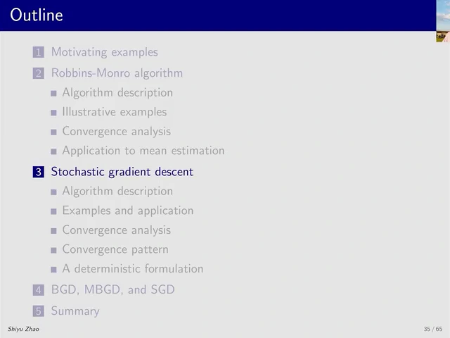

把梯度为零当作求根，再用样本梯度作观测。

### 第 36 页 · SGD Roadmap

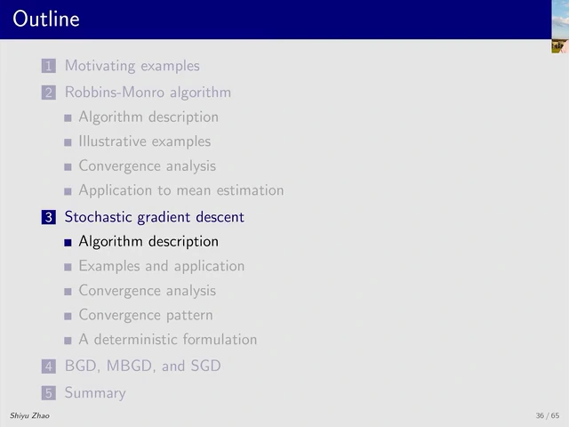

先比较 GD、BGD 和 SGD 的梯度，再讨论收敛和批量大小。

### 第 37 页 · Optimization as Root Finding

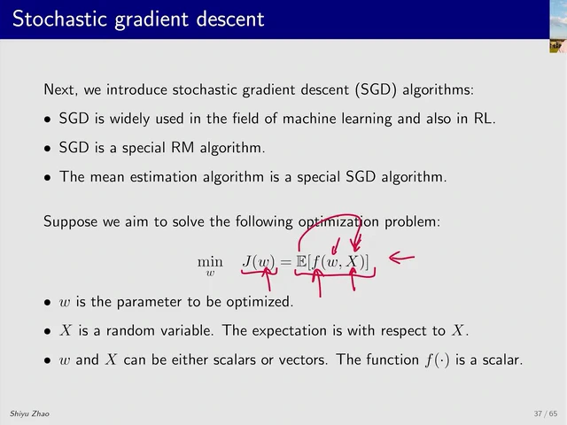

若 $J(w)=\mathbb E[f(w,X)]$，可从一阶条件 $J'(w)=0$ 出发。SGD 是 RM 的特例，递推均值又是 SGD 的特例。

### 第 38 页 · GD and BGD

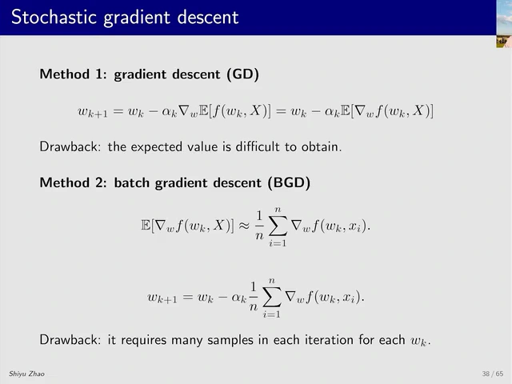

GD 用真实期望梯度。实际只有有限样本时，BGD 用整个样本集的平均梯度；每轮遍历全部数据。

### 第 39 页 · SGD Update

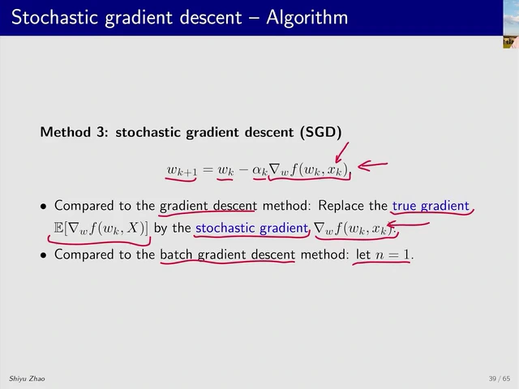

每轮只观测一个样本梯度 $\nabla_w f(w_k,x_k)$，做 $w_{k+1}=w_k-\alpha_k\nabla_w f(w_k,x_k)$。单次更新便宜，更新方向有噪声。

## Part 5 · SGD · Applications and Convergence

### 第 40 页 · Least-squares Application（课件补充）

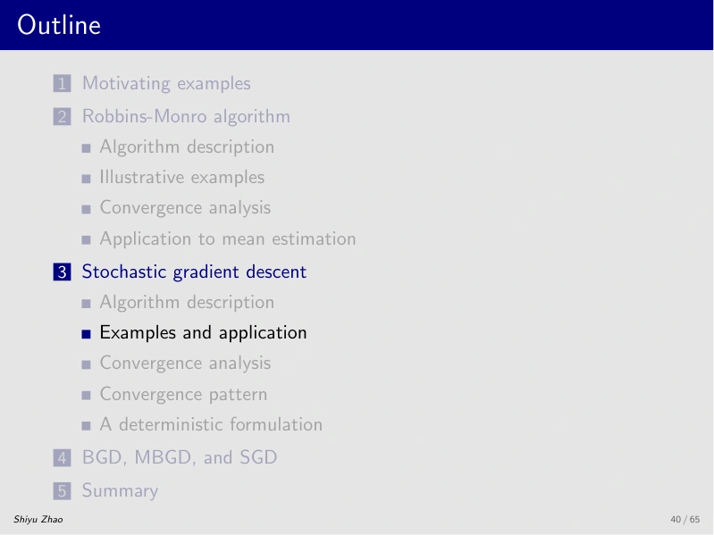

用平方损失展示为什么一次 SGD 更新会等于均值递推。

### 第 41 页 · Mean as an Optimizer

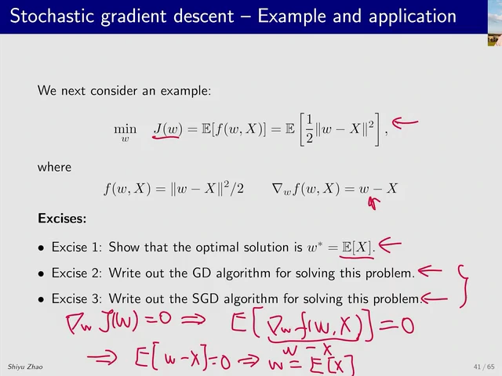

$J(w)=\mathbb E[\

### 第 42 页 · Apply GD and SGD

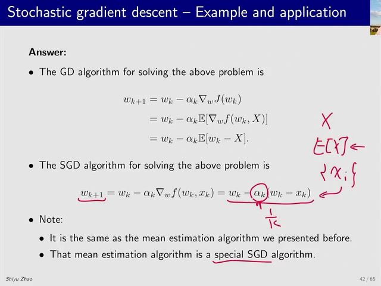

GD 用 $w_k-\mathbb E[X]$，SGD 将其换成 $w_k-x_k$，得到 $w_{k+1}=w_k+\alpha_k(x_k-w_k)$。

### 第 43 页 · SGD Convergence

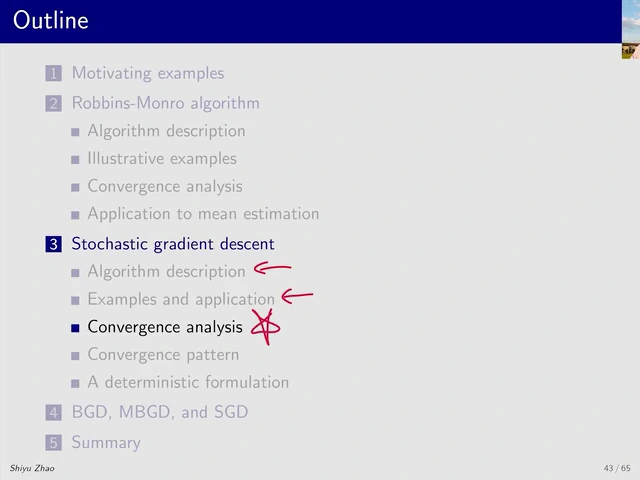

把样本梯度拆成真实梯度和误差，得到 RM 更新。

### 第 44 页 · Gradient Noise

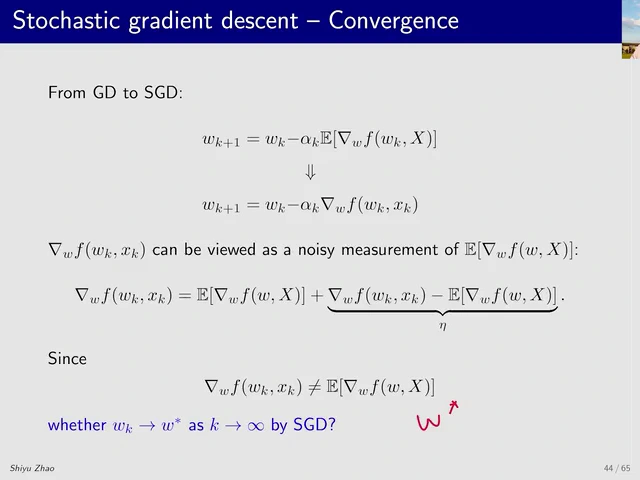

$\eta_k=\nabla f(w_k,x_k)-\mathbb E[\nabla f(w_k,X)]$。新样本独立于历史时，给定当前估计的噪声均值为零。

### 第 45 页 · Root of the Population Gradient

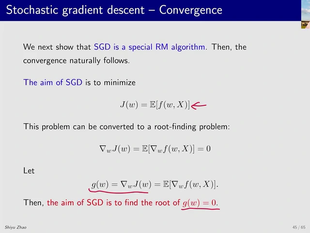

在可以交换微分与期望时，$g(w)=\mathbb E[\nabla f(w,X)]=\nabla J(w)$。凸性保证驻点是全局极小值。

### 第 46 页 · SGD as RM

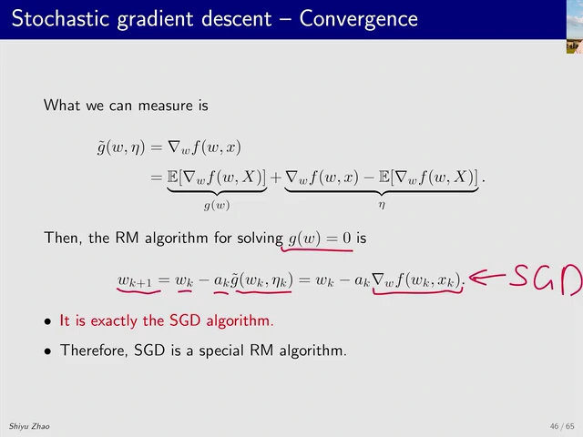

RM 的观测 $\widetilde g$ 设成单样本梯度，代回就得到 SGD。算法形式与收敛条件可以一起对照。

### 第 47 页 · SGD Convergence Conditions

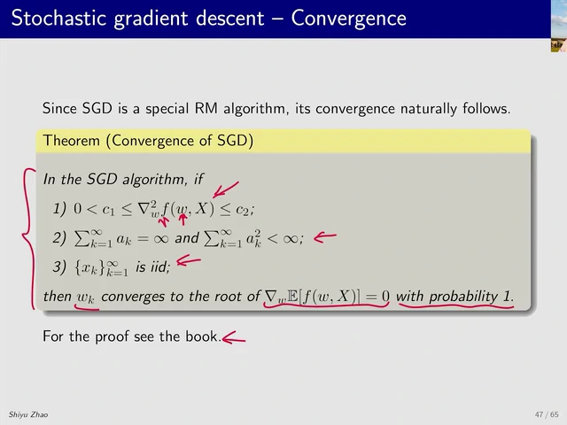

课件用正的曲率上下界控制斜率，配合独立采样和 RM 步长得到几乎必然收敛。严格应用仍需检查样本梯度的二阶矩。老师指出课件这里按标量写上下界，向量情形应改用 Hessian 的矩阵界。

## Part 6 · SGD · Convergence Pattern and Finite Sums

### 第 48 页 · Convergence Pattern

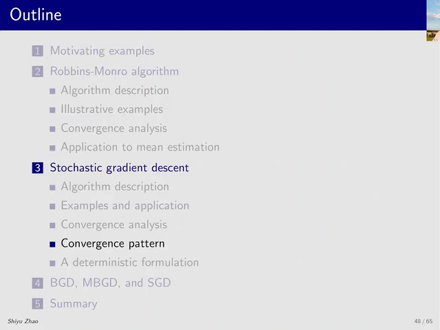

接下来比较真实梯度大小与样本梯度误差，看迭代在不同阶段为何表现不同。

### 第 49 页 · Relative Gradient Error

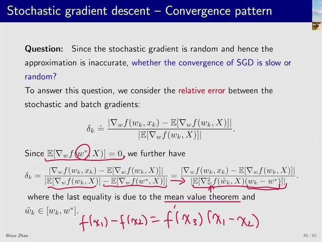

用 $

### 第 50 页 · Curvature Lower Bound

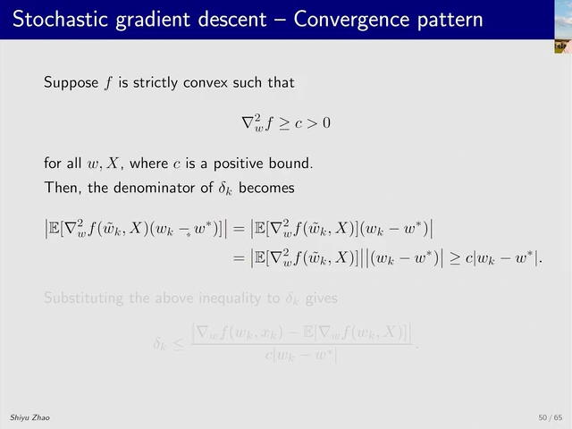

一维情形由中值定理，$

### 第 51 页 · Near the Optimum

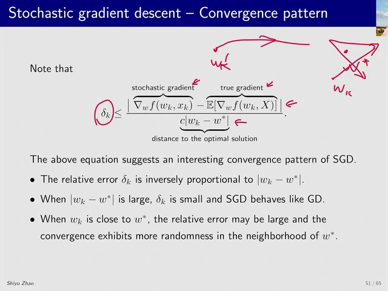

靠近最优点时真实梯度趋零，而样本梯度仍可能波动，因此相对误差可能增大。该上界不保证误差和距离严格成反比。

### 第 52 页 · Two-dimensional Mean

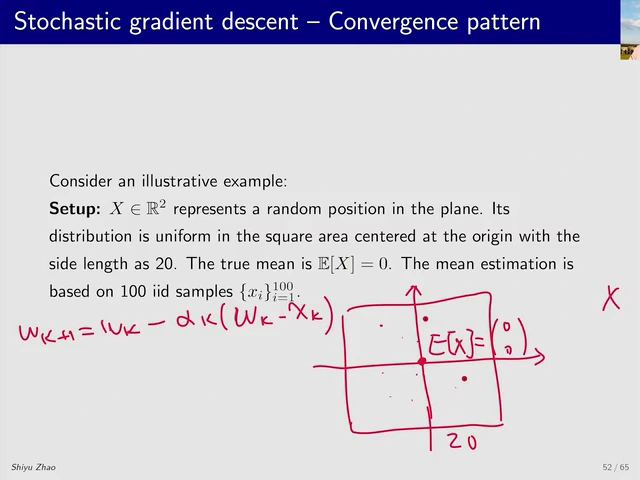

在平面均匀采样，用单样本和不同批量估计同一个均值。比较路径及其与真值的距离。

### 第 53 页 · Read the Convergence Curves

图示中，小批量路径更抖，大批量通常更平滑。比较横轴上的迭代次数时也要注意每一步花了多少样本。

### 第 54 页 · Finite-sum Formulation

把目标从总体期望换成有限数据集上的平均损失。

### 第 55 页 · Empirical Objective

$J(w)=\frac1n\sum_i f(w,x_i)$ 可以直接定义为确定性优化问题。

### 第 56 页 · Single-sample Gradient

遍历全体可算经验目标的精确梯度。每次只取一项时，要说明这一项的随机来源及其期望。

### 第 57 页 · Uniform Index Sampling

从索引集合有放回均匀抽样，$\mathbb E_I[f(w,x_I)]=J(w)$ 是等式。单样本梯度对经验目标无偏。每轮的抽样相互独立，允许抽到之前用过的数据。

## Part 7 · BGD, MBGD and SGD

### 第 58 页 · Batch-size Comparison

用批量大小来连接 BGD、MBGD、SGD。

### 第 59 页 · BGD, MBGD, SGD

每轮用全体、$m$ 个随机样本或单个样本的平均梯度。独立重复抽到同一个索引时应按抽取次数计入。

### 第 60 页 · Cost and Variance

独立同分布抽样下，批量梯度的协方差是单样本的 $1/m$。批量越大，单步越贵，但方向通常更稳定。

### 第 61 页 · Finite-data Mean

最小化经验平方损失时，全批、迷你批和单样本分别把估计推向全体平均、当前批的平均以及当前样本。

### 第 62 页 · Read the Exact Recurrences

$\alpha_k=1/k$ 时，全批第一步就到数据均值。迷你批递推得到批均值的平均，SGD 得到单样本均值。

### 第 63 页 · Read the Batch-size Experiment

课件用固定一批二维点比较不同批量。增大批量能让每轮估计更平稳，比较总成本需把每轮使用的样本数乘进去。

### 第 64 页 · Recap

三个层次对应均值估计、带噪声求根和用样本梯度做优化。

### 第 65 页 · Summary

均值递推可视为 RM，也可视为平方损失上的 SGD。下一课会把贝尔曼残差写成随机观测，沿用同样的更新结构。
