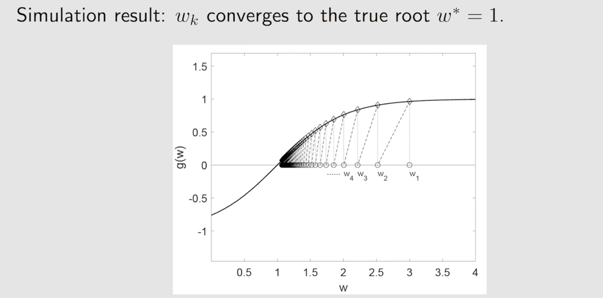

# 第 6 课 · Stochastic Approximation and Stochastic Gradient Descent · V2（总结）

## 1. Motivating Example

#### （1）Mean Estimation

Motivating Example · Mean Estimation

第五课用 **sample mean** 估计期望。给定 $N$ 个 samples，要计算的是

$$
\mathbb E[X]\approx \bar x
:=\frac{1}{N}\sum_{i=1}^{N}x_i.
$$

**怎样计算 $\bar x$？**

- **Batch method**。等全部 samples 到齐，再统一求平均。
  - 若 samples 陆续到来，这种做法要等到最后才能给出结果。
- **Incremental method**。每收到一个 sample，就更新当前估计。每一步都沿用上一次的结果，因此也是一种 **iterative method**。

#### （2）Derive the Incremental Update

Incremental Update · 用旧均值和新 Sample 推出新均值

按课件的下标，$w_{k+1}$ 是读入 $x_k$ 后的 estimate，包含前 $k$ 个 samples：

$$
w_{k+1}=\frac1k\sum_{i=1}^{k}x_i,
\qquad k=1,2,\ldots
$$

相应地，$w_k$ 是读入 $x_k$ **之前**的 estimate：

$$
w_k=\frac1{k-1}\sum_{i=1}^{k-1}x_i,
\qquad k\ge 2.
$$

把旧 samples 的总和写成 $(k-1)w_k$，再加上新 sample $x_k$：

$$
\begin{aligned}
w_{k+1}
&=\frac1k\left(\sum_{i=1}^{k-1}x_i+x_k\right)\\
&=\frac1k\bigl((k-1)w_k+x_k\bigr).
\end{aligned}
$$

整理出 **update rule**：

$$
\boxed{w_{k+1}=w_k-\frac1k(w_k-x_k)}.
$$

#### （3）Work Through the First Updates

Incremental Mean · 逐步代入

课件从 $w_1=x_1$ 开始。将新 sample 依次代入 update rule：

$$
\begin{aligned}
w_2 &= w_1-(w_1-x_1)=x_1,\\[3pt]
w_3 &= w_2-\frac12(w_2-x_2)\\
    &= \frac12(x_1+x_2),\\[3pt]
w_4 &= w_3-\frac13(w_3-x_3)\\
    &= \frac13(x_1+x_2+x_3).
\end{aligned}
$$

每一步得到的都是**截至当前的 sample mean**。读到第 $k$ 个 sample 后，结果为

$$
w_{k+1}=\frac1k\sum_{i=1}^{k}x_i.
$$

#### （4）Remarks

Remarks · Estimate 可以随到随用

- **Immediate estimate**。新 sample 一到，就能产出新的 mean estimate，可立刻用于后续计算。更新只需要旧 estimate、新 sample 和计数。
- **Early estimates are noisy**。前几步 samples 较少，$w_k$ 可能离 $\mathbb E[X]$ 很远，但已经有了可用的阶段性估计。

## 2. Robbins–Monro Algorithm {#_2-robbins-monro-algorithm}

#### （1）Stochastic Approximation

Stochastic Approximation (SA)

- **目标**。用随机迭代求解 **root finding** 或 **optimization** 问题。
- **可用信息**。以这里的 Robbins–Monro 为例，每轮只用一次带噪声的函数观测来更新。即使 $g$ 的表达式和导数都未知，也可以计算这一步。

#### （2）Problem Statement

Problem Statement · 求一个 Root

给定 $g:\mathbb R\to\mathbb R$，求满足下式的 $w^*$：

$$
g(w^*)=0.
$$

例如，对可微的 **objective function** $J(w)$ 做无约束最小化时，可以先求 **stationary point**。令 $g(w)=J'(w)$，问题就变成解 $g(w)=0$。求到的点还需判断是否是 minimum。

#### （3）When the Expression of g Is Unknown

What if g Is a Black Box?

能直接算 $g(w)$ 时，可以用常见的数值求根方法。有些问题只能在指定 $w$ 时得到一条带噪声的信息：

- **Neural network**。设总体 loss 为 $J(w)=\mathbb E_Z[\ell(w;Z)]$。可以用 **backpropagation** 算某个 sample 或 minibatch 的 gradient，但数据分布未知时，通常无法直接算出总体 gradient $g(w)=\nabla J(w)$。在可交换微分和期望的条件下，可把随机样本的 gradient 当作它的观测。这里用向量参数举例，下面的收敛定理只讨论标量情形。
- **Noisy experiment**。想找出使平均读数等于指定 target 的控制量 $w$。每次调到 $w$ 都能测一个读数，减去 target 就得到一次观测，而读数均值随 $w$ 变化的关系可能未知。

#### （4）Robbins–Monro Update

Robbins–Monro Update · 用观测修正当前 Estimate

$$
\boxed{w_{k+1}=w_k-a_k\widetilde g(w_k,\eta_k)},
\qquad k=1,2,\ldots
$$

- $w_k$ 是第 $k$ 次 **root estimate**。
- $\widetilde g(w_k,\eta_k)=g(w_k)+\eta_k$ 是这一步的 **noisy observation**。
- $a_k>0$ 是 **step size**。

每轮把 $w_k$ 输入 black box，读取 $\widetilde g(w_k,\eta_k)$，再算下一轮的输入 $w_{k+1}$。

#### （5）Illustrative Example

Illustrative Example · tanh

- **Function**。$g(w)=\tanh(w-1)$，真实 root 为 $w^*=1$。
- **Parameters**。$w_1=3$，$a_k=1/k$，$\eta_k\equiv 0$。

无 noise 时，观测值等于 $g(w_k)$，所以更新简化为

$$
w_{k+1}=w_k-\frac1k\tanh(w_k-1).
$$

#### （6）Simulation Result

Simulation Result · Iterates Approach the Root

<figure>
  
</figure>

横轴的圆点是各步的 estimates $w_1,w_2,\ldots$，曲线上的菱形是对应的 $g(w_k)$。这组 iterates 从右侧逐步逼近 $w^*=1$。

#### （7）Intuition · Direction of the Update

Intuition · 看 g 的符号决定方向

对单调递增的 $g$，先看无 noise 时的两种情况：

- **右侧**。$w_k>w^*$ 时，$g(w_k)>0$，更新向左移。
- **左侧**。$w_k<w^*$ 时，$g(w_k)<0$，更新向右移。

这解释了更新方向。还要控制 step size，才能避免跨过 root 太远。在上面的 $\tanh$ 例子里，$|\tanh(w_k-1)|\le |w_k-1|$ 且 $a_k\le1$，所以每一步都向 root 靠近。

#### （8）Robbins–Monro Theorem {#robbins-monro-theorem}

Theorem · Robbins–Monro Convergence

在标量 Robbins–Monro 更新中，令 $\mathcal H_k$ 表示已知 $w_k$、尚未收到本轮观测时的历史。下面是一组 **sufficient conditions**：

1. **Slope bounds**。对所有 $w$，存在常数 $0<c_1\le g'(w)\le c_2<\infty$。
2. **Step sizes**。$a_k>0$，且 $\sum_{k=1}^\infty a_k=\infty$、$\sum_{k=1}^\infty a_k^2<\infty$。
3. **Noise**。$\mathbb E[\eta_k\mid\mathcal H_k]=0$，且条件二阶矩有统一上界 $\mathbb E[\eta_k^2\mid\mathcal H_k]\le M<\infty$。

在这些条件下，$w_k$ **almost surely** 收敛到唯一的 root $w^*$。课件把第 3 条简写为条件二阶矩有限，这里写明了统一上界。各条件的作用和 $a_k=1/k$ 的计算见[附录](appendix.md#robbins-monro-convergence-conditions)。证明思路见 [Dvoretzky Convergence Theorem](appendix.md#dvoretzky-convergence-theorem)。[课程教材 §6.2](https://raw.githubusercontent.com/MathFoundationRL/Book-Mathematical-Foundation-of-Reinforcement-Learning/refs/heads/main/Book-all-in-one.pdf)

#### （9）When the Conditions Fail

When the Conditions Fail · Local Convergence and Constant Step Sizes

- **初值的影响**。$g(w)=w^3-5$ 的导数 $3w^2$ 缺少全局的正下界和有限上界。初值靠近 root、step size 合适时，迭代仍可收敛。初值离得较远时，更新可能越过 root 很远并发散。
- **Constant step size**。不少 RL 算法采用足够小的常数 $a_k=a>0$。这时 $\sum_k a_k^2$ 发散。在持续有 noise 时，估计可能在 root 附近波动，这种更新仍可用来跟踪随时间变化的量。

## 3. Stochastic Gradient Descent (SGD)

#### （1）Optimization Problem

Optimization Problem · Minimize an Expected Loss

$$
\min_w J(w),
\qquad J(w)=\mathbb E_X[f(w,X)].
$$

- $w$ 是要优化的 **parameter**。
- $X$ 是 **random variable**，期望对 $X$ 的分布取。
- $w$ 和 $X$ 都可以是 scalar 或 vector，$f(w,X)$ 的输出是 scalar。

下面四种方法都沿负 gradient 的方向更新，差别在于每一步用什么计算 **gradient**。

#### （2）Method 1 · Gradient Descent (GD)

Method 1 · Gradient Descent (GD)

在可以交换微分和期望的条件下，GD 每步使用 **true gradient**：

$$
\begin{aligned}
w_{k+1}
&=w_k-\alpha_k\nabla_w J(w_k)\\
&=w_k-\alpha_k\mathbb E_X[\nabla_w f(w_k,X)].
\end{aligned}
$$

$\alpha_k>0$ 是 **step size**。如果 $X$ 的分布未知，或者期望本身难算，这个 gradient 就很难直接得到。

#### （3）Method 2 · Batch Gradient Descent (BGD)

Method 2 · Batch Gradient Descent (BGD)

用手头全部 $n$ 个 samples 的 gradient 取平均，估计总体 gradient：

$$
\mathbb E_X[\nabla_w f(w_k,X)]
\approx \frac1n\sum_{i=1}^n\nabla_w f(w_k,x_i).
$$

于是 **update rule** 为

$$
w_{k+1}=w_k-\alpha_k\frac1n\sum_{i=1}^n\nabla_w f(w_k,x_i).
$$

右侧的平均值是这批数据的 **empirical loss** 的精确 gradient。每次 $w_k$ 改变后，都要用新的 $w_k$ 重新计算整批 samples 的 gradients。

#### （4）Method 3 · Stochastic Gradient Descent (SGD)

Method 3 · Stochastic Gradient Descent (SGD)

第 $k$ 步只取一个 sample $x_k$，用它的 gradient 直接更新：

$$
w_{k+1}=w_k-\alpha_k\nabla_w f(w_k,x_k).
$$

- **Stochastic gradient**。$\nabla_w f(w_k,x_k)$ 是 true gradient 的一次样本估计。若新样本独立于此前的历史且来自 $X$ 的分布，在给定当前 $w_k$ 时，它的期望等于 $\nabla_w J(w_k)$。
- **每步只用一个 sample**。把每步用于计算平均 gradient 的 sample 数设为 $1$，就得到这条更新式。每次更新只算一个 gradient，方向也更容易随抽到的 sample 波动。

#### （5）Method 4 · Mini-Batch Gradient Descent (MBGD)

Method 4 · Mini-Batch Gradient Descent (MBGD)

第 $k$ 步从数据集中取一个 **mini-batch** $B_k$，设 **batch size** 为 $b=|B_k|$。先在同一个 $w_k$ 上算这 $b$ 个 samples 的 gradients，再取平均做一次更新：

$$
w_{k+1}=w_k-\alpha_k\frac1b\sum_{i\in B_k}\nabla_w f(w_k,x_i).
$$

- $b=1$ 时，就是本节的单样本 SGD。
- $b=n$ 且包含全部数据时，就是 BGD。
- $1<b<n$ 时，一步只处理部分数据。相较于单样本更新，取平均可以减小 gradient 的波动。相较于全批量更新，每一步需要处理的 samples 更少。

