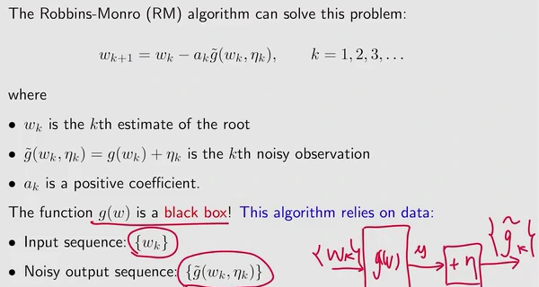
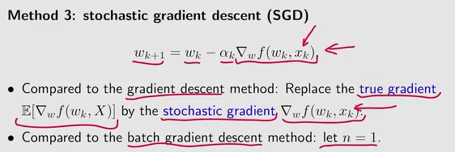

# 第 6 课 · 随机近似与随机梯度下降 · V2（总结）

[切换到 V1（逐页）](stochastic-approximation-slides.md)

## 1. Incremental Mean Estimation

目标是从样本流 $x_1,x_2,\ldots$ 估计总体均值 $\mu=\mathbb E[X]$。第 5 课用样本均值作为估计量，这里改变的是它的计算方式。按课件的下标，$w_k$ 是读入 $x_k$ **之前**的估计，所以在 $k\ge2$ 时包含前 $k-1$ 个样本。把旧样本和写成 $(k-1)w_k$：

$$
\begin{aligned}
w_{k+1}
&=\frac{(k-1)w_k+x_k}{k}\\
&=w_k+\frac1k(x_k-w_k).
\end{aligned}
$$

第一步 $1/k=1$ 令 $w_2=x_1$，初始猜测被消去。此后只需保留估计和计数。增量算法在每一步都等于重新对已有样本求平均。

### Step Size & Sample Weights

把 $1/k$ 换成 $\alpha_k$，得到 $w_{k+1}=(1-\alpha_k)w_k+\alpha_k x_k$。当 $0<\alpha_k\le1$ 时，更新是旧估计和新样本的加权平均。逐次展开：

$$
\begin{aligned}
w_{k+1}
&=\left[\prod_{j=1}^k(1-\alpha_j)\right]w_1\\
&\quad+\sum_{i=1}^k\left[\alpha_i
  \prod_{j=i+1}^k(1-\alpha_j)\right]x_i.
\end{aligned}
$$

每个样本进入时先乘 $\alpha_i$，以后每更新一次再乘相应的 $1-\alpha_j$。当 $\alpha_j=1/j$ 时，$\prod_{j=i+1}^k (j-1)/j=i/k$，所以每项权重都是 $1/k$。

常数步长 $\alpha\in(0,1)$ 给 $x_i$ 权重 $\alpha(1-\alpha)^{k-i}$，越早的数据权重越小。这适合跟踪变化中的均值。若初值固定，且样本 iid、方差为 $\sigma^2>0$，独立性让方差按权重的平方相加：

$$
\begin{aligned}
\mathbb E[w_{k+1}]-\mu&=(1-\alpha)^k(w_1-\mu),\\
\mathrm{Var}(w_{k+1})
&=\alpha^2\sigma^2\sum_{j=0}^{k-1}(1-\alpha)^{2j}\\
&\longrightarrow \frac{\alpha\sigma^2}{2-\alpha}.
\end{aligned}
$$

期望趋近 $\mu$ 时，估计的方差仍可能为正。第 7 课区分期望收敛与样本路径收敛时，也会遇到这个步长问题。

## 2. Robbins–Monro · Root Finding under Noise

要求 $g(w^*)=0$，每步只可观察 $\widetilde g(w_k,\eta_k)=g(w_k)+\eta_k$。更新式为

$$
w_{k+1}=w_k-a_k\widetilde g(w_k,\eta_k).
$$

若 $g$ 递增，根右边的正函数值把估计往左推，根左边则相反。带噪声时单次方向可能出错，因此需要同时约束步长和噪声。

<figure>
  
</figure>

### Convergence Conditions

| Condition | What it controls |
| --- | --- |
| $0<c_1\le g'(w)\le c_2$ | 正下界保证全局增长和唯一根，上界限制确定性更新的幅度 |
| $\sum_k a_k=\infty$ | 总修正能力不会提前耗尽 |
| $\sum_k a_k^2<\infty$ | 步长趋零，使加权噪声的累计方差可控 |
| $\mathbb E[\eta_k\mid\mathcal F_k]=0$，且条件二阶矩统一有界 | $\mathcal F_k$ 表示本轮观测之前的历史。噪声没有系统性漂移，方差受控 |

这些是标量 RM 的一组充分条件，结论是 $w_k\to w^*$ 几乎必然成立。课件把噪声条件简写为有限二阶矩。使用该结论时应明确矩的控制，例如上表的统一上界。典型步长 $a_k=1/k$。常数步长违反平方可和，$1/k^2$ 的总步长有限。

令误差为 $e_k=w_k-w^*$。中值定理给出 $g(w_k)=h_ke_k$，其中 $h_k\in[c_1,c_2]$。所以

$$
e_{k+1}=(1-a_k h_k)e_k-a_k\eta_k.
$$

这就是课件 Dvoretzky 形式中的「收缩项加零均值噪声」。条件零均值使平方误差展开后的交叉项在取条件期望时消失。$\sum a_k$ 与 $\sum a_k^2$ 分别控制长期收缩和噪声累积。

$$
\begin{aligned}
\mathbb E[e_{k+1}^2\mid\mathcal F_k]
&=(1-a_kh_k)^2e_k^2\\
&\quad+a_k^2\mathbb E[\eta_k^2\mid\mathcal F_k].
\end{aligned}
$$

当步长足够小时，第一项的系数小于 1，收缩量与 $a_k$ 同阶。若条件二阶矩的上界为 $C$，第二项的总和至多为 $C\sum_k a_k^2$。

### Why the Two Step-size Conditions Matter

无噪声时，从足够大的轮次 $K$ 起可以取 $0\le 1-a_kh_k\le 1-c_1a_k$。展开误差递推，并用 $1-x\le e^{-x}$：

$$
\begin{aligned}
|e_{k+1}|&\le |e_K|\prod_{j=K}^{k}(1-c_1a_j)\\
&\le |e_K|\exp\!\left(-c_1\sum_{j=K}^{k}a_j\right).
\end{aligned}
$$

$\sum a_k=\infty$ 让这个上界趋零。相反，对于线性 $g(w)=c(w-w^*)$，若 $0<ca_k<1$ 且 $\sum a_k<\infty$，累乘可能保留一部分初始误差。带噪声时再用 $\sum a_k^2<\infty$ 控制每步注入的方差。几乎必然收敛是 RM 定理的结论。上面的乘积只展开了无噪声的部分。

课件第 34 页给出可选的 Dvoretzky 形式 $z_{k+1}=(1-\beta_k)z_k+\lambda_k\xi_k$。用它看 RM，可令 $z_k=e_k$、$\beta_k=a_kh_k$、$\lambda_k=a_k$、$\xi_k=-\eta_k$。有界正斜率把关于 $a_k$ 的条件传给 $\beta_k$，噪声项则沿用平方可和的 $a_k$。

### Mean Estimation as RM

令 $\mu=\mathbb E[X]$，取 $g(w)=w-\mu$、$\widetilde g(w,x)=w-x$，则

$$
\eta_k=\mu-x_k,\qquad
w_{k+1}=w_k+\alpha_k(x_k-w_k).
$$

斜率恒为 1。iid 且有限方差的样本满足这里的噪声条件，所以步长符合 RM 条件时，仍可估计 $\mu$。

## 3. Stochastic Gradient Descent

令 $J(w)=\mathbb E[f(w,X)]$。可交换微分与期望时，$g(w)=\nabla J(w)=\mathbb E[\nabla f(w,X)]$。寻找驻点就是求 $g(w)=0$。GD 使用 $w_{k+1}=w_k-\alpha_k\nabla J(w_k)$，每一步需要真实的总体梯度。SGD 用单个样本的梯度替代它，相当于把同一个求根问题交给 RM：

$$
\begin{aligned}
\widetilde g_k &= \nabla f(w_k,X_k),\\
\eta_k &= \widetilde g_k-\nabla J(w_k),\\
w_{k+1} &= w_k-\alpha_k\widetilde g_k.
\end{aligned}
$$

虽然 $w_k$ 取决于以前的样本，它在给定 $\mathcal F_k$ 后已确定。若新样本 $X_k$ 独立于这段历史，$\mathbb E[\nabla f(w_k,X_k)\mid\mathcal F_k]=\nabla J(w_k)$，故 $\mathbb E[\eta_k\mid\mathcal F_k]=0$。

<figure>
  
</figure>

课件的标量收敛条件用 $0<c_1\le \partial_w^2 f(w,X)\le c_2$、RM 步长及 iid 样本。这个曲率界会传给 $g'(w)=J''(w)$。严格套用 RM 还要检查梯度噪声的二阶矩。正曲率使驻点成为唯一极小值。向量情况下，曲率界写成 Hessian 的矩阵不等式。一般非凸目标中，梯度为零只表示驻点。

平方损失直接连接三种递推：

$$
f(w,X)=\tfrac12\|w-X\|^2,\quad
\nabla f(w,X)=w-X,\quad
\nabla J(w)=w-\mu.
$$

因此最优解 $w^*=\mu$。将 $\nabla f(w_k,x_k)=w_k-x_k$ 代入 SGD，得到 $w_{k+1}=w_k+\alpha_k(x_k-w_k)$，这就是第 1 节的递推。<strong>递推均值是平方损失上的 SGD，SGD 是用样本梯度观测求根函数的 RM。</strong>

### Relative Gradient Error

在一维、曲率下界为 $c>0$ 时，利用 $J'(w^*)=0$ 和中值定理，可把真实梯度写成 $J''(\xi_k)(w_k-w^*)$，其中 $\xi_k$ 在 $w_k,w^*$ 之间。对 $w_k\ne w^*$，

$$
\begin{aligned}
|\nabla J(w_k)| &\ge c|w_k-w^*|,\\
\frac{|\widetilde g_k-\nabla J(w_k)|}{|\nabla J(w_k)|}
&\le\frac{|\widetilde g_k-\nabla J(w_k)|}{c|w_k-w^*|}.
\end{aligned}
$$

靠近最优点时，真实梯度变小，随机梯度仍可能波动，所以相对误差可能变大。课件的迭代轨迹体现这一现象，该不等式本身只给出上界。

## 4. BGD, MBGD & SGD

课件第 55–57 页先把数据集视为固定，只让索引随机。对 $I\sim\mathrm{Unif}\{1,\ldots,n\}$，

$$
\begin{aligned}
\mathbb E_I[f(w,x_I)]&=\frac1n\sum_{i=1}^n f(w,x_i)=J_n(w),\\
\mathbb E_I[\nabla f(w,x_I)]&=\nabla J_n(w).
\end{aligned}
$$

这两条是对经验目标的等式。若原先要优化的是总体目标 $J$，则 $J_n$ 本身仍是基于有限数据的近似。每种方法都做 $w_{k+1}=w_k-\alpha_k d_k$，差别在于梯度 $d_k$ 如何计算。

| Method | Gradient used at step $k$ | per-step sample count |
| --- | --- | ---: |
| BGD | $\frac1n\sum_i\nabla f(w_k,x_i)$ | $n$ |
| MBGD | $\frac1m\sum_{j=1}^m\nabla f(w_k,x_{I_j})$ | $m$ |
| SGD | $\nabla f(w_k,x_I)$ | $1$ |

给定本轮 $w_k$，若独立有放回地抽取 $m$ 个索引，批量梯度的协方差等于 $m$ 个单样本协方差之和除以 $m^2$，因此是单样本的 $1/m$。BGD 遍历所有固定样本，对经验目标没有抽样方差。批量增大通常降低单步随机性但提高开销。比较收敛曲线时，要区分用掉多少轮和累计处理多少样本。

### Engineering Trade-offs · 工程上的优缺点

| Method | 优点 | 代价 | 适用场景 |
| --- | --- | --- | --- |
| **BGD** · Full batch | 使用完整的经验梯度，更新没有批次抽样噪声 | 更新前要扫完整个数据集。可以分块累加来控制显存和内存，但仍要付出一轮读数和计算的成本 | 数据量小、全量遍历便宜，或需要用精确经验梯度做基准 |
| **MBGD** · Mini-batch | 同批样本可以并行处理，通常比逐样本更新更能发挥 GPU 吞吐。批内平均也能降低梯度波动 | 批量过小可能难以摊薄调度和数据搬运开销。批量过大占用更多显存，同样扫完一遍数据时参数更新次数更少，可能需要重新调学习率 | 大规模离线训练，需要兼顾加速器吞吐和更新频率 |
| **SGD** · Single sample | 单次更新只处理一个样本，新样本到达后可立即更新。对批数据的内存需求最低 | 梯度波动较大，通常更依赖步长控制。每次只处理一个样本时，GPU 可能吃不满，频繁调度和参数更新也有开销 | 在线学习、流式数据，或每个样本到达后都需要尽快更新 |

固定数据量下，顺序遍历一遍数据（one epoch）时，三者分别更新 $1$、$\lceil n/m\rceil$、$n$ 次，假设最后一批保留。实际比较应看**达到相同验证指标所需的总时间**，同时记下样本吞吐和峰值显存。单步快、每轮快、最终训练快是三个不同的指标。
