---
---

# 第 7 课 · 时序差分方法 · V1（逐页）

按公开视频分段排列，页号采用公开课件编号。**课件补充**表示使用公开课件原页；第 7 课部分视频的页脚总数与公开课件不同。

## Part 1 · Motivating Examples

### 第 01 页 · Course Map

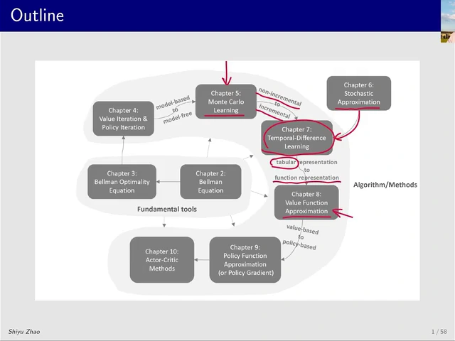

在 MC 之后介绍第二类 model-free 方法。TD 把第 6 课的随机近似用到贝尔曼方程。

### 第 02 页 · Introducing TD

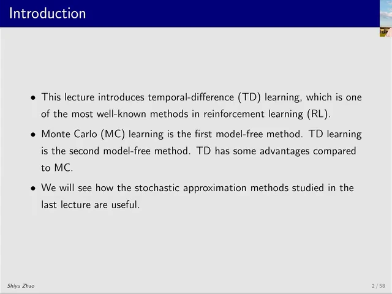

普通 TD 评价状态，Sarsa 评价动作，Q-learning 学最优动作价值。三者都能从经验更新。

### 第 03 页 · Lecture Outline

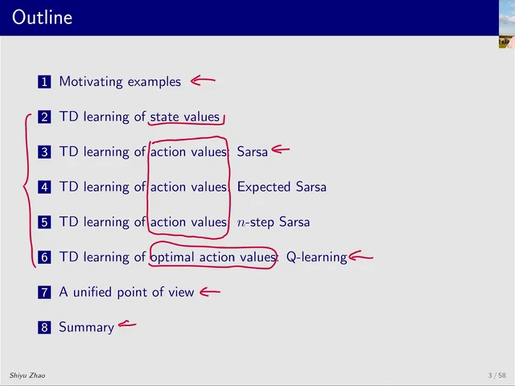

从随机均值递推导入，再依次讨论 TD、Sarsa 及其变体、Q-learning 和统一形式。

### 第 04 页 · Motivating Examples

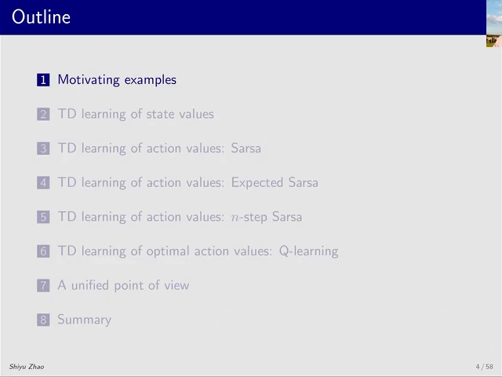

把随机目标从单个样本逐步扩展到奖励加折扣后的函数值。

### 第 05 页 · Estimate a Mean

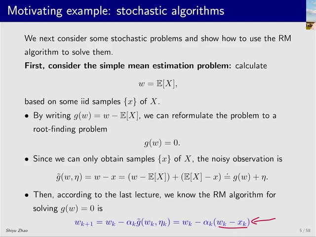

令 $g(w)=w-\mathbb E[X]$，用 $w-x_k$ 作观测，得到均值递推。

### 第 06 页 · Estimate a Function Mean

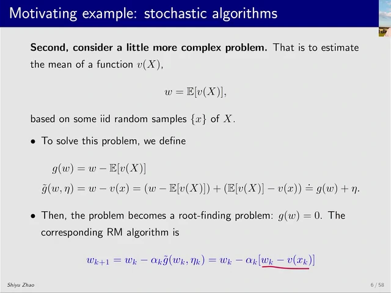

若目标为 $\mathbb E[v(X)]$，把观测换成 $v(x_k)$，仍可用相同的 RM 更新。

### 第 07 页 · Reward plus a Discounted Value

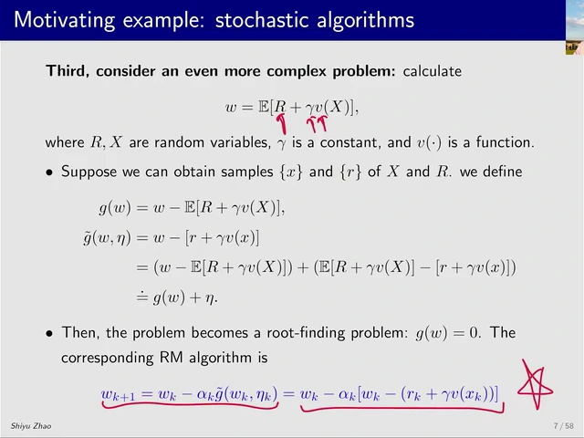

若目标为 $\mathbb E[R+\gamma v(X)]$，使用配对观测 $(r_k,x_k)$。这已经具有 TD target 的结构。

### 第 08 页 · Same Recursion

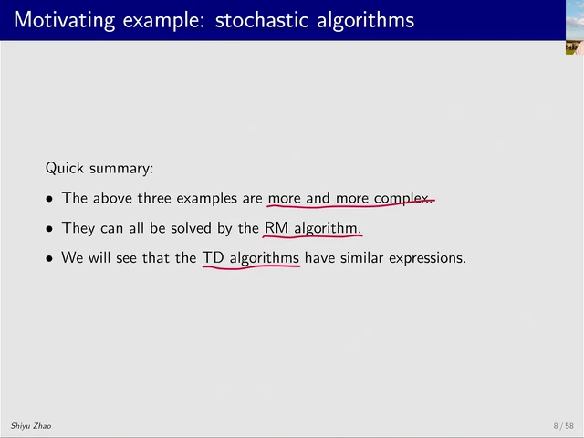

三个目标都写成旧估计加步长乘「样本目标减旧估计」。以后目标里的价值本身也会被更新。

## Part 2 · TD(0) · State-value Updates

### 第 09 页 · State-value TD

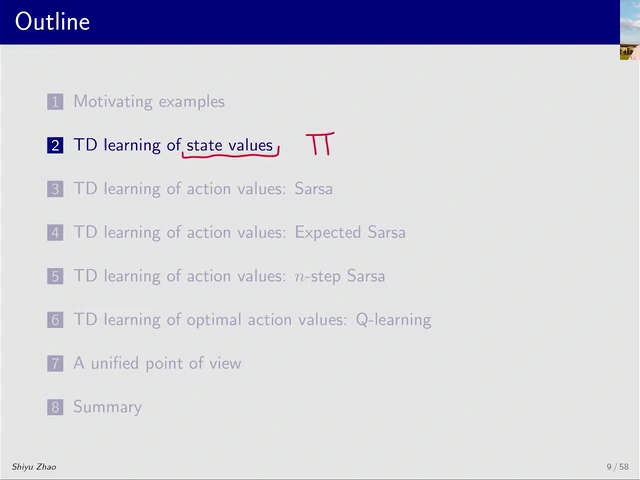

现在从单一标量改为每个状态有自己的估计。

### 第 10 页 · Two Meanings of TD

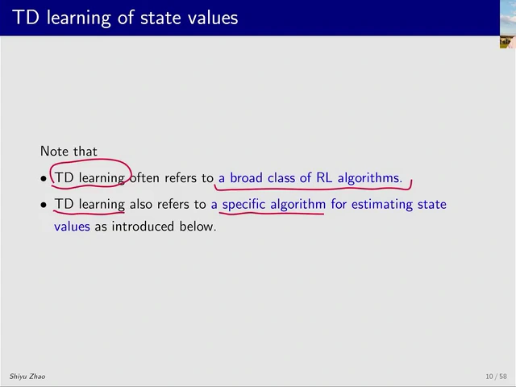

TD 可以指整个算法族，也可以专指固定策略下的一步状态价值更新。

### 第 11 页 · TD(0) Update

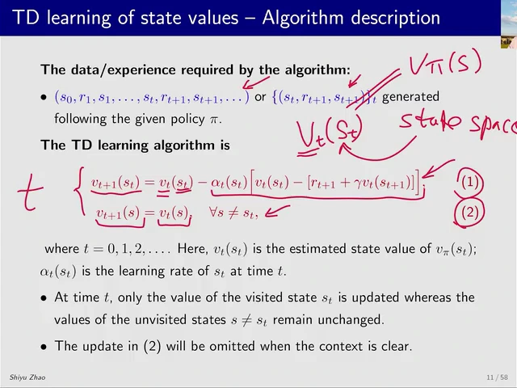

从策略 $\pi$ 生成 $(s_t,r_{t+1},s_{t+1})$，只把 $v(s_t)$ 向 $r_{t+1}+\gamma v(s_{t+1})$ 移动。其他状态本轮保持不变。

### 第 12 页 · TD Target & Error

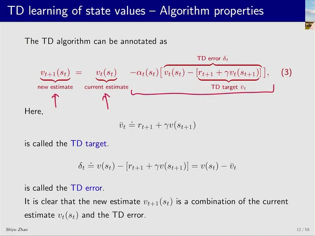

目标为 $\bar v_t=r_{t+1}+\gamma v_t(s_{t+1})$。课件用旧估计减目标作误差，再减去步长乘误差；也可用相反号的误差并做加法。

### 第 13 页 · Move toward the Target

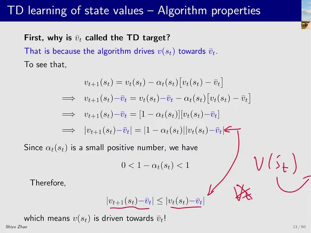

固定当前目标时，$v_{t+1}(s_t)-\bar v_t=(1-\alpha_t)[v_t(s_t)-\bar v_t]$。步长在 0 和 1 之间时，更新是二者的加权平均。

### 第 14 页 · Why Temporal Difference

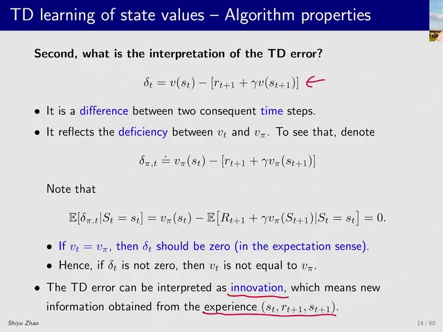

比较的是当前价值和下一时刻估值加上即时奖励。误差反映这次样本转移与当前贝尔曼预测之间的差距。

### 第 15 页 · Scope of TD(0)

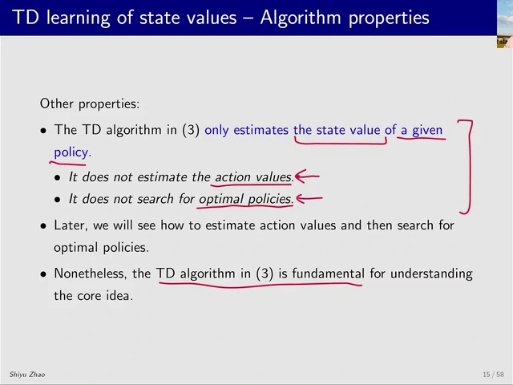

固定策略下，此处的输出是状态价值。策略搜索还要能比较不同首步动作。

## Part 3 · TD Convergence and Comparison with MC

### 第 16 页 · What Equation Is Solved?

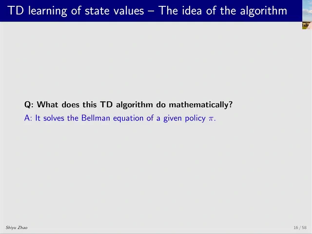

TD(0) 对固定策略的 Bellman expectation equation 做随机近似。

### 第 17 页 · Bellman Equation as an Expectation

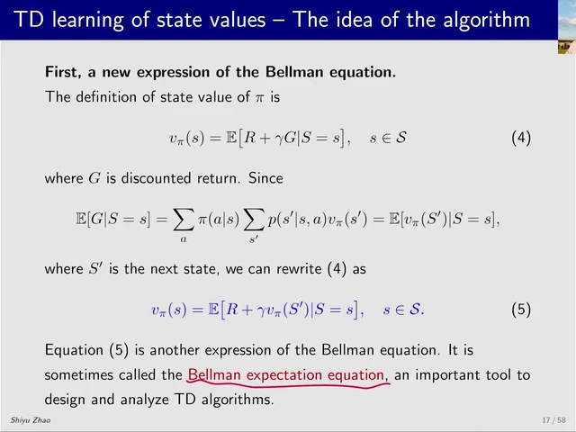

由回报分解以及给定下一状态后的马尔可夫性质，$v_\pi(s)=\mathbb E_\pi[R_{t+1}+\gamma v_\pi(S_{t+1})\mid S_t=s]$。

### 第 18 页 · Turn the Equation into a Root

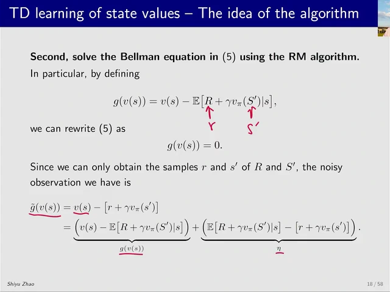

定义旧估计减真实贝尔曼目标的残差。单次转移可样本化期望，用 $r+\gamma v_\pi(s')$ 替代目标。

### 第 19 页 · An Intermediate Update

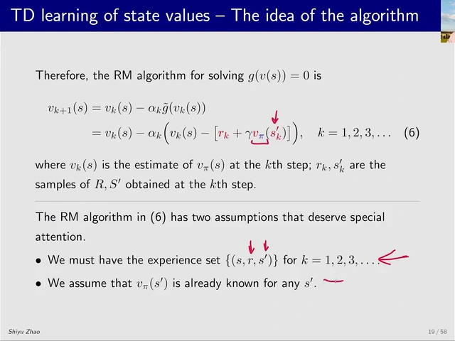

若能读取真实 $v_\pi(s')$，可直接用它形成无偏目标。实际中这个值正是未知量。

### 第 20 页 · Bootstrapped Implementation

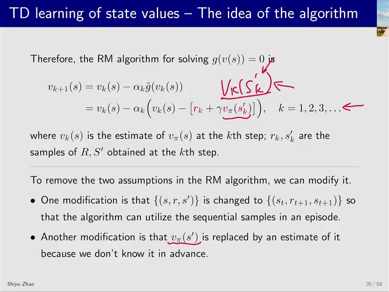

把未知 $v_\pi(s')$ 换成当前估计 $v_t(s')$ 得到 TD。单次只更新实际访问的状态，所以各状态需要持续获得数据。

### 第 21 页 · Convergence and Visits

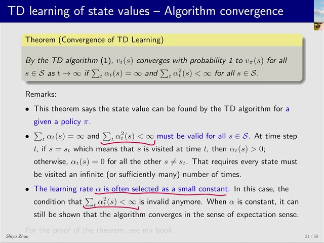

固定策略下逐状态要求 $\sum_t\alpha_t(s)=\infty$、$\sum_t\alpha_t(s)^2<\infty$，未访问时步长记 0。常数步长不满足同一个几乎必然收敛结论。

### 第 22 页 · TD versus MC · Timing

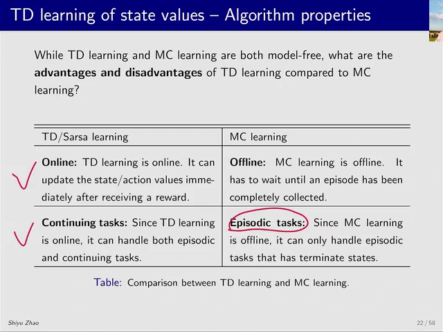

TD 获得一步转移就可更新，适用于持续任务。标准回合 MC 要等完整回报；持续任务若截断则有尾项误差。

### 第 23 页 · TD versus MC · Target

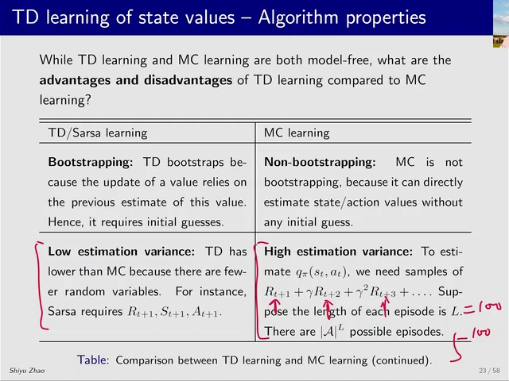

TD 使用已有估计（bootstrapping），短目标通常方差较小、可能有偏。MC 用完整实际回报，通常波动更大，但目标不依赖初始估值。老师还指出，按固定策略采样时完整回报的条件期望是真实价值；TD 的早期目标可能继承初始化偏差。

## Part 4 · Sarsa

### 第 24 页 · Sarsa Roadmap

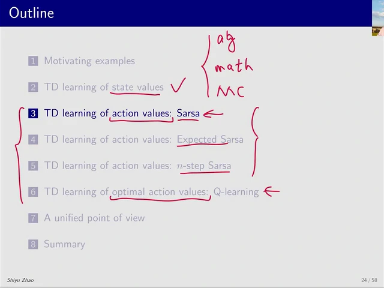

在状态价值递推的基础上，用状态动作对作为更新单位。

### 第 25 页 · From State Values to Action Values

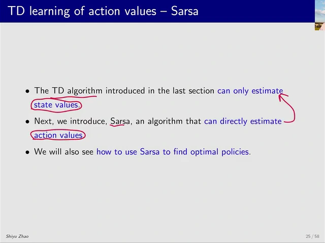

把价值表改成 $q(s,a)$ 后，可以依据不同首步的价值改进策略。

### 第 26 页 · Sarsa Update

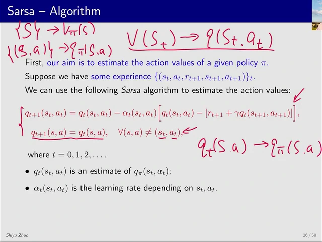

目标为 $r_{t+1}+\gamma q_t(s_{t+1},a_{t+1})$。下一动作从待评价策略采样，只更新 $(s_t,a_t)$。

### 第 27 页 · State–Action–Reward–State–Action

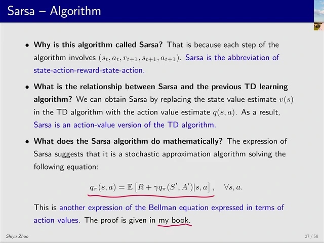

Sarsa 的名字来自更新用到的五元组。可把它理解为在状态动作对上套用一步 TD。

### 第 28 页 · Sarsa Evaluation Convergence

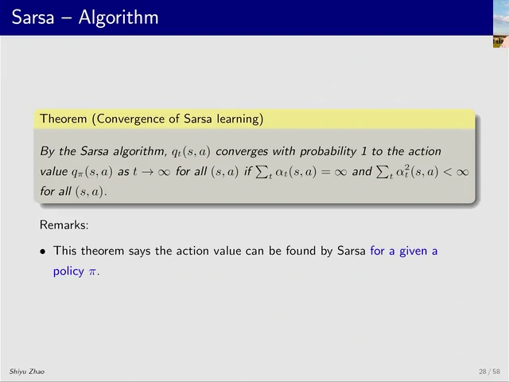

固定策略，若每个相关状态动作对持续访问且其局部步长满足随机近似条件，则动作价值收敛到 $q_\pi$。这条结论和控制过程的条件要分开。

### 第 29 页 · Sarsa Control Pseudocode

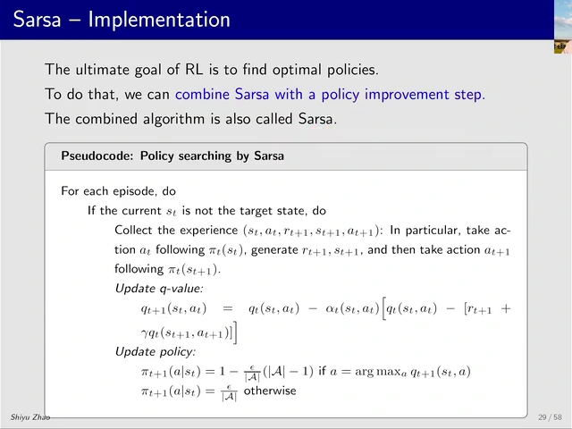

用当前 ε-greedy 策略采样下一动作，先更新当前动作价值，再在相应状态贪心改进并保留探索概率。若转移真正终止，目标只有即时奖励。

### 第 30 页 · Generalized Policy Iteration

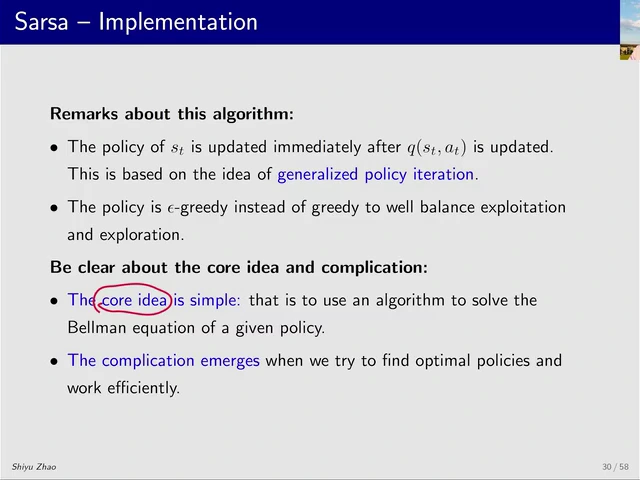

边评价边改进体现 GPI。软策略提供探索，训练时仅在已访问位置更新。固定正 ε 下评价的是含探索的实际行为。

### 第 31 页 · Sarsa Gridworld Task

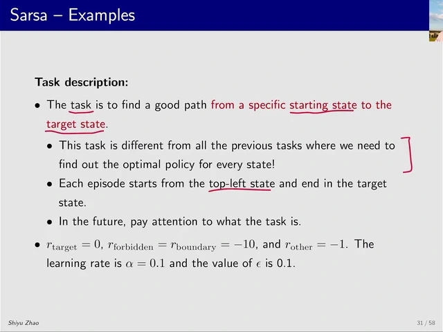

本例要求从指定起点找到目标，并非强制从每个状态覆盖全部动作。看回合时要区分终止规则与奖励规则。

### 第 32 页 · Read the Learning Curves

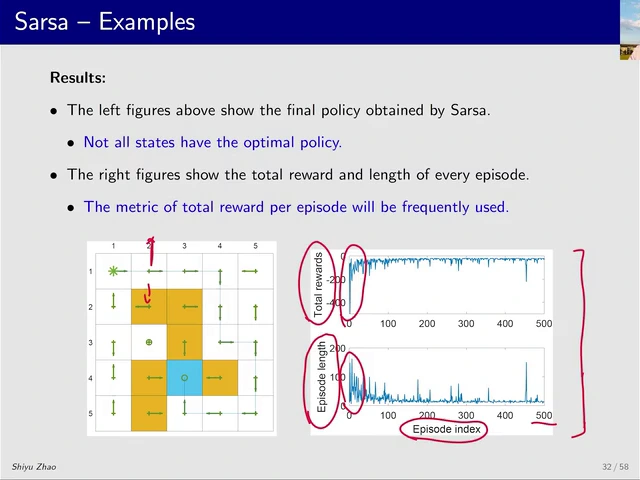

箭头描述已学策略；逐回合总奖励和长度描述训练过程。沿途动作可改善，少访区域未必学好。未折扣总奖励和折扣价值是不同指标。讲解中按回合追踪长度，从早期几百步降为几十步，表示从同一起点越来越快到达目标。

## Part 5 · Expected Sarsa and n-step Sarsa

### 第 33 页 · Expected Sarsa

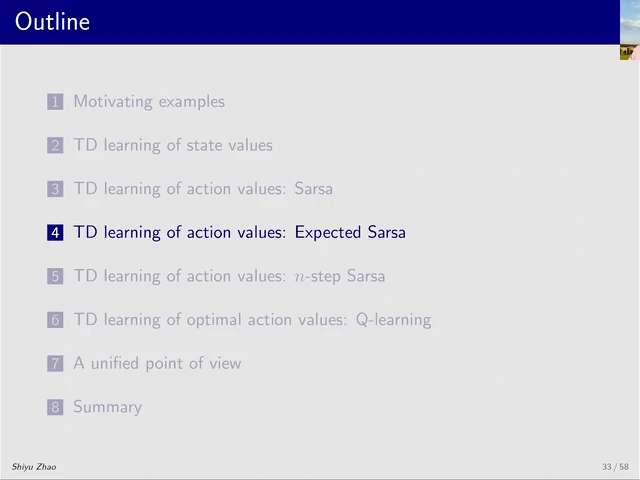

下一步从抽一个动作改为用当前策略的分布做平均。

### 第 34 页 · Expected Sarsa Update

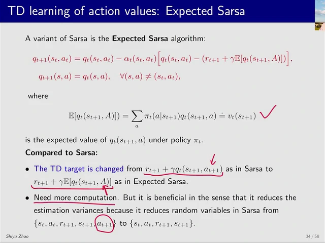

样本化 $r_{t+1},s_{t+1}$，把后续动作价值替换为 $\sum_a\pi_t(a\mid s_{t+1})q_t(s_{t+1},a)$，只更新当前对。

### 第 35 页 · What Gets Averaged?

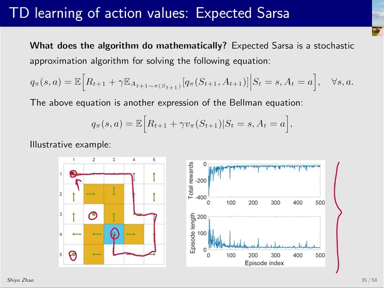

对下一动作使用全期望，得到同一个固定策略的贝尔曼目标。它消除了给定下一状态时的动作抽样波动，仍保留环境随机性。

### 第 36 页 · n-step Sarsa

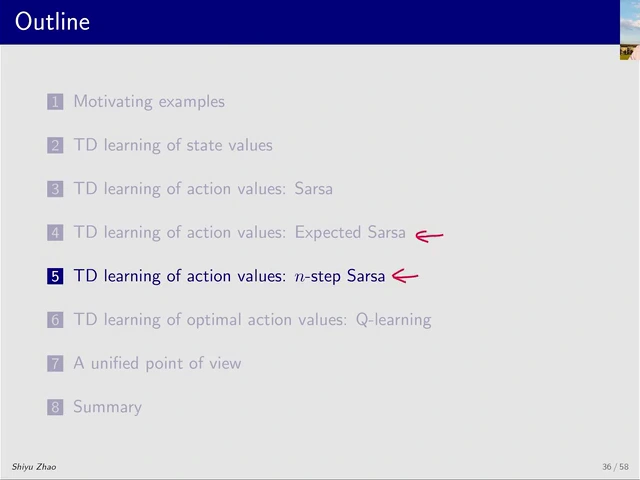

让目标吸收多步真实奖励，再用估计补尚未观察的后缀。

### 第 37 页 · Decompose the Return

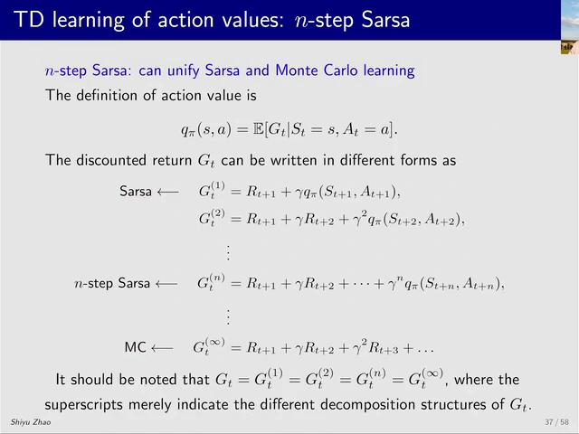

把回报拆成前 $n$ 笔奖励和 $\gamma^nG_{t+n}$；给定末端状态动作后，其后缀条件期望为相应的 $q_\pi$。

### 第 38 页 · Sarsa to Monte Carlo

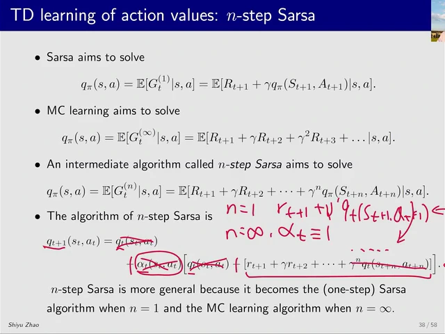

一步就是 Sarsa。若真实奖励已覆盖整个回合，bootstrap 项消失，目标就是 MC return。中间的 $n$ 在两者之间。

### 第 39 页 · Delayed Update

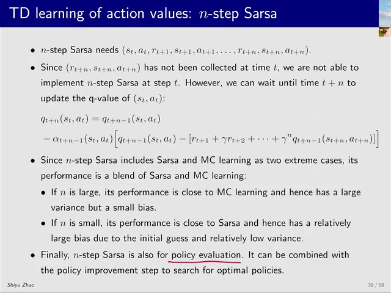

需要等到第 $n$ 步或回合提前终止才能更新原来的状态动作对。$n$ 较小更依赖当前估计，较大引入更多采样波动。

## Part 6 · Q-learning and Off-policy Learning

### 第 40 页 · Q-learning Roadmap

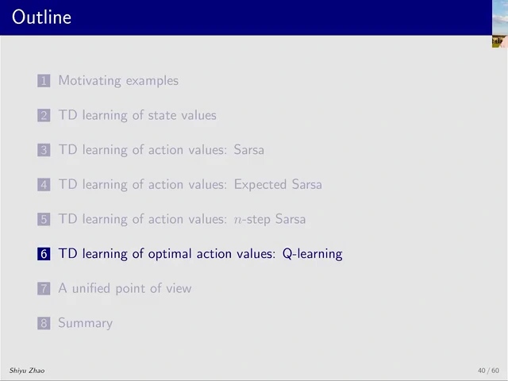

从评价给定策略切换到直接解最优方程。

### 第 41 页 · Optimal Action Values

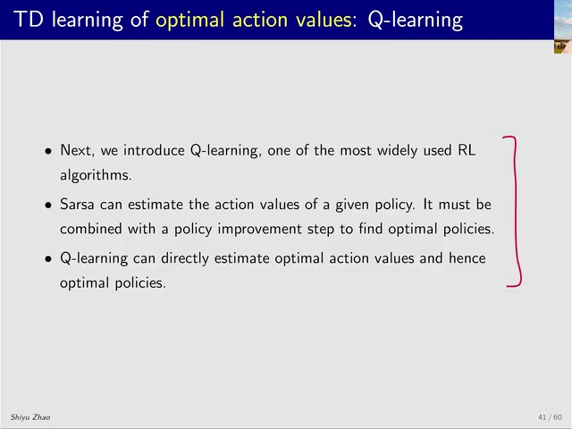

Sarsa 的下一动作由策略选。Q-learning 将这部分目标换成下一状态所有动作值的最大值。

### 第 42 页 · Q-learning Update

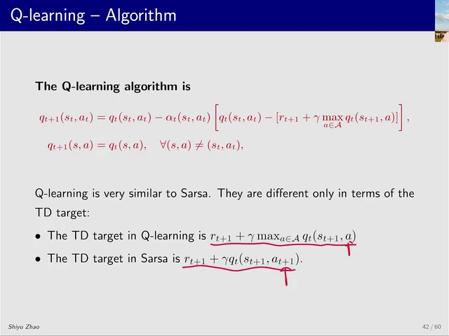

目标 $r_{t+1}+\gamma\max_a q_t(s_{t+1},a)$。实际下一步采取什么动作不进入这个目标。

### 第 43 页 · Bellman Optimality Equation for Q

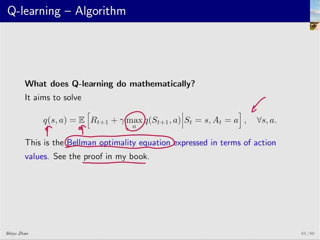

$q^*(s,a)=\mathbb E[R_{t+1}+\gamma\max_b q^*(S_{t+1},b)\mid s,a]$。Q-learning 用样本近似右端、用当前估计自举。

### 第 44 页 · Behavior and Target Policies

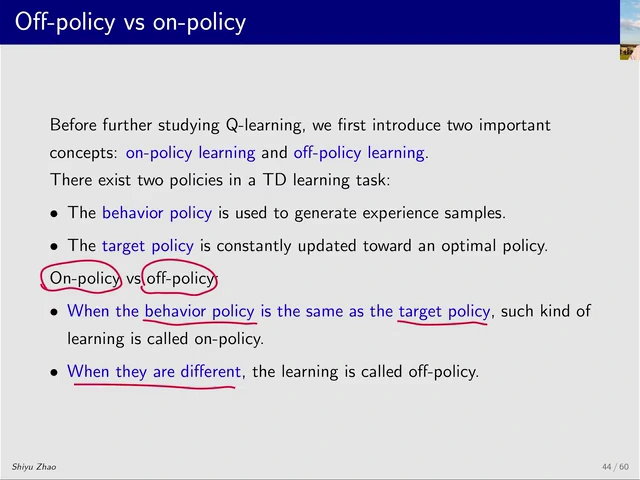

Behavior policy 产生数据，target policy 定义要学习的策略。两者相同是 on-policy，可以不同时是 off-policy。

### 第 45 页 · Why Off-policy Learning?

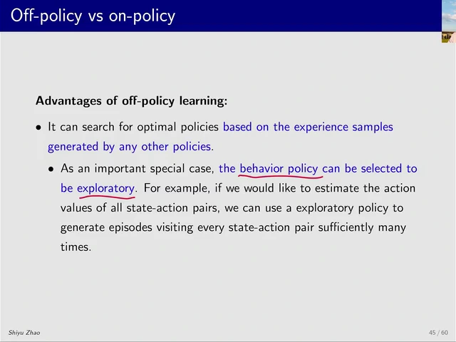

采样可以采用更具探索性的策略，目标仍可贪心。任意行为数据只有在所需对充分覆盖等条件下才足够。

### 第 46 页 · How to Classify an Algorithm?

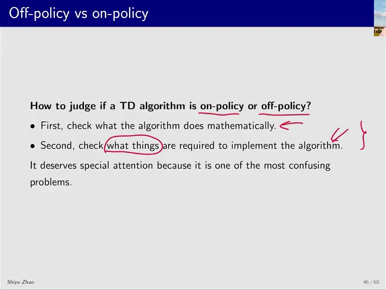

先辨认它求哪个方程，再看实际目标需要从哪套策略取得下一动作或回报。

### 第 47 页 · Sarsa Is On-policy

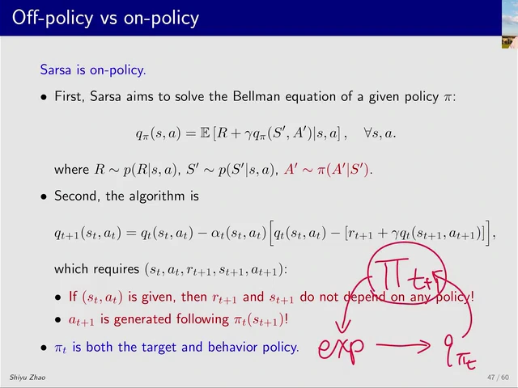

下一动作要从被评价的同一策略抽，实际数据和 Bellman expectation equation 中的动作分布一致。

### 第 48 页 · Monte Carlo in This Lecture

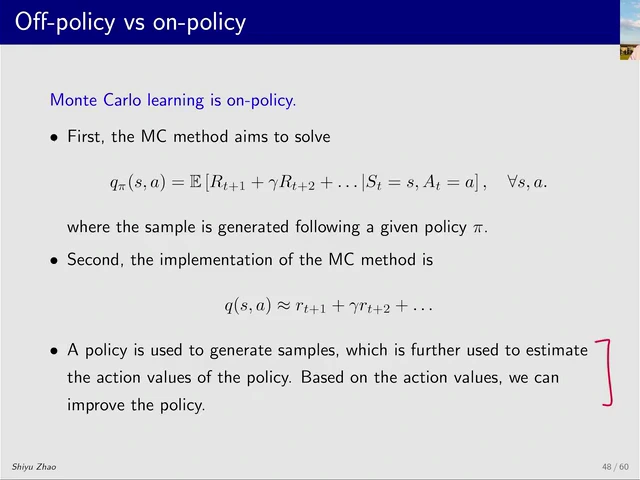

课上的普通回报平均沿生成轨迹的策略评价它。若用别的策略的数据评价目标策略，需要额外处理分布差异。

### 第 49 页 · Q-learning Is Off-policy

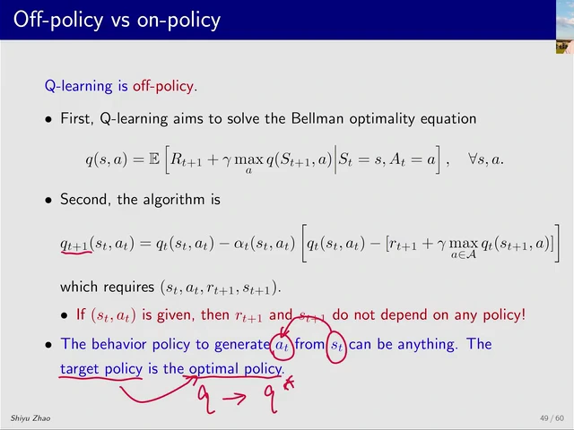

目标最大值与下一步由行为策略采到哪个动作无关。给定当前对，环境产生的奖励和落点仍可用于最优更新。

## Part 7 · Q-learning · Pseudocode and Experiments

### 第 50 页 · Online Behavior Update Pseudocode

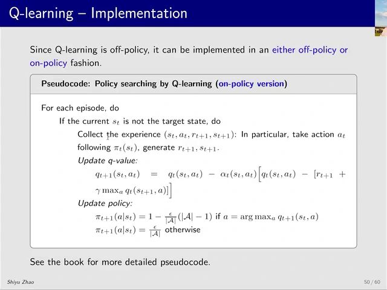

课件的 on-policy version 指边采样边更新用于采样的 ε-greedy 策略。Q 的 TD target 仍取最大值，所以学习目标与行为可以不同。

### 第 51 页 · Separate Behavior and Target Pseudocode

用独立行为策略生成轨迹，逐步更新 Q 并提取贪心目标策略。行为策略无需在更新后一起改变。

### 第 52 页 · Q-learning Gridworld Task

这里要估计各状态的最优行为。课件的越界及禁区扣 1，目标加 1，折扣取 0.9。能否学全依赖访问。

### 第 53 页 · Read an Off-policy Experiment

均匀行为策略对五个动作各给 0.2 的概率。比较行为箭头、一次长轨迹与学到的贪心策略。曲线的纵轴是当前贪心策略的状态价值与已知最优价值之差的范数。原页标的是 $10^5$ 步，口头讲解说到一百万步。此处的要点是长轨迹需要充分覆盖状态动作对。

### 第 54 页 · Exploration Changes Coverage

同样长的轨迹，探索不足可能只覆盖一小部分状态动作对。样本条数不能替代覆盖。

### 第 55 页 · Compare Different Behavior Policies

即使探索率相同，起点和行为策略的主要方向也会改变到访分布，因此估计误差可能不同。

## Part 8 · Unified TD Targets and Summary

### 第 56 页 · Unified View Roadmap

把各算法写成同一个递推，通过 target 区分。

### 第 57 页 · Unified TD Targets

统一形式是 $q\leftarrow q+\alpha(\text{target}-q)$。一步采样、策略平均、多步奖励、最大值和完整回报分别对应五种目标。MC 平均要对样本做平均；步长 1 只写入本次样本。

### 第 58 页 · Compare the Equations

固定策略的 Sarsa 家族与普通 MC 对应期望方程，Q-learning 对应最优方程。第 58 页 Q-learning 一栏漏写的 $\gamma$ 应补在后续最大值之前。

### 第 59 页 · Review the Connections

先按是否自举、是否等待终止区分 TD 与 MC，再按下一动作的处理区分 TD 家族。

### 第 60 页 · Summary（课件补充）

掌握更新目标、采样时机、更新对象和所解方程，便能把 TD、Sarsa 各变体、Q-learning 与 MC 放在同一框架中。下一课会把表格价值换成函数近似。
