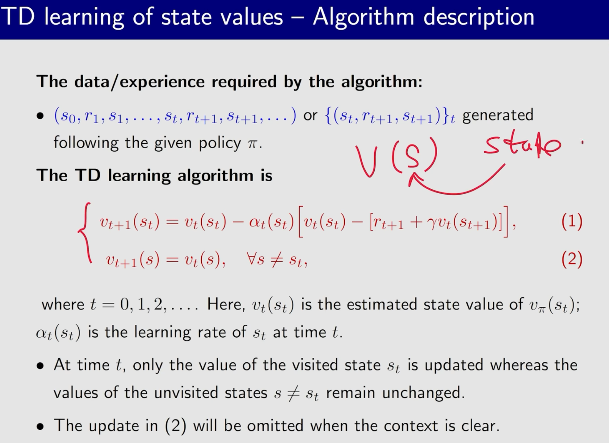
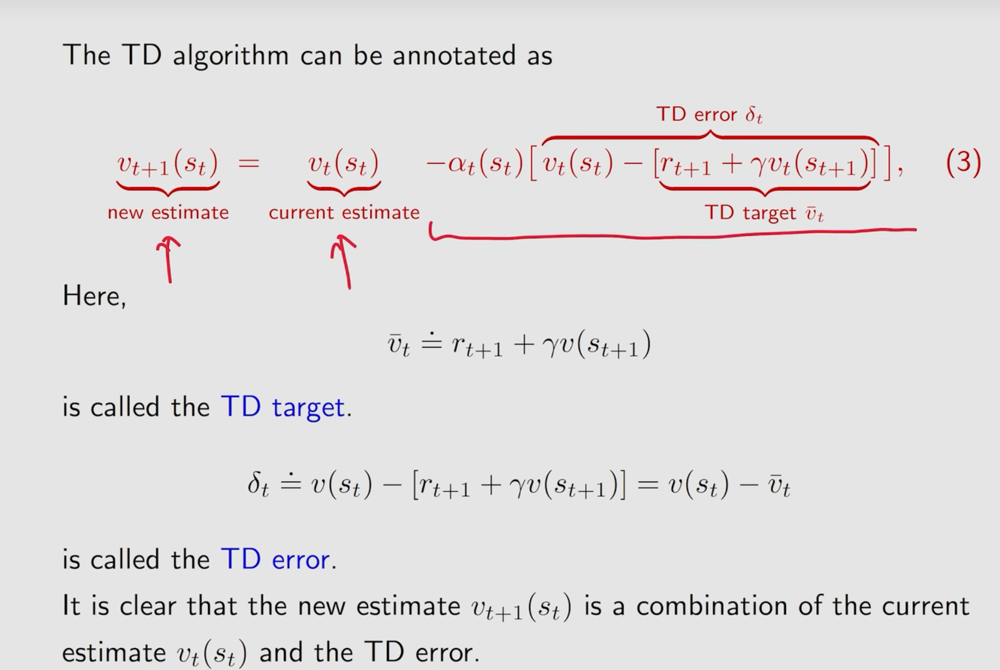
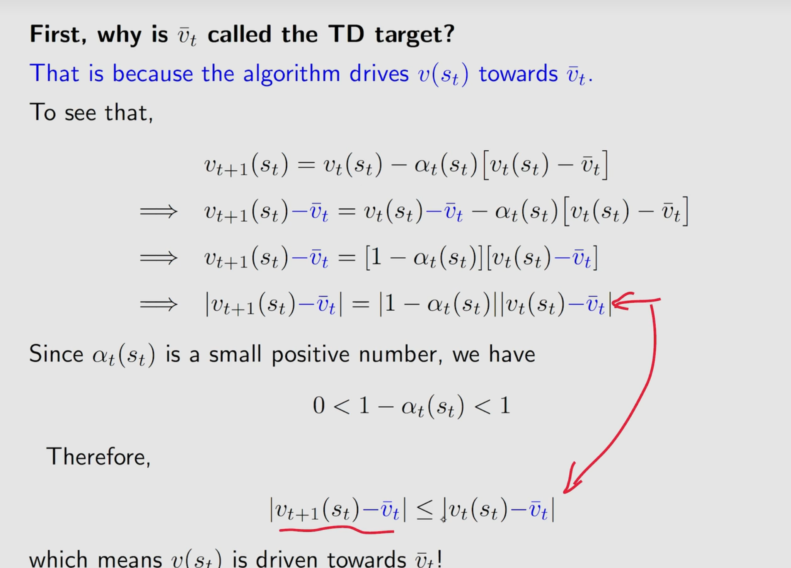
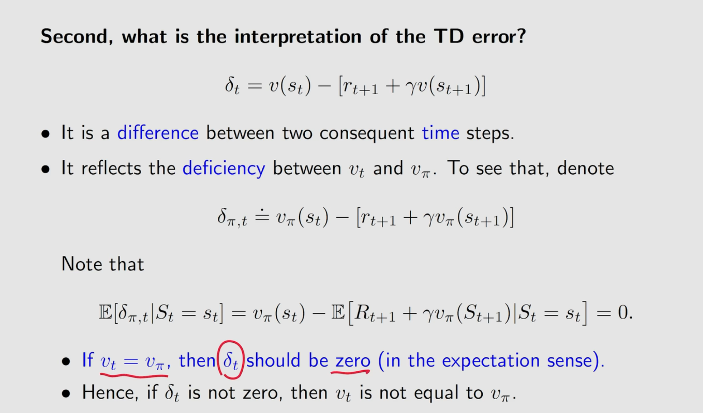
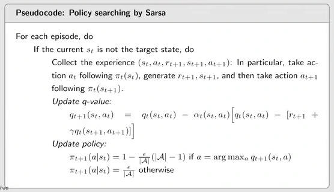
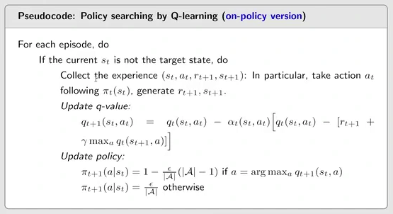

# 第 7 课 · 时序差分方法 · V2（总结）

[切换到 V1（逐页）](temporal-difference-slides.md)

## 1. TD(0) · State-value Prediction

#### （1）Algorithm Description

<figure>
  
</figure>

#### （2）TD Target and TD Error

<figure>
  
</figure>

#### （3）Why It Is Called the TD Target

<figure>
  
</figure>

#### （4）Interpretation of the TD Error

<figure>
  
</figure>

第（4）页末句的「非零」指**给定当前状态时的条件期望**。即使估值等于真实价值，单次转移的 TD error 也可能非零。

### Bellman Equation & Robbins–Monro

记 $[T_\pi v](s)=\mathbb E_\pi[R_{t+1}+\gamma v(S_{t+1})\mid S_t=s]$。要求的根是 $v-T_\pi v=0$。给定当前价值表及当前状态后，一次转移产生的 $\delta_t$ 是残差 $v_t(s_t)-[T_\pi v_t](s_t)$ 的随机观测。TD(0) 将这个样本残差用于 Robbins–Monro 更新，在每次访问时解相应状态的方程。

表格型、有限、折扣且固定策略时，在各状态充分访问和满足标准噪声条件下，常用局部步长条件为 $\sum_t\alpha_t(s)=\infty$、$\sum_t\alpha_t(s)^2<\infty$。未访问该状态时记 $\alpha_t(s)=0$。这给出几乎必然收敛。常数步长适合持续更新，但不能由该定理推出样本路径收敛。

### TD vs. Monte Carlo

#### （1）Online Updates and Task Types

<figure>
  
</figure>

#### （2）Bootstrapping and Estimation Variance

<figure>
  
</figure>

## 2. Sarsa · Action-value Learning

观测五元组 $(S_t,A_t,R_{t+1},S_{t+1},A_{t+1})$。固定策略时，下一动作按同一策略抽取：

$$
\begin{aligned}
Y_t &= R_{t+1}+\gamma Q_t(S_{t+1},A_{t+1}),\\
Q_{t+1}(S_t,A_t)&=Q_t(S_t,A_t)
+\alpha_t\bigl[Y_t-Q_t(S_t,A_t)\bigr].
\end{aligned}
$$

其他表项本轮不变。期望目标来自 $q_\pi$ 的贝尔曼方程。固定策略评价的收敛要求逐状态动作对的覆盖与适当步长。用于 control 时，按同一 $\varepsilon$-greedy 策略采样和评价，并更新它，属于 on-policy 的广义策略迭代。固定正探索率评价的是含探索的策略。

### Sarsa · 原课件伪代码

<figure>
  
</figure>

## 3. Expected Sarsa & n-step Sarsa

<strong>Expected Sarsa</strong> 对下一动作求条件期望，环境仍用样本：

$$
Y_t=R_{t+1}+\gamma\sum_a
 \pi_t(a\mid S_{t+1})Q_t(S_{t+1},a).
$$

对给定的下一状态，这一步消除抽取单个动作带来的方差，代价是求和所需的动作值与概率。

<strong>n-step Sarsa</strong> 用前 $n$ 步真实奖励，再用价值估计补后缀：

$$
\begin{aligned}
G^{(n)}_t
&=\sum_{j=0}^{n-1}\gamma^jR_{t+j+1}\\
&\quad+\gamma^n Q(S_{t+n},A_{t+n}).
\end{aligned}
$$

从 $t$ 开始的更新必须等到第 $n$ 步信息就绪，或等回合提前结束。提前结束时只累计到末笔奖励，去掉自举项。$n=1$ 恢复 Sarsa，覆盖整个回合则得到 MC target。增加 $n$ 通常减少对当前估计的依赖，同时纳入更多采样随机性。

## 4. Q-learning · Learning Optimal Action Values

用下一状态的最大动作值替换 Sarsa 的下一动作样本：

$$
\begin{aligned}
Y_t &= R_{t+1}+\gamma\max_b Q_t(S_{t+1},b),\\
q^*(s,a)&=\mathbb E[R_{t+1}
+\gamma\max_b q^*(S_{t+1},b)\mid s,a].
\end{aligned}
$$

第一行是一次样本更新的目标，第二行是要解的 Bellman optimality equation。课件第 58 页汇总表的 Q-learning 一栏漏写了折扣因子，按第 43 页及更新式补上 $\gamma$。

| Policy | Role |
| --- | --- |
| Behavior policy | 生成经历，可保留探索概率 |
| Target policy | 决定更新的学习目标。Q-learning 用当前 Q 的贪心动作 |

Sarsa 使用行为策略抽出的 $A_{t+1}$ 评价同一策略。Q-learning 的最大值与实际执行的下一动作无关，属于 off-policy 更新。课件称第 50 页为 on-policy version，指边采样边更新用于生成经验的策略。该实现里的 Q 更新目标仍取最大值。第 51 页则直接使用独立行为策略已有的数据。无论使用哪种数据来源，仍需充分访问相关状态动作对。

课件的探索实验在比较数据覆盖。均匀探索生成的轨迹能覆盖更多状态动作对。若行为策略长期偏向少数动作，延长轨迹也可能只增加已常见的访问，稀少表项仍难学好。图中的纵轴比较训练中提取的贪心策略价值与已知最优价值的差距。

### Q-learning · 原课件两种实现

<figure>
  
</figure>

<figure>
  
</figure>

## 5. Unified TD Targets

所有动作值更新都可写成 $Q\leftarrow Q+\alpha(Y-Q)$，区别集中在目标 $Y$。

| Algorithm | Target $Y$ | Equation |
| --- | --- | --- |
| Sarsa | $R_{t+1}+\gamma Q(S_{t+1},A_{t+1})$ | 给定策略的 BE |
| Expected Sarsa | $R_{t+1}+\gamma\sum_a\pi(a\mid S_{t+1})Q(S_{t+1},a)$ | 给定策略的 BE |
| n-step Sarsa | $G^{(n)}_t$ | 给定策略的多步 BE |
| Q-learning | $R_{t+1}+\gamma\max_a Q(S_{t+1},a)$ | BOE |
| Monte Carlo | $G_t$ | 给定策略的完整回报期望 |

MC 的等权样本均值对应第 $N$ 次访问使用 $\alpha=1/N$。课件把 $\alpha=1$ 写作直接放入单次回报，这只是统一更新式中的单样本情形。
