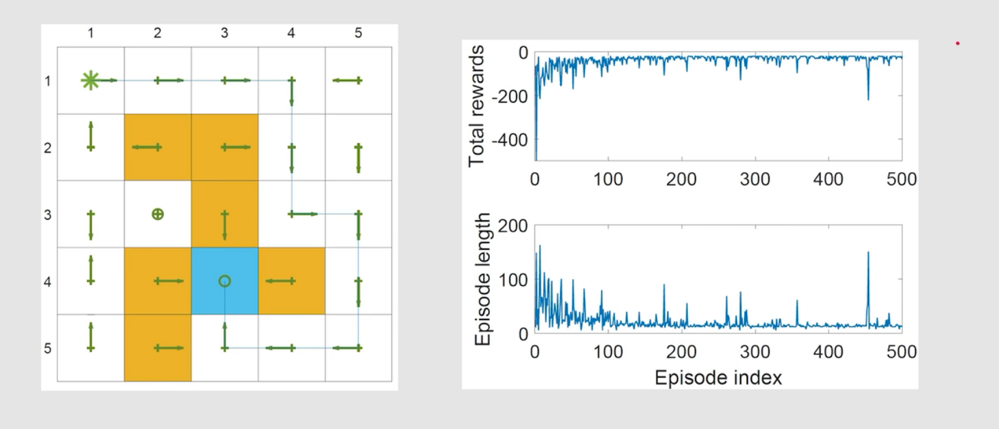

# 第 7 课 · 时序差分方法 · V2（总结）

[切换到 V1（逐页）](temporal-difference-slides.md)

## 1. 时序差分（Temporal-Difference，TD）· State-value Prediction

#### （1）算法描述

TD 状态价值学习 · 算法描述

**算法所需的经验**

- 按给定策略 $\pi$ 生成轨迹（trajectory）$(s_0,r_1,s_1,\ldots,s_t,r_{t+1},s_{t+1},\ldots)$，也可写作经验三元组 $\{(s_t,r_{t+1},s_{t+1})\}_t$。

**TD 更新公式**

$$
\begin{cases}
v_{t+1}(s_t)=v_t(s_t)-\alpha_t(s_t)\bigl[v_t(s_t)-[r_{t+1}+\gamma v_t(s_{t+1})]\bigr], & (1)\\
v_{t+1}(s)=v_t(s),\quad \forall s\ne s_t, & (2)
\end{cases}
$$

其中 $t=0,1,2,\ldots$。$v_t(s_t)$ 是对状态价值（state value）$v_\pi(s_t)$ 的当前估计，$\alpha_t(s_t)$ 是状态 $s_t$ 在第 $t$ 步的学习率（learning rate）。

- 第 $t$ 步只更新当前访问的状态 $s_t$，其他状态按式（2）处理。
- 下文可省略式（2）。

#### （2）TD target 与 TD error

给更新公式的各项加上标注。

$$
\underbrace{v_{t+1}(s_t)}_{\text{new estimate}}
=\underbrace{v_t(s_t)}_{\text{current estimate}}
-\alpha_t(s_t)\left[
\overbrace{v_t(s_t)-\bigl[\underbrace{r_{t+1}+\gamma v_t(s_{t+1})}_{\text{TD target }\bar v_t}\bigr]}^{\text{TD error }\delta_t}
\right].\qquad (3)
$$

<strong class="td-slide-emphasis">TD target（目标值）</strong>

$$
\bar v_t\mathrel{\dot{=}}r_{t+1}+\gamma v_t(s_{t+1})
$$

<strong class="td-slide-emphasis">TD error（时序差分误差）</strong>

$$
\delta_t\mathrel{\dot{=}}v_t(s_t)-[r_{t+1}+\gamma v_t(s_{t+1})]
=v_t(s_t)-\bar v_t
$$

新估计等于当前估计减去学习率乘以 TD error。

#### （3）为什么称为 TD target

每次更新都会把当前状态的估计推向本轮目标。

更新式两边减去 $\bar v_t$，再提取公因子。

$$
\begin{aligned}
v_{t+1}(s_t)
&=v_t(s_t)-\alpha_t(s_t)[v_t(s_t)-\bar v_t]\\[3pt]
v_{t+1}(s_t)-\bar v_t
&=v_t(s_t)-\bar v_t-\alpha_t(s_t)[v_t(s_t)-\bar v_t]\\[3pt]
&=[1-\alpha_t(s_t)][v_t(s_t)-\bar v_t]\\[3pt]
\bigl|v_{t+1}(s_t)-\bar v_t\bigr|
&=\bigl|1-\alpha_t(s_t)\bigr|\bigl|v_t(s_t)-\bar v_t\bigr|.
\end{aligned}
$$

当学习率满足 $0<\alpha_t(s_t)<1$ 时，

$$
0<1-\alpha_t(s_t)<1.
$$

于是，新估计与本轮目标的距离缩小。

$$
|v_{t+1}(s_t)-\bar v_t|\le |v_t(s_t)-\bar v_t|.
$$

#### （4）TD error 的含义

$$
\delta_t=v_t(s_t)-[r_{t+1}+\gamma v_t(s_{t+1})].
$$

- 它比较**相邻两个时刻**对同一段回报的估计。下一时刻的估值要先折扣，再加上这一步的奖励。
- 它反映当前估计 $v_t$ 与真实价值 $v_\pi$ 的差距。把当前估计换成真实价值，记作

$$
\delta_{\pi,t}\mathrel{\dot{=}}v_\pi(s_t)-[r_{t+1}+\gamma v_\pi(s_{t+1})].
$$

由贝尔曼期望方程（Bellman expectation equation），

$$
\begin{aligned}
\mathbb E_\pi[\delta_{\pi,t}\mid S_t=s_t]
&=v_\pi(s_t)-\mathbb E_\pi[R_{t+1}+\gamma v_\pi(S_{t+1})\mid S_t=s_t]\\
&=0.
\end{aligned}
$$

- 若 $v_t=v_\pi$，则给定当前价值表和状态，**TD error 的条件期望**为零。
- 若这个条件期望非零，则 $v_t$ 与 $v_\pi$ 有差距。即使价值表准确，单次转移仍可能产生非零误差。

## 2. TD 算法的收敛性、与 MC 的比较

### Bellman Equation 与 TD 更新

#### （1）TD 在求解什么

TD 求解给定策略 $\pi$ 的贝尔曼方程，得到各状态的价值 $v_\pi$。

#### （2）从回报定义写出状态价值

令 $S$ 为当前状态、$R$ 为下一笔奖励（reward）、$G$ 为下一状态起算的后续回报（return），$\gamma$ 为折扣因子（discount factor）。策略 $\pi$ 的状态价值为

$$
v_\pi(s)=\mathbb E[R+\gamma G\mid S=s],
\qquad s\in\mathcal S. \qquad (4)
$$

#### （3）用下一状态的价值改写

令 $S'$ 为下一状态。给定 $S'$ 后，后续回报的条件期望为 $v_\pi(S')$，所以式（4）可写成

$$
v_\pi(s)=\mathbb E[R+\gamma v_\pi(S')\mid S=s],
\qquad s\in\mathcal S. \qquad (5)
$$

#### （4）把贝尔曼方程写成求根问题

对固定状态 $s$，定义贝尔曼残差（Bellman residual）

$$
g(v(s))=v(s)-\mathbb E[R+\gamma v_\pi(S')\mid S=s].
$$

式（5）等价于 $g(v(s))=0$，可用 Robbins–Monro（RM）算法求根。

#### （5）把样本残差拆成真残差与噪声

从状态 $s$ 按策略 $\pi$ 采样一次，得到奖励 $r$ 和下一状态 $s'$。用它们代替期望，再加减同一个期望项。

$$
\begin{aligned}
\tilde g(v(s))&=v(s)-[r+\gamma v_\pi(s')]\\
&=\underbrace{v(s)-\mathbb E[R+\gamma v_\pi(S')\mid S=s]}_{g(v(s))}\\
&\quad+\underbrace{\mathbb E[R+\gamma v_\pi(S')\mid S=s]-[r+\gamma v_\pi(s')]}_{\eta}.
\end{aligned}
$$

噪声 $\eta$ 是期望目标与样本目标之差。给定 $s$，其条件期望为零。

#### （6）写出 RM 更新

$$
\begin{aligned}
v_{k+1}(s)
&=v_k(s)-\alpha_k\tilde g(v_k(s))\\
&=v_k(s)-\alpha_k\bigl(v_k(s)-[r_k+\gamma v_\pi(s_k')]\bigr),
\qquad (6)
\end{aligned}
$$

其中 $k=1,2,3,\ldots$。$v_k(s)$ 是第 $k$ 步对 $v_\pi(s)$ 的估计，$r_k,s_k'$ 是该步对 $R,S'$ 的采样结果。

#### （7）式（6）的两个假设

- 求固定状态 $s$ 的价值时，每一步 $k$ 都要拿到从同一状态 $s$ 出发的经验 $(s,r_k,s_k')$。
- 任意下一状态 $s'$ 的真实价值 $v_\pi(s')$ 都已知。

#### （8）改成实际可用的 TD 更新

- **直接用轨迹上的顺序样本。** 将固定 $s$ 的经验改为 $\{(s_t,r_{t+1},s_{t+1})\}_t$，每步更新当下访问的状态 $s_t$。
- **Bootstrapping（自举）。** 真实价值 $v_\pi(s_{t+1})$ 未知，用 $v_t(s_{t+1})$ 代入式（6），就得到第一节的 TD 更新式（1）。

### 收敛定理

#### （9）逐状态的学习率条件

定理 · TD 学习的收敛性

在有限状态的表格型（tabular）折扣任务中，固定策略 $\pi$，并假设奖励有界。若对每个待估计的状态 $s$ 都有

$$
\sum_t\alpha_t(s)=\infty,
\qquad
\sum_t\alpha_t(s)^2<\infty,
$$

则当 $t\to\infty$ 时，式（1）给出的 $v_t(s)$ 几乎必然（almost surely，即以概率 $1$）收敛到 $v_\pi(s)$。

**说明**

- 收敛目标是**给定策略 $\pi$ 的状态价值**。
- 两个条件要逐状态检查。第 $t$ 步仅对 $s=s_t$ 取 $\alpha_t(s)>0$，其余状态的步长为零。要让一个状态的步长之和发散，就必须无限次访问该状态。
- 实践中常用较小的常数步长（constant step size）。持续访问时，固定正步长的平方和发散。课件指出，在适当条件下仍可**依期望收敛（convergence in expectation）**。上面的几乎必然收敛定理要求平方和有限。

### 与蒙特卡洛（Monte Carlo，MC）的比较

#### （10）更新时机与适用任务

TD 状态价值学习 · 算法性质

TD 和 MC 都是 **model-free（无模型）**方法。

| TD / Sarsa 学习 | MC 学习 |
| --- | --- |
| **Online。** 观察到一步奖励和下一状态即可更新状态价值。Sarsa 再采样下一动作，即可更新动作价值。 | **Offline（本表指回合结束后更新）。** 标准回合式 MC 等完整回合收齐，再用实际回报更新。 |
| **Episodic tasks 与 continuing tasks。** 有终止回合或持续运行的任务都可逐步更新。 | **Episodic tasks。** 标准回合式 MC 需要到达终止状态（terminal state），才能得到完整回报。 |

TD 与 MC 的比较

#### （11）Bootstrapping 与估计方差

TD 状态价值学习 · 算法性质

| TD / Sarsa 学习 | MC 学习 |
| --- | --- |
| **Bootstrapping。** 目标用到已有的价值估计，因此需要为价值表设初值。 | **Non-bootstrapping。** 用实际回报估计状态或动作价值，目标与价值表初值无关。 |
| **Lower estimation variance。** 一步目标用到的随机量较少，估计方差通常较低。例如 Sarsa 使用 $R_{t+1}$、$S_{t+1}$ 和 $A_{t+1}$。 | **Higher estimation variance。** 估计 $q_\pi(s_t,a_t)$ 要采样完整折扣回报（discounted return）$R_{t+1}+\gamma R_{t+2}$ $+\gamma^2R_{t+3}+\cdots$。长度为 $L$ 的回合，每步有 $\lvert\mathcal A\rvert$ 个动作时，单是动作序列就可有 $\lvert\mathcal A\rvert^L$ 种。 |

TD 与 MC 的比较（续）

在固定策略下，完整 MC 回报是价值的无偏估计（unbiased estimate）。TD target 依赖当前估计，可能带有偏差（bias），偏差来自下一状态的估值误差。

## 3. Sarsa · Action-value Learning

#### （1）从 State Values 到 Action Values

- 前两节的 TD 算法估计的是 **state value** $v_\pi(s)$。
- Sarsa 直接估计 **action value** $q_\pi(s,a)$，可以比较同一状态下不同动作的价值。
- 将 Sarsa 与 **policy improvement** 结合，就可以搜索最优策略（optimal policy）。

#### （2）Sarsa 更新公式

Sarsa · 算法

给定固定策略 $\pi$，用经验 $\{(s_t,a_t,r_{t+1},s_{t+1},a_{t+1})\}_t$ 估计 $q_\pi$。下一动作 $a_{t+1}$ 从同一策略 $\pi(\cdot\mid s_{t+1})$ 采样。

$$
\begin{aligned}
q_{t+1}(s_t,a_t)
&=q_t(s_t,a_t)-\alpha_t(s_t,a_t)\\
&\quad\times\bigl[q_t(s_t,a_t)
 -[r_{t+1}+\gamma q_t(s_{t+1},a_{t+1})]\bigr],\\[3pt]
q_{t+1}(s,a)&=q_t(s,a),\quad (s,a)\ne(s_t,a_t).
\end{aligned}
$$

其中 $t=0,1,2,\ldots$。

- $q_t(s_t,a_t)$ 是 $q_\pi(s_t,a_t)$ 的当前估计。
- $\alpha_t(s_t,a_t)$ 是当前 **state–action pair** 的学习率（learning rate）。

#### （3）Sarsa 与 TD 的关系

- **为什么叫 Sarsa？** 每一步用到的五元组依次是 **State–Action–Reward–State–Action**。
- **它与 TD 有什么关系？** 把 TD 更新中的状态价值 $v(s)$ 换成动作价值 $q(s,a)$，并输入实际采样的下一动作，就得到 Sarsa。
- **它在求解什么？** Sarsa 用随机近似（stochastic approximation）求解动作价值形式的 **Bellman expectation equation**。

$$
q_\pi(s,a)=\mathbb E_\pi\bigl[R+\gamma q_\pi(S',A')\mid S=s,A=a\bigr],
\qquad \forall(s,a).
$$

这里 $S'$ 是下一状态，$A'$ 按 $\pi(\cdot\mid S')$ 抽取。Sarsa 每次用一次真实转移和下一动作构造期望右侧的样本目标。

#### （4）Sarsa 的收敛性

定理 · Convergence of Sarsa Learning

沿用上一节的表格型折扣设定，固定策略 $\pi$。若对每个待估计的 $(s,a)$ 都满足

$$
\sum_t\alpha_t(s,a)=\infty,
\qquad
\sum_t\alpha_t(s,a)^2<\infty,
$$

则当 $t\to\infty$ 时，$q_t(s,a)$ 以概率 $1$ 收敛到 $q_\pi(s,a)$。未访问的状态动作对当步的学习率为零，因此条件要求每个待估计的状态动作对都被无限次访问。

#### （5）用 Sarsa 搜索策略

在 Sarsa 的单步价值更新后接一步 **policy improvement**，就得到用于 control 的 Sarsa。每次交替做一次评价和一次改进，体现了 **Generalized Policy Iteration（GPI）**。

伪代码 · Policy Searching by Sarsa

对每个 episode，从初始状态 $s_0$ 开始，按 $\pi_0(\cdot\mid s_0)$ 采样首个动作 $a_0$。

当前状态 $s_t$ 尚未到达目标时，重复执行。

执行已选动作 $a_t$，观察 $r_{t+1}$ 和 $s_{t+1}$，再按当前策略 $\pi_t(\cdot\mid s_{t+1})$ 采样 $a_{t+1}$。到达终止状态时，目标只取即时奖励 $r_{t+1}$，省去下一动作和自举项。

**Update q-value（policy evaluation，但只执行一次）**

$$
\begin{aligned}
q_{t+1}(s_t,a_t)
&=q_t(s_t,a_t)-\alpha_t(s_t,a_t)\\
&\quad\times\bigl[q_t(s_t,a_t)
 -[r_{t+1}+\gamma q_t(s_{t+1},a_{t+1})]\bigr].
\end{aligned}
$$

**Update policy（policy improvement）**

在 $s_t$ 按更新后的 $q_{t+1}$ 选出一个 greedy action $a^*$，再用 $\varepsilon$-greedy 分配概率。

$$
\begin{aligned}
a^*&\in\operatorname*{arg\,max}_{b} q_{t+1}(s_t,b),\\[3pt]
\pi_{t+1}(a\mid s_t)&=
\begin{cases}
1-\dfrac{\varepsilon}{|\mathcal A|}(|\mathcal A|-1),&a=a^*,\\[4pt]
\dfrac{\varepsilon}{|\mathcal A|},&a\ne a^*.
\end{cases}
\end{aligned}
$$

若回合继续，进入 $s_{t+1}$ 并沿用已采样的 $a_{t+1}$。

使用同一策略采样并评价，属于 **on-policy** 学习。固定 $\varepsilon>0$ 时，执行的是仍含探索的策略。

#### （6）Gridworld 任务

- 找一条从指定起点到目标状态的好路径。任务只考察这个起点出发的表现，之前的任务要求在每个状态都找到最优策略。
- 每个 episode 从左上角开始，到达目标状态时结束。

#### （7）实验结果与评价指标

- **左图**显示 Sarsa 最终学得的策略。箭头表示各状态的动作，仍有一些状态上的动作未达到最优。
- **右图**上方是每回合总奖励（total reward per episode），下方是回合长度（episode length）。每回合总奖励是后续常用的评价指标。

#### （8）学得的策略与 Learning Curves

<figure>
  
  <figcaption>随训练推进，回合通常更短，总奖励趋于稳定。探索仍可能让个别回合出现明显波动。</figcaption>
</figure>

## 4. Expected Sarsa 与 n-step Sarsa

<strong>Expected Sarsa</strong> 对下一动作求条件期望，环境转移仍用样本。

$$
Y_t=R_{t+1}+\gamma\sum_a
 \pi_t(a\mid S_{t+1})Q_t(S_{t+1},a).
$$

对给定的下一状态，这一步消除抽取单个动作带来的方差，代价是求和所需的动作值与概率。

<strong>n-step Sarsa</strong> 的 n-step return 由前 $n$ 步真实奖励和折扣后的价值估计组成。

$$
\begin{aligned}
G^{(n)}_t
&=\sum_{j=0}^{n-1}\gamma^jR_{t+j+1}\\
&\quad+\gamma^n Q(S_{t+n},A_{t+n}).
\end{aligned}
$$

从 $t$ 开始的更新必须等到第 $n$ 步信息就绪，或等回合提前结束。提前结束时只累计到末笔奖励，去掉自举项。$n=1$ 恢复 Sarsa，覆盖整个回合则得到 MC target。增加 $n$ 通常减少对当前估计的依赖，同时纳入更多采样随机性。

## 5. Q-learning · Optimal Action Values

用下一状态的最大动作值替换 Sarsa 的下一动作样本：

$$
\begin{aligned}
Y_t &= R_{t+1}+\gamma\max_b Q_t(S_{t+1},b),\\
q^*(s,a)&=\mathbb E[R_{t+1}
+\gamma\max_b q^*(S_{t+1},b)\mid s,a].
\end{aligned}
$$

第一行是一次样本更新的目标，第二行是要解的 Bellman optimality equation。课件第 58 页汇总表的 Q-learning 一栏漏写了折扣因子，按第 43 页及更新式补上 $\gamma$。

| 策略 | 作用 |
| --- | --- |
| Behavior policy（行为策略） | 生成经验，可保留探索概率 |
| Target policy（目标策略） | 决定更新目标。Q-learning 使用关于当前 $Q$ 的 greedy policy（贪心策略） |

Sarsa 使用行为策略抽出的 $A_{t+1}$ 评价同一策略。Q-learning 的最大值与实际执行的下一动作无关，属于 **off-policy** 更新。课件第 50 页的版本边采样边更新生成经验的策略，Q 更新目标仍取最大值。第 51 页直接使用独立行为策略生成的数据。两种实现都需要充分访问相关状态动作对。

课件的实验在比较探索（exploration）如何改变状态动作对的覆盖（coverage）。均匀探索生成的轨迹能覆盖更多状态动作对。若行为策略长期偏向少数动作，延长轨迹也可能只增加已常见的访问，稀少表项仍难学好。图中的纵轴比较训练中提取的 greedy policy 的价值与已知最优价值的差距。

### Q-learning · 原课件两种实现

<figure>
  
</figure>

<figure>
  
</figure>

## 6. TD 目标汇总

所有动作值更新都可写成 $Q\leftarrow Q+\alpha(Y-Q)$，区别集中在目标 $Y$。

| 算法 | 目标 $Y$ | 对应方程 |
| --- | --- | --- |
| Sarsa | $R_{t+1}+\gamma Q(S_{t+1},A_{t+1})$ | Bellman expectation equation |
| Expected Sarsa | $R_{t+1}+\gamma\sum_a\pi(a\mid S_{t+1})Q(S_{t+1},a)$ | Bellman expectation equation |
| n-step Sarsa | $G^{(n)}_t$ | 多步 Bellman expectation equation |
| Q-learning | $R_{t+1}+\gamma\max_a Q(S_{t+1},a)$ | Bellman optimality equation |
| MC | $G_t$ | 给定策略的完整回报期望 |

MC 的等权样本均值对应第 $N$ 次访问使用 $\alpha=1/N$。课件把 $\alpha=1$ 写作直接放入单次回报，这只是统一更新式中的单样本情形。

