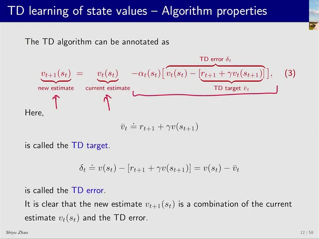
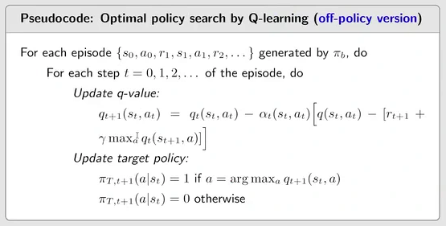

# 第 7 课 · 时序差分方法 · V2（总结）

[切换到 V1（逐页）](temporal-difference-slides.md)

## 1. TD(0) · State-value Prediction

给定固定策略 $\pi$，TD(0) 预测每个状态的价值 $v_\pi(s)=\mathbb E_\pi[G_t\mid S_t=s]$。每一步让动作按 $\pi(\cdot\mid s_t)$ 采样，得到轨迹 $(s_0,r_1,s_1,r_2,s_2,\ldots)$，也可将它写成逐步到达的经验三元组 $\{(s_t,r_{t+1},s_{t+1})\}_t$。价值表按状态索引，因此更新只需读取这三个量。

### One-step Update

第 $t$ 步（$t=0,1,2,\ldots$）用更新前的价值表 $v_t$ 计算两项：

- **TD target（目标）** $\bar v_t=r_{t+1}+\gamma v_t(s_{t+1})$。即时奖励来自真实转移，之后的回报用下一状态的估值补上，这一步叫 **bootstrapping（自举）**。若 $s_{t+1}$ 是终止状态，后续项取零。
- **TD error（误差）** $\delta_t=v_t(s_t)-\bar v_t$。按课件的符号，误差为正时下调估计，误差为负时上调。

$$
\begin{cases}
v_{t+1}(s_t)=v_t(s_t)-\alpha_t(s_t)\delta_t,\\
v_{t+1}(s)=v_t(s),\qquad s\ne s_t.
\end{cases}
$$

其中 $v_t(s_t)$ 是对 $v_\pi(s_t)$ 的当前估计，$\alpha_t(s_t)$ 是状态 $s_t$ 在本轮的 **learning rate（学习率）**。新估计等于当前估计减去步长加权的误差。每次只写入当前访问的 $s_t$，后续简写更新式时可省略其他表项的等式。

<figure>
  
</figure>

### Why the Estimate Moves toward the TD Target

用同一个本轮目标 $\bar v_t$ 比较更新前后的距离。把更新式两边减去 $\bar v_t$，再提取公因子：

$$
\begin{aligned}
v_{t+1}(s_t)-\bar v_t
&=v_t(s_t)-\bar v_t-\alpha_t(s_t)[v_t(s_t)-\bar v_t]\\
&=[1-\alpha_t(s_t)][v_t(s_t)-\bar v_t].
\end{aligned}
$$

当 $0<\alpha_t(s_t)<1$ 时，$0<1-\alpha_t(s_t)<1$，因此

$$
|v_{t+1}(s_t)-\bar v_t|
=|1-\alpha_t(s_t)|\,|v_t(s_t)-\bar v_t|
\le |v_t(s_t)-\bar v_t|.
$$

也就是说，新估计沿着从旧估计到本轮目标的方向走了 $\alpha_t(s_t)$ 比例的距离。下一轮会用新的转移和估值重新计算目标。

### What the TD Error Measures

$\delta_t$ 比较**相邻两个时刻对同一段回报的估计**。在 $t$ 时刻直接读出 $v_t(s_t)$。走一步之后，已知 $r_{t+1}$，把它加到折扣后的后续估值上，就得到对从 $t$ 开始的回报的另一个估计 $\bar v_t$。

由 $G_t=R_{t+1}+\gamma G_{t+1}$ 和马尔可夫性质，真实价值满足贝尔曼期望公式（Bellman expectation equation）：

$$
\begin{aligned}
v_\pi(s)
&=\mathbb E_\pi[R_{t+1}+\gamma G_{t+1}\mid S_t=s]\\
&=\mathbb E_\pi[R_{t+1}+\gamma v_\pi(S_{t+1})\mid S_t=s].
\end{aligned}
$$

把更新前的估值换成真实价值，定义 $\delta_{\pi,t}=v_\pi(s_t)-[r_{t+1}+\gamma v_\pi(s_{t+1})]$。在策略 $\pi$ 下，对从 $s_t$ 出发的所有可能转移取平均：

$$
\begin{aligned}
\mathbb E_\pi[\delta_{\pi,t}\mid S_t=s_t]
&=v_\pi(s_t)-\mathbb E_\pi[R_{t+1}+\gamma v_\pi(S_{t+1})\mid S_t=s_t]\\
&=0.
\end{aligned}
$$

**条件平均误差**反映了当前价值表与贝尔曼方程的一致程度。在当前价值表给定时，某个状态的条件平均误差非零，说明价值表还未满足该状态的贝尔曼等式。即使 $v_t=v_\pi$，单次转移也可能因奖励和下一状态的随机性产生非零误差。

### Bellman Equation & Robbins–Monro

记 $[T_\pi v](s)=\mathbb E_\pi[R_{t+1}+\gamma v(S_{t+1})\mid S_t=s]$。要求的根是 $v-T_\pi v=0$。给定当前价值表及当前状态后，一次转移产生的 $\delta_t$ 是残差 $v_t(s_t)-[T_\pi v_t](s_t)$ 的随机观测。TD(0) 将这个样本残差用于 Robbins–Monro 更新，在每次访问时解相应状态的方程。

表格型、有限、折扣且固定策略时，在各状态充分访问和满足标准噪声条件下，常用局部步长条件为 $\sum_t\alpha_t(s)=\infty$、$\sum_t\alpha_t(s)^2<\infty$。未访问该状态时记 $\alpha_t(s)=0$。这给出几乎必然收敛。常数步长适合持续更新，但不能由该定理推出样本路径收敛。

### TD vs. Monte Carlo

两者都是 **model-free** 的策略评价方法，直接用策略 $\pi$ 生成的经验更新价值。更新的形式相同，都把当前估计向样本目标移动一小步。

$$
\begin{aligned}
\text{TD(0) target}\quad &r_{t+1}+\gamma v_t(s_{t+1}),\\
\text{MC target}\quad &G_t=\sum_{k=0}^{T-t-1}\gamma^k R_{t+k+1},
\end{aligned}
$$

其中 $T$ 是该回合的终止时刻。MC 收集到最后一笔奖励 $R_T$ 后，可用 $G_t=R_{t+1}+\gamma G_{t+1}$、$G_T=0$ 反向计算每个时刻的回报。

| Aspect | TD(0) / Sarsa | Episodic Monte Carlo |
| --- | --- | --- |
| **Update timing** | Online。TD(0) 观察到下一状态和奖励即可更新。Sarsa 再抽取下一动作后即可更新。 | 要等完整回合收齐，再更新本回合访问过的状态或状态动作对。课件把这种回合结束后更新称为 offline。 |
| **Task type** | 适用于 episodic 和 continuing tasks，逐步更新无需等待终止。 | 标准回合式 MC 依赖终止时刻。持续任务若截断轨迹，截断之后的折扣回报会被省去。 |
| **Bootstrapping** | 用当前价值估计补足未观测的后续回报，因此目标会继承价值表的初始化和估计误差。 | 直接用实际回报作目标。目标与价值表的初始化无关，样本均值可直接从第一笔完整回报开始累计。 |
| **Typical variance** | 固定当前价值表时，TD(0) 的目标只涉及一步奖励和下一状态，Sarsa 还涉及下一动作。短目标通常方差较低。 | 每一步的动作、转移与奖励都可能使完整回报发生变化，方差通常较高。 |

**Bias（偏差）来自哪里？** 在固定策略下，从 $s$ 出发的完整 MC 回报满足 $\mathbb E_\pi[G_t\mid S_t=s]=v_\pi(s)$。对于 TD(0)，固定当前价值表 $v_t$ 和状态 $s$ 时，目标的期望是 $[T_\pi v_t](s)$。用贝尔曼等式 $v_\pi=T_\pi v_\pi$ 相减，可直接读出目标的偏差：

$$
[T_\pi v_t](s)-v_\pi(s)
=\gamma\,\mathbb E_\pi[(v_t-v_\pi)(S_{t+1})\mid S_t=s].
$$

TD 的目标偏差来自**下一状态的估值误差**。偏差的绝对值最多为 $\gamma$ 乘以价值表的最大绝对误差。当 $v_t=v_\pi$ 时，自举目标也无偏。

**Variance（方差）来自哪里？** 展开 MC 回报，可以看到 $R_{t+1},\gamma R_{t+2},\gamma^2R_{t+3},\ldots$ 都带着沿途采样的随机性。课件用长度为 $L$、每步有 $|\mathcal A|$ 个动作的情形说明，单是动作序列就可有 $|\mathcal A|^L$ 种。TD 将后续随机回报替换成当前表里的估值，所以一步数据就能更新，通常也减少了目标的波动。两者的取舍集中在**完整采样的波动**和**自举估计的偏差**。

## 2. Sarsa · Action-value Learning

观测五元组 $(S_t,A_t,R_{t+1},S_{t+1},A_{t+1})$。固定策略时，下一动作按同一策略抽取：

$$
\begin{aligned}
Y_t &= R_{t+1}+\gamma Q_t(S_{t+1},A_{t+1}),\\
Q_{t+1}(S_t,A_t)&=Q_t(S_t,A_t)
+\alpha_t\bigl[Y_t-Q_t(S_t,A_t)\bigr].
\end{aligned}
$$

其他表项本轮不变。期望目标来自 $q_\pi$ 的贝尔曼方程。固定策略评价的收敛要求逐状态动作对的覆盖与适当步长。用于 control 时，按同一 $\varepsilon$-greedy 策略采样和评价，并更新它，属于 on-policy 的广义策略迭代。固定正探索率评价的是含探索的策略。

### Sarsa · 原课件伪代码

<figure>
  
</figure>

## 3. Expected Sarsa & n-step Sarsa

<strong>Expected Sarsa</strong> 对下一动作求条件期望，环境仍用样本：

$$
Y_t=R_{t+1}+\gamma\sum_a
 \pi_t(a\mid S_{t+1})Q_t(S_{t+1},a).
$$

对给定的下一状态，这一步消除抽取单个动作带来的方差，代价是求和所需的动作值与概率。

<strong>n-step Sarsa</strong> 用前 $n$ 步真实奖励，再用价值估计补后缀：

$$
\begin{aligned}
G^{(n)}_t
&=\sum_{j=0}^{n-1}\gamma^jR_{t+j+1}\\
&\quad+\gamma^n Q(S_{t+n},A_{t+n}).
\end{aligned}
$$

从 $t$ 开始的更新必须等到第 $n$ 步信息就绪，或等回合提前结束。提前结束时只累计到末笔奖励，去掉自举项。$n=1$ 恢复 Sarsa，覆盖整个回合则得到 MC target。增加 $n$ 通常减少对当前估计的依赖，同时纳入更多采样随机性。

## 4. Q-learning · Learning Optimal Action Values

用下一状态的最大动作值替换 Sarsa 的下一动作样本：

$$
\begin{aligned}
Y_t &= R_{t+1}+\gamma\max_b Q_t(S_{t+1},b),\\
q^*(s,a)&=\mathbb E[R_{t+1}
+\gamma\max_b q^*(S_{t+1},b)\mid s,a].
\end{aligned}
$$

第一行是一次样本更新的目标，第二行是要解的 Bellman optimality equation。课件第 58 页汇总表的 Q-learning 一栏漏写了折扣因子，按第 43 页及更新式补上 $\gamma$。

| Policy | Role |
| --- | --- |
| Behavior policy | 生成经历，可保留探索概率 |
| Target policy | 决定更新的学习目标。Q-learning 用当前 Q 的贪心动作 |

Sarsa 使用行为策略抽出的 $A_{t+1}$ 评价同一策略。Q-learning 的最大值与实际执行的下一动作无关，属于 off-policy 更新。课件称第 50 页为 on-policy version，指边采样边更新用于生成经验的策略。该实现里的 Q 更新目标仍取最大值。第 51 页则直接使用独立行为策略已有的数据。无论使用哪种数据来源，仍需充分访问相关状态动作对。

课件的探索实验在比较数据覆盖。均匀探索生成的轨迹能覆盖更多状态动作对。若行为策略长期偏向少数动作，延长轨迹也可能只增加已常见的访问，稀少表项仍难学好。图中的纵轴比较训练中提取的贪心策略价值与已知最优价值的差距。

### Q-learning · 原课件两种实现

<figure>
  
</figure>

<figure>
  
</figure>

## 5. Unified TD Targets

所有动作值更新都可写成 $Q\leftarrow Q+\alpha(Y-Q)$，区别集中在目标 $Y$。

| Algorithm | Target $Y$ | Equation |
| --- | --- | --- |
| Sarsa | $R_{t+1}+\gamma Q(S_{t+1},A_{t+1})$ | 给定策略的 BE |
| Expected Sarsa | $R_{t+1}+\gamma\sum_a\pi(a\mid S_{t+1})Q(S_{t+1},a)$ | 给定策略的 BE |
| n-step Sarsa | $G^{(n)}_t$ | 给定策略的多步 BE |
| Q-learning | $R_{t+1}+\gamma\max_a Q(S_{t+1},a)$ | BOE |
| Monte Carlo | $G_t$ | 给定策略的完整回报期望 |

MC 的等权样本均值对应第 $N$ 次访问使用 $\alpha=1/N$。课件把 $\alpha=1$ 写作直接放入单次回报，这只是统一更新式中的单样本情形。
