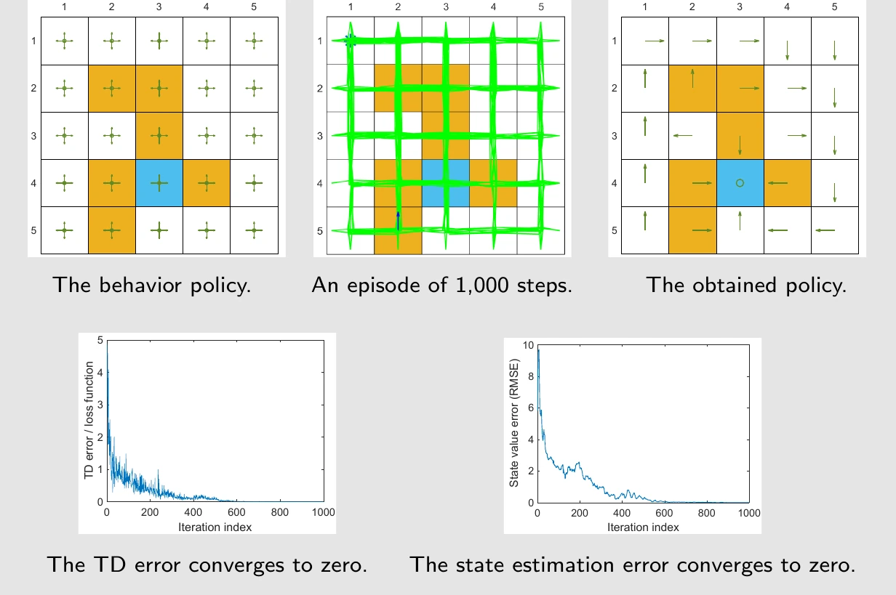

# 第 8 课 · 价值函数近似

## 1. Motivating Example · Curve Fitting {#curve-fitting}

#### 1.1 从表格到共享参数

Tabular Representation · 每个状态动作对有一格

前七课用表格存储 **state value** 和 **action value**。以 $q_\pi$ 为例，行对应状态，列对应动作，每格存一个 $q_\pi(s,a)$。课件中 9 个状态、每个状态 5 个动作，共有 45 个表项。

**优点（Advantage）**

查表直观，逐项更新也容易分析。

**缺点（Disadvantages）**

- **Storage**。状态或动作越多，需要的表项越多。连续空间无法逐项列成有限表。
- **Generalization**。表项各自独立，更新一个表项时，其他表项的估计不会随之改变。

Curve Fitting · 用一条曲线表示多个状态的价值

固定策略 $\pi$，把一维状态及其价值看成数据点 $(s,v_\pi(s))$。状态很多时，可以用同一个 **parameterized function** $\hat v(s,w)$ 来拟合这些点。

#### 1.2 Linear in Parameters

Polynomial Features · 直线与二次曲线

直线用 $\phi(s)=[1,s]^\top$，二次曲线用 $\phi(s)=[1,s,s^2]^\top$。两者都可以写成

$$
\hat v(s,w)=\phi(s)^\top w.
$$

- $w\in\mathbb R^m$ 是 **parameter vector**，存放要学习的系数。
- $\phi(s)\in\mathbb R^m$ 是状态 $s$ 的 **feature vector**，存放用来表示该状态的特征。

加入 $s^2$ 后，曲线可以弯曲。这里的 **linear** 指对参数 $w$ 线性，feature 本身可以是状态的非线性函数。

#### 1.3 Quick Summary

Value Function Approximation · Storage 与 Generalization

用 $\hat v(s,w)\approx v_\pi(s)$ 近似状态价值，也可以用 $\hat q(s,a,w)$ 近似动作价值。

- **Storage**。对状态价值而言，参数维数 $m$ 可以远小于状态数 $|\mathcal S|$。
- **Generalization**。从一个已访问状态得到的经验会更新共享参数 $w$，也可能改变其他尚未访问状态的价值估计。

## Algorithm for state value estimation {#algorithm-for-state-value-estimation}

### 2. Objective Function {#objective-function}

#### 2.1 Weighted Value Error {#_2-1-weighted-value-error}

Policy Evaluation · 要找怎样的参数？

固定策略 $\pi$，用 $\hat v(s,w)$ 近似真实的 **state value** $v_\pi(s)$。我们要找一组参数 $w$，让它在整个状态空间上的近似误差尽可能小。这是 **policy evaluation**，后面再扩展到 **policy improvement**。

1. 本节定义 **objective function**，衡量近似误差。
2. 下一节从这个目标出发，推导参数更新算法。

Objective · 最小化平方误差

令随机状态 $S\sim d$，寻找使下式最小的 $w$。

$$
J(w)=\frac12\mathbb E_{S\sim d}
\big[(v_\pi(S)-\hat v(S,w))^2\big].
$$

前面的 $1/2$ 方便下一节求导，最优参数与课件中的写法相同。分布 $d$ 决定各状态的误差在目标里占多大权重。

#### 2.2 Uniform Distribution {#uniform-distribution}

Uniform Distribution · 每个状态权重相同

若有限状态集 $\mathcal S$ 上的每个状态都取概率 $1/|\mathcal S|$，则

$$
J(w)=\frac{1}{2|\mathcal S|}
\sum_{s\in\mathcal S}(v_\pi(s)-\hat v(s,w))^2.
$$

**缺点**。策略 $\pi$ 对各状态的访问频率可能相差很大，均匀权重会让罕见状态和常见状态同样影响拟合。

#### 2.3 Stationary Distribution {#_2-2-stationary-distribution}

Stationary Distribution · 按长期访问频率加权

令 $d_\pi(s)$ 表示策略 $\pi$ 诱导的 Markov chain 的 stationary distribution。它满足 $d_\pi(s)\ge 0$，且 $\sum_{s\in\mathcal S}d_\pi(s)=1$。用它给误差加权，得到

$$
J(w)=\frac12\sum_{s\in\mathcal S}
d_\pi(s)(v_\pi(s)-\hat v(s,w))^2.
$$

在遍历条件下，常访问的状态有更大的 $d_\pi(s)$，对拟合结果的影响也更大。

Stationary Equation · 一步转移后分布保持不变

记 $P_\pi(s,s')$ 为按 $\pi$ 从 $s$ 转移到 $s'$ 的概率。把 $d_\pi^\top$ 写成行向量，平稳条件是

$$
d_\pi^\top=d_\pi^\top P_\pi.
$$

右侧第 $s'$ 项是 $\sum_s d_\pi(s)P_\pi(s,s')$，即一步转移后落在 $s'$ 的总概率。它等于原来的 $d_\pi(s')$，因此状态分布保持不变。

对有限、不可约且非周期的 Markov chain，任意初始分布经过足够多步都会趋近唯一的 $d_\pi$。沿一条长轨迹统计各状态的访问比例，也会趋近相应的 $d_\pi(s)$。

### 3. Optimization Algorithms {#td-function-approximation}

#### 3.1 从 Gradient Descent 到 SGD {#_3-1-从-sgd-到-semi-gradient-td}

Gradient Descent · 对目标函数求导

对第 2 节的目标 $J(w)$ 做 **gradient descent**。

$$
w_{k+1}=w_k-\alpha_k\nabla_w J(w_k).
$$

令 $e(s,w)=v_\pi(s)-\hat v(s,w)$。固定策略下，$v_\pi$ 与状态分布 $d$ 都不随 $w$ 变化。对平方误差应用 chain rule，得到

$$
\begin{aligned}
\nabla_w J(w)
&=\mathbb E_d[e(S,w)\nabla_w e(S,w)]\\
&=-\mathbb E_d[e(S,w)\nabla_w\hat v(S,w)].
\end{aligned}
$$

第 2 节的 $1/2$ 抵消了平方求导产生的 $2$。

SGD · 用一个状态替代期望

用状态样本 $s_t$ 计算 **stochastic gradient**，得到

$$
\begin{aligned}
w_{t+1}&=w_t+\alpha_t e(s_t,w_t)
  \nabla_w\hat v(s_t,w_t).
\end{aligned}
$$

这一步仍需要待估计的真实价值 $v_\pi(s_t)$。实际更新可以用下面两种 **target** 来代替它。

#### 3.2 Monte Carlo 与 TD Learning

Monte Carlo · 用完整 Return 作 Target

按 $\pi$ 生成一个 episode 后，取从 $s_t$ 开始的 discounted return $g_t$ 作为 $v_\pi(s_t)$ 的样本。

$$
\begin{aligned}
e_t^{\mathrm{MC}}&=g_t-\hat v(s_t,w_t),\\
w_{t+1}&=w_t+\alpha_t e_t^{\mathrm{MC}}
  \nabla_w\hat v(s_t,w_t).
\end{aligned}
$$

TD Update · 用单步 Target 替换未知价值

沿用第七课的 TD target，只需一条转移 $(s_t,r_{t+1},s_{t+1})$。

$$
\begin{aligned}
y_t&=r_{t+1}+\gamma\hat v(s_{t+1},w_t),\\
\delta_t&=y_t-\hat v(s_t,w_t),\\
w_{t+1}&=w_t+\alpha_t\delta_t\nabla_w\hat v(s_t,w_t).
\end{aligned}
$$

本次更新把 $y_t$ 当作常数，只对当前预测求导，因此叫 **semi-gradient**。终止转移取 $y_t=r_{t+1}$。

#### 3.3 TD Learning Pseudocode

Pseudocode · TD Learning with Function Approximation

**Initialization**。选定对 $w$ 可微的 $\hat v(s,w)$ 和初始参数 $w_0$。目标是近似给定策略 $\pi$ 的 state values。

1. 按 $\pi$ 生成 episode。每收到一条转移 $(s_t,r_{t+1},s_{t+1})$，就计算本步的 target 和 TD error $\delta_t$。
2. 用 $w_{t+1}=w_t+\alpha_t\delta_t\nabla_w\hat v(s_t,w_t)$ 更新参数，再处理下一条转移。

**Linear case**。若 $\hat v(s,w)=\phi(s)^\top w$，则 gradient 等于 $\phi(s_t)$，更新写成

$$
\begin{aligned}
y_t&=r_{t+1}+\gamma\phi(s_{t+1})^\top w_t,\\
\delta_t&=y_t-\phi(s_t)^\top w_t,\\
w_{t+1}&=w_t+\alpha_t\delta_t\phi(s_t).
\end{aligned}
$$

终止转移同样取 $y_t=r_{t+1}$。

### 4. Selection of Function Approximators {#linear-features}

#### 4.1 Linear 与 Nonlinear Approximators

两种 Approximator · 怎样选择模型？

- **Linear function**。用 $\hat v(s,w)=\phi(s)^\top w$。Feature vector $\phi(s)$ 可由 **polynomial basis** 或 **Fourier basis** 构成。第 1 节的直线和二次曲线都属于这种形式。
- **Neural network**。输入状态 $s$，输出价值估计 $\hat v(s,w)$，网络参数为 $w$。网络可以表示非线性的价值函数，gradient 可由 backpropagation 计算。

#### 4.2 TD-Linear

TD-Linear · Gradient 等于 Feature Vector

对 $\hat v(s,w)=\phi(s)^\top w$ 求导，得到 $\nabla_w\hat v(s,w)=\phi(s)$。代入第 3 节的 semi-gradient TD 更新，得到 **TD-Linear**。

$$
\begin{aligned}
y_t&=r_{t+1}+\gamma\phi(s_{t+1})^\top w_t,\\
\delta_t&=y_t-\phi(s_t)^\top w_t,\\
w_{t+1}&=w_t+\alpha_t\delta_t\phi(s_t).
\end{aligned}
$$

终止转移取 $y_t=r_{t+1}$。

Linear Approximation · 优点与缺点

**缺点（Disadvantage）**

合适的 feature vector 往往难选。训练只能调整已有特征的系数。

**优点（Advantages）**

- Linear TD 的收敛性质更容易分析。
- **Tabular representation** 是 linear function approximation 的一个特例。

#### 4.3 Tabular TD 是 TD-Linear 的特例 {#_4-1-linear-td-与-tabular-td}

One-hot Features · 每个状态选中一个表项

令 $\phi(s)=e_s\in\mathbb R^{|\mathcal S|}$，其中 $e_s$ 对应状态 $s$ 的分量为 $1$，其余分量为 $0$。于是

$$
\hat v(s,w)=e_s^\top w=w(s).
$$

代入 TD-Linear 后，普通转移的 TD error 为 $\delta_t=r_{t+1}+\gamma w_t(s_{t+1})-w_t(s_t)$，而向量更新是 $w_{t+1}=w_t+\alpha_t\delta_t e_{s_t}$。

两边左乘 $e_{s_t}^\top$，就只读出状态 $s_t$ 的分量。

$$
w_{t+1}(s_t)=w_t(s_t)+\alpha_t\delta_t.
$$

只有当前状态的表项被更新，这就是 **tabular TD**。

#### 4.4 Summary {#value-approximation-summary}

Summary · 从 Policy Evaluation 到 Semi-gradient TD

1. **Objective**。固定 $\pi$，用 $J(w)=\frac12\mathbb E_d[(v_\pi(S)-\hat v(S,w))^2]$ 衡量价值近似的误差。
2. **SGD**。对样本 $s_t$，用误差 $v_\pi(s_t)-\hat v(s_t,w_t)$ 乘 $\nabla_w\hat v(s_t,w_t)$ 来更新参数。
3. **Semi-gradient TD**。真实价值未知，用 $r_{t+1}+\gamma\hat v(s_{t+1},w_t)$ 替代 $v_\pi(s_t)$，更新时把这个 target 当作常数。

这三步解释了 TD 更新的来由。换成含当前估计的 TD target 后，更新方向一般会偏离 $J(w)$ 的负梯度。

Theoretical Analysis · 三种误差

令 $\hat v(w)$ 表示所有状态的价值估计，$D=\operatorname{diag}(d_\pi)$，$\|x\|_D^2=x^\top D x$。Bellman operator 为 $T_\pi x=r_\pi+\gamma P_\pi x$。

**True Value Error** 衡量估计与真实价值的差距。在 $d=d_\pi$ 时，$J_E(w)=2J(w)$。

$$
J_E(w)=\|\hat v(w)-v_\pi\|_D^2.
$$

**Bellman Error** 比较当前估计与一次 Bellman backup 的结果。

$$
J_{\mathrm{BE}}(w)=\|\hat v(w)-T_\pi\hat v(w)\|_D^2.
$$

**Projected Bellman Error** 先将 backup 的结果投影回线性模型能表示的空间，再比较。$\Pi_D$ 是按 $D$ 加权的正交投影。

$$
J_{\mathrm{PBE}}(w)
=\|\hat v(w)-\Pi_D T_\pi\hat v(w)\|_D^2.
$$

在标准 on-policy 线性收敛条件下，TD-Linear 收敛到 projected Bellman equation 的解，此时 $J_{\mathrm{PBE}}=0$。[附录 · Projected Bellman Equation](appendix.md#linear-td-projected-bellman-equation)

## 5. Sarsa and Q-learning with Function Approximation {#approximate-control}

#### 5.1 Sarsa with Function Approximation {#_5-1-sarsa-·-用采样到的下一动作}

Semi-gradient Sarsa · 从 State Value 换成 Action Value

把第 3 节 **semi-gradient TD** 的 state value $\hat v(s,w)$ 换成 action value $\hat q(s,a,w)$。下一动作 $a_{t+1}$ 按当前策略 $\pi_t(\cdot\mid s_{t+1})$ 采样。

$$
\begin{aligned}
y_t&=r_{t+1}+\gamma\hat q(s_{t+1},a_{t+1},w_t),\\
\delta_t&=y_t-\hat q(s_t,a_t,w_t),\\
w_{t+1}&=w_t+\alpha_t\delta_t\nabla_w\hat q(s_t,a_t,w_t).
\end{aligned}
$$

更新时将 $y_t$ 当作常数，只对当前预测求导。终止转移取 $y_t=r_{t+1}$。

Pseudocode · Sarsa Control

初始化 $w$。每个 episode 从 $s_0$ 出发，按当前 $\varepsilon$-greedy policy 选初始动作。

1. **Collect experience**。执行 $a_t$，观察 $r_{t+1}$ 和 $s_{t+1}$。若未终止，按 $\pi_t$ 采样下一动作 $a_{t+1}$。
2. **Policy evaluation**。用上面的 Sarsa 更新式算出 $w_{t+1}$。
3. **Policy improvement**。用更新后的 $\hat q$ 在 $s_t$ 选一个 greedy action $a^*$，再更新 $\varepsilon$-greedy 的概率。
4. 若未终止，进入 $s_{t+1}$ 并沿用已采样的 $a_{t+1}$。

令 $m=|\mathcal A(s_t)|$，第 3 步的策略更新为

$$
\pi_{t+1}(a\mid s_t)=
\begin{cases}
1-\varepsilon+\varepsilon/m, & a=a^*,\\
\varepsilon/m, & a\ne a^*.
\end{cases}
$$

评估用到的下一动作，也是交互中实际执行的下一动作，因此 Sarsa 是 **on-policy**。

#### 5.2 Q-learning · 用下一状态的最大动作值

Semi-gradient Q-learning · Greedy Target

参数更新沿用上一小节的形式。Q-learning 的 target 为

$$
y_t=r_{t+1}+\gamma\max_b\hat q(s_{t+1},b,w_t).
$$

两种算法在终止转移都只用即时奖励。Gridworld 实验沿用第七课的指标，用每回合 total reward、episode length 和学到的 greedy policy 检查控制效果。共享参数让一次更新可以影响多个状态动作对。

## 6. Deep Q-learning {#deep-q-learning}

#### 6.1 Online Network 与 Target Network

DQN Loss · 用暂时固定的 Target 拟合动作价值

DQN 用神经网络近似 $q^*$。令 $w$ 为 **online network** 的参数，$w^-$ 为 **target network** 的参数。

$$
\begin{aligned}
y &= r+\gamma\max_b\hat q(s',b,w^-),\\
L(w)&=\mathbb E[(y-\hat q(s,a,w))^2].
\end{aligned}
$$

终止转移令 $y=r$。训练时固定 $w^-$，只更新 $w$，每隔 $C$ 次更新把 $w$ 复制给 $w^-$。这样连续几步使用同一套 target 参数。

#### 6.2 Experience Replay

Replay Buffer · 随机抽取 Mini-batch

把每条经验存进 **replay buffer**，训练时均匀抽取 mini-batch。这样可以复用旧转移，也能减弱连续轨迹中相邻样本的相关性。抽样分布由 buffer 里的数据决定，哪些状态动作对能被学到仍取决于数据覆盖。

#### 6.3 Algorithm and Gridworld Example

Pseudocode · Deep Q-learning

1. 初始化 online network，复制参数到 target network。
2. 用探索性 behavior policy 收集转移，存入 replay buffer。课件示例使用预先采集的轨迹。
3. 每次均匀抽取一个 mini-batch，用 target network 计算 $y$，以平方误差更新 online network。
4. 每隔 $C$ 次更新同步参数。需要输出策略时，从 online network 取 greedy action。

Gridworld · 1,000 步与 100 步的覆盖

课件用同一个 5×5 Gridworld 比较两条长度不同的轨迹。1,000 步轨迹覆盖较广，学到的策略更接近最优。100 步轨迹覆盖不足，即使训练 loss 已很低，整体价值估计仍有明显误差。

<figure>
  
  <figcaption>1,000 步轨迹</figcaption>
</figure>

<figure>
  
  <figcaption>100 步轨迹</figcaption>
</figure>

[Shiyu Zhao · Lecture 8 原课件](https://github.com/MathFoundationRL/Book-Mathematical-Foundation-of-Reinforcement-Learning/blob/main/Lecture%20slides/slidesForMyLectureVideos/L8_Value%20function%20approximation.pdf)
