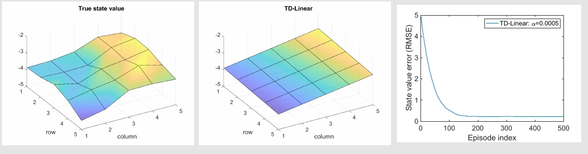

# 第 8 课 · 价值函数近似 · V2（总结）

## 1. Motivating Example · Curve Fitting {#curve-fitting}

### 1.1 从表格到共享参数

Curve Fitting · 用一条曲线表示多个状态的价值

把每个状态的价值 $v_\pi(s)$ 看作一个数据点。状态很多时，可以用一个参数化函数 $\hat v(s,w)$ 拟合这些点。更新共享参数 $w$，也会改变其他使用这些参数的状态的预测，这就是 **generalization**。

### 1.2 Linear in Parameters

Polynomial Features · 直线与二次曲线

直线用 $\phi(s)=[1,s]^\top$，二次曲线用 $\phi(s)=[1,s,s^2]^\top$。两者都可以写成

$$
\hat v(s,w)=\phi(s)^\top w.
$$

加入 $s^2$ 后，曲线可以弯曲。这里的 **linear** 指对参数 $w$ 线性，feature 本身可以是状态的非线性函数。

## 2. Objective Function {#objective-function}

### 2.1 Weighted Value Error

Objective · 哪些状态的误差更重要？

固定策略 $\pi$，用状态分布 $d$ 给平方误差加权。系数 $1/2$ 方便求导。

$$
J(w)=\frac12\mathbb E_{S\sim d}
\big[(v_\pi(S)-\hat v(S,w))^2\big].
$$

- **Uniform distribution**。每个状态权重相同。
- **Stationary distribution**。按策略 $\pi$ 诱导的 Markov chain 的长期访问频率加权，常访问的状态权重更大。

### 2.2 Stationary Distribution

Stationary Distribution · 一步转移后分布保持不变

用行向量记状态分布。若 $d_\pi=d_\pi P_\pi$，则从 $d_\pi$ 出发做一步转移，状态分布仍是 $d_\pi$。有限、不可约且非周期的 Markov chain 会从任意初始分布收敛到这个分布。

因此，按 $\pi$ 产生的长轨迹可以为这个加权目标提供样本。对于回合任务，长期访问分布还取决于 episode 的重启方式。

在课件的四状态例子里，$d_\pi\approx(0.0345,0.1084,0.1330,0.7241)$。长轨迹中约 72% 的访问落在第四个状态，所以按 $d_\pi$ 加权时，第四个状态的误差占更大权重。

## 3. Optimization · TD with Function Approximation {#td-function-approximation}

### 3.1 从 SGD 到 Semi-gradient TD

SGD · 理想更新需要真实的 State Value

如果能得到 $v_\pi(s_t)$，第六课的 SGD 给出

$$
\begin{aligned}
e_t&=v_\pi(s_t)-\hat v(s_t,w_t),\\
w_{t+1}&=w_t+\alpha_t e_t\nabla_w\hat v(s_t,w_t).
\end{aligned}
$$

TD Update · 用单步 Target 替换未知价值

沿用第七课的 TD target，只需一条转移 $(s_t,r_{t+1},s_{t+1})$。

$$
\begin{aligned}
y_t&=r_{t+1}+\gamma\hat v(s_{t+1},w_t),\\
\delta_t&=y_t-\hat v(s_t,w_t),\\
w_{t+1}&=w_t+\alpha_t\delta_t\nabla_w\hat v(s_t,w_t).
\end{aligned}
$$

本次更新把 $y_t$ 当作常数，只对当前预测求导，因此叫 **semi-gradient**。终止转移取 $y_t=r_{t+1}$。

## 4. Function Approximators and Gridworld {#linear-features}

### 4.1 Linear TD 与 Tabular TD

Linear TD · Gradient 就是 Feature Vector

用线性模型时，$\nabla_w\hat v(s,w)=\phi(s)$，所以 $w_{t+1}=w_t+\alpha_t\delta_t\phi(s_t)$。如果 $\phi(s)$ 是状态的 **one-hot vector**，每次只改该状态的一个参数，得到第七课的 tabular TD。

也可以用 **neural network** 直接学习非线性的 $\hat v(s,w)$，用 backpropagation 计算 gradient。

### 4.2 Gridworld · Feature 决定可以拟合的形状

5×5 Gridworld · 用平面拟合价值曲面

以坐标 $(x,y)$ 表示状态，$\phi(s)=[1,x,y]^\top$ 只需要三个参数，预测值构成一个平面。课件图中，TD-Linear 学到了价值变化的大致方向，但误差在训练后趋于平稳。

<figure>
  
</figure>

加入 $x^2,y^2,xy$ 后可拟合二次曲面。课件继续比较了 6 维和 10 维 feature，展示了增加 feature 如何改善这组实验里的拟合。线性 TD 求解的方程见[附录](appendix.md#linear-td-projected-bellman-equation)。

## 5. Sarsa and Q-learning with Function Approximation {#approximate-control}

### 5.1 Sarsa · 用采样到的下一动作

Semi-gradient Sarsa · 从 State Value 换成 Action Value

用 $\hat q(s,a,w)$ 表示 action value。按当前策略采样 $a_{t+1}$，定义

$$
y_t=r_{t+1}+\gamma\hat q(s_{t+1},a_{t+1},w_t).
$$

把误差 $\delta_t=y_t-\hat q(s_t,a_t,w_t)$ 乘当前预测的 gradient，得到

$$
w_{t+1}=w_t+\alpha_t\delta_t\nabla_w\hat q(s_t,a_t,w_t).
$$

做 control 时，用当前 $\hat q$ 构造 $\varepsilon$-greedy policy，继续采样和更新。

### 5.2 Q-learning · 用下一状态的最大动作值

Semi-gradient Q-learning · Greedy Target

参数更新沿用上一小节的形式。Q-learning 的 target 为

$$
y_t=r_{t+1}+\gamma\max_b\hat q(s_{t+1},b,w_t).
$$

两种算法在终止转移都只用即时奖励。Gridworld 实验沿用第七课的指标，用每回合 total reward、episode length 和学到的 greedy policy 检查控制效果。共享参数让一次更新可以影响多个状态动作对。

## 6. Deep Q-learning {#deep-q-learning}

### 6.1 Online Network 与 Target Network

DQN Loss · 用暂时固定的 Target 拟合动作价值

DQN 用神经网络近似 $q^*$。令 $w$ 为 **online network** 的参数，$w^-$ 为 **target network** 的参数。

$$
\begin{aligned}
y &= r+\gamma\max_b\hat q(s',b,w^-),\\
L(w)&=\mathbb E[(y-\hat q(s,a,w))^2].
\end{aligned}
$$

终止转移令 $y=r$。训练时固定 $w^-$，只更新 $w$，每隔 $C$ 次更新把 $w$ 复制给 $w^-$。这样连续几步使用同一套 target 参数。

### 6.2 Experience Replay

Replay Buffer · 随机抽取 Mini-batch

把每条经验存进 **replay buffer**，训练时均匀抽取 mini-batch。这样可以复用旧转移，也能减弱连续轨迹中相邻样本的相关性。抽样分布由 buffer 里的数据决定，哪些状态动作对能被学到仍取决于数据覆盖。

### 6.3 Algorithm and Gridworld Example

Pseudocode · Deep Q-learning

1. 初始化 online network，复制参数到 target network。
2. 用探索性 behavior policy 收集转移，存入 replay buffer。课件示例使用预先采集的轨迹。
3. 每次均匀抽取一个 mini-batch，用 target network 计算 $y$，以平方误差更新 online network。
4. 每隔 $C$ 次更新同步参数。需要输出策略时，从 online network 取 greedy action。

Gridworld · 1,000 步与 100 步的覆盖

课件用同一个 5×5 Gridworld 比较两条长度不同的轨迹。1,000 步轨迹覆盖较广，学到的策略更接近最优。100 步轨迹覆盖不足，即使训练 loss 已很低，整体价值估计仍有明显误差。

<figure>
  
  <figcaption>1,000 步轨迹</figcaption>
</figure>

<figure>
  
  <figcaption>100 步轨迹</figcaption>
</figure>

[Shiyu Zhao · Lecture 8 原课件](https://github.com/MathFoundationRL/Book-Mathematical-Foundation-of-Reinforcement-Learning/blob/main/Lecture%20slides/slidesForMyLectureVideos/L8_Value%20function%20approximation.pdf)
