# 第 4 课 · 值迭代与策略迭代 · V1（逐页）

[切换到 V2（总结）](value-policy-iteration.md)

## Part 1 · Value Iteration

### 第 01 页 · 从求解方程到实际算法

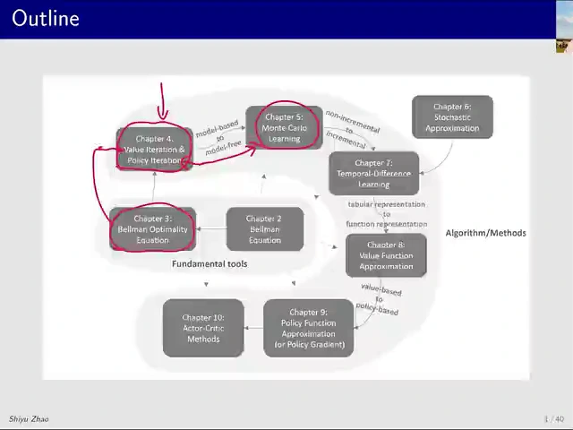

第 2 课的贝尔曼方程给定策略求价值，第 3 课的贝尔曼最优公式同时确定最优价值与最优动作。这课把公式变成可以在已知环境模型下执行的算法。这是课程第一次正式介绍基于模型（model-based）的算法。值迭代上一课已经从数学上导出，本课会讲具体实现。策略迭代则为下一课基于采样的蒙特卡洛方法打基础。

### 第 02 页 · 本课的三种算法

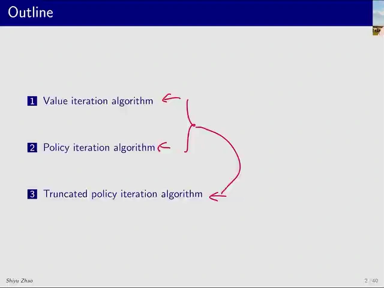

依次讨论值迭代（value iteration）、策略迭代（policy iteration）和截断策略迭代（truncated policy iteration）。先弄清前两种每一轮做什么，再用第三种说明它们之间的关系。

### 第 03 页 · 进入值迭代

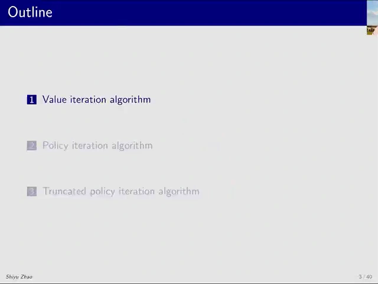

先从上一课的贝尔曼最优方程出发，看看把一次不动点更新拆开以后，怎样比较动作、怎样写出新的状态价值估计。

### 第 04 页 · 把最优方程写成迭代

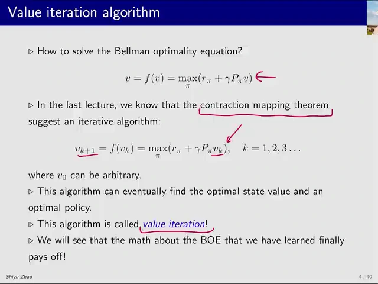

贝尔曼最优方程是 $v=Tv$，其中 $Tv=\max_\pi(\mathbf r_\pi+\gamma P_\pi v)$，最大值逐状态取。第 3 课的收缩映射定理（contraction mapping theorem）说明，从任意 $v_0$ 反复做 $v_{k+1}=Tv_k$，价值都会收敛到 $v^*$。用 $v^*$ 比较首步动作，可提取最优策略。这就是值迭代。

### 第 05 页 · 一次更新拆成选动作和写价值

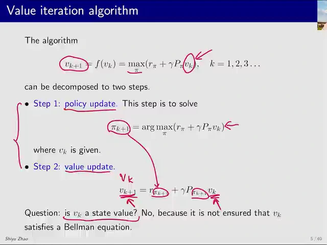

先固定旧估计 $v_k$，逐状态找能让 $\mathbf r_\pi+\gamma P_\pi v_k$ 最大的策略 $\pi_{k+1}$。随后用该策略对 $v_k$ 做一次更新，写出 $v_{k+1}=\mathbf r_{\pi_{k+1}}+\gamma P_{\pi_{k+1}}v_k$。中间的 $v_k$ 只是估计，未必满足某个固定策略的贝尔曼方程，因此一般不能写成 $v_{\pi_k}$。

### 第 06 页 · 从矩阵公式转为逐状态实现

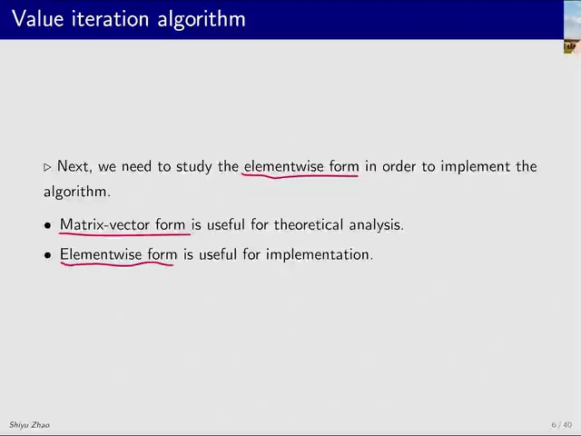

矩阵向量形式（matrix–vector form）适合描述整个算子和证明收敛。实现时采用逐状态形式（elementwise form），要列出每个状态的可选动作，逐个计算「平均即时奖励加折扣后续价值」，再比较这些数。下面分别写出选动作和更新价值的逐状态形式。

### 第 07 页 · Policy update · 选最大动作

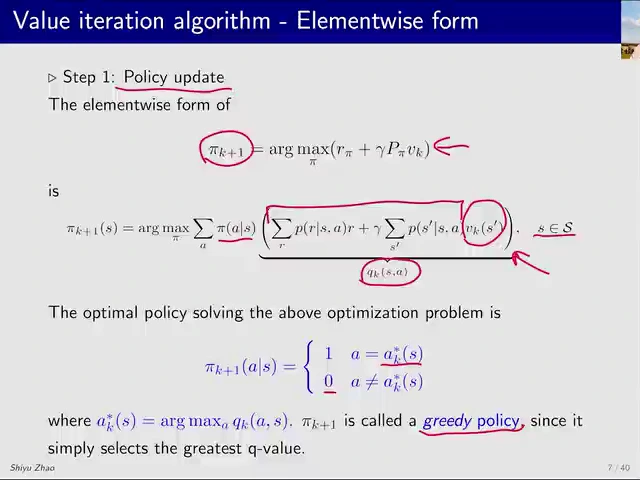

对每个 $s,a$ 算 $q_k(s,a)=\sum_r p(r\mid s,a)r+\gamma\sum_{s'}p(s'\mid s,a)v_k(s')$。用动作概率加权的结果不能超过最大的 $q_k$，所以可给任一最大动作概率 1、其余概率 0。这样的选择称为贪心策略（greedy policy）。此时的 $q_k$ 随估计 $v_k$ 改变。

### 第 08 页 · Value update · 记录最大值

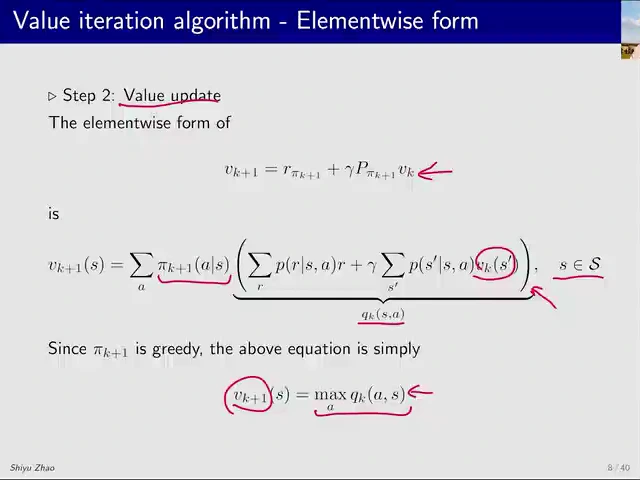

既然贪心策略只选一个最大动作，就可以把按新策略求平均简化为 $v_{k+1}(s)=\max_a q_k(s,a)$。$\arg\max$ 给出动作，$\max$ 给出它的数值。程序可以在遍历动作时同时保存两者。

### 第 09 页 · Value Iteration pseudocode

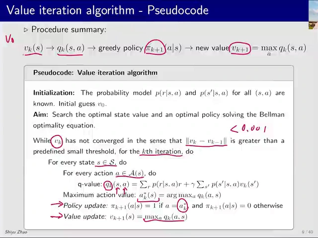

已知每个状态动作对的奖励和转移模型（transition model）。先给出 $v_0$。每轮用同一份旧值，遍历全部状态和它们的全部动作，算 $q_k$、记录最大动作并保存 $v_{k+1}$。全部状态处理后才进入下一轮。停止条件（stopping criterion）是相邻两轮的价值差低于预设阈值，课上以 0.001 为例。达到条件后输出价值估计及相应的贪心策略。

### 第 10 页 · 四格算例 · 给每个动作列出计算式

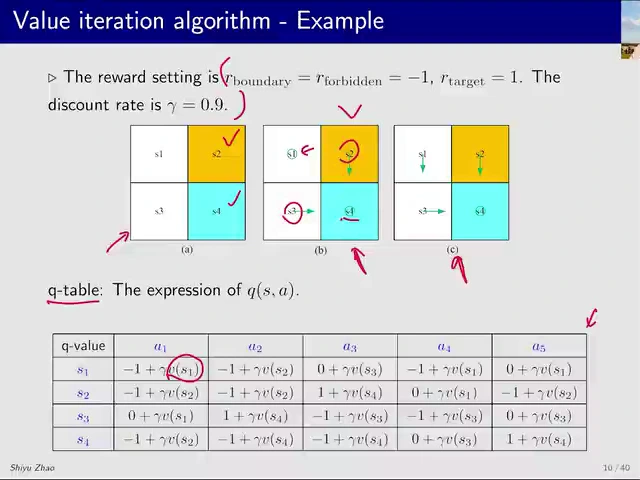

左上 $s_1$、右上禁区 $s_2$、左下 $s_3$、右下目标 $s_4$。动作依次为上、右、下、左、停留。撞墙留在原地并扣 1，进入或留在禁区扣 1，进入或停在目标得 1，其余为 0。取 $\gamma=0.9$。例如 $s_1$ 向右是 $-1+\gamma v(s_2)$，向下是 $\gamma v(s_3)$。三个网格分别用于看环境和头两轮的动作选择。实现时可以边算边比较，程序里不必真的保存整张动作值表。

### 第 11 页 · 第一轮 · 只看即时奖励

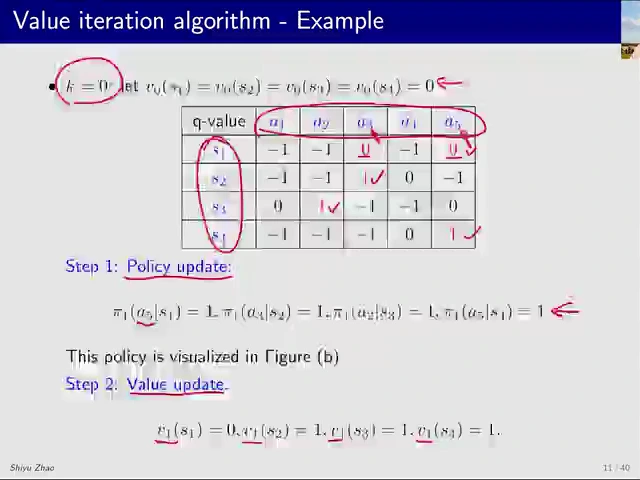

令 $v_0=(0,0,0,0)$，所有后续项均为 0。$s_1$ 向下和停留同得 0，图中选停留。$s_2$ 向下、$s_3$ 向右、$s_4$ 停留均可立即得 1。逐行取最大得到 $v_1=(0,1,1,1)$。这轮若在 $s_1$ 选向下，价值更新仍是 0。

### 第 12 页 · 第二轮 · 起点开始看到目标奖励

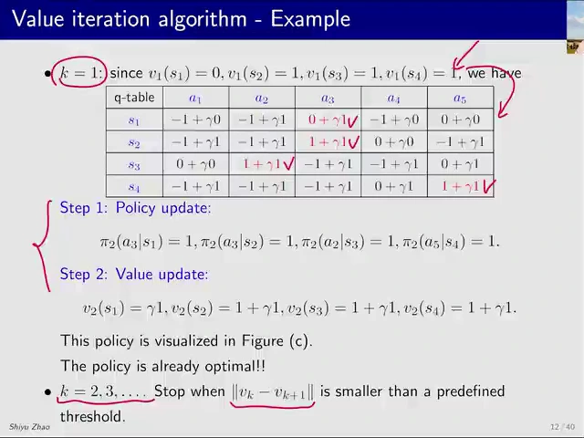

把 $v_1$ 代入。$s_1$ 向下是 $0+0.9(1)=0.9$，停留是 0，向右是 $-1+0.9(1)=-0.1$，因此改为向下。其余三格仍选之前的动作，值变为 $1.9$，故 $v_2=(0.9,1.9,1.9,1.9)$。后三格能立即持续得 1，$s_1$ 最快在第二步开始得 1，所以此时策略已最优。价值估计还没到 $(9,10,10,10)$，程序仍要按阈值继续更新。

## Part 2 · Policy Iteration

### 第 13 页 · 进入策略迭代

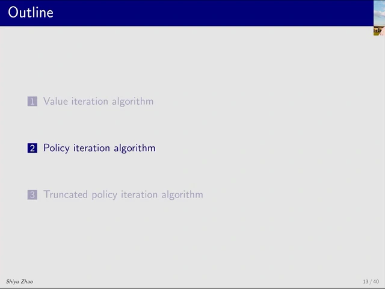

值迭代从一组价值估计出发。接下来改从一套实际的策略出发，先算它的价值，再借这组价值找更好的动作。

### 第 14 页 · Policy Iteration · 评价与改进

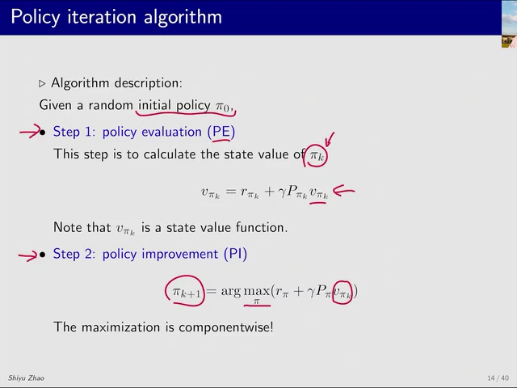

给定初始策略 $\pi_0$。策略评价（policy evaluation，PE）固定当前 $\pi_k$，求出它的价值 $v_{\pi_k}=\mathbf r_{\pi_k}+\gamma P_{\pi_k}v_{\pi_k}$。策略改进（policy improvement，PI）用这组已经求出的价值，逐状态选最大的首步动作，得到 $\pi_{k+1}$。

### 第 15 页 · 策略与价值怎样交替

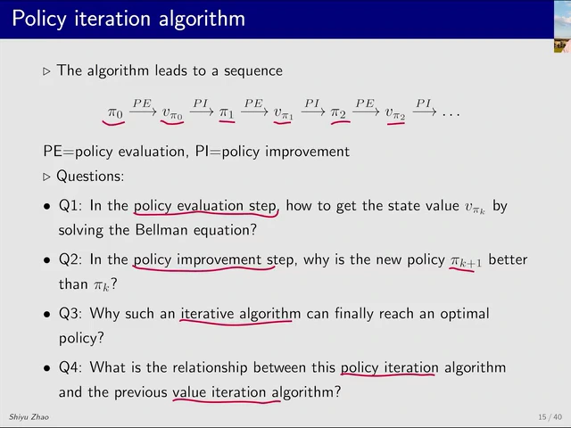

一轮的输入是策略，先算出该策略的价值，再用价值改出下一套策略。接下来依次讨论怎样解评价方程、为什么改进不会变差、怎样达到最优，以及它和值迭代的联系。

### 第 16 页 · Exact policy evaluation · 两种解法

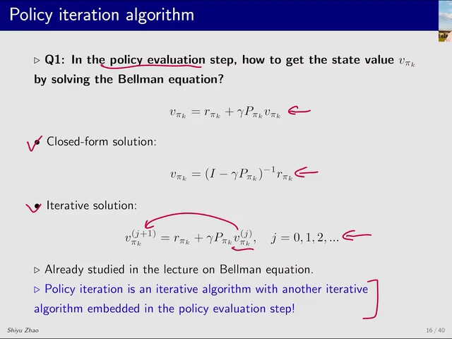

可解 $(I-\gamma P_{\pi_k})v_{\pi_k}=\mathbf r_{\pi_k}$，也可固定 $\pi_k$ 反复做 $v^{(j+1)}=\mathbf r_{\pi_k}+\gamma P_{\pi_k}v^{(j)}$，直到得到该策略的价值。闭式解（closed-form solution）可用线性方程组求得。状态多时，显式求逆通常代价较大，因此也常用迭代求解（iterative solution）。$k$ 数外层循环换策略的轮次，$j$ 数内层循环评价同一策略的步数。

### 第 17 页 · Policy improvement lemma

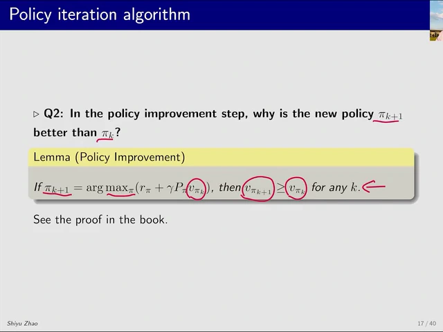

旧策略用自己的动作分布对 $q_{\pi_k}(s,a)$ 求平均，新策略选最大值，所以用旧价值做一次新策略更新就有 $T_{\pi_{k+1}}v_{\pi_k}\ge v_{\pi_k}$。用新策略继续更新会保持逐状态大小关系，极限是新策略真实价值。因此 $v_{\pi_{k+1}}\ge v_{\pi_k}$，这里允许两者打平。

### 第 18 页 · 为什么最后达到最优

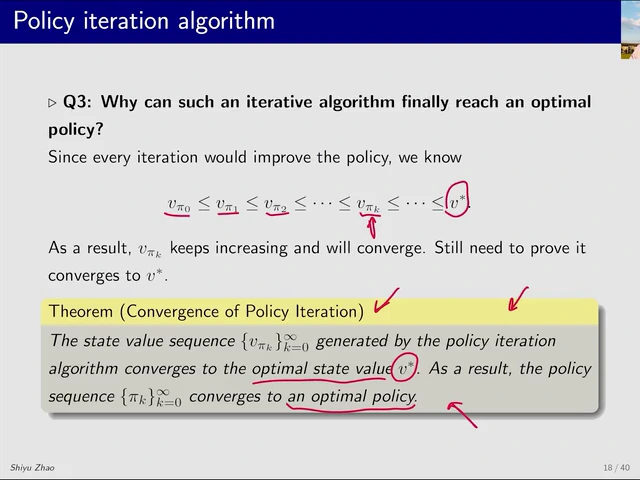

每轮策略价值逐状态不降，而且被 $v^*$ 从上面限制。仅凭这两点可知收敛，还要确定极限的位置。由于新策略评价的结果至少达到第一次更新 $Tv_{\pi_k}$，策略迭代的价值逐轮不低于从同一初值开始的值迭代。后者收敛到 $v^*$，所以策略价值也收敛到 $v^*$。有并列动作时，保留已是最大动作的旧选择，可避免在等价策略间来回切换。

### 第 19 页 · 先留下与值迭代的比较

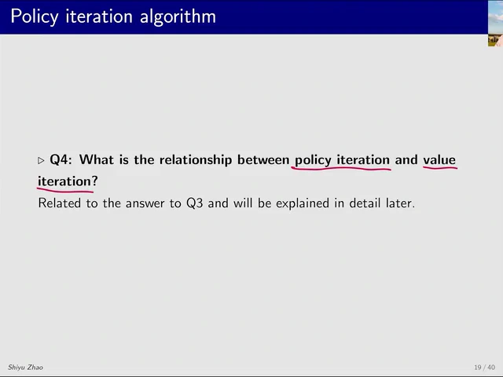

策略迭代的收敛可以借助值迭代的收敛来证明。第三段还会说明，两种方法都是截断策略迭代的特殊情况，差别在于选好新策略后固定它更新几次。

### 第 20 页 · Policy evaluation · 逐状态公式

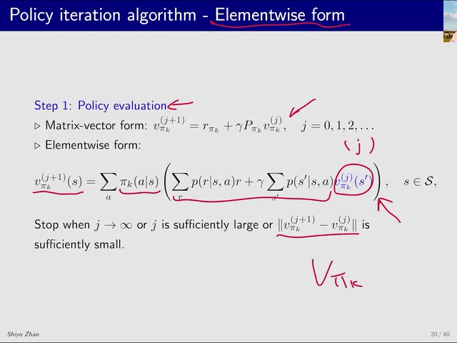

评价期间一直用 $\pi_k(a\mid s)$ 给各动作加权。把旧的内层估计 $v^{(j)}_{\pi_k}$ 放进折扣项，算出全部状态的 $v^{(j+1)}_{\pi_k}$。可以迭代到相邻值差很小，理论上的完全评价对应求到方程的固定点。

### 第 21 页 · Policy improvement · 逐状态公式

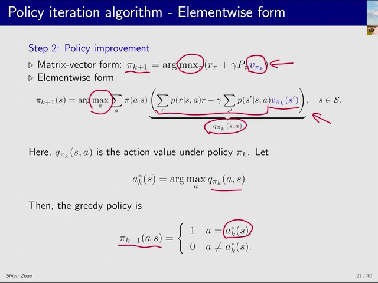

用刚求得的真实价值 $v_{\pi_k}$ 来算 $q_{\pi_k}(s,a)$。它的含义是先指定动作 $a$，再按旧策略走。逐状态选 $a_k^*(s)\in\arg\max_a q_{\pi_k}(s,a)$，新策略给这个动作概率 1。即使旧策略从来不选某个首步，也要把它纳入比较。

### 第 22 页 · Policy Iteration pseudocode

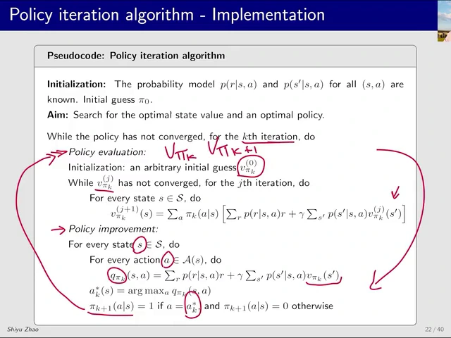

外层从 $\pi_0$ 开始。每一轮先固定策略，内层迭代到评价完成；接着用评价结果遍历所有状态与动作，选出新策略。若原策略在各状态已经是贪心的，就可停止。若采用保留原动作的并列处理规则（tie-breaking rule），这可以直接通过检查策略是否改变来实现。

### 第 23 页 · 两格算例 · 读懂初始箭头

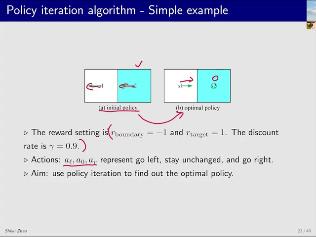

左格 $s_1$ 是普通格，右格 $s_2$ 是目标。可选左、停、右，撞边界扣 1 并留在原地，进入或停在目标得 1，其余为 0，$\gamma=0.9$。左图的初始策略在两格都向左，右图的目标策略在 $s_1$ 向右、在 $s_2$ 停留。下面用算法求出右图的动作。

### 第 24 页 · Policy evaluation · 两格算例

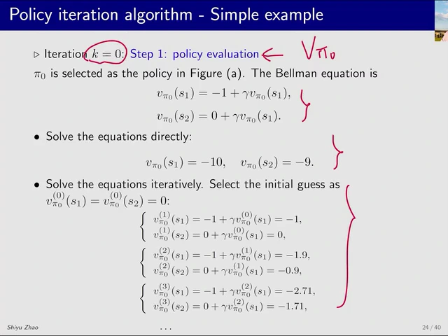

从 $s_1$ 向左会一直撞墙，所以 $v_{\pi_0}(s_1)=-1+0.9v_{\pi_0}(s_1)=-10$。从 $s_2$ 向左，先得 0 并到 $s_1$，所以 $v_{\pi_0}(s_2)=0+0.9(-10)=-9$。用全零值迭代评价，前三轮依次为 $(-1,0)$、$(-1.9,-0.9)$、$(-2.71,-1.71)$，继续算会趋于同一结果。目标格是起点，过去到达它时的得分不计入当前回报。

### 第 25 页 · Policy improvement · 两格算例

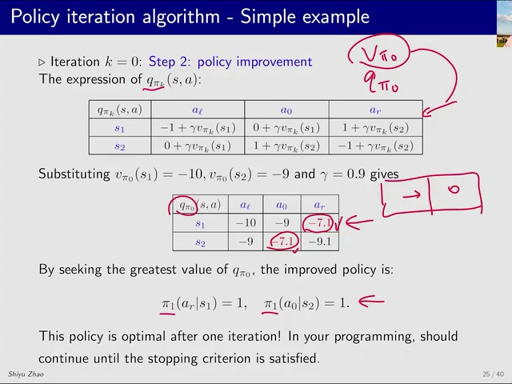

把 $(-10,-9)$ 代入动作值。按左、停、右排列，$s_1$ 是 $(-10,-9,-7.1)$，$s_2$ 是 $(-9,-7.1,-9.1)$。例如 $s_1$ 向右是 $1+0.9(-9)=-7.1$，表示进目标之后仍按旧策略离开。选出的新策略在左格向右、右格停留，重新评价可得 $(10,10)$。本例一轮改进已最优，程序还需用停止条件确认。

### 第 26 页 · 把目标格换到左边

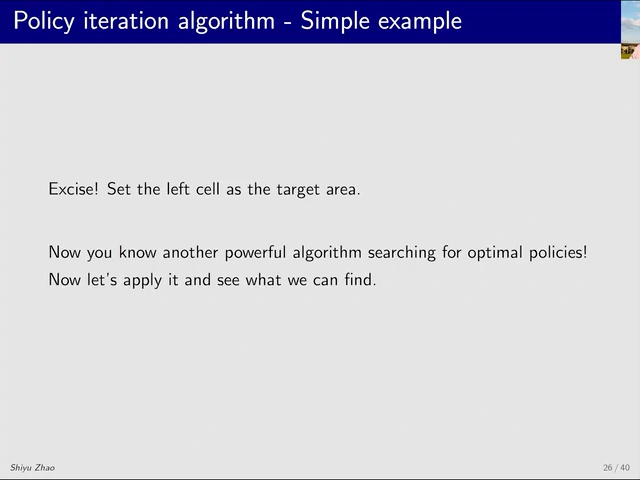

老师把这页留作练习，视频中没有演算。把左格改为目标，重新按奖励规则写两格的评价式，再比较三个动作。动作比较的过程保持相同，最优走法会改成左格停留、右格向左。

### 第 27 页 · 五乘五网格 · 观察前几轮

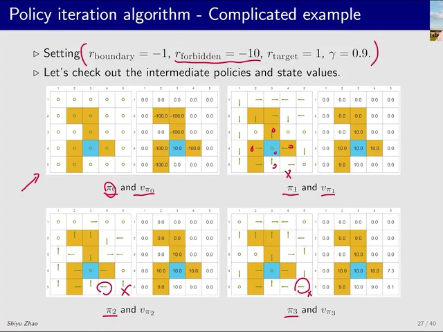

撞边界扣 1、进入或留在禁区扣 10、进入或停在目标得 1，$\gamma=0.9$。初始策略处处停留，所以普通格价值是 0，禁区是 $-10/(1-0.9)=-100$，目标是 10。图中每组左边画动作、右边画相应策略的真实价值。先评价 $\pi_0$，再贪心改进得到 $\pi_1$ 并重新评价。最早的改进出现在能较快到达目标的格子。

### 第 28 页 · 五乘五网格 · 有利走法向外扩展

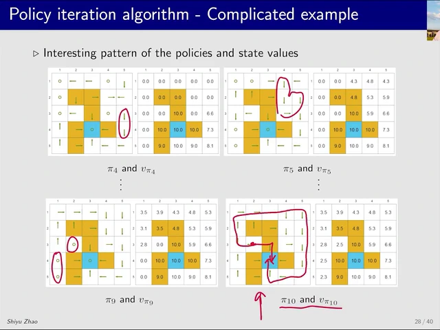

后面的几轮把能到达目标的走法逐步传到更远的格子。普通格早期可能原地不动，因为沿当时已知走法还看不到更高回报。等相邻格的策略能走到目标，再朝它移动就有价值。从 $\pi_2$ 到 $\pi_3$，右下方的一些格子开始向左接上通往目标的路线。到 $\pi_9$，接近目标的格子大多已有合适的动作，较远的格子仍在调整。课件的 $\pi_{10}$ 从各个起点都可以走到目标，有绕行路线时会避开代价高的禁区。

## Part 3 · Truncated Policy Iteration

### 第 29 页 · 进入截断策略迭代

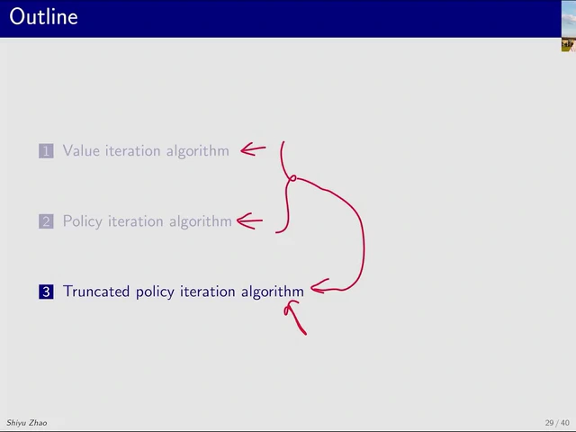

把值迭代和策略迭代对齐到同一个起点，看它们第一次采取不同做法的地方。截断策略迭代就在这一步调节评价次数。

### 第 30 页 · 并列比较两种算法

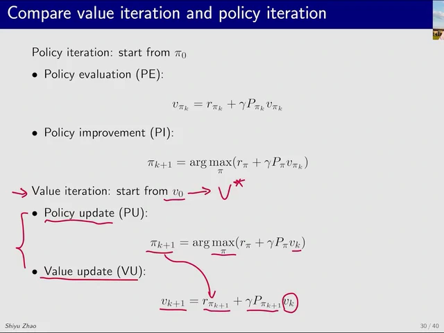

策略迭代从 $\pi_0$ 开始，先评价至 $v_{\pi_k}$，再用它改进策略。值迭代从 $v_0$ 开始，先用当前估计选择贪心策略，再对它做一次价值更新。两者的选动作规则相同，选动作时用到的价值来源不同。

### 第 31 页 · 把两条更新链错开对齐

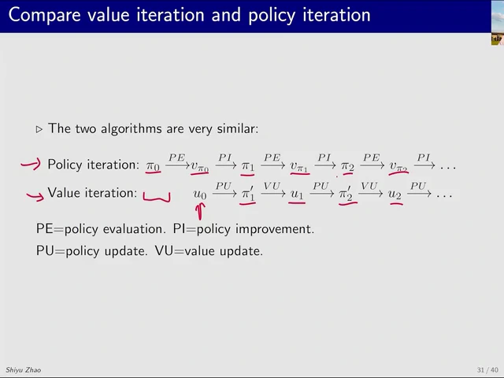

策略迭代的链是「策略 → 完整评价 → 贪心改进 → 新策略」。值迭代的链是「价值估计 → 贪心选策略 → 一次更新 → 新价值估计」。如果从价值出发看，两者都先选一套新策略，再给这套策略做某种程度的评价。

### 第 32 页 · 用同一个初值找出第一个差别

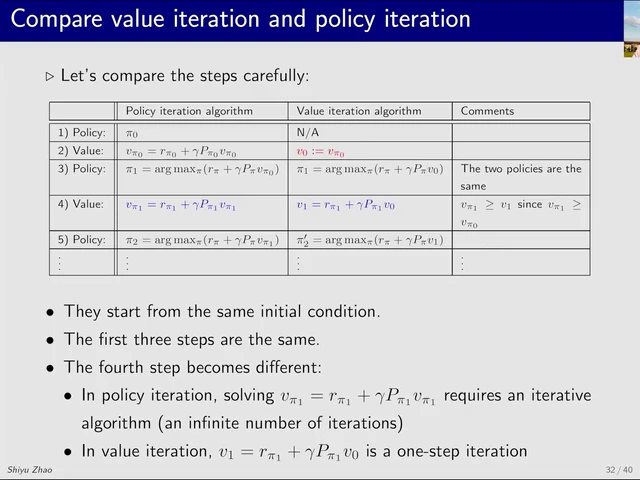

令值迭代初值 $v_0=v_{\pi_0}$，两者第一次用相同价值做贪心选择，因此可选到同一个 $\pi_1$。接下来，值迭代得到 $v_1=T_{\pi_1}v_0$，策略迭代求的是 $v_{\pi_1}=T_{\pi_1}v_{\pi_1}$。从这个共同初值出发，$v_{\pi_1}\ge v_1$。之后两者用不同价值再选动作，策略也可能分开。

### 第 33 页 · 用内层步数连接三种方法

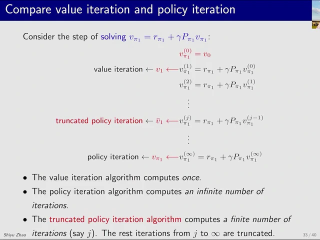

固定刚选出的 $\pi_1$，以旧值 $v_0$ 开始评价。做 1 次就是值迭代的一次更新，做若干次后提早停下就是截断策略迭代，求到极限就是完整评价。这里的「无穷次」指迭代评价的理论极限，也可以直接求解贝尔曼方程。

### 第 34 页 · Truncated Policy Iteration pseudocode

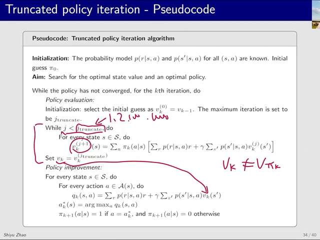

课件按「评价当前策略、贪心改进」编排。每轮评价沿用上一轮的价值估计作内层起点，固定当前策略做 $m$ 次同步更新，把第 $m$ 次的结果交给下一次改进。代码要分清外层的策略轮次与内层的评价步数（evaluation steps）。单看一轮中动作没有变化，未必能确认近似价值已经收敛。

### 第 35 页 · Value improvement · 逐步提升的条件

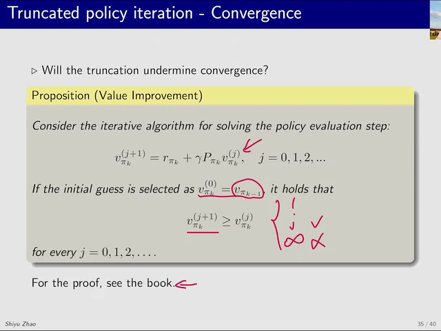

课件命题从上一套策略的真实价值 $v_{\pi_{k-1}}$ 出发，固定对它贪心的新策略 $\pi_k$。第一次更新已经不低于起点。固定策略的更新会保持逐状态大小关系，所以第二次也不低于第一次，依此类推。这个逐步改进结论依赖所述起点条件，不能套到随意指定的初始估计上。

### 第 36 页 · Convergence · 三条示意线

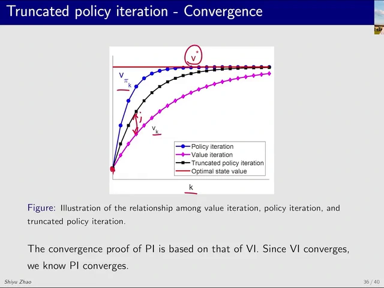

图把值迭代、截断策略迭代和策略迭代放在同一个最优值下比较。对齐共同的初值后，完整评价至少达到一次更新的价值。值迭代又收敛到最优价值，于是可以用上下界理解策略迭代的收敛。示意图把有限次评价的曲线画在一次更新与完整评价之间。横轴是外层轮次，每轮做的计算量不同。

当前视频从第 36 页跳到第 40 页。第 37–39 页用作者公开课件补齐。

### 第 37 页 · Value error · 实验设置（课件补充）

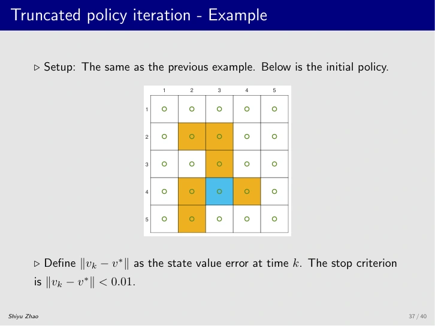

沿用五乘五网格和课件给出的初始策略。这里用 $\|v_k-v^*\|$ 画价值误差，以小于 0.01 为停止条件。这个对照实验预先有 $v^*$。实际未知最优值时，可检查相邻价值差或贝尔曼残差。

### 第 38 页 · Evaluation steps · 四组对比（课件补充）

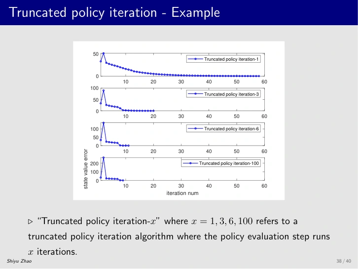

图比较每轮固定策略评价 $m=1,3,6,100$ 步。横轴是外层轮次，纵轴是价值误差。$m=1$ 是每次只更新一次的情形。不同小图纵轴刻度不同，要用刻度比较误差大小；起初的误差也可能先升高。

### 第 39 页 · 怎样解读误差曲线（课件补充）

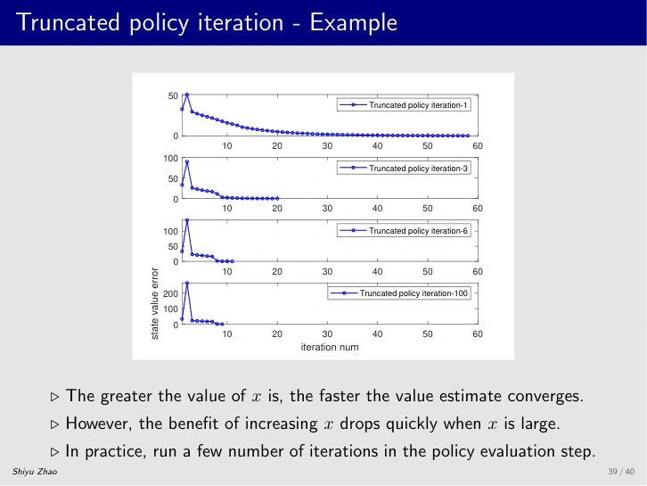

本例中，增加内层评价步数减少了达到误差阈值所需的外层轮次，但从 6 增到 100 的边际收益已很小。每一轮做的内层计算也同时增加，因此还要区分外层轮数与实际计算量。课件用此例说明少量评价步数常能在两者之间取得折中。

### 第 40 页 · 回顾三种迭代

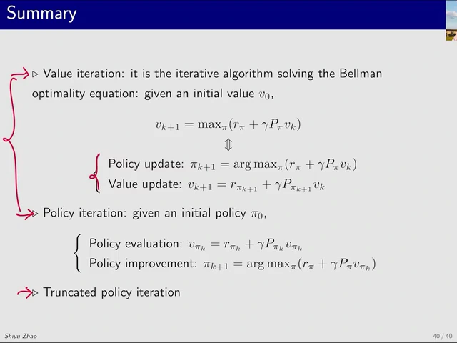

值迭代用当前价值选出贪心策略并更新一次。策略迭代先完整评价策略，再选下一套贪心策略。截断策略迭代固定策略做有限次评价再换策略。用共同起点对齐时，三者的区别是每次换动作之间做多少次固定策略的价值更新。下一课会沿用策略迭代的评价与改进框架，引入不依赖环境模型的蒙特卡洛方法。
