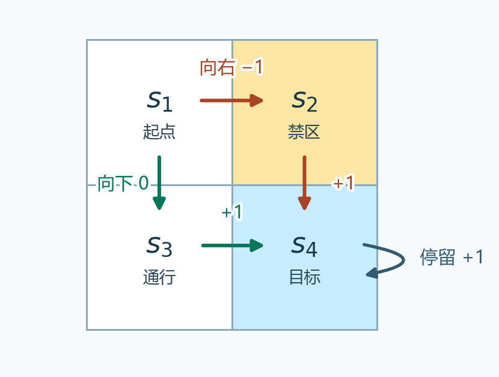
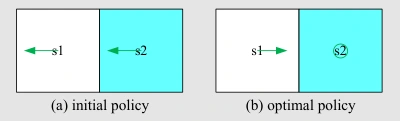
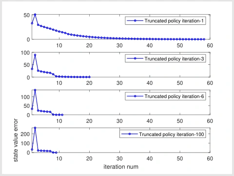

# 第 4 课 · 值迭代与策略迭代 · V2（总结）

[切换到 V1（逐页）](value-policy-iteration-slides.md)

## 1. 已知环境，怎样求出最优策略

本课假设已知环境模型。对于任意状态 $s$ 和动作 $a$，能算出这一步的平均奖励，也知道各个下一状态 $s'$ 出现的概率。这类方法属于<strong>动态规划（dynamic programming）</strong>。网格中的动作结果是确定的，所以每次只要查即时奖励和落点。

给一组价值估计 $v$，指定先做动作 $a$，把平均即时奖励和折扣后的落点价值加起来，得到一次向前看的分数。

$$
\begin{aligned}
q_v(s,a)
&=\underbrace{\sum_r p(r\mid s,a)r}_{\text{平均即时奖励}}\\
&\quad+\gamma\underbrace{\sum_{s'}p(s'\mid s,a)v(s')}_{\text{平均落点价值}}.
\end{aligned}
$$

比较同一状态下的这些分数，选一个最高的动作，就得到对 $v$ 的<strong>贪心策略（greedy policy）</strong>。它依赖所用的 $v$。估计变了，选出的动作也可能变。

后面会反复用到两种更新。<strong>固定策略更新</strong> $T_\pi v$ 按 $\pi$ 的动作概率给各分数加权。<strong>最优更新</strong> $Tv$ 逐状态挑最高的分数。

$$
\begin{aligned}
[T_\pi v](s)&=\sum_a\pi(a\mid s)q_v(s,a),\\
[Tv](s)&=\max_a q_v(s,a).
\end{aligned}
$$

把所有格子的价值排成向量，固定策略的一次更新也可写成 $T_\pi v=\mathbf r_\pi+\gamma P_\pi v$。其中 $\mathbf r_\pi$ 收集各格的平均即时奖励，$P_\pi$ 的每一行是按该策略走一步的落点概率。

三种算法的主要区别在于<strong>选出一套贪心动作后，用它更新几次价值才重新选动作</strong>。

## 2. 值迭代 · 每轮比较动作，再更新一次

### 从贝尔曼最优公式得到算法

第 3 课的贝尔曼最优公式是 $v^*=Tv^*$。当 $0\le\gamma<1$，$T$ 是收缩映射。从任意初值 $v_0$ 反复做 $v_{k+1}=Tv_k$，就会趋近最优值 $v^*$。

每一轮先用<strong>同一份旧值</strong> $v_k$ 算所有 $q_{v_k}(s,a)$。每个状态要记两样东西。

- <strong>策略更新（policy update）</strong>记录哪一个动作取到最大值，由此得到 $\pi_{k+1}$。
- <strong>价值更新（value update）</strong>把这个最大分数写进 $v_{k+1}(s)$。所有格写完后，下一轮才改用 $v_{k+1}$。

因为 $\pi_{k+1}$ 选的恰好是最大动作，所以 $v_{k+1}=T_{\pi_{k+1}}v_k=Tv_k$。右侧只做了一次更新，中间的 $v_{k+1}$ 是价值估计，一般尚未等于策略 $\pi_{k+1}$ 的完整价值 $v_{\pi_{k+1}}$。

### 四格算例 · 为什么第一轮可能原地停留

<figure>
  
  <figcaption>进入禁区或撞墙扣 1 分，进入或停在目标得 1 分，其余为 0。本例取折扣因子 0.9。</figcaption>
</figure>

<strong>第一轮</strong>从 $v_0=(0,0,0,0)$ 开始，所有后续价值都是 0。对 $s_1$ 来说，向下和停留都立即得 0 分，因此并列第一。课件在这两个动作中选了停留。$s_2$ 向下、$s_3$ 向右和 $s_4$ 停留都能立即得 1 分，于是 $v_1=(0,1,1,1)$。

<strong>第二轮</strong>拿 $v_1$ 作输入。$s_1$ 向下到 $s_3$ 的分数是 $0+0.9(1)=0.9$。停留还是 0 分，向右进禁区则是 $-1+0.9(1)=-0.1$。此时向下严格更好。其他三格都能立即得到 1 分并到达或留在 $s_4$，所以它们的新值都是 $1+0.9(1)=1.9$。整轮得到 $v_2=(0.9,1.9,1.9,1.9)$。

从全零值开始时，第 $k$ 轮相当于先只看未来 $k$ 步。目标奖励在第一轮先影响能一步拿分的格子，第二轮才进入 $s_1$ 的比较。此时箭头已经最优，因为从 $s_1$ 最快第二步拿到 1 分，其他格可以第一步就拿到，随后都可以一直得分。<strong>最优动作可以先出现，价值还要继续更新。</strong> 算到极限才得到 $(9,10,10,10)$。

## 3. 策略迭代 · 先算完整价值，再改动作

### 外层换策略，内层评价同一个策略

从一套初始策略 $\pi_0$ 开始，每轮做两件事。

1. <strong>策略评价（policy evaluation，PE）</strong>。固定当前策略 $\pi_k$，求它真正的长期价值 $v_{\pi_k}$。这个值满足 $v_{\pi_k}=T_{\pi_k}v_{\pi_k}$。可以直接解线性方程组，也可以反复应用 $T_{\pi_k}$ 直到收敛。这段内层计算始终使用同一套动作概率。
2. <strong>策略改进（policy improvement，PI）</strong>。用刚求出的 $v_{\pi_k}$ 计算每个首步动作的分数 $q_{\pi_k}(s,a)$。该分数表示第一步指定做 $a$，从第二步起照旧策略走。每格选一个分数最大的动作，组成下一轮的 $\pi_{k+1}$。

下标 $k$ 数外层已经换了几次策略。用迭代做评价时，内层下标 $j$ 只数固定同一个策略更新了几次。如果评价完成后，当前动作在每个状态都已经是最大动作，就可以停止。并列时保留原来的最大动作，可以避免在等价选择之间反复切换。

完整评价的两种写法如下。上式移项后可以直接求解，下面的递推式可以从任意初值重复应用。

$$
\begin{aligned}
(I-\gamma P_{\pi_k})v_{\pi_k}&=\mathbf r_{\pi_k},\\
v^{(j+1)}&=\mathbf r_{\pi_k}+\gamma P_{\pi_k}v^{(j)}.
\end{aligned}
$$

### 两格算例 · 一轮改进从负回报变为持续得分

<figure>
  
  <figcaption>左格是普通格，右格是目标。初始策略两个格子都向左。改进后，左格向右，右格停留。</figcaption>
</figure>

可以向左、停留或向右。撞墙扣 1 分并留在原地，进入或留在目标得 1 分，其余为 0，$\gamma=0.9$。

<strong>先评价旧策略。</strong> 从左格 $s_1$ 出发会一直撞墙。每步都扣 1 分，且扣分后仍在 $s_1$，所以 $v_{\pi_0}(s_1)=-1+0.9v_{\pi_0}(s_1)$。移项后得到 $0.1v_{\pi_0}(s_1)=-1$，即 $v_{\pi_0}(s_1)=-10$。右格 $s_2$ 虽是目标，旧策略却会立即向左离开。这一步得 0 分，之后接上左格的价值，所以 $v_{\pi_0}(s_2)=0+0.9(-10)=-9$。

如果用内层迭代而非移项，从 $(0,0)$ 开始，第一次只有左格撞墙扣分，得到 $(-1,0)$。第二次左格为 $-1+0.9(-1)=-1.9$，右格为 $0+0.9(-1)=-0.9$。两格一直沿用旧策略，迭代才会趋向 $(-10,-9)$。

<strong>再比较首步。</strong> 例如 $s_1$ 向右得 1 分并到 $s_2$。假设下一步起仍用旧策略，分数就是 $1+0.9(-9)=-7.1$。逐项计算如下。

| 起点 | 向左 | 停留 | 向右 |
| --- | ---: | ---: | ---: |
| $s_1$ | $-10$ | $-9$ | **$-7.1$** |
| $s_2$ | $-9$ | **$-7.1$** | $-9.1$ |

两行最大的都是 $-7.1$，对应的动作分别是向右和停留。<strong>$-7.1$ 是用旧策略续走算出的分数。</strong> 两个动作同时改好后，从任一格都能第一步就拿到 1 分，再持续得 1 分，所以重新评价的新价值是 $(10,10)$。这也达到每步最多 1 分的回报上界。

### 为什么改一次不会变差

旧策略自己的价值是 $v_{\pi_k}=T_{\pi_k}v_{\pi_k}$。用这组旧价值比较动作，旧策略取加权平均，新策略 $\pi_{k+1}$ 取最大值，所以第一次按新策略更新后，价值逐状态至少和原来一样高。

$$
T_{\pi_{k+1}}v_{\pi_k}=Tv_{\pi_k}\ge v_{\pi_k}.
$$

固定新策略再更新时，后续价值按非负概率加权。上一轮每个分量都不低于再上一轮，这一轮也会维持同样的大小关系。于是从 $v_{\pi_k}$ 开始评价新策略，内层估计逐步不降，最后收敛到 $v_{\pi_{k+1}}$。

为什么会达到最优？从同一份初值出发，值迭代只做一次最优更新，策略迭代的完整评价至少达到这一次更新的值。由于 $T$ 也保持逐状态的大小关系，后续各轮仍可用值迭代的结果作为下界。上界是 $v^*$，而下界本身就会趋近 $v^*$，所以策略迭代的价值也趋近最优值。

## 4. 截断策略迭代 · 每次评价有限步

### 用同一份旧值比较三种更新

令值迭代与策略迭代从同一份价值 $v_0=v_{\pi_0}$ 开始。它们第一次贪心选动作时可以得到同一个 $\pi_1$。分歧发生在接下来如何评价 $\pi_1$。先固定它，以 $u_0=v_0$ 开始做 $u_{j+1}=T_{\pi_1}u_j$。

| 算法 | 固定 $\pi_1$ 评价多久 | 下一轮拿什么选动作 |
| --- | --- | --- |
| 值迭代（VI） | 只更新 1 步 | $u_1$ |
| 截断策略迭代（TPI） | 更新有限的 $m$ 步 | $u_m$ |
| 策略迭代（PI） | 求到评价方程的解 | $v_{\pi_1}$ |

课件用 $j$ 表示内层评价步，另用截断上限指定每轮做几步。把这个上限记为 $m$ 后，循环就是<strong>对当前值贪心选策略 → 固定这套策略更新 $m$ 次 → 用所得价值重新选策略</strong>。如果按课件伪代码从一套初始策略开始，就先执行它的第一段评价，再进入同样的循环。

回到两格算例。选出「左格向右、右格停留」以后，从 $u_0=(-10,-9)$ 开始，第一次只更新到 $u_1=(-7.1,-7.1)$。再固定这套动作做一次，每格都是 $1+0.9(-7.1)=-5.39$。继续做下去才会到 $(10,10)$。做一次、做两次和完整求解，用的是<strong>同一条评价公式</strong>，只是把不同深度的估计交回下一轮。

### 什么时候能保证逐步提高

若从上一套策略的真实价值开始，新策略贪心，所以第一次更新已经不低于起点。固定它继续更新会保持这个大小关系。截在第 $m$ 步时，拿到的是一次更新与完整评价之间的价值。随意指定初始估计时，不能仅凭这条结论断言每个分量从第一轮开始都上升。

在上述共同初值下，截断值仍可用值迭代的结果作下界。具体来说，每轮固定策略做的第一步等于 $Tv$，后续几步不降，因此截断值至少达到 $Tv$。把 $u_m$ 交给下一轮时，重新做最优更新又至少和原策略再做一步一样好，所以下一轮仍能重复这个比较。这样得到的价值被夹在值迭代的结果与 $v^*$ 之间。

## 5. 怎样看收敛图与停止条件

<figure>
  
  <figcaption>五乘五网格实验。横轴是外层迭代轮次，纵轴是价值误差。四个小图的纵轴刻度各不相同。</figcaption>
</figure>

课件用已知的 $v^*$ 做实验对照，当 $\|v_k-v^*\|<0.01$ 时停止。这个网格里，每轮评价 6 步比 1 步少用很多外层轮次，从 6 步加到 100 步则改善较小。每轮更长也意味着更多计算，<strong>外层轮数少和总计算量小是两件事</strong>。图中部分曲线开始时还有上升，这和上节的结论并不冲突，因为实验里的初始估计未必满足逐分量改进的起点条件。

实际求解时 $v^*$ 通常未知。值迭代可以检查相邻两轮价值差。对任何一组候选 $v$，也可以算<strong>贝尔曼残差（Bellman residual）</strong> $\|Tv-v\|_\infty$，看看再做一次最优更新还会改变多少。由于 $T$ 每次至多按 $\gamma$ 缩小两组价值的差，当前价值距最优值的最大误差至多是残差除以 $1-\gamma$。只看到贪心动作一轮没变时，仍应检查价值或残差。
