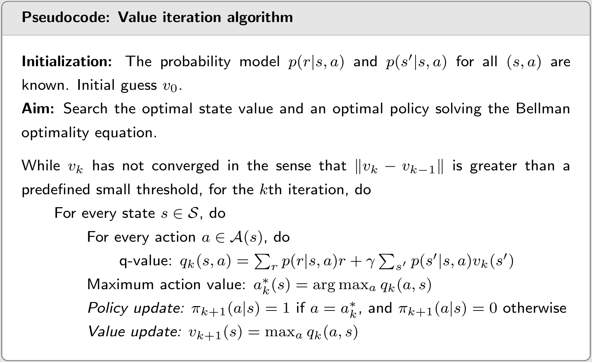
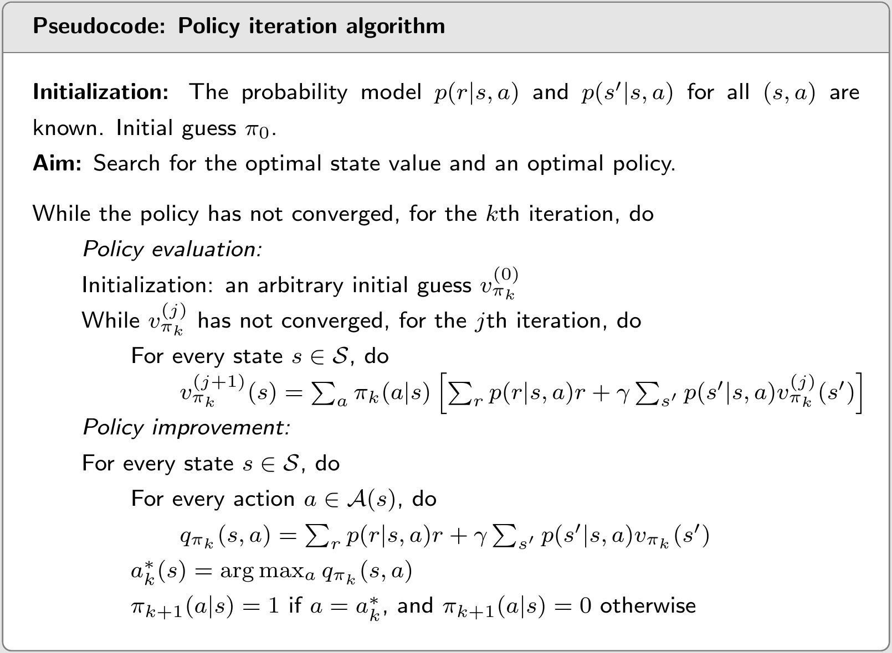
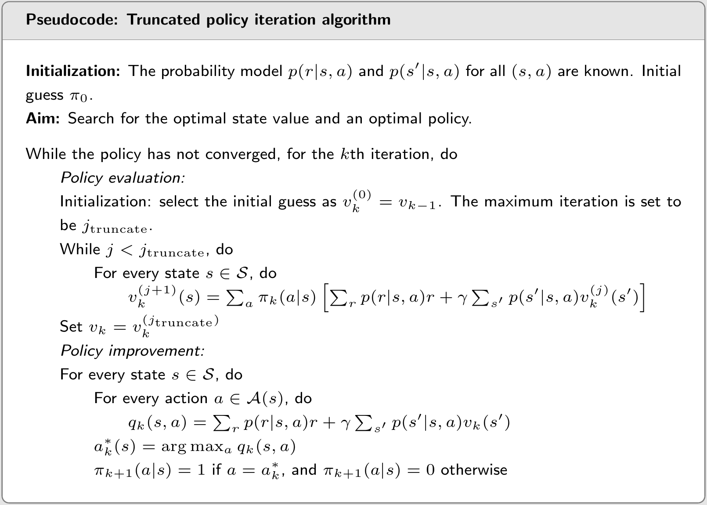
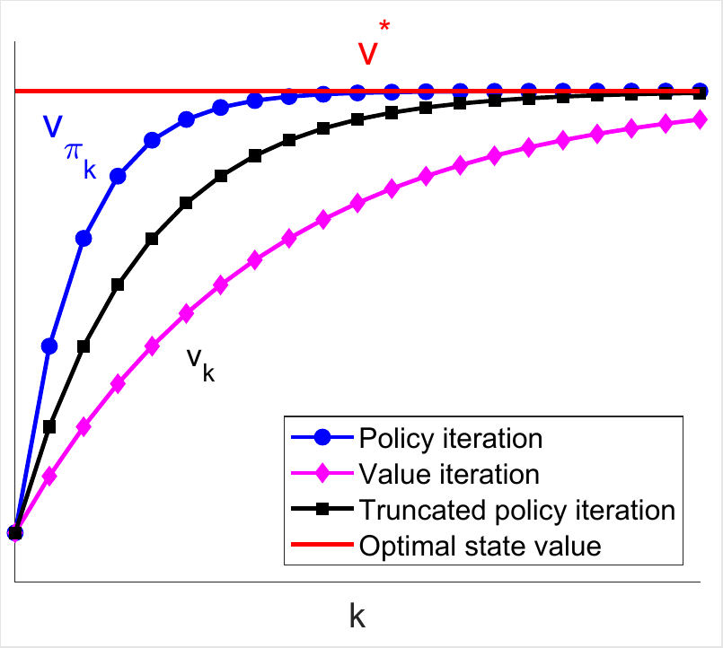

# 第 4 课 · 值迭代与策略迭代 · V2（总结）

[切换到 V1（逐页）](value-policy-iteration-slides.md)

## 1. Value Iteration

#### （1）一轮值迭代可以拆成两步

Value iteration algorithm · 两步更新

第三课用值迭代求解贝尔曼最优方程（BOE）。给定旧价值向量 $\mathbf v_k$，对每个状态取使一步前瞻值最大的动作：

$$
\mathbf v_{k+1}=f(\mathbf v_k)
=\max_\pi\bigl(\mathbf r_\pi+\gamma P_\pi\mathbf v_k\bigr).
$$

这个更新可以拆成下面两步。其中最大化是逐状态做的：

$$
\begin{aligned}
\text{Step 1:}\quad
\pi_{k+1}&\in\arg\max_\pi\bigl(\mathbf r_\pi+\gamma P_\pi\mathbf v_k\bigr),\\
\text{Step 2:}\quad
\mathbf v_{k+1}&=\mathbf r_{\pi_{k+1}}+\gamma P_{\pi_{k+1}}\mathbf v_k.
\end{aligned}
$$

<strong>Policy update</strong> 找到使右侧取最大值的策略；<strong>value update</strong> 把它代回右侧算出新价值。后一步仍然用旧的 $\mathbf v_k$ 做后续价值，只更新一次。中间的 $\mathbf v_k$ 是<strong>价值估计</strong>，未必满足任何固定策略的贝尔曼方程，因此不一定是某个策略的真实状态价值。

#### （2）Step 1 · Policy update

Policy update · 用旧价值选贪心动作

固定 $\mathbf v_k$。在每个状态 $s$，对每个可用动作 $a$ 先算<strong>一步前瞻值</strong>：

$$
q_k(s,a)=\sum_r p(r\mid s,a)\,r
+\gamma\sum_{s'}p(s'\mid s,a)\,v_k(s').
$$

逐状态看，矩阵式里的 $\arg\max_\pi$ 就是在选动作分布，使各动作的一步前瞻值的加权平均最大：

$$
\pi_{k+1}(\cdot\mid s)
\in\arg\max_{\pi(\cdot\mid s)}
\sum_{a\in\mathcal A(s)}\pi(a\mid s)\,q_k(s,a).
$$

加权平均不会超过最大项，故可任选一个 $a_k^*(s)\in\arg\max_{a\in\mathcal A(s)}q_k(s,a)$，把全部概率给它：

$$
\pi_{k+1}(a\mid s)=
\begin{cases}
1,&a=a_k^*(s),\\
0,&a\ne a_k^*(s).
\end{cases}
$$

这就是<strong>贪心策略（greedy policy）</strong>：在每个状态选当前 $q_k$ 最大的动作。

#### （3）Step 2 · Value update

Value update · 用选定动作更新价值

把 $\pi_{k+1}$ 代入 $\mathbf v_{k+1}=\mathbf r_{\pi_{k+1}}+\gamma P_{\pi_{k+1}}\mathbf v_k$。逐状态展开：

$$
\begin{aligned}
v_{k+1}(s)
&=\sum_a\pi_{k+1}(a\mid s)
\underbrace{\left[\sum_r p(r\mid s,a)\,r
+\gamma\sum_{s'}p(s'\mid s,a)\,v_k(s')\right]}_{q_k(s,a)}\\
&=q_k(s,a_k^*(s))=\max_{a\in\mathcal A(s)}q_k(s,a).
\end{aligned}
$$

最后一步成立，因为 $\pi_{k+1}$ 把概率 $1$ 给了当前值最大的动作。一轮内所有状态都使用同一份旧价值 $\mathbf v_k$，全部算完再换成 $\mathbf v_{k+1}$。

#### （4）Procedure Summary & Pseudocode

Procedure summary · 一轮的输入与输出

$$
\mathbf v_k\longrightarrow q_k(s,a)
\longrightarrow\pi_{k+1}(a\mid s)
\longrightarrow v_{k+1}(s)=\max_a q_k(s,a).
$$

<strong>初始化：</strong> 已知各状态动作对的奖励与转移概率，给定初始估计 $\mathbf v_0$。目标是求出 BOE 的最优状态价值和一套最优策略。先做一次更新，再用相邻两轮价值之差是否低于预设阈值判断是否继续。

<figure>
  
</figure>

## 2. Policy Iteration

#### （1）从一套初始策略开始

Policy iteration algorithm · 先评估，再改进

可以随机选一套初始策略 $\pi_0$。每一轮先求出当前策略的状态价值，再用这组价值选下一套策略：

$$
\begin{aligned}
\text{Step 1:}\quad
\mathbf v_{\pi_k}&=\mathbf r_{\pi_k}+\gamma P_{\pi_k}\mathbf v_{\pi_k},\\
\text{Step 2:}\quad
\pi_{k+1}&\in\arg\max_\pi\bigl(\mathbf r_\pi+\gamma P_\pi\mathbf v_{\pi_k}\bigr).
\end{aligned}
$$

<strong>Policy evaluation（PE，策略评估）</strong>求的是固定策略 $\pi_k$ 的真实状态价值；<strong>policy improvement（PI，策略改进）</strong>用这组价值在各状态做贪心选择。两步交替：

$$
\pi_0\xrightarrow{\mathrm{PE}}\mathbf v_{\pi_0}
\xrightarrow{\mathrm{PI}}\pi_1
\xrightarrow{\mathrm{PE}}\mathbf v_{\pi_1}
\xrightarrow{\mathrm{PI}}\pi_2
\xrightarrow{\mathrm{PE}}\mathbf v_{\pi_2}
\xrightarrow{\mathrm{PI}}\cdots .
$$

课件接着问四个问题：<strong>Q1</strong> 怎样求 $v_{\pi_k}$？<strong>Q2</strong> 为什么新策略不比旧策略差？<strong>Q3</strong> 为什么最后能达到最优？<strong>Q4</strong> 它和值迭代有什么关系？

#### （2）Q1 · 怎样求解策略评估？

Policy evaluation · 两种求解方式

固定 $\pi_k$ 后，奖励向量和转移矩阵都已确定。用第 2 课的方法求解贝尔曼期望方程：

$$
\begin{aligned}
\text{Closed-form solution:}\qquad
\mathbf v_{\pi_k}&=(I-\gamma P_{\pi_k})^{-1}\mathbf r_{\pi_k},\\
\text{Iterative solution:}\qquad
\mathbf v_{\pi_k}^{(j+1)}
&=\mathbf r_{\pi_k}+\gamma P_{\pi_k}\mathbf v_{\pi_k}^{(j)},
\qquad j=0,1,2,\ldots .
\end{aligned}
$$

$k$ 是外层的策略轮次，$j$ 是评估同一策略时的内层轮次。评估期间只更新价值估计，$\pi_k$ 保持固定。

#### （3）Q2 · 为什么贪心更新能改进策略？

Lemma · Policy Improvement

对当前策略的真实价值 $\mathbf v_{\pi_k}$ 逐状态做贪心选择，得到 $\pi_{k+1}$ 后，有

$$
\pi_{k+1}\in\arg\max_\pi
\bigl(\mathbf r_\pi+\gamma P_\pi\mathbf v_{\pi_k}\bigr)
\quad\Longrightarrow\quad
v_{\pi_{k+1}}(s)\ge v_{\pi_k}(s)
\quad \forall s\in\mathcal S .
$$

因为旧策略也在备选范围内，新策略对旧价值做一次更新，结果不会比旧价值低。转移概率非负，固定新策略继续评估时，这个大小关系会保留下来；迭代的极限就是新策略的真实价值。

#### （4）Q3 · 为什么最终能达到最优？

Theorem · Convergence of Policy Iteration

由策略改进引理，价值逐状态不下降，并始终受最优价值 $\mathbf v^*$ 限制：

$$
\mathbf v_{\pi_0}\le\mathbf v_{\pi_1}
\le\mathbf v_{\pi_2}\le\cdots\le\mathbf v_{\pi_k}
\le\cdots\le\mathbf v^* .
$$

单调有界只说明价值存在极限。要看为什么极限是 $\mathbf v^*$，注意贪心选择后，对旧价值做的第一次更新正是 BOE 更新 $f(\mathbf v_{\pi_k})$。继续评估新策略，价值只会再提高，因此

$$
\mathbf v_{\pi_k}\le f(\mathbf v_{\pi_k})
\le\mathbf v_{\pi_{k+1}}\le\mathbf v^*.
$$

两端趋向同一个极限，而收缩映射 $f$ 连续，所以该极限满足 BOE。第三课已知 BOE 的价值解唯一，因此 $\mathbf v_{\pi_k}\to\mathbf v^*$。在有限状态和动作下，若并列时优先保留仍为贪心的旧动作，策略也会稳定在一套最优策略。允许任意切换并列动作时，价值可以已经最优，策略却仍在等价动作之间切换。

#### （5）展开 Step 1 与 Step 2

Step 1 · Policy evaluation（矩阵式与逐状态式）

从任意内层初值 $\mathbf v_{\pi_k}^{(0)}$ 出发，在固定 $\pi_k$ 的条件下更新：

$$
\mathbf v_{\pi_k}^{(j+1)}
=\mathbf r_{\pi_k}+\gamma P_{\pi_k}\mathbf v_{\pi_k}^{(j)}.
$$

$$
v_{\pi_k}^{(j+1)}(s)=\sum_a\pi_k(a\mid s)
\left[\sum_r p(r\mid s,a)\,r
+\gamma\sum_{s'}p(s'\mid s,a)v_{\pi_k}^{(j)}(s')\right],
\qquad s\in\mathcal S.
$$

理论上取 $j\to\infty$ 得到准确值；实际可在内层轮数足够多，或相邻两轮的最大变化 $\|\mathbf v_{\pi_k}^{(j+1)}-\mathbf v_{\pi_k}^{(j)}\|_\infty$ 小于预设阈值时停止，得到近似值。

Step 2 · Policy improvement（矩阵式与逐状态式）

把评估结果代入矩阵形式 $\pi_{k+1}\in\arg\max_\pi(\mathbf r_\pi+\gamma P_\pi\mathbf v_{\pi_k})$。逐状态展开：

$$
\pi_{k+1}(\cdot\mid s)\in\arg\max_{\pi(\cdot\mid s)}
\sum_a\pi(a\mid s)
\underbrace{\left[\sum_r p(r\mid s,a)\,r
+\gamma\sum_{s'}p(s'\mid s,a)v_{\pi_k}(s')\right]}_{q_{\pi_k}(s,a)}.
$$

这里 $q_{\pi_k}(s,a)$ 是旧策略的<strong>动作价值</strong>：第一步指定做 $a$，之后按 $\pi_k$ 行动。取任意 $a_k^*(s)\in\arg\max_{a\in\mathcal A(s)}q_{\pi_k}(s,a)$，得到新策略：

$$
\pi_{k+1}(a\mid s)=
\begin{cases}
1,&a=a_k^*(s),\\
0,&a\ne a_k^*(s).
\end{cases}
$$

#### （6）Procedure Summary & Pseudocode

Procedure summary · 两层循环

已知奖励与转移模型并给定初始策略。外层反复执行评估与改进，直到策略稳定；内层只评估当前策略，达到精度要求后才进行下一次改进。

<figure>
  
</figure>

<strong>Q4 · 与值迭代的联系：</strong>两者都逐状态做贪心选择。值迭代每轮只按贪心策略更新一次价值；策略迭代先充分评估固定策略，再用评估结果做下一次贪心选择。

## Truncated Policy Iteration

#### （1）把两条更新流程放在一起

Policy iteration vs. Value iteration

$$
\begin{aligned}
\text{Policy iteration:}\quad&
\pi_0\xrightarrow{\mathrm{PE}}\mathbf v_{\pi_0}
\xrightarrow{\mathrm{PI}}\pi_1
\xrightarrow{\mathrm{PE}}\mathbf v_{\pi_1}
\xrightarrow{\mathrm{PI}}\pi_2
\xrightarrow{\mathrm{PE}}\mathbf v_{\pi_2}\xrightarrow{\mathrm{PI}}\cdots\\
\text{Value iteration:}\quad&
\mathbf u_0\xrightarrow{\mathrm{PU}}\pi'_1
\xrightarrow{\mathrm{VU}}\mathbf u_1
\xrightarrow{\mathrm{PU}}\pi'_2
\xrightarrow{\mathrm{VU}}\mathbf u_2\xrightarrow{\mathrm{PU}}\cdots .
\end{aligned}
$$

PE 是 policy evaluation，PI 是 policy improvement；PU 是 policy update，VU 是 value update。这里用 $\mathbf u_k$ 表示值迭代的中间估计，以免与固定策略的真实价值 $\mathbf v_{\pi_k}$ 混淆。

#### （2）从同一组价值出发：在哪一步分开？

Step-by-step comparison · 前三步对齐，第四步分开

为了对齐起点，<strong>特意取 $\mathbf u_0=\mathbf v_{\pi_0}$</strong>。值迭代本身无须先给定策略，也不要求初值是某个策略的价值。表中的 $\arg\max$ 都按状态取，并列时使用同一选择规则。

| 步骤 | Policy Iteration | Value Iteration | 对比 |
| --- | --- | --- | --- |
| 1. 初始策略 | $\pi_0$ | 不需要 | $\pi_0$ 用于确定比较时的共同初值。 |
| 2. 初始价值 | $\mathbf v_{\pi_0}=\mathbf r_{\pi_0}+\gamma P_{\pi_0}\mathbf v_{\pi_0}$ | $\mathbf u_0:=\mathbf v_{\pi_0}$ | 两者用同一组价值。 |
| 3. 贪心选策略 | $\pi_1\in\arg\max_\pi(\mathbf r_\pi+\gamma P_\pi\mathbf v_{\pi_0})$ | $\pi'_1\in\arg\max_\pi(\mathbf r_\pi+\gamma P_\pi\mathbf u_0)$ | 选到同一策略，记为 $\pi_1$。 |
| 4. 更新价值 | $\mathbf v_{\pi_1}=\mathbf r_{\pi_1}+\gamma P_{\pi_1}\mathbf v_{\pi_1}$ | $\mathbf u_1=\mathbf r_{\pi_1}+\gamma P_{\pi_1}\mathbf u_0$ | 左边完整评估 $\pi_1$；右边只更新一次。 |
| 5. 再选策略 | $\pi_2\in\arg\max_\pi(\mathbf r_\pi+\gamma P_\pi\mathbf v_{\pi_1})$ | $\pi'_2\in\arg\max_\pi(\mathbf r_\pi+\gamma P_\pi\mathbf u_1)$ | 输入价值不同，得到的策略可能不同。 |

为什么第四步有 $\mathbf v_{\pi_1}\ge\mathbf u_1$？策略改进保证 $\mathbf v_{\pi_1}\ge\mathbf v_{\pi_0}=\mathbf u_0$。用同一个非负转移矩阵加权后，仍有

$$
\mathbf v_{\pi_1}-\mathbf u_1
=\gamma P_{\pi_1}(\mathbf v_{\pi_1}-\mathbf u_0)\ge\mathbf 0.
$$

若用迭代做完整评估，第 4 步的 $\mathbf v_{\pi_1}$ 是内层迭代的极限，也可以直接解线性方程。值迭代的 $\mathbf u_1$ 则是从同一起点做完第一步时得到的值。

#### （3）在同一条评估序列上选停止位置

Truncated policy iteration · 只评估有限轮

固定刚选出的 $\pi_1$，令 $\mathbf v_{\pi_1}^{(0)}=\mathbf u_0$，每次按同一个映射 $T_{\pi_1}(\mathbf w)=\mathbf r_{\pi_1}+\gamma P_{\pi_1}\mathbf w$ 更新。三种算法的区别在于拿哪一轮的结果去做下一次贪心选择：

$$
\begin{aligned}
\mathbf v_{\pi_1}^{(0)}&=\mathbf u_0,\\
\mathbf v_{\pi_1}^{(1)}&=T_{\pi_1}(\mathbf v_{\pi_1}^{(0)})=\mathbf u_1,\\
\mathbf v_{\pi_1}^{(2)}&=T_{\pi_1}(\mathbf v_{\pi_1}^{(1)}),\\
&\ \vdots\\
\mathbf v_{\pi_1}^{(j)}&=T_{\pi_1}(\mathbf v_{\pi_1}^{(j-1)})=\bar{\mathbf v}_1,\\
&\ \vdots\\
\mathbf v_{\pi_1}^{(\infty)}&=\mathbf v_{\pi_1}
=\mathbf r_{\pi_1}+\gamma P_{\pi_1}\mathbf v_{\pi_1}.
\end{aligned}
$$

- <strong>Value iteration：</strong>做一次更新，就用 $\mathbf u_1$ 选下一套贪心策略。
- <strong>Truncated policy iteration：</strong>做有限次更新（例如 $j>1$ 次），用 $\bar{\mathbf v}_1$ 选下一套策略，余下的内层更新省略。
- <strong>Policy iteration：</strong>用完整评估的结果 $\mathbf v_{\pi_1}$ 再选下一套策略。

#### （4）Procedure Summary & Pseudocode

Pseudocode · 用上轮估计作为本轮评估初值

已知奖励与转移模型，给定初始策略 $\pi_0$ 和起始价值估计。每轮固定当前策略 $\pi_k$，以上一轮的估计 $\mathbf v_{k-1}$ 作为内层初值，只评估 $j_{\mathrm{truncate}}$ 轮。令 $\mathbf v_k=\mathbf v_k^{(j_{\mathrm{truncate}})}$，再据此算 $q_k(s,a)$，逐状态选出新的贪心策略 $\pi_{k+1}$。$\mathbf v_k$ 一般只是 $\mathbf v_{\pi_k}$ 的近似值。

<figure>
  
</figure>

课件用「策略收敛」描述外层停止。因为这里的评估尚未做完，策略恰好有一轮没变并不保证已经最优；实际也可检查最优方程残差 $\|f(\mathbf v_k)-\mathbf v_k\|_\infty$ 是否足够小。

#### （5）截断会破坏收敛吗？

Proposition · Value Improvement

设 $\pi_k$ 由上一套策略的真实价值 $\mathbf v_{\pi_{k-1}}$ 贪心选出。用这个真实价值作为评估 $\pi_k$ 的初值：

$$
\begin{aligned}
\mathbf v_{\pi_k}^{(0)}&=\mathbf v_{\pi_{k-1}},\\
\mathbf v_{\pi_k}^{(j+1)}&=\mathbf r_{\pi_k}
+\gamma P_{\pi_k}\mathbf v_{\pi_k}^{(j)},
\qquad j=0,1,2,\ldots .
\end{aligned}
$$

那么对每一轮 $j$，都有逐状态的<strong>价值改进</strong>：

$$
\mathbf v_{\pi_k}^{(j+1)}\ge\mathbf v_{\pi_k}^{(j)} .
$$

第一次更新不低于初值：贪心选择的一步前瞻值不低于沿用旧策略，而旧策略对其真实价值做一次更新会得到原值。之后固定 $\pi_k$，非负的转移概率使每次更新都保留上一轮的大小关系。因此，截断时拿到的价值至少和第一轮更新一样高。

Convergence · 三种算法怎样接近最优值

实际截断时，下一轮用的是上轮的<strong>近似价值</strong>。若起始估计 $\mathbf w$ 满足 $\mathbf w\le f(\mathbf w)$，以它选出的贪心策略做第一轮更新就得到 $f(\mathbf w)$。继续用同一策略做有限轮，结果 $\mathbf w_{\mathrm{new}}$ 不会更低，也仍满足 $\mathbf w_{\mathrm{new}}\le f(\mathbf w_{\mathrm{new}})$。在这个条件下，只要每次至少评估一轮，从同一初值出发的截断迭代就逐轮不低于值迭代，同时不会超过 $\mathbf v^*$。值迭代收敛到 $\mathbf v^*$，截断迭代也收敛到它。

<figure>
  
  <figcaption>示意图中，做更多内层评估会更早接近红色最优价值线，但横轴只计外层轮数。每轮计算量不同，不能从图中直接判断哪种算法运行时间最短。</figcaption>
</figure>

