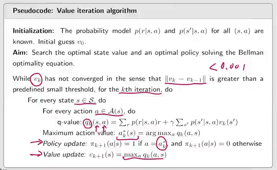

# 第 4 课 · 值迭代与策略迭代 · V2（总结）

[切换到 V1（逐页）](value-policy-iteration-slides.md)

## 1. Value Iteration

#### （1）一轮值迭代可以拆成两步

Value iteration algorithm · 两步更新

第三课用值迭代求解贝尔曼最优方程（BOE）。给定旧价值向量 $\mathbf v_k$，对每个状态取使一步前瞻值最大的动作：

$$
\mathbf v_{k+1}=f(\mathbf v_k)
=\max_\pi\bigl(\mathbf r_\pi+\gamma P_\pi\mathbf v_k\bigr).
$$

这个更新可以拆成下面两步。其中最大化是逐状态做的：

$$
\begin{aligned}
\text{Step 1:}\quad
\pi_{k+1}&\in\arg\max_\pi\bigl(\mathbf r_\pi+\gamma P_\pi\mathbf v_k\bigr),\\
\text{Step 2:}\quad
\mathbf v_{k+1}&=\mathbf r_{\pi_{k+1}}+\gamma P_{\pi_{k+1}}\mathbf v_k.
\end{aligned}
$$

<strong>Policy update</strong> 找到使右侧取最大值的策略；<strong>value update</strong> 把它代回右侧算出新价值。后一步仍然用旧的 $\mathbf v_k$ 做后续价值，只更新一次。中间的 $\mathbf v_k$ 是<strong>价值估计</strong>，未必满足任何固定策略的贝尔曼方程，因此不一定是某个策略的真实状态价值。

#### （2）Step 1 · Policy update

Policy update · 用旧价值选贪心动作

固定 $\mathbf v_k$。在每个状态 $s$，对每个可用动作 $a$ 先算<strong>一步前瞻值</strong>：

$$
q_k(s,a)=\sum_r p(r\mid s,a)\,r
+\gamma\sum_{s'}p(s'\mid s,a)\,v_k(s').
$$

逐状态看，矩阵式里的 $\arg\max_\pi$ 就是在选动作分布，使各动作的一步前瞻值的加权平均最大：

$$
\pi_{k+1}(\cdot\mid s)
\in\arg\max_{\pi(\cdot\mid s)}
\sum_{a\in\mathcal A(s)}\pi(a\mid s)\,q_k(s,a).
$$

加权平均不会超过最大项，故可任选一个 $a_k^*(s)\in\arg\max_{a\in\mathcal A(s)}q_k(s,a)$，把全部概率给它：

$$
\pi_{k+1}(a\mid s)=
\begin{cases}
1,&a=a_k^*(s),\\
0,&a\ne a_k^*(s).
\end{cases}
$$

这就是<strong>贪心策略（greedy policy）</strong>：在每个状态选当前 $q_k$ 最大的动作。

#### （3）Step 2 · Value update

Value update · 用选定动作更新价值

把 $\pi_{k+1}$ 代入 $\mathbf v_{k+1}=\mathbf r_{\pi_{k+1}}+\gamma P_{\pi_{k+1}}\mathbf v_k$。逐状态展开：

$$
\begin{aligned}
v_{k+1}(s)
&=\sum_a\pi_{k+1}(a\mid s)
\underbrace{\left[\sum_r p(r\mid s,a)\,r
+\gamma\sum_{s'}p(s'\mid s,a)\,v_k(s')\right]}_{q_k(s,a)}\\
&=q_k(s,a_k^*(s))=\max_{a\in\mathcal A(s)}q_k(s,a).
\end{aligned}
$$

最后一步成立，因为 $\pi_{k+1}$ 把概率 $1$ 给了当前值最大的动作。一轮内所有状态都使用同一份旧价值 $\mathbf v_k$，全部算完再换成 $\mathbf v_{k+1}$。

#### （4）Procedure Summary & Pseudocode

Procedure summary · 一轮的输入与输出

$$
\mathbf v_k\longrightarrow q_k(s,a)
\longrightarrow\pi_{k+1}(a\mid s)
\longrightarrow v_{k+1}(s)=\max_a q_k(s,a).
$$

<strong>初始化：</strong> 已知各状态动作对的奖励与转移概率，给定初始估计 $\mathbf v_0$。目标是求出 BOE 的最优状态价值和一套最优策略。先做一次更新，再用相邻两轮价值之差是否低于预设阈值判断是否继续。

<figure>
  
</figure>

